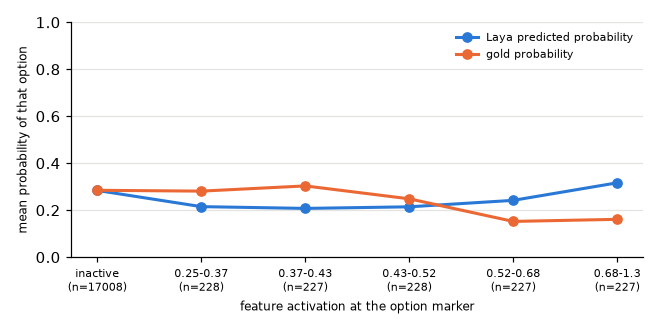

# Feature 12037

Critérios em que aparece: pred_error_stratified

**Interpretação (preencher):** 

---

## Maiores ativações

**tr_customer_service_000058 / category** (choice, customer_service) | ativação 4.254 em `opção` | opções ['account', 'billing', 'delivery', 'refund', 'technical'] | Laya: **refund** [0.226, 0.125, 0.142, 0.282, 0.224] | gabarito: **account**

```
[CLS]choice question: What is this customer conversation primarily about?[SEP]
▸ [MASK] account: Login, plan changes, profile or access management.
▸ [MASK] billing: A charge, invoice⟦,⟧ subscription or payment problem.
▸ [MASK] delivery: Shipping, fulfilment or delivery of a physical item.
▸ [MASK] refund: The customer is explicitly asking for money back.
▸ [MASK] technical: The product or service is not working as expected.

[SEP]

{"account": {"lifetime_value_usd": 386, "prior_tickets_90d": 0, "seats": 3, "tenure_months": 5, "tier": "enterprise"}, "orders": [{"amount_usd": 49, "date": "2026-03-18", "id": "A-70177", "status": "refunded"}, {"amount_usd": 49, "date": "2026-01-12", "id": "A-80512", "status": "refunded"}, {"amount_usd": 49, "date": "2026-03-04", "id": "A-71911", "status": "failed"}], "thread": [{"role": "customer", "text": "I’d like to request a data export from our account; I’m not in a rush, just need to know the steps."}, {"role": "agent", "text": "Sure thing. Which format would you prefer for the export?"}, {"role": "customer", "text": "CSV works for us. Also, could you tell me roughly how long the process takes?"}, {"role": "agent", "text": "I’ll check on the timing. Do you need the export for a specific date range?"}, {"role": "customer", "text": "Just the last month up to today, and I understand it may not be immediate."}, {"role": "agent", "text": "Thanks for confirming. I’ll queue the request and let you know when it’s ready. Anything else you’d like to add?"}, {"role": "customer", "text": "That’s all for now, thank you."}]}[SEP]
```

**tr_customer_service_000229 / category** (choice, customer_service) | ativação 4.199 em `opção` | opções ['account', 'billing', 'delivery', 'refund', 'technical'] | Laya: **billing** [0.22, 0.239, 0.096, 0.205, 0.239] | gabarito: **billing**

```
[CLS]choice question: What is this customer conversation primarily about?[SEP]
▸ [MASK] account: Login, plan changes, profile or access management.
▸ [MASK] billing: A charge, invoice⟦,⟧ subscription or payment problem.
▸ [MASK] delivery: Shipping, fulfilment or delivery of a physical item.
▸ [MASK] refund: The customer is explicitly asking for money back.
▸ [MASK] technical: The product or service is not working as expected.

[SEP]

{"account": {"lifetime_value_usd": 926, "prior_tickets_90d": 3, "seats": 1, "tenure_months": 19, "tier": "standard"}, "orders": [{"amount_usd": 147, "date": "2026-01-24", "id": "A-70530", "status": "settled"}, {"amount_usd": 147, "date": "2026-02-11", "id": "A-96734", "status": "pending"}], "thread": [{"role": "customer", "text": "Hello, I hope you’re doing well. I recently noticed a charge of about $147 on my statement that I wasn’t expecting."}, {"role": "agent", "text": "Thank you for reaching out. I can look into that for you. Could you let me know which billing period this charge appears on, or share the invoice number?"}, {"role": "customer", "text": "The charge is on the March invoice, number INV-2023-03-019. I’ve opened a few tickets about billing inconsistencies over the past months—three in total—but the explanations never quite matched the amounts."}, {"role": "agent", "text": "I appreciate you sharing that. To make sure I’m looking at the right record, could you confirm the email address tied to the standard plan account you’ve had for 19 months?"}, {"role": "customer", "text": "It’s mike.smith@example.com. I’m just hoping we can figure out why this $147 appeared, as it’s higher than what I’ve been paying."}]}[SEP]
```

**tr_customer_service_000116 / category** (choice, customer_service) | ativação 4.172 em `opção` | opções ['account', 'billing', 'delivery', 'refund', 'technical'] | Laya: **billing** [0.14, 0.429, 0.042, 0.155, 0.233] | gabarito: **billing**

```
[CLS]choice question: What is this customer conversation primarily about?[SEP]
▸ [MASK] account: Login, plan changes, profile or access management.
▸ [MASK] billing: A charge, invoice⟦,⟧ subscription or payment problem.
▸ [MASK] delivery: Shipping, fulfilment or delivery of a physical item.
▸ [MASK] refund: The customer is explicitly asking for money back.
▸ [MASK] technical: The product or service is not working as expected.

[SEP]

{"account": {"lifetime_value_usd": 720, "prior_tickets_90d": 2, "seats": 1, "tenure_months": 11, "tier": "standard"}, "orders": [{"amount_usd": 149, "date": "2026-03-09", "id": "A-35212", "status": "failed"}, {"amount_usd": 149, "date": "2026-01-13", "id": "A-58845", "status": "settled"}], "thread": [{"role": "customer", "text": "I just checked my statement and saw a charge for $149, which is completely unexpected! I've been on the standard plan for 11 months and it's never been this high before. Can you explain why this happened?"}, {"role": "agent", "text": "I see the charge you're referring to. Could you please provide the billing date listed on that transaction so I can pull up the specific invoice details for you?"}, {"role": "customer", "text": "It’s dated for the 14th. This is the third time I’ve had to reach out about billing discrepancies, and I really need to get to the bottom of why these charges keep fluctuating."}]}[SEP]
```

**tr_customer_service_000239 / category** (choice, customer_service) | ativação 4.160 em `opção` | opções ['account', 'billing', 'delivery', 'refund', 'technical'] | Laya: **technical** [0.274, 0.136, 0.121, 0.186, 0.282] | gabarito: **account**

```
[CLS]choice question: What is this customer conversation primarily about?[SEP]
▸ [MASK] account: Login, plan changes, profile or access management.
▸ [MASK] billing: A charge, invoice⟦,⟧ subscription or payment problem.
▸ [MASK] delivery: Shipping, fulfilment or delivery of a physical item.
▸ [MASK] refund: The customer is explicitly asking for money back.
▸ [MASK] technical: The product or service is not working as expected.

[SEP]

{"account": {"lifetime_value_usd": 672, "prior_tickets_90d": 5, "seats": 40, "tenure_months": 11, "tier": "enterprise"}, "orders": [{"amount_usd": 19, "date": "2026-03-14", "id": "A-50305", "status": "settled"}, {"amount_usd": 19, "date": "2026-02-11", "id": "A-78147", "status": "failed"}, {"amount_usd": 19, "date": "2026-02-26", "id": "A-68714", "status": "settled"}], "thread": [{"role": "customer", "text": "I’ve decided to downgrade my plan. I’ve reached out five times before about these billing issues, and at this point, I’m just tired of dealing with it."}, {"role": "agent", "text": "I am sorry to hear you've had such a difficult experience with us. Before I process that change, could you clarify which tier you would like to move to?"}, {"role": "customer", "text": "Just the basic tier. I’ve been here for eleven months, but I don’t think the enterprise features are worth the ongoing headache."}]}[SEP]
```

**tr_customer_service_000251 / category** (choice, customer_service) | ativação 4.129 em `opção` | opções ['account', 'billing', 'delivery', 'refund', 'technical'] | Laya: **account** [0.308, 0.168, 0.125, 0.168, 0.231] | gabarito: **technical**

```
[CLS]choice question: What is this customer conversation primarily about?[SEP]
▸ [MASK] account: Login, plan changes, profile or access management.
▸ [MASK] billing: A charge, invoice⟦,⟧ subscription or payment problem.
▸ [MASK] delivery: Shipping, fulfilment or delivery of a physical item.
▸ [MASK] refund: The customer is explicitly asking for money back.
▸ [MASK] technical: The product or service is not working as expected.

[SEP]

{"account": {"lifetime_value_usd": 173, "prior_tickets_90d": 0, "seats": 3, "tenure_months": 2, "tier": "enterprise"}, "orders": [{"amount_usd": 38, "date": "2026-02-05", "id": "A-71684", "status": "settled"}], "thread": [{"role": "customer", "text": "Our team’s been dealing with extremely slow load times on the dashboard for the past few days; everything feels laggy, and it’s hampering our workflow."}, {"role": "agent", "text": "I understand how frustrating that can be; can you tell me if the slowdown occurs on specific pages or across the entire platform?"}, {"role": "customer", "text": "It’s pretty much everywhere—reports, the analytics view, even the basic settings page takes ages to render."}, {"role": "agent", "text": "Got it. Have you noticed any pattern, like the issue worsening at certain times of day or after particular actions?"}, {"role": "customer", "text": "It seems constant, though it does feel a bit worse during our peak usage windows around 10 AM UTC."}, {"role": "agent", "text": "Thanks for that detail. Are you accessing the service via a VPN or any corporate proxy that might affect latency?"}, {"role": "customer", "text": "We use our standard corporate VPN, which we’ve used without problems before, so I’m not sure if that’s a factor."}]}[SEP]
```

## Ativações medianas (faixa 40-60%, mediana 0.621)

**tr_security_incidents_000062 / severity** (score, security_incidents) | ativação 0.554 em `estado` | opções ['0', '1', '2', '3', '4'] | Laya: **1** [0.044, 0.39, 0.38, 0.089, 0.097] | gabarito: **0**

```
[CLS]score question: How severe is the potential impact if this alert is real?[SEP]
▸ [MASK] level 0: Negligible: no access to anything sensitive.
▸ [MASK] level 1: Low: limited access, easily reversed.
▸ [MASK] level 2: Moderate: access to internal systems or non-public data.
▸ [MASK] level 3: High: access to production, secrets or customer data.
▸ [MASK] level 4: Critical: active compromise of crown-jewel systems.

[SEP]

{"alert": {"description": "an endpoint agent matched a known signature", "evidence": "At 2026-09-13 08:27:55 UTC the endpoint agent on host WIN-5F7A3B9C flagged the file C:\\Windows\\Temp\\malicious.exe as matching malware signature \"EICAR-Test-File\". The detection was associated with user \"admin_jdoe\" (admin role, unprivileged access) who has MFA enabled and whose credentials were last rotated 180 days ago. The source of the file could not be correlated to any known trusted location.", "rule": "malware_signature"}, "context": {"asset_criticality":⟦ "⟧low", "change_window_active": false, "source_on_allowlist": false}, "history": {"credential_rotation_days_ago": 180, "distinct_countries_30d": 2, "logins_30d": 1336, "prior_alerts_90d": 3}, "principal": {"mfa_enrolled": true, "name": "svc-analytics-924", "privileges": ["repo:read"], "type": "admin"}}[SEP]
```

**tr_security_incidents_000190 / disposition** (choice, security_incidents) | ativação 0.565 em `estado` | opções ['close_benign', 'contain', 'investigate', 'monitor'] | Laya: **close_benign** [0.453, 0.198, 0.095, 0.254] | gabarito: **investigate**

```
[CLS]choice question: How should this security alert be dispositioned?[SEP]
▸ [MASK] close_benign: Expected, explainable activity; close without analyst time.
▸ [MASK] contain: Contain the host or account immediately; do not wait for triage.
▸ [MASK] investigate: Warrants an analyst opening an investigation.
▸ [MASK] monitor: Not clearly malicious, but worth watching for recurrence.

[SEP]

{"alert": {"description": "an account granted itself or received elevated permissions", "evidence": "CI runner \"runner-42\" was added to the \"docker-admin\" group on 2026-09-15 04:12:57 UTC originating from IP 198.51.100.22. The API token used for the change was last rotated on 2025-03-15.", "rule": "privilege_escalation"}, "context": {"asset_criticality": "high", "change_window⟦_⟧active": false, "source_on_allowlist": false}, "history": {"credential_rotation_days_ago": 180, "distinct_countries_30d": 1, "logins_30d": 451, "prior_alerts_90d": 8}, "principal": {"mfa_enrolled": true, "name": "svc-analytics-751", "privileges": ["repo:read"], "type": "ci_runner"}}[SEP]
```

**tr_invoice_processing_000154 / disposition** (choice, invoice_processing) | ativação 0.630 em `estado` | opções ['approve', 'hold', 'manual_review', 'reject'] | Laya: **approve** [0.491, 0.215, 0.125, 0.168] | gabarito: **manual_review**

```
[CLS]choice question: How should this vendor invoice be dispositioned?[SEP]
▸ [MASK] approve: Matches the order and delivery; approve for payment.
▸ [MASK] hold: Something needs confirming before payment; hold pending clarification.
▸ [MASK] manual_review: A human in finance must review the discrepancy.
▸ [MASK] reject: Should not be paid: duplicate, unauthorised or materially wrong.

[SEP]

{"delivery": {"condition": "accepted", "date": "2026-03-01", "received_qty": 250}, "invoice": {"currency": "USD", "id": "INV-2026-7413", "lines": [{"qty": 250, "sku": "SKU-182", "total_usd": 23190.0, "unit_usd": 92.76}, {"qty": 1, "sku": "FREIGHT", "total_usd": 830.67, "unit_usd": 830.67}], "total_usd": 24020.67, "vendor": "Kestrel Supply"}, "payment": {"days_until_due": 44, "discount_expires_in_days": null, "early_payment_discount_pct": null, "status": "scheduled", "terms": "net 60"}, "purchase_order": {"freight_terms": "freight prepaid by vendor, not separately billable", "id": "PO-3689", "lines": [{"qty": 250, "unit_usd": 92.76}], "total_usd": 23190.0}, "vendor_history": {"disputes_12m": 1, "invoices_12m": 2, "prior_invoice_ids": ["INV-2026⟦-⟧8130", "INV-2026-9090"]}}[SEP]
```

**tr_invoice_processing_000226 / duplicate** (noul, invoice_processing) | ativação 0.685 em `estado` | opções ['false', 'true'] | Laya: **true** [0.258, 0.742] | gabarito: **false**

```
[CLS]noul question: This invoice appears to duplicate an invoice already submitted.[SEP]
▸ [MASK] false: no, the statement does not hold
▸ [MASK] true: yes, the statement holds

[SEP]

{"delivery": {"condition": "accepted", "date": "2026-03-05", "received_qty": 400}, "invoice": {"currency": "USD", "id": "INV-2026-2809", "lines": [{"qty": 400, "sku": "SKU-223", "total_usd": 7260.0, "unit_usd": 18.15}, {"qty": 1, "sku": "FREIGHT", "total_usd": 1723.25, "unit_usd": 1723.25}], "total_usd": 8983.25, "vendor": "Acme Fabrication"}, "payment": {"days_until_due": 11, "discount_expires_in_days": null, "early_payment_discount_pct": null, "status": "scheduled", "terms": "net 30"}, "purchase_order": {"freight_terms": "freight prepaid by vendor, not separately billable", "id": "PO-8525", "lines": [{"qty": 400, "unit_usd": 18.15}], "total_usd": 7260.0}, "vendor_history": {"disputes_12m": 0, "invoices_12m": 41, "prior_invoice_ids": ["INV-2026-1925", "INV-2026⟦-⟧5375"]}}[SEP]
```

**tr_security_incidents_000195 / true_positive** (noul, security_incidents) | ativação 0.549 em `estado` | opções ['false', 'true'] | Laya: **false** [0.624, 0.376] | gabarito: **true**

```
[CLS]noul question: This alert reflects genuinely malicious or unauthorised activity.[SEP]
▸ [MASK] false: Benign activity, a misconfiguration, or a known false positive.
▸ [MASK] true: The underlying behaviour is malicious or unauthorised.

[SEP]

{"alert": {"description": "two successful logins from distant locations too close together", "evidence": "At 08:12 UTC, a successful MFA-authenticated login occurred from IP 192.0.2.45 in San Francisco, followed by another successful login at 08:27 UTC from 203.0.113.12 in Berlin. Both events originated from allowlisted sources using an unprivileged employee account with credentials last rotated 30 days ago.", "rule": "impossible_travel"}, "context": {"asset_criticality": "medium", "change_window_active": false, "source_on_allowlist": true}, "history": {"credential_rotation_days_ago": 30, "distinct_countries_30d": 1, "logins_30d": 729, "prior_alerts_90d": 1}, "principal": {"mfa_enrolled": true, "name":⟦ "⟧usr-infra-343", "privileges": ["repo:read"], "type": "employee"}}[SEP]
```

## Estatísticas (conjunto de descoberta, dev e teste)

**pred / error**

| split | decisões | ativas | ativas e Laya errou | taxa | lift | q (BH) | OR (CMH) | q (CMH) |
|---|---|---|---|---|---|---|---|---|
| discovery | 5100 | 292 | 255 | 0.873 | 1.37 | 3.26e-19 | 3.18 | 1.59e-08 |
| dev | 900 | 49 | 41 | 0.837 | 1.27 | 0.0561 | 2.49 | 0.196 |
| test | 2000 | 122 | 104 | 0.852 | 1.34 | 7.27e-07 | 3.40 | 8.35e-05 |

**corr / error**

| split | decisões | ativas | ativas e Laya errou | taxa | lift | q (BH) | OR (CMH) | q (CMH) |
|---|---|---|---|---|---|---|---|---|
| discovery | 5100 | 281 | 244 | 0.868 | 1.36 | 2.98e-18 | 2.34 | 0.0179 |
| dev | 900 | 47 | 39 | 0.830 | 1.26 | 0.0199 | 2.43 | 0.555 |
| test | 2000 | 97 | 79 | 0.814 | 1.28 | 0.000291 | 1.42 | 0.693 |

**state / error**

| split | decisões | ativas | ativas e Laya errou | taxa | lift | q (BH) | OR (CMH) | q (CMH) |
|---|---|---|---|---|---|---|---|---|
| discovery | 5100 | 1106 | 742 | 0.671 | 1.05 | 0.0695 | 1.13 | 0.251 |
| dev | 900 | 235 | 168 | 0.715 | 1.09 | 0.684 | 1.39 | 0.279 |
| test | 2000 | 426 | 286 | 0.671 | 1.05 | 0.545 | 0.97 | 0.921 |

Confusão mais sobre-representada (pred): `disposition|0>2` (n=150, lift 10.96, p=0). Formato `pergunta|índice previsto>índice correto`.

Confusão mais sobre-representada (corr): `disposition|0>2` (n=94, lift 7.14, p=0). Formato `pergunta|índice previsto>índice correto`.

Confusão mais sobre-representada (state): `disposition|0>2` (n=117, lift 2.26, p=1.09e-21). Formato `pergunta|índice previsto>índice correto`.



