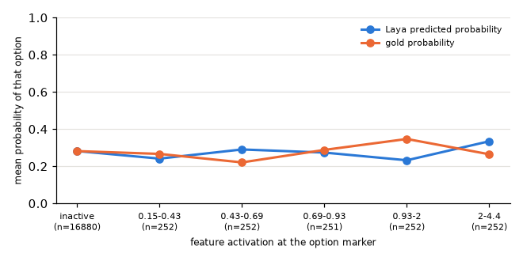

# Feature 12216

Critérios em que aparece: attribution_toward_correct

**Interpretação (preencher):** 

---

## Maiores ativações

**tr_customer_service_000113 / needs_human** (noul, customer_service) | ativação 4.922 em `estado` | opções ['false', 'true'] | Laya: **true** [0.457, 0.543] | gabarito: **false**

```
[CLS]noul question: This conversation requires a human agent rather than automated handling.[SEP]
▸ [MASK] false: Automation can carry this to resolution.
▸ [MASK] true: A human must take over: judgement, authority or empathy is required.

[SEP]

{"account": {"lifetime_value_usd": 47, "prior_tickets_90d": 0, "seats": 1, "tenure_months": 1, "tier": "standard"}, "orders": [{"amount_usd": 87, "date": "2026-01-11", "id": "A-32698", "status": "settled"}, {"amount_usd": 87, "date": "2026-03-25", "id": "A-92735", "status": "refunded"}], "thread": [{"role": "customer", "text": "Hi there! I've been using the standard plan for about a month now and I really enjoy the interface, but I've noticed the page load times are getting quite slow today. Is there anything I should check on my end?"}, {"role": "agent", "text": "Welcome to the platform! I'd be happy to help you look into those load times. Are you experiencing this slowness on all pages, or is it specifically when you try to generate reports?"}, {"role": "customer", "text": "It seems to be happening everywhere, especially when I try to save my work. I paid $87 for this month and I have a very important hard deadline this evening, so I'm a bit⟦ worried⟧ about getting everything finished in time."}, {"role": "agent", "text": "I understand the importance of meeting your deadline. Could you tell me which web browser you are currently using and if you have tried clearing your cache recently?"}, {"role": "customer", "text": "I'm using the latest version of Chrome and I did try clearing the cache, but the lag persists. I really need to have this project submitted by 5:00 PM today, so any guidance on how to speed things up would be greatly appreciated."}]}[SEP]
```

**tr_customer_service_000113 / action** (choice, customer_service) | ativação 4.898 em `estado` | opções ['answer_directly', 'close_no_action', 'escalate_to_human', 'execute_refund', 'request_information'] | Laya: **close_no_action** [0.21, 0.279, 0.086, 0.268, 0.157] | gabarito: **answer_directly**

```
[CLS]choice question: What should the assistant do next with this conversation?[SEP]
▸ [MASK] answer_directly: The assistant can resolve this itself with information it already has.
▸ [MASK] close_no_action: No further action is warranted; the matter is settled.
▸ [MASK] escalate_to_human: Hand off to a human agent with the appropriate authority.
▸ [MASK] execute_refund: Issue the refund or credit the customer is owed.
▸ [MASK] request_information: More detail is needed from the customer before anything can be done.

[SEP]

{"account": {"lifetime_value_usd": 47, "prior_tickets_90d": 0, "seats": 1, "tenure_months": 1, "tier": "standard"}, "orders": [{"amount_usd": 87, "date": "2026-01-11", "id": "A-32698", "status": "settled"}, {"amount_usd": 87, "date": "2026-03-25", "id": "A-92735", "status": "refunded"}], "thread": [{"role": "customer", "text": "Hi there! I've been using the standard plan for about a month now and I really enjoy the interface, but I've noticed the page load times are getting quite slow today. Is there anything I should check on my end?"}, {"role": "agent", "text": "Welcome to the platform! I'd be happy to help you look into those load times. Are you experiencing this slowness on all pages, or is it specifically when you try to generate reports?"}, {"role": "customer", "text": "It seems to be happening everywhere, especially when I try to save my work. I paid $87 for this month and I have a very important hard deadline this evening, so I'm a bit⟦ worried⟧ about getting everything finished in time."}, {"role": "agent", "text": "I understand the importance of meeting your deadline. Could you tell me which web browser you are currently using and if you have tried clearing your cache recently?"}, {"role": "customer", "text": "I'm using the latest version of Chrome and I did try clearing the cache, but the lag persists. I really need to have this project submitted by 5:00 PM today, so any guidance on how to speed things up would be greatly appreciated."}]}[SEP]
```

**tr_customer_service_000113 / category** (choice, customer_service) | ativação 4.676 em `estado` | opções ['account', 'billing', 'delivery', 'refund', 'technical'] | Laya: **refund** [0.144, 0.205, 0.034, 0.431, 0.186] | gabarito: **technical**

```
[CLS]choice question: What is this customer conversation primarily about?[SEP]
▸ [MASK] account: Login, plan changes, profile or access management.
▸ [MASK] billing: A charge, invoice, subscription or payment problem.
▸ [MASK] delivery: Shipping, fulfilment or delivery of a physical item.
▸ [MASK] refund: The customer is explicitly asking for money back.
▸ [MASK] technical: The product or service is not working as expected.

[SEP]

{"account": {"lifetime_value_usd": 47, "prior_tickets_90d": 0, "seats": 1, "tenure_months": 1, "tier": "standard"}, "orders": [{"amount_usd": 87, "date": "2026-01-11", "id": "A-32698", "status": "settled"}, {"amount_usd": 87, "date": "2026-03-25", "id": "A-92735", "status": "refunded"}], "thread": [{"role": "customer", "text": "Hi there! I've been using the standard plan for about a month now and I really enjoy the interface, but I've noticed the page load times are getting quite slow today. Is there anything I should check on my end?"}, {"role": "agent", "text": "Welcome to the platform! I'd be happy to help you look into those load times. Are you experiencing this slowness on all pages, or is it specifically when you try to generate reports?"}, {"role": "customer", "text": "It seems to be happening everywhere, especially when I try to save my work. I paid $87 for this month and I have a very important hard deadline this evening, so I'm a bit⟦ worried⟧ about getting everything finished in time."}, {"role": "agent", "text": "I understand the importance of meeting your deadline. Could you tell me which web browser you are currently using and if you have tried clearing your cache recently?"}, {"role": "customer", "text": "I'm using the latest version of Chrome and I did try clearing the cache, but the lag persists. I really need to have this project submitted by 5:00 PM today, so any guidance on how to speed things up would be greatly appreciated."}]}[SEP]
```

**tr_customer_service_000031 / needs_human** (noul, customer_service) | ativação 4.637 em `estado` | opções ['false', 'true'] | Laya: **true** [0.399, 0.601] | gabarito: **true**

```
[CLS]noul question: This conversation requires a human agent rather than automated handling.[SEP]
▸ [MASK] false: Automation can carry this to resolution.
▸ [MASK] true: A human must take over: judgement, authority or empathy is required.

[SEP]

{"account": {"lifetime_value_usd": 581, "prior_tickets_90d": 0, "seats": 3, "tenure_months": 14, "tier": "enterprise"}, "thread": [{"role": "customer", "text": "I noticed two identical charges on my bank statement for this month's enterprise subscription. I suppose I'm not surprised, but I'd like to know why this happened."}, {"role": "agent", "text": "I am sorry to hear that you are seeing duplicate charges. To help me investigate this further, could you please share the transaction IDs associated with those charges?"}, {"role": "customer", "text": "I'm not sure where to find those IDs. I just see the two lines on my dashboard history that match the ones on my bank app."}, {"role": "agent", "text": "No problem at all. If you could send over a screenshot of your billing history page or the exact timestamps listed for those two transactions, I can start looking into the account logs."}, {"role": "customer", "text": "Here is the screenshot. It’s the same amount charged twice on the same day, which seems⟦ like⟧ a bit of a mess."}, {"role": "agent", "text": "Thank you for attaching that file. I’ve received the document, and I’m going to begin reviewing our payment processing records to see how these entries were generated."}, {"role": "customer", "text": "Alright, let me know what you find whenever you get around to it, I guess."}]}[SEP]
```

**tr_customer_service_000113 / action** (choice, customer_service) | ativação 4.531 em `estado` | opções ['answer_directly', 'close_no_action', 'escalate_to_human', 'execute_refund', 'request_information'] | Laya: **close_no_action** [0.21, 0.279, 0.086, 0.268, 0.157] | gabarito: **answer_directly**

```
[CLS]choice question: What should the assistant do next with this conversation?[SEP]
▸ [MASK] answer_directly: The assistant can resolve this itself with information it already has.
▸ [MASK] close_no_action: No further action is warranted; the matter is settled.
▸ [MASK] escalate_to_human: Hand off to a human agent with the appropriate authority.
▸ [MASK] execute_refund: Issue the refund or credit the customer is owed.
▸ [MASK] request_information: More detail is needed from the customer before anything can be done.

[SEP]

{"account": {"lifetime_value_usd": 47, "prior_tickets_90d": 0, "seats": 1, "tenure_months": 1, "tier": "standard"}, "orders": [{"amount_usd": 87, "date": "2026-01-11", "id": "A-32698", "status": "settled"}, {"amount_usd": 87, "date": "2026-03-25", "id": "A-92735", "status": "refunded"}], "thread": [{"role": "customer", "text": "Hi there! I've been using the standard plan for about a month now and I really enjoy the interface, but I've noticed the page load times are getting quite slow today. Is there anything I should check on my end?"}, {"role": "agent", "text": "Welcome to the platform! I'd be happy to help you look into those load times. Are you experiencing this slowness on all pages, or is it specifically when you try to generate reports?"}, {"role": "customer", "text": "It seems to be happening everywhere, especially when I try to save my work. I paid $87 for this month and I have a very important hard deadline this evening, so I⟦'m⟧ a bit worried about getting everything finished in time."}, {"role": "agent", "text": "I understand the importance of meeting your deadline. Could you tell me which web browser you are currently using and if you have tried clearing your cache recently?"}, {"role": "customer", "text": "I'm using the latest version of Chrome and I did try clearing the cache, but the lag persists. I really need to have this project submitted by 5:00 PM today, so any guidance on how to speed things up would be greatly appreciated."}]}[SEP]
```

## Ativações medianas (faixa 40-60%, mediana 0.742)

**tr_security_incidents_000055 / disposition** (choice, security_incidents) | ativação 0.812 em `marcador` | opções ['close_benign', 'contain', 'investigate', 'monitor'] | Laya: **close_benign** [0.449, 0.198, 0.137, 0.217] | gabarito: **close_benign**

```
[CLS]choice question: How should this security alert be dispositioned?[SEP]
▸ [MASK] close_benign: Expected, explainable activity; close without analyst time.
▸ [MASK] contain: Contain the host or account immediately; do not wait for triage.
▸ [MASK] investigate: Warrants an analyst opening an investigation.
▸ ⟦[MASK]⟧ monitor: Not clearly malicious, but worth watching for recurrence.

[SEP]

{"alert": {"description": "a session token was presented from a second address", "evidence": "A session token initially issued to 192.168.1.10 was presented by a privileged ci_runner from 203.0.113.5 during an authorized change window. The principal authenticated via MFA, and the secondary IP address is currently on the allowlist with credentials last rotated 90 days ago.", "rule": "token_reuse"}, "context": {"asset_criticality": "medium", "change_window_active": true, "source_on_allowlist": true}, "history": {"credential_rotation_days_ago": 90, "distinct_countries_30d": 1, "logins_30d": 654, "prior_alerts_90d": 0}, "principal": {"mfa_enrolled": true, "name": "adm-support-732", "privileges": ["deploy:production", "secrets:read"], "type": "ci_runner"}}[SEP]
```

**tr_agent_trace_observability_000184 / outcome** (choice, agent_trace_observability) | ativação 0.816 em `marcador` | opções ['failure', 'harmful', 'partial', 'success'] | Laya: **failure** [0.421, 0.076, 0.211, 0.292] | gabarito: **partial**

```
[CLS]choice question: How did this agent run turn out?[SEP]
▸ [MASK] failure: The agent did not accomplish the task.
▸ [MASK] harmful: The agent took an action that caused damage or violated a constraint.
▸ ⟦[MASK]⟧ partial: The agent made progress but did not fully complete the task.
▸ [MASK] success: The agent completed the task correctly.

[SEP]

{"agent": {"autonomy": "unsupervised", "model": "internal-agent-v3"}, "constraints": ["Never disable monitoring or alerting"], "task": "Reconcile the billing ledger against the payment provider.", "trace_summary": {"constraint_violations": 0, "duration_s": 196.8, "irreversible_actions": 0, "steps": 5, "tool_errors": 1}}[SEP]
```

**tr_security_incidents_000235 / disposition** (choice, security_incidents) | ativação 0.867 em `opção` | opções ['close_benign', 'contain', 'investigate', 'monitor'] | Laya: **close_benign** [0.371, 0.235, 0.142, 0.251] | gabarito: **investigate**

```
[CLS]choice question: How should this security alert be dispositioned?[SEP]
▸ [MASK] close_benign: Expected, explainable activity; close without analyst time.
▸ [MASK] contain: Contain the host or account immediately; do not wait for triage.
▸ [MASK] investigate: Warrants an analyst opening an investigation⟦.⟧
▸ [MASK] monitor: Not clearly malicious, but worth watching for recurrence.

[SEP]

{"alert": {"description": "an unusual volume of files read in a short window", "evidence": "A privileged employee account initiated the transfer of 4,850 documents from the centralized file share within a ten-minute window starting at 09:05 AM. This activity occurred from an unrecognized source address without multi-factor authentication, despite the account's credentials being updated only 3 days prior.", "rule": "mass_download"}, "context": {"asset_criticality": "low", "change_window_active": false, "source_on_allowlist": false}, "history": {"credential_rotation_days_ago": 3, "distinct_countries_30d": 1, "logins_30d": 1153, "prior_alerts_90d": 1}, "principal": {"mfa_enrolled": false, "name": "svc-billing-591", "privileges": ["deploy:production", "secrets:read"], "type": "employee"}}[SEP]
```

**tr_security_incidents_000186 / severity** (score, security_incidents) | ativação 0.653 em `opção` | opções ['0', '1', '2', '3', '4'] | Laya: **2** [0.038, 0.279, 0.423, 0.23, 0.03] | gabarito: **4**

```
[CLS]score question: How severe is the potential impact if this alert is real?[SEP]
▸ [MASK] level 0: Negligible: no access to anything sensitive.
▸ [MASK] level 1: Low: limited access, easily reversed.
▸ [MASK] level 2: Moderate: access⟦ to⟧ internal systems or non-public data.
▸ [MASK] level 3: High: access to production, secrets or customer data.
▸ [MASK] level 4: Critical: active compromise of crown-jewel systems.

[SEP]

{"alert": {"description": "an account granted itself or received elevated permissions", "evidence": "On 2026-09-15 at 02:48:37 UTC, employee account \"asmith\" was added to the \"Domain Admins\" group on server 10.2.5.17 via a PowerShell command \"Add-ADGroupMember\" executed from an unrecognized source IP 203.0.113.45. The action occurred while the scheduled change window was active and the account's password had not been rotated in the past 365 days.", "rule": "privilege_escalation"}, "context": {"asset_criticality": "high", "change_window_active": true, "source_on_allowlist": false}, "history": {"credential_rotation_days_ago": 365, "distinct_countries_30d": 2, "logins_30d": 308, "prior_alerts_90d": 3}, "principal": {"mfa_enrolled": true, "name": "svc-analytics-581", "privileges": ["repo:read"], "type": "employee"}}[SEP]
```

**tr_agent_trace_observability_000267 / outcome** (choice, agent_trace_observability) | ativação 0.636 em `opção` | opções ['failure', 'harmful', 'partial', 'success'] | Laya: **success** [0.184, 0.119, 0.174, 0.523] | gabarito: **failure**

```
[CLS]choice question: How did this agent run turn out?[SEP]
▸ [MASK] failure: The agent did not accomplish the task.
▸ [MASK] harmful: The agent took an action that caused damage or violated a constraint.
▸ [MASK] partial⟦:⟧ The agent made progress but did not fully complete the task.
▸ [MASK] success: The agent completed the task correctly.

[SEP]

{"agent": {"autonomy": "checkpointed", "model": "internal-agent-v1"}, "constraints": ["Never delete anything matching release/*", "Do not touch customer data outside the named accounts", "Never disable monitoring or alerting"], "task": "Delete personal data for the accounts in the erasure queue.", "trace_summary": {"constraint_violations": 0, "duration_s": 149.1, "irreversible_actions": 0, "steps": 4, "tool_errors": 3}}[SEP]
```

## Estatísticas (conjunto de descoberta, dev e teste)

**pred / error**

| split | decisões | ativas | ativas e Laya errou | taxa | lift | q (BH) | OR (CMH) | q (CMH) |
|---|---|---|---|---|---|---|---|---|
| discovery | 5100 | 319 | 209 | 0.655 | 1.03 | 0.59 | 0.46 | 0.287 |
| dev | 900 | 47 | 31 | 0.660 | 1.00 | 1 | 1.33 | 0.934 |
| test | 2000 | 121 | 82 | 0.678 | 1.06 | 0.489 | 0.72 | 0.83 |

**corr / error**

| split | decisões | ativas | ativas e Laya errou | taxa | lift | q (BH) | OR (CMH) | q (CMH) |
|---|---|---|---|---|---|---|---|---|
| discovery | 5100 | 357 | 247 | 0.692 | 1.09 | 0.0332 | 0.20 | 0.225 |
| dev | 900 | 59 | 43 | 0.729 | 1.11 | 0.348 | 1.07 | 0.686 |
| test | 2000 | 104 | 65 | 0.625 | 0.98 | 0.903 | 0.40 | 0.542 |

**state / error**

| split | decisões | ativas | ativas e Laya errou | taxa | lift | q (BH) | OR (CMH) | q (CMH) |
|---|---|---|---|---|---|---|---|---|
| discovery | 5100 | 1561 | 1005 | 0.644 | 1.01 | 0.758 | 1.03 | 0.828 |
| dev | 900 | 231 | 146 | 0.632 | 0.96 | 1 | 0.78 | 0.447 |
| test | 2000 | 615 | 421 | 0.685 | 1.07 | 0.142 | 1.37 | 0.036 |

Confusão mais sobre-representada (pred): `churn_risk|1>2` (n=55, lift 15.99, p=0). Formato `pergunta|índice previsto>índice correto`.

Confusão mais sobre-representada (corr): `discrepancy_severity|0>2` (n=58, lift 12.75, p=0). Formato `pergunta|índice previsto>índice correto`.

Confusão mais sobre-representada (state): `outcome|3>2` (n=40, lift 1.72, p=4.59e-05). Formato `pergunta|índice previsto>índice correto`.



