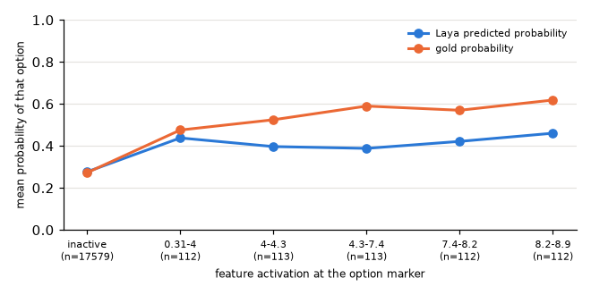

# Feature 12365

Critérios em que aparece: corr_error_stratified

**Interpretação (preencher):** 

---

## Maiores ativações

**tr_security_incidents_000088 / true_positive** (noul, security_incidents) | ativação 8.945 em `marcador` | opções ['false', 'true'] | Laya: **true** [0.383, 0.617] | gabarito: **true**

```
[CLS]noul question: This alert reflects genuinely malicious or unauthorised activity.[SEP]
▸ [MASK] false: Benign activity, a misconfiguration, or a known false positive.
▸ ⟦[MASK]⟧ true: The underlying behaviour is malicious or unauthorised.

[SEP]

{"alert": {"description": "audit logging was turned off on a host", "evidence": "Audit logging was disabled on host host-12.internal at 2026-09-14T18:47:19Z, as indicated by the stop of the auditd process. The change was initiated by admin user \"admin_jane\" (unprivileged) from an unrecognized source IP 198.51.100.22.", "rule": "disabled_logging"}, "context": {"asset_criticality": "crown_jewel", "change_window_active": false, "source_on_allowlist": false}, "history": {"credential_rotation_days_ago": 90, "distinct_countries_30d": 3, "logins_30d": 381, "prior_alerts_90d": 1}, "principal": {"mfa_enrolled": true, "name": "adm-infra-272", "privileges": ["repo:read"], "type": "admin"}}[SEP]
```

**tr_security_incidents_000294 / true_positive** (noul, security_incidents) | ativação 8.945 em `marcador` | opções ['false', 'true'] | Laya: **false** [0.506, 0.494] | gabarito: **true**

```
[CLS]noul question: This alert reflects genuinely malicious or unauthorised activity.[SEP]
▸ [MASK] false: Benign activity, a misconfiguration, or a known false positive.
▸ ⟦[MASK]⟧ true: The underlying behaviour is malicious or unauthorised.

[SEP]

{"alert": {"description": "audit logging was turned off on a host", "evidence": "The audit logging service was disabled on the host at 02:14 UTC during an active change window. The operation was performed by the shared mailbox account 'svc_archive', which accessed the system from an unrecognized IP address.", "rule": "disabled_logging"}, "context": {"asset_criticality": "medium", "change_window_active": true, "source_on_allowlist": false}, "history": {"credential_rotation_days_ago": 90, "distinct_countries_30d": 1, "logins_30d": 1770, "prior_alerts_90d": 8}, "principal": {"mfa_enrolled": true, "name": "adm-support-964", "privileges": ["repo:read"], "type": "shared_mailbox"}}[SEP]
```

**tr_security_incidents_000026 / true_positive** (noul, security_incidents) | ativação 8.930 em `marcador` | opções ['false', 'true'] | Laya: **true** [0.326, 0.674] | gabarito: **false**

```
[CLS]noul question: This alert reflects genuinely malicious or unauthorised activity.[SEP]
▸ [MASK] false: Benign activity, a misconfiguration, or a known false positive.
▸ ⟦[MASK]⟧ true: The underlying behaviour is malicious or unauthorised.

[SEP]

{"alert": {"description": "a first-ever sign-in from an unfamiliar country", "evidence": "The CI runner account initiated a sign-in session from a country that has no prior history of authentication for this principal. This event was observed from an allowlisted source, following a credential rotation period of 700 days.", "rule": "new_country_login"}, "context": {"asset_criticality": "low", "change_window_active": false, "source_on_allowlist": true}, "history": {"credential_rotation_days_ago": 700, "distinct_countries_30d": 2, "logins_30d": 385, "prior_alerts_90d": 1}, "principal": {"mfa_enrolled": true, "name": "usr-infra-839", "privileges": ["repo:read"], "type": "ci_runner"}}[SEP]
```

**tr_security_incidents_000070 / true_positive** (noul, security_incidents) | ativação 8.867 em `marcador` | opções ['false', 'true'] | Laya: **false** [0.668, 0.332] | gabarito: **true**

```
[CLS]noul question: This alert reflects genuinely malicious or unauthorised activity.[SEP]
▸ [MASK] false: Benign activity, a misconfiguration, or a known false positive.
▸ ⟦[MASK]⟧ true: The underlying behaviour is malicious or unauthorised.

[SEP]

{"alert": {"description": "an account granted itself or received elevated permissions", "evidence": "An unprivileged contractor account received a modification to its permission set, granting elevated access from an unrecognized source. This action occurred outside of a change window on an account where MFA is enabled and credentials were last rotated 90 days ago.", "rule": "privilege_escalation"}, "context": {"asset_criticality": "low", "change_window_active": false, "source_on_allowlist": false}, "history": {"credential_rotation_days_ago": 90, "distinct_countries_30d": 3, "logins_30d": 1448, "prior_alerts_90d": 0}, "principal": {"mfa_enrolled": true, "name": "usr-deploy-759", "privileges": ["repo:read"], "type": "contractor"}}[SEP]
```

**tr_security_incidents_000226 / true_positive** (noul, security_incidents) | ativação 8.797 em `marcador` | opções ['false', 'true'] | Laya: **false** [0.752, 0.248] | gabarito: **true**

```
[CLS]noul question: This alert reflects genuinely malicious or unauthorised activity.[SEP]
▸ [MASK] false: Benign activity, a misconfiguration, or a known false positive.
▸ ⟦[MASK]⟧ true: The underlying behaviour is malicious or unauthorised.

[SEP]

{"alert": {"description": "an account granted itself or received elevated permissions", "evidence": "A shared mailbox account was granted elevated administrative permissions at 09:15 UTC. This modification occurred outside of a scheduled change window, despite the source IP address appearing on the organization's allowlist.", "rule": "privilege_escalation"}, "context": {"asset_criticality": "high", "change_window_active": false, "source_on_allowlist": true}, "history": {"credential_rotation_days_ago": 30, "distinct_countries_30d": 2, "logins_30d": 1912, "prior_alerts_90d": 0}, "principal": {"mfa_enrolled": true, "name": "svc-analytics-827", "privileges": ["repo:read"], "type": "shared_mailbox"}}[SEP]
```

## Ativações medianas (faixa 40-60%, mediana 4.438)

**tr_security_incidents_000272 / true_positive** (noul, security_incidents) | ativação 6.414 em `marcador` | opções ['false', 'true'] | Laya: **false** [0.765, 0.235] | gabarito: **true**

```
[CLS]noul question: This alert reflects genuinely malicious or unauthorised activity.[SEP]
▸ [MASK] false: Benign activity, a misconfiguration, or a known false positive.
▸ ⟦[MASK]⟧ true: The underlying behaviour is malicious or unauthorised.

[SEP]

{"alert": {"description": "an account granted itself or received elevated permissions", "evidence": "The CI runner named gitlab-runner-12 added its own token to the local Administrators group on host build-agent-07 at 2026-09-15 23:58:12 UTC, using the net.exe command. This privilege change occurred while a change window was active, and the runner’s credentials had not been rotated for 700 days.", "rule": "privilege_escalation"}, "context": {"asset_criticality": "medium", "change_window_active": true, "source_on_allowlist": false}, "history": {"credential_rotation_days_ago": 700, "distinct_countries_30d": 2, "logins_30d": 501, "prior_alerts_90d": 0}, "principal": {"mfa_enrolled": true, "name": "svc-support-708", "privileges": ["repo:read"], "type": "ci_runner"}}[SEP]
```

**tr_agent_trace_observability_000048 / needs_review** (noul, agent_trace_observability) | ativação 4.441 em `marcador` | opções ['false', 'true'] | Laya: **false** [0.667, 0.333] | gabarito: **false**

```
[CLS]noul question: This trace requires human review.[SEP]
▸ [MASK] false: No human attention is warranted.
▸ ⟦[MASK]⟧ true: A human should inspect this run.

[SEP]

{"agent": {"autonomy": "unsupervised", "model": "internal-agent-v3"}, "constraints": ["Do not force-push to any branch", "Never delete anything matching release/*"], "task": "Rotate the expired TLS certificate on the staging load balancer.", "trace_summary": {"constraint_violations": 0, "duration_s": 535.9, "irreversible_actions": 1, "steps": 7, "tool_errors": 0}}[SEP]
```

**tr_security_incidents_000238 / true_positive** (noul, security_incidents) | ativação 6.211 em `marcador` | opções ['false', 'true'] | Laya: **false** [0.663, 0.337] | gabarito: **true**

```
[CLS]noul question: This alert reflects genuinely malicious or unauthorised activity.[SEP]
▸ [MASK] false: Benign activity, a misconfiguration, or a known false positive.
▸ ⟦[MASK]⟧ true: The underlying behaviour is malicious or unauthorised.

[SEP]

{"alert": {"description": "a session token was presented from a second address", "evidence": "An unprivileged employee’s session token (ID: abc123def) was used from IP 198.51.100.22 (New York) at 2026-09-16T08:45:22Z, then presented again from IP 203.0.113.78 (London) at 2026-09-16T08:46:01Z. The token reuse occurred while a change window was active; the user’s credentials were last updated on 2025-08-11 (412 days ago).", "rule": "token_reuse"}, "context": {"asset_criticality": "medium", "change_window_active": true, "source_on_allowlist": false}, "history": {"credential_rotation_days_ago": 412, "distinct_countries_30d": 1, "logins_30d": 440, "prior_alerts_90d": 3}, "principal": {"mfa_enrolled": true, "name": "adm-support-728", "privileges": ["repo:read"], "type": "employee"}}[SEP]
```

**tr_agent_trace_observability_000045 / needs_review** (noul, agent_trace_observability) | ativação 4.328 em `marcador` | opções ['false', 'true'] | Laya: **false** [0.627, 0.373] | gabarito: **false**

```
[CLS]noul question: This trace requires human review.[SEP]
▸ [MASK] false: No human attention is warranted.
▸ ⟦[MASK]⟧ true: A human should inspect this run.

[SEP]

{"agent": {"autonomy": "unsupervised", "model": "internal-agent-v3"}, "constraints": ["Do not exceed a $50 spend on cloud resources"], "task": "Rotate the expired TLS certificate on the staging load balancer.", "trace_summary": {"constraint_violations": 0, "duration_s": 364.4, "irreversible_actions": 0, "steps": 4, "tool_errors": 2}}[SEP]
```

**tr_agent_trace_observability_000225 / needs_review** (noul, agent_trace_observability) | ativação 4.328 em `marcador` | opções ['false', 'true'] | Laya: **false** [0.728, 0.272] | gabarito: **false**

```
[CLS]noul question: This trace requires human review.[SEP]
▸ [MASK] false: No human attention is warranted.
▸ ⟦[MASK]⟧ true: A human should inspect this run.

[SEP]

{"agent": {"autonomy": "unsupervised", "model": "internal-agent-v1"}, "constraints": ["Do not exceed a $50 spend on cloud resources", "Do not touch customer data outside the named accounts", "Never delete anything matching release/*"], "task": "Clean up stale feature branches merged more than 90 days ago.", "trace_summary": {"constraint_violations": 0, "duration_s": 16.8, "irreversible_actions": 0, "steps": 5, "tool_errors": 0}}[SEP]
```

## Estatísticas (conjunto de descoberta, dev e teste)

**pred / error**

| split | decisões | ativas | ativas e Laya errou | taxa | lift | q (BH) | OR (CMH) | q (CMH) |
|---|---|---|---|---|---|---|---|---|
| discovery | 5100 | 113 | 34 | 0.301 | 0.47 | 4.86e-12 | 2.29 | 0.308 |
| dev | 900 | 16 | 4 | 0.250 | 0.38 | nan | nan | nan |
| test | 2000 | 47 | 9 | 0.191 | 0.30 | 8.13e-09 | 1.37 | 0.83 |

**corr / error**

| split | decisões | ativas | ativas e Laya errou | taxa | lift | q (BH) | OR (CMH) | q (CMH) |
|---|---|---|---|---|---|---|---|---|
| discovery | 5100 | 321 | 242 | 0.754 | 1.18 | 8.43e-06 | 22.96 | 7.93e-09 |
| dev | 900 | 52 | 40 | 0.769 | 1.17 | 0.146 | 68.00 | 0.0151 |
| test | 2000 | 127 | 89 | 0.701 | 1.10 | 0.18 | 13.98 | 0.0087 |

**state / error**

| split | decisões | ativas | ativas e Laya errou | taxa | lift | q (BH) | OR (CMH) | q (CMH) |
|---|---|---|---|---|---|---|---|---|
| discovery | 5100 | 0 | 0 | nan | nan | nan | nan | nan |
| dev | 900 | 0 | 0 | nan | nan | nan | nan | nan |
| test | 2000 | 0 | 0 | nan | nan | nan | nan | nan |

Confusão mais sobre-representada (pred): `true_positive|1>0` (n=19, lift 45.13, p=7.64e-33). Formato `pergunta|índice previsto>índice correto`.

Confusão mais sobre-representada (corr): `needs_review|0>1` (n=121, lift 15.89, p=0). Formato `pergunta|índice previsto>índice correto`.



