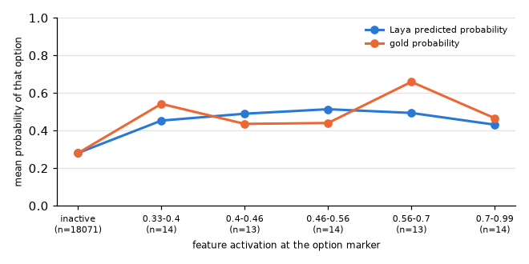

# Feature 12615

Critérios em que aparece: corr_error_stratified

**Interpretação (preencher):** 

---

## Maiores ativações

**tr_customer_service_000139 / needs_human** (noul, customer_service) | ativação 1.863 em `opção` | opções ['false', 'true'] | Laya: **false** [0.544, 0.456] | gabarito: **false**

```
[CLS]noul question: This conversation requires a human agent rather than automated handling.[SEP]
▸ [MASK] false: Automation⟦ can⟧ carry this to resolution.
▸ [MASK] true: A human must take over: judgement, authority or empathy is required.

[SEP]

{"account": {"lifetime_value_usd": 216, "prior_tickets_90d": 0, "seats": 1, "tenure_months": 5, "tier": "standard"}, "thread": [{"role": "customer", "text": "I’m a bit confused—how do I request a data export? I’ve been on the standard plan for five months and can’t find the option."}]}[SEP]
```

**tr_customer_service_000232 / urgency** (score, customer_service) | ativação 1.861 em `estado` | opções ['0', '1', '2', '3'] | Laya: **3** [0.103, 0.33, 0.218, 0.35] | gabarito: **3**

```
[CLS]score question: How time-sensitive is this conversation?[SEP]
▸ [MASK] level 0: No time pressure; can wait indefinitely.
▸ [MASK] level 1: Routine; handle within the normal queue.
▸ [MASK] level 2: Elevated; should be handled within the same week.
▸ [MASK] level 3: Critical; requires action within the same day.

[SEP]

{"account": {"lifetime_value_usd": 186, "prior_tickets_90d": 0, "seats": 5, "tenure_months": 3, "tier": "premium"}, "orders": [{"amount_usd": 2997, "date": "2026-01-02", "id": "A-95746", "status": "refunded"}, {"amount_usd": 2997, "date": "2026-03-02", "id": "A-16068", "status": "settled"}], "thread": [{"role": "customer", "text": "I'm looking at my dashboard and everything is grayed out, it says I'm on a trial but I've been a Premium member for three months? I don't understand why it would change now, especially since I have a massive project deadline tomorrow and I need my tools."}, {"role": "agent", "text": "I can certainly look into your subscription status for you. To get started, could you please confirm the email address associated with your $2997 annual Premium plan?"}, {"role": "customer", "text": "It's the same email I'm using for this chat, but I'm just so confused because my bank shows the payment went through months ago. Why would the system suddenly think I'm not a customer anymore?"}, {"role": "agent", "text": "Thank you for that information. I am reviewing your account history now. Have you recently made any changes to your team settings or tried to link a secondary account to this workspace?"}, {"role": "customer", "text": "I haven't touched the settings at all, I just logged in to finish my work and saw the 'downgraded' notification at the top. I'm really worried because I have to submit this work by 8 AM tomorrow and I can't even export my files right now."}, {"role": "agent", "text": "I appreciate you clarifying that. To help me narrow this down, could you tell me if you are seeing any specific error codes when you try to click on the export button?"}, {"role": "customer", "text": "There aren't any codes, it just opens a pop-up telling me to 'Upgrade⟦ to⟧ Premium' to use that feature, which makes no sense at all since I'm already paying. Can someone please figure out why the system isn't recognizing my plan before I lose my window to finish this?"}]}[SEP]
```

**tr_customer_service_000232 / churn_risk** (score, customer_service) | ativação 1.836 em `estado` | opções ['0', '1', '2', '3'] | Laya: **2** [0.143, 0.248, 0.469, 0.139] | gabarito: **2**

```
[CLS]score question: How likely is this customer to stop doing business with us because of this interaction?[SEP]
▸ [MASK] level 0: No sign of dissatisfaction.
▸ [MASK] level 1: Mild frustration, but the relationship is intact.
▸ [MASK] level 2: Clearly unhappy; repeat problems or explicit complaints.
▸ [MASK] level 3: Imminent: threatening to cancel, dispute or leave.

[SEP]

{"account": {"lifetime_value_usd": 186, "prior_tickets_90d": 0, "seats": 5, "tenure_months": 3, "tier": "premium"}, "orders": [{"amount_usd": 2997, "date": "2026-01-02", "id": "A-95746", "status": "refunded"}, {"amount_usd": 2997, "date": "2026-03-02", "id": "A-16068", "status": "settled"}], "thread": [{"role": "customer", "text": "I'm looking at my dashboard and everything is grayed out, it says I'm on a trial but I've been a Premium member for three months? I don't understand why it would change now, especially since I have a massive project deadline tomorrow and I need my tools."}, {"role": "agent", "text": "I can certainly look into your subscription status for you. To get started, could you please confirm the email address associated with your $2997 annual Premium plan?"}, {"role": "customer", "text": "It's the same email I'm using for this chat, but I'm just so confused because my bank shows the payment went through months ago. Why would the system suddenly think I'm not a customer anymore?"}, {"role": "agent", "text": "Thank you for that information. I am reviewing your account history now. Have you recently made any changes to your team settings or tried to link a secondary account to this workspace?"}, {"role": "customer", "text": "I haven't touched the settings at all, I just logged in to finish my work and saw the 'downgraded' notification at the top. I'm really worried because I have to submit this work by 8 AM tomorrow and I can't even export my files right now."}, {"role": "agent", "text": "I appreciate you clarifying that. To help me narrow this down, could you tell me if you are seeing any specific error codes when you try to click on the export button?"}, {"role": "customer", "text": "There aren't any codes, it just opens a pop-up telling me to 'Upgrade⟦ to⟧ Premium' to use that feature, which makes no sense at all since I'm already paying. Can someone please figure out why the system isn't recognizing my plan before I lose my window to finish this?"}]}[SEP]
```

**tr_customer_service_000052 / needs_human** (noul, customer_service) | ativação 1.823 em `estado` | opções ['false', 'true'] | Laya: **true** [0.387, 0.613] | gabarito: **true**

```
[CLS]noul question: This conversation requires a human agent rather than automated handling.[SEP]
▸ [MASK] false: Automation can carry this to resolution.
▸ [MASK] true: A human must take over: judgement, authority or empathy is required.

[SEP]

{"account": {"lifetime_value_usd": 1015, "prior_tickets_90d": 3, "seats": 1, "tenure_months": 11, "tier": "standard"}, "orders": [{"amount_usd": 149, "date": "2026-01-24", "id": "A-11891", "status": "refunded"}, {"amount_usd": 149, "date": "2026-02-03", "id": "A-76056", "status": "failed"}], "thread": [{"role": "customer", "text": "Hello, I'm having trouble logging into my account. I've been a subscriber for 11 months on the standard plan, paying about $149, and I've already opened three tickets that haven't been resolved. Could you please look into this?"}, {"role": "agent", "text": "I’m sorry you’re still experiencing this. Could you let me know the exact error message you see when you try to sign in, and whether you’ve tried resetting your password?"}, {"role": "customer", "text": "Sure, the page just says 'Invalid credentials' even after I reset the password. I’m using the same email as before."}, {"role": "agent", "text": "Thank you for confirming that. I’ll need to check the status of your account and the recent password reset attempts. May I have the email address associated with the account?"}, {"role": "customer", "text": "The email is john.doe@example.com.⟦ Please⟧ let me know what you find."}]}[SEP]
```

**tr_customer_service_000095 / needs_human** (noul, customer_service) | ativação 1.782 em `estado` | opções ['false', 'true'] | Laya: **true** [0.364, 0.636] | gabarito: **true**

```
[CLS]noul question: This conversation requires a human agent rather than automated handling.[SEP]
▸ [MASK] false: Automation can carry this to resolution.
▸ [MASK] true: A human must take over: judgement, authority or empathy is required.

[SEP]

{"account": {"lifetime_value_usd": 2044, "prior_tickets_90d": 1, "seats": 12, "tenure_months": 60, "tier": "premium"}, "thread": [{"role": "customer", "text": "I am beyond frustrated. I’ve been a loyal premium customer for five years, and the item I just received is already damaged. This is unacceptable, especially since my previous ticket about the shipping quality is still just sitting there ignored."}, {"role": "agent", "text": "I truly apologize for the frustration caused by the state of your delivery. To⟦ better⟧ assist you, could you please provide a few photos of the damage so I can document the issue?"}, {"role": "customer", "text": "I shouldn't have to jump through hoops to prove this arrived broken when your company has a history of these failures. My time is being wasted."}]}[SEP]
```

## Ativações medianas (faixa 40-60%, mediana 0.587)

**tr_customer_service_000282 / churn_risk** (score, customer_service) | ativação 0.555 em `estado` | opções ['0', '1', '2', '3'] | Laya: **1** [0.089, 0.432, 0.388, 0.09] | gabarito: **2**

```
[CLS]score question: How likely is this customer to stop doing business with us because of this interaction?[SEP]
▸ [MASK] level 0: No sign of dissatisfaction.
▸ [MASK] level 1: Mild frustration, but the relationship is intact.
▸ [MASK] level 2: Clearly unhappy; repeat problems or explicit complaints.
▸ [MASK] level 3: Imminent: threatening to cancel, dispute or leave.

[SEP]

{"account": {"lifetime_value_usd": 53, "prior_tickets_90d": 0, "seats": 3, "tenure_months": 1, "tier": "premium"}, "⟦thread⟧": [{"role": "customer", "text": "I've been waiting for my refund to hit my account for days now and there's still nothing showing up. I signed up for the Premium plan last month and it's been nothing but a headache."}, {"role": "agent", "text": "I understand how concerning it is when expected funds don't appear. Could you please confirm the date you initially requested the transaction reversal?"}, {"role": "customer", "text": "I did it last Tuesday! It's ridiculous that I'm even having to ask about this because the confirmation email said it was processed immediately."}, {"role": "agent", "text": "Thank you for that information. To help me look into the status on our end, are you able to provide the transaction ID from that confirmation email?"}, {"role": "customer", "text": "I'm looking for it now, but I shouldn't have to jump through hoops just to get my money back from a service I barely used for four weeks."}]}[SEP]
```

**tr_agent_trace_observability_000075 / action** (choice, agent_trace_observability) | ativação 0.597 em `opção` | opções ['continue', 'human_review', 'observe', 'stop'] | Laya: **continue** [0.641, 0.074, 0.186, 0.098] | gabarito: **observe**

```
[CLS]choice question: What should the observability system do with this trace?[SEP]
▸ [MASK] continue: Let the agent proceed without interruption.
▸ [MASK] human_review: Queue this trace for a human to review.
▸ [MASK] observe: Keep running, but flag⟦ the⟧ trace for later sampling.
▸ [MASK] stop: Halt the agent now.

[SEP]

{"agent": {"autonomy": "unsupervised", "model": "internal-agent-v4"}, "constraints": ["Do not touch customer data outside the named accounts", "Do not exceed a $50 spend on cloud resources", "Do not force-push to any branch"], "task": "Rotate the expired TLS certificate on the staging load balancer.", "trace_summary": {"constraint_violations": 0, "duration_s": 596.9, "irreversible_actions": 0, "steps": 9, "tool_errors": 1}}[SEP]
```

**tr_customer_service_000089 / churn_risk** (score, customer_service) | ativação 0.607 em `pergunta` | opções ['0', '1', '2', '3'] | Laya: **1** [0.28, 0.439, 0.124, 0.157] | gabarito: **1**

```
[CLS]score question: How likely is this customer to stop doing business with⟦ us⟧ because of this interaction?[SEP]
▸ [MASK] level 0: No sign of dissatisfaction.
▸ [MASK] level 1: Mild frustration, but the relationship is intact.
▸ [MASK] level 2: Clearly unhappy; repeat problems or explicit complaints.
▸ [MASK] level 3: Imminent: threatening to cancel, dispute or leave.

[SEP]

{"account": {"lifetime_value_usd": 166, "prior_tickets_90d": 1, "seats": 1, "tenure_months": 2, "tier": "standard"}, "orders": [{"amount_usd": 57, "date": "2026-01-06", "id": "A-19796", "status": "settled"}, {"amount_usd": 57, "date": "2026-03-23", "id": "A-59627", "status": "settled"}, {"amount_usd": 57, "date": "2026-03-19", "id": "A-98751", "status": "settled"}], "thread": [{"role": "customer", "text": "I received the package today, but the item inside isn’t the one I ordered – I ordered the standard widget for $57, and I got the premium version instead."}, {"role": "agent", "text": "I understand. Could you share the order number so I can pull up the details?"}, {"role": "customer", "text": "Sure, the order number is 987654321. I’d like to know how we can get the correct item sent out."}]}[SEP]
```

**tr_invoice_processing_000118 / duplicate** (noul, invoice_processing) | ativação 0.569 em `opção` | opções ['false', 'true'] | Laya: **true** [0.18, 0.82] | gabarito: **false**

```
[CLS]noul question: This invoice appears to duplicate an invoice already submitted.[SEP]
▸ [MASK] false: no, the statement⟦ does⟧ not hold
▸ [MASK] true: yes, the statement holds

[SEP]

{"delivery": {"condition": "accepted", "date": "2026-03-06", "received_qty": 100}, "invoice": {"currency": "USD", "id": "INV-2026-4359", "lines": [{"qty": 100, "sku": "SKU-579", "total_usd": 44892.0, "unit_usd": 448.92}], "total_usd": 44892.0, "vendor": "Orbit Logistics"}, "payment": {"days_until_due": 18, "discount_expires_in_days": 3, "early_payment_discount_pct": 2.0, "status": "scheduled", "terms": "net 45"}, "purchase_order": {"freight_terms": "freight prepaid by vendor, not separately billable", "id": null, "lines": [{"qty": 100, "unit_usd": 448.92}], "total_usd": 44892.0}, "vendor_history": {"disputes_12m": 5, "invoices_12m": 6, "prior_invoice_ids": ["INV-2026-6501", "INV-2026-9349", "INV-2026-2429", "INV-2026-9623"]}}[SEP]
```

**tr_customer_service_000152 / needs_human** (noul, customer_service) | ativação 0.537 em `pergunta` | opções ['false', 'true'] | Laya: **false** [0.568, 0.432] | gabarito: **true**

```
[CLS]noul⟦ question⟧: This conversation requires a human agent rather than automated handling.[SEP]
▸ [MASK] false: Automation can carry this to resolution.
▸ [MASK] true: A human must take over: judgement, authority or empathy is required.

[SEP]

{"account": {"lifetime_value_usd": 799, "prior_tickets_90d": 0, "seats": 1, "tenure_months": 33, "tier": "standard"}, "thread": [{"role": "customer", "text": "Hello, I'm writing because the analytics dashboard stopped updating as of this morning, and I need the latest data by 5 pm today to finalize my report. Could you please look into this?"}]}[SEP]
```

## Estatísticas (conjunto de descoberta, dev e teste)

**pred / error**

| split | decisões | ativas | ativas e Laya errou | taxa | lift | q (BH) | OR (CMH) | q (CMH) |
|---|---|---|---|---|---|---|---|---|
| discovery | 5100 | 30 | 11 | 0.367 | 0.58 | 0.00998 | 1.33 | 0.68 |
| dev | 900 | 5 | 1 | 0.200 | 0.30 | nan | nan | nan |
| test | 2000 | 11 | 3 | 0.273 | 0.43 | nan | nan | nan |

**corr / error**

| split | decisões | ativas | ativas e Laya errou | taxa | lift | q (BH) | OR (CMH) | q (CMH) |
|---|---|---|---|---|---|---|---|---|
| discovery | 5100 | 33 | 14 | 0.424 | 0.67 | 0.0268 | 4.00 | 9.1e-06 |
| dev | 900 | 10 | 6 | 0.600 | 0.91 | nan | nan | nan |
| test | 2000 | 15 | 7 | 0.467 | 0.73 | nan | nan | nan |

**state / error**

| split | decisões | ativas | ativas e Laya errou | taxa | lift | q (BH) | OR (CMH) | q (CMH) |
|---|---|---|---|---|---|---|---|---|
| discovery | 5100 | 1129 | 674 | 0.597 | 0.94 | 0.0327 | 1.16 | 0.163 |
| dev | 900 | 168 | 115 | 0.685 | 1.04 | 1 | 1.45 | 0.29 |
| test | 2000 | 433 | 248 | 0.573 | 0.90 | 0.12 | 0.89 | 0.578 |

Confusão mais sobre-representada (pred): `needs_human|1>0` (n=8, lift 21.25, p=1.85e-09). Formato `pergunta|índice previsto>índice correto`.

Confusão mais sobre-representada (corr): `needs_human|0>1` (n=12, lift 132.47, p=5.02e-26). Formato `pergunta|índice previsto>índice correto`.

Confusão mais sobre-representada (state): `churn_risk|1>2` (n=34, lift 2.79, p=2.19e-10). Formato `pergunta|índice previsto>índice correto`.



