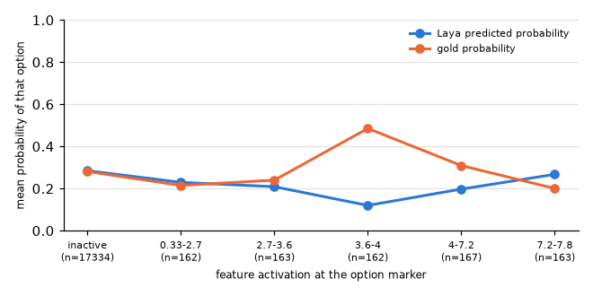

# Feature 12627

Critérios em que aparece: attribution_toward_wrong

**Interpretação (preencher):** 

---

## Maiores ativações

**tr_security_incidents_000156 / disposition** (choice, security_incidents) | ativação 8.711 em `opção` | opções ['close_benign', 'contain', 'investigate', 'monitor'] | Laya: **close_benign** [0.562, 0.16, 0.074, 0.205] | gabarito: **close_benign**

```
[CLS]choice question: How should this security alert be dispositioned?[SEP]
▸ [MASK] close_benign: Expected, explainable activity; close without analyst time.
▸ [MASK] contain: Contain the host or account immediately; do not wait for triage.
▸ [MASK] investigate: Warrants an analyst opening an investigation⟦.⟧
▸ [MASK] monitor: Not clearly malicious, but worth watching for recurrence.

[SEP]

{"alert": {"description": "two successful logins from distant locations too close together", "evidence": "At 2026-09-15 02:13 UTC the admin account authenticated successfully from 203.0.113.45 (New York, US). Twenty‑four minutes later the same account logged in from 51.178.0.1 (London, UK), both sessions using MFA and originating from IPs present on the allow‑list; the credentials for this account were last rotated on 2025‑09‑15.", "rule": "impossible_travel"}, "context": {"asset_criticality": "low", "change_window_active": false, "source_on_allowlist": true}, "history": {"credential_rotation_days_ago": 365, "distinct_countries_30d": 1, "logins_30d": 1571, "prior_alerts_90d": 0}, "principal": {"mfa_enrolled": true, "name": "svc-billing-407", "privileges": ["repo:read"], "type": "admin"}}[SEP]
```

**tr_security_incidents_000063 / disposition** (choice, security_incidents) | ativação 8.688 em `opção` | opções ['close_benign', 'contain', 'investigate', 'monitor'] | Laya: **close_benign** [0.366, 0.27, 0.098, 0.266] | gabarito: **close_benign**

```
[CLS]choice question: How should this security alert be dispositioned?[SEP]
▸ [MASK] close_benign: Expected, explainable activity; close without analyst time.
▸ [MASK] contain: Contain the host or account immediately; do not wait for triage.
▸ [MASK] investigate: Warrants an analyst opening an investigation⟦.⟧
▸ [MASK] monitor: Not clearly malicious, but worth watching for recurrence.

[SEP]

{"alert": {"description": "a first-ever sign-in from an unfamiliar country", "evidence": "At 2026-09-15 03:42:11 UTC, the CI runner \"ci-runner-42\" authenticated from IP 203.0.113.78, which maps to Nairobi, Kenya, a country with no prior successful logins for this principal. MFA was successfully verified for the session, and the source IP is on the allowlist; the account's credentials were last rotated 365 days ago.", "rule": "new_country_login"}, "context": {"asset_criticality": "medium", "change_window_active": false, "source_on_allowlist": true}, "history": {"credential_rotation_days_ago": 365, "distinct_countries_30d": 2, "logins_30d": 1410, "prior_alerts_90d": 0}, "principal": {"mfa_enrolled": true, "name": "adm-analytics-641", "privileges": ["repo:read"], "type": "ci_runner"}}[SEP]
```

**tr_security_incidents_000113 / disposition** (choice, security_incidents) | ativação 8.664 em `opção` | opções ['close_benign', 'contain', 'investigate', 'monitor'] | Laya: **monitor** [0.284, 0.125, 0.074, 0.517] | gabarito: **investigate**

```
[CLS]choice question: How should this security alert be dispositioned?[SEP]
▸ [MASK] close_benign: Expected, explainable activity; close without analyst time.
▸ [MASK] contain: Contain the host or account immediately; do not wait for triage.
▸ [MASK] investigate: Warrants an analyst opening an investigation⟦.⟧
▸ [MASK] monitor: Not clearly malicious, but worth watching for recurrence.

[SEP]

{"alert": {"description": "audit logging was turned off on a host", "evidence": "At 2026-09-15 09:03:12 UTC the process \"auditctl\" executed on host \"win-01.example.com\" with arguments \"-e 0\" and disabled audit logging for the system. The command was issued by the shared_mailbox account \"audit_monitor\" from an allow‑listed source, and MFA was disabled for this principal.", "rule": "disabled_logging"}, "context": {"asset_criticality": "crown_jewel", "change_window_active": false, "source_on_allowlist": true}, "history": {"credential_rotation_days_ago": 412, "distinct_countries_30d": 2, "logins_30d": 491, "prior_alerts_90d": 8}, "principal": {"mfa_enrolled": false, "name": "adm-support-214", "privileges": ["repo:read"], "type": "shared_mailbox"}}[SEP]
```

**tr_security_incidents_000013 / disposition** (choice, security_incidents) | ativação 8.617 em `opção` | opções ['close_benign', 'contain', 'investigate', 'monitor'] | Laya: **close_benign** [0.34, 0.324, 0.078, 0.257] | gabarito: **investigate**

```
[CLS]choice question: How should this security alert be dispositioned?[SEP]
▸ [MASK] close_benign: Expected, explainable activity; close without analyst time.
▸ [MASK] contain: Contain the host or account immediately; do not wait for triage.
▸ [MASK] investigate: Warrants an analyst opening an investigation⟦.⟧
▸ [MASK] monitor: Not clearly malicious, but worth watching for recurrence.

[SEP]

{"alert": {"description": "audit logging was turned off on a host", "evidence": "Audit logging was disabled on host WIN-DB01 (IP 10.2.5.23) at 2026-09-16T08:45:00Z by user \"jdoe_admin\". The user role is classified as unprivileged admin with MFA enabled, and the password for this account was last changed 14 days prior. No approved change window was active at the time of the event.", "rule": "disabled_logging"}, "context": {"asset_criticality": "medium", "change_window_active": false, "source_on_allowlist": false}, "history": {"credential_rotation_days_ago": 14, "distinct_countries_30d": 1, "logins_30d": 1970, "prior_alerts_90d": 0}, "principal": {"mfa_enrolled": true, "name": "ci-analytics-642", "privileges": ["repo:read"], "type": "admin"}}[SEP]
```

**tr_security_incidents_000041 / disposition** (choice, security_incidents) | ativação 8.617 em `opção` | opções ['close_benign', 'contain', 'investigate', 'monitor'] | Laya: **close_benign** [0.464, 0.172, 0.13, 0.234] | gabarito: **close_benign**

```
[CLS]choice question: How should this security alert be dispositioned?[SEP]
▸ [MASK] close_benign: Expected, explainable activity; close without analyst time.
▸ [MASK] contain: Contain the host or account immediately; do not wait for triage.
▸ [MASK] investigate: Warrants an analyst opening an investigation⟦.⟧
▸ [MASK] monitor: Not clearly malicious, but worth watching for recurrence.

[SEP]

{"alert": {"description": "two successful logins from distant locations too close together", "evidence": "Two successful logins were recorded for service account svc_sync: one from IP 203.0.113.45 (New York) at 2026-09-16 01:02 UTC and another from IP 198.51.100.22 (Tokyo) at 2026-09-16 01:10 UTC, a span of eight minutes. The account is unprivileged, does not have MFA enabled, and its password was last changed three days ago. Both source entries appear on the allowlist.", "rule": "impossible_travel"}, "context": {"asset_criticality": "low", "change_window_active": false, "source_on_allowlist": true}, "history": {"credential_rotation_days_ago": 3, "distinct_countries_30d": 2, "logins_30d": 1729, "prior_alerts_90d": 0}, "principal": {"mfa_enrolled": false, "name": "usr-analytics-776", "privileges": ["repo:read"], "type": "service_account"}}[SEP]
```

## Ativações medianas (faixa 40-60%, mediana 3.512)

**tr_security_incidents_000019 / disposition** (choice, security_incidents) | ativação 3.928 em `opção` | opções ['close_benign', 'contain', 'investigate', 'monitor'] | Laya: **close_benign** [0.396, 0.226, 0.175, 0.204] | gabarito: **investigate**

```
[CLS]choice question: How should this security alert be dispositioned?[SEP]
▸ [MASK] close_benign: Expected, explainable activity; close without analyst time⟦.⟧
▸ [MASK] contain: Contain the host or account immediately; do not wait for triage.
▸ [MASK] investigate: Warrants an analyst opening an investigation.
▸ [MASK] monitor: Not clearly malicious, but worth watching for recurrence.

[SEP]

{"alert": {"description": "an unrecognised binary executed on a server", "evidence": "A privileged service account executed an unrecognized binary titled 'db_sync_tool' on the production server during an open change window. The execution was traced to an allowlisted source IP, and logs show the account credentials have not been rotated for 180 days. MFA authentication was successfully verified for this privileged session.", "rule": "suspicious_process"}, "context": {"asset_criticality": "crown_jewel", "change_window_active": true, "source_on_allowlist": true}, "history": {"credential_rotation_days_ago": 180, "distinct_countries_30d": 4, "logins_30d": 1491, "prior_alerts_90d": 3}, "principal": {"mfa_enrolled": true, "name": "usr-deploy-880", "privileges": ["deploy:production", "secrets:read"], "type": "service_account"}}[SEP]
```

**tr_security_incidents_000291 / disposition** (choice, security_incidents) | ativação 3.582 em `marcador` | opções ['close_benign', 'contain', 'investigate', 'monitor'] | Laya: **close_benign** [0.49, 0.203, 0.087, 0.22] | gabarito: **monitor**

```
[CLS]choice question: How should this security alert be dispositioned?[SEP]
▸ [MASK] close_benign: Expected, explainable activity; close without analyst time.
▸ [MASK] contain: Contain the host or account immediately; do not wait for triage.
▸ ⟦[MASK]⟧ investigate: Warrants an analyst opening an investigation.
▸ [MASK] monitor: Not clearly malicious, but worth watching for recurrence.

[SEP]

{"alert": {"description": "two successful logins from distant locations too close together", "evidence": "The service account successfully authenticated from IP 192.168.1.5 and 10.0.8.2 within an 8-minute interval. This principal operates without MFA and has not undergone credential rotation in 412 days.", "rule": "impossible_travel"}, "context": {"asset_criticality": "medium", "change_window_active": false, "source_on_allowlist": true}, "history": {"credential_rotation_days_ago": 412, "distinct_countries_30d": 1, "logins_30d": 44, "prior_alerts_90d": 3}, "principal": {"mfa_enrolled": false, "name": "adm-analytics-523", "privileges": ["deploy:production", "secrets:read"], "type": "service_account"}}[SEP]
```

**tr_security_incidents_000150 / disposition** (choice, security_incidents) | ativação 3.707 em `marcador` | opções ['close_benign', 'contain', 'investigate', 'monitor'] | Laya: **close_benign** [0.422, 0.202, 0.152, 0.225] | gabarito: **investigate**

```
[CLS]choice question: How should this security alert be dispositioned?[SEP]
▸ [MASK] close_benign: Expected, explainable activity; close without analyst time.
▸ [MASK] contain: Contain the host or account immediately; do not wait for triage.
▸ ⟦[MASK]⟧ investigate: Warrants an analyst opening an investigation.
▸ [MASK] monitor: Not clearly malicious, but worth watching for recurrence.

[SEP]

{"alert": {"description": "an account granted itself or received elevated permissions", "evidence": "On 2026-09-15 at 22:13:07 UTC, the CI runner process \"gitlab-runner\" on host 10.2.5.12 executed a net localgroup command that added its own service account to the local Administrators group. The account’s credential record shows the last rotation occurred 365 days ago.", "rule": "privilege_escalation"}, "context": {"asset_criticality": "low", "change_window_active": false, "source_on_allowlist": true}, "history": {"credential_rotation_days_ago": 365, "distinct_countries_30d": 4, "logins_30d": 788, "prior_alerts_90d": 1}, "principal": {"mfa_enrolled": true, "name": "usr-billing-675", "privileges": ["repo:read"], "type": "ci_runner"}}[SEP]
```

**tr_security_incidents_000162 / disposition** (choice, security_incidents) | ativação 3.088 em `opção` | opções ['close_benign', 'contain', 'investigate', 'monitor'] | Laya: **close_benign** [0.336, 0.268, 0.13, 0.266] | gabarito: **investigate**

```
[CLS]choice question: How should this security alert be dispositioned?[SEP]
▸ [MASK] close_benign: Expected, explainable activity; close without analyst time.
▸ [MASK] contain: Contain the host or account immediately; do not wait for triage.
▸ [MASK] investigate: Warrants an analyst opening an investigation.
▸ [MASK] monitor⟦:⟧ Not clearly malicious, but worth watching for recurrence.

[SEP]

{"alert": {"description": "a first-ever sign-in from an unfamiliar country", "evidence": "An administrative account accessed the system from an unrecognized IP address located in a country with no prior login history. The credentials for this principal have not been updated in 700 days.", "rule": "new_country_login"}, "context": {"asset_criticality": "medium", "change_window_active": false, "source_on_allowlist": false}, "history": {"credential_rotation_days_ago": 700, "distinct_countries_30d": 1, "logins_30d": 1674, "prior_alerts_90d": 1}, "principal": {"mfa_enrolled": true, "name": "svc-support-499", "privileges": ["repo:read"], "type": "admin"}}[SEP]
```

**tr_security_incidents_000030 / disposition** (choice, security_incidents) | ativação 3.148 em `opção` | opções ['close_benign', 'contain', 'investigate', 'monitor'] | Laya: **close_benign** [0.393, 0.239, 0.085, 0.283] | gabarito: **investigate**

```
[CLS]choice question: How should this security alert be dispositioned?[SEP]
▸ [MASK] close_benign: Expected, explainable activity; close without analyst time.
▸ [MASK] contain: Contain the host or account immediately; do not wait for triage.
▸ [MASK] investigate: Warrants an analyst opening an investigation.
▸ [MASK] monitor⟦:⟧ Not clearly malicious, but worth watching for recurrence.

[SEP]

{"alert": {"description": "a long-unused account became active", "evidence": "A successful logon to employee account JDOE was recorded at 2026-09-15 08:12:34 UTC from source IP 198.51.100.22, marking the first authentication event for this user in the past 180 days. The authentication occurred without multi‑factor verification and originated from a device not listed in the known asset inventory.", "rule": "dormant_account_use"}, "context": {"asset_criticality": "low", "change_window_active": false, "source_on_allowlist": false}, "history": {"credential_rotation_days_ago": 180, "distinct_countries_30d": 2, "logins_30d": 450, "prior_alerts_90d": 1}, "principal": {"mfa_enrolled": false, "name": "ci-infra-957", "privileges": ["repo:read"], "type": "employee"}}[SEP]
```

## Estatísticas (conjunto de descoberta, dev e teste)

**pred / error**

| split | decisões | ativas | ativas e Laya errou | taxa | lift | q (BH) | OR (CMH) | q (CMH) |
|---|---|---|---|---|---|---|---|---|
| discovery | 5100 | 53 | 45 | 0.849 | 1.33 | 0.00251 | 0.98 | 0.875 |
| dev | 900 | 6 | 6 | 1.000 | 1.52 | nan | nan | nan |
| test | 2000 | 19 | 17 | 0.895 | 1.40 | nan | nan | nan |

**corr / error**

| split | decisões | ativas | ativas e Laya errou | taxa | lift | q (BH) | OR (CMH) | q (CMH) |
|---|---|---|---|---|---|---|---|---|
| discovery | 5100 | 239 | 231 | 0.967 | 1.52 | 4.91e-35 | 0.27 | 0.232 |
| dev | 900 | 40 | 40 | 1.000 | 1.52 | 2.94e-07 | 1.60 | 0.393 |
| test | 2000 | 99 | 97 | 0.980 | 1.54 | 3.36e-16 | 1.43 | 0.863 |

**state / error**

| split | decisões | ativas | ativas e Laya errou | taxa | lift | q (BH) | OR (CMH) | q (CMH) |
|---|---|---|---|---|---|---|---|---|
| discovery | 5100 | 14 | 12 | 0.857 | 1.35 | nan | nan | nan |
| dev | 900 | 0 | 0 | nan | nan | nan | nan | nan |
| test | 2000 | 3 | 1 | 0.333 | 0.52 | nan | nan | nan |

Confusão mais sobre-representada (pred): `disposition|3>2` (n=18, lift 96.23, p=7.82e-38). Formato `pergunta|índice previsto>índice correto`.

Confusão mais sobre-representada (corr): `disposition|0>2` (n=155, lift 13.84, p=0). Formato `pergunta|índice previsto>índice correto`.

Confusão mais sobre-representada (state): `true_positive|0>1` (n=2, lift 6.45, p=nan). Formato `pergunta|índice previsto>índice correto`.



