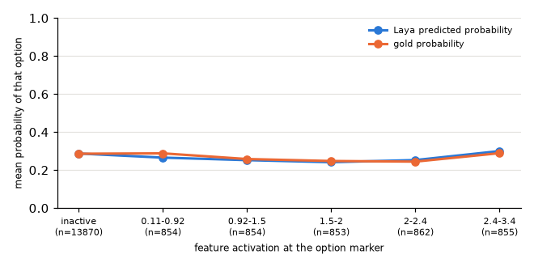

# Feature 12639

Critérios em que aparece: pred_error_stratified, corr_error_stratified, attribution_toward_correct

**Interpretação (preencher):** 

---

## Maiores ativações

**tr_customer_service_000008 / urgency** (score, customer_service) | ativação 5.219 em `opção` | opções ['0', '1', '2', '3'] | Laya: **1** [0.15, 0.466, 0.106, 0.279] | gabarito: **3**

```
[CLS]score question: How time-sensitive is this conversation?[SEP]
▸ [MASK] level 0: No time pressure; can wait indefinitely.
▸ [MASK] level 1:⟦ Rout⟧ine; handle within the normal queue.
▸ [MASK] level 2: Elevated; should be handled within the same week.
▸ [MASK] level 3: Critical; requires action within the same day.

[SEP]

{"account": {"lifetime_value_usd": 72, "prior_tickets_90d": 3, "seats": 1, "tenure_months": 3, "tier": "standard"}, "orders": [{"amount_usd": 87, "date": "2026-03-21", "id": "A-17904", "status": "settled"}, {"amount_usd": 87, "date": "2026-01-08", "id": "A-81775", "status": "settled"}, {"amount_usd": 87, "date": "2026-02-15", "id": "A-95492", "status": "failed"}], "thread": [{"role": "customer", "text": "Looking at my account, I need to add five more seats to the team before tomorrow’s rollout. This is my third ticket on the same issue, and I’m still on the $87 standard plan after three months."}, {"role": "agent", "text": "Got it, I see the previous tickets. Could you confirm the email addresses you’d like the new seats assigned to?"}, {"role": "customer", "text": "The emails are alice@example.com, bob@example.com, carol@example.com, dave@example.com, and eve@example.com. I need all five active by end of day tomorrow."}, {"role": "agent", "text": "Thanks for the list. Are any of the current seats being de‑provisioned, or should we simply expand the total count?"}, {"role": "customer", "text": "No removals, just add the five on top of the current three seats."}, {"role": "agent", "text": "Understood. I’ll look into why the previous attempts didn’t stick. What verification method would you prefer for the new seats—email link or admin console?"}, {"role": "customer", "text": "Send the email links; I’ll forward them right away. Please make sure the seats are live before the 5 PM deadline."}]}[SEP]
```

**tr_customer_service_000151 / needs_human** (noul, customer_service) | ativação 5.180 em `pergunta` | opções ['false', 'true'] | Laya: **true** [0.45, 0.55] | gabarito: **true**

```
[CLS]noul question: This conversation requires a human agent rather than automated⟦ handling⟧.[SEP]
▸ [MASK] false: Automation can carry this to resolution.
▸ [MASK] true: A human must take over: judgement, authority or empathy is required.

[SEP]

{"account": {"lifetime_value_usd": 95, "prior_tickets_90d": 0, "seats": 1, "tenure_months": 3, "tier": "enterprise"}, "orders": [{"amount_usd": 299, "date": "2026-02-01", "id": "A-70416", "status": "failed"}, {"amount_usd": 299, "date": "2026-02-15", "id": "A-68913", "status": "pending"}], "thread": [{"role": "customer", "text": "Hello, I’m reaching out because the platform’s performance has been noticeably slow over the past week, and it’s affecting our workflow. We’re on the enterprise plan, paying $299 a month, and we need a stable experience."}, {"role": "agent", "text": "I’m sorry to hear about the slowdown. Could you tell me which features or pages are most affected, and any error messages you’ve encountered?"}, {"role": "customer", "text": "The dashboard and reporting modules take up to 45 seconds to load, and occasional time‑outs appear when we try to export data. I need a solution in place by next Friday, or we’ll have to look elsewhere."}, {"role": "agent", "text": "Thanks for the specifics. Do you have any recent logs or screenshots that show the time‑outs? That would help us pinpoint the bottleneck."}, {"role": "customer", "text": "I’ve attached the latest logs from our server and a couple of screenshots of the timeout dialogs. Please let me know what’s causing this lag."}, {"role": "agent", "text": "I appreciate you sending those files. I’ll have our performance team examine them and see what’s triggering the delay. Meanwhile, is there any temporary workaround you’ve tried that offers a bit more speed?"}, {"role": "customer", "text": "We’ve tried clearing caches and using a different browser, but the issue persists. If this isn’t sorted out by next Friday, I’ll have to consider moving to a competitor."}]}[SEP]
```

**tr_customer_service_000171 / action** (choice, customer_service) | ativação 5.148 em `pergunta` | opções ['answer_directly', 'close_no_action', 'escalate_to_human', 'execute_refund', 'request_information'] | Laya: **close_no_action** [0.228, 0.288, 0.104, 0.224, 0.156] | gabarito: **request_information**

```
[CLS]choice question: What should the assistant⟦ do⟧ next with this conversation?[SEP]
▸ [MASK] answer_directly: The assistant can resolve this itself with information it already has.
▸ [MASK] close_no_action: No further action is warranted; the matter is settled.
▸ [MASK] escalate_to_human: Hand off to a human agent with the appropriate authority.
▸ [MASK] execute_refund: Issue the refund or credit the customer is owed.
▸ [MASK] request_information: More detail is needed from the customer before anything can be done.

[SEP]

{"account": {"lifetime_value_usd": 2300, "prior_tickets_90d": 0, "seats": 1, "tenure_months": 26, "tier": "standard"}, "orders": [{"amount_usd": 49, "date": "2026-02-14", "id": "A-88180", "status": "refunded"}, {"amount_usd": 49, "date": "2026-02-22", "id": "A-79800", "status": "settled"}, {"amount_usd": 49, "date": "2026-02-08", "id": "A-91927", "status": "refunded"}], "thread": [{"role": "customer", "text": "The service is painfully slow right now—I'm on a deadline and can't get anything done."}, {"role": "agent", "text": "I hear the urgency. Can you tell me which device and operating system you’re using?"}, {"role": "customer", "text": "It’s a Windows 10 desktop, and the slowdown started after the latest update."}, {"role": "agent", "text": "Thanks for the details. Have you tried clearing the application cache or restarting the app?"}, {"role": "customer", "text": "Yes, I cleared everything and rebooted, but it’s still crawling. I need this resolved quickly."}]}[SEP]
```

**tr_customer_service_000080 / action** (choice, customer_service) | ativação 5.145 em `opção` | opções ['answer_directly', 'close_no_action', 'escalate_to_human', 'execute_refund', 'request_information'] | Laya: **execute_refund** [0.205, 0.214, 0.21, 0.237, 0.134] | gabarito: **escalate_to_human**

```
[CLS]choice question: What should the assistant do next with this conversation?[SEP]
▸ [MASK] answer_directly: The assistant can resolve this itself with information it already has.
▸ [MASK] close_no_⟦action⟧: No further action is warranted; the matter is settled.
▸ [MASK] escalate_to_human: Hand off to a human agent with the appropriate authority.
▸ [MASK] execute_refund: Issue the refund or credit the customer is owed.
▸ [MASK] request_information: More detail is needed from the customer before anything can be done.

[SEP]

{"account": {"lifetime_value_usd": 3438, "prior_tickets_90d": 2, "seats": 1, "tenure_months": 49, "tier": "standard"}, "orders": [{"amount_usd": 2997, "date": "2026-02-11", "id": "A-94735", "status": "settled"}, {"amount_usd": 2997, "date": "2026-02-27", "id": "A-74448", "status": "refunded"}], "thread": [{"role": "customer", "text": "I've been trying to get my full data export for over a month now and nothing's happened—this is unacceptable after 49 months on the standard plan and nearly $3,000 spent!"}, {"role": "agent", "text": "I’m sorry you’re experiencing this delay. Could you let me know which type of export you requested and the date you originally submitted the request?"}, {"role": "customer", "text": "It was the complete CSV export I asked for on March 3rd. I’ve opened two tickets already and they were left hanging, so I need this sorted right now."}, {"role": "agent", "text": "I understand how frustrating that is. Can you confirm the email address linked to your account so I can pull up the exact tickets?"}, {"role": "customer", "text": "It’s john.doe@example.com. I expect this to be fixed immediately; I’ll wait for your next message."}]}[SEP]
```

**tr_customer_service_000180 / needs_human** (noul, customer_service) | ativação 5.133 em `pergunta` | opções ['false', 'true'] | Laya: **true** [0.432, 0.568] | gabarito: **true**

```
[CLS]noul question: This conversation requires a human agent rather than automated⟦ handling⟧.[SEP]
▸ [MASK] false: Automation can carry this to resolution.
▸ [MASK] true: A human must take over: judgement, authority or empathy is required.

[SEP]

{"account": {"lifetime_value_usd": 1386, "prior_tickets_90d": 0, "seats": 5, "tenure_months": 33, "tier": "premium"}, "orders": [{"amount_usd": 29, "date": "2026-01-04", "id": "A-58867", "status": "settled"}], "thread": [{"role": "customer", "text": "I need you to fix our seat management right now – we can't add any new users and the dashboard keeps throwing a 500 error. If this isn’t sorted out immediately I’m pulling us off the platform."}, {"role": "agent", "text": "I’m sorry you’re seeing that, and I understand the urgency. Could you tell me which team or project you’re trying to add seats to?"}, {"role": "customer", "text": "It’s the Sales Ops group – the “Add Seats” button just spins forever after I enter the email addresses, and none of the new accounts appear."}, {"role": "agent", "text": "Thanks for the detail. Are you getting any specific error message besides the spinner, maybe in the console or an email notification?"}, {"role": "customer", "text": "No email, just the endless loading. I’ve tried clearing cache, different browsers, everything. I need this resolved today or we’re out."}]}[SEP]
```

## Ativações medianas (faixa 40-60%, mediana 1.732)

**tr_customer_service_000183 / action** (choice, customer_service) | ativação 1.529 em `opção` | opções ['answer_directly', 'close_no_action', 'escalate_to_human', 'execute_refund', 'request_information'] | Laya: **close_no_action** [0.221, 0.25, 0.174, 0.185, 0.169] | gabarito: **answer_directly**

```
[CLS]choice question: What should the assistant do next with this conversation?[SEP]
▸ [MASK] answer_directly: The assistant can resolve this itself with information it already has.
▸ [MASK] close_no_action: No further action is warranted; the matter is settled.
▸ [MASK] escalate_to_human: Hand off to a human agent with the appropriate authority.
▸ [MASK] execute_refund: Issue the refund or credit the customer is⟦ owed⟧.
▸ [MASK] request_information: More detail is needed from the customer before anything can be done.

[SEP]

{"account": {"lifetime_value_usd": 455, "prior_tickets_90d": 0, "seats": 1, "tenure_months": 5, "tier": "free"}, "orders": [{"amount_usd": 98, "date": "2026-03-24", "id": "A-16754", "status": "settled"}], "thread": [{"role": "customer", "text": "My payment just failed again and I have a hard deadline tomorrow to keep my account active – this is getting ridiculous."}, {"role": "agent", "text": "I’m really sorry you’re experiencing this. Could you tell me which payment method you’re trying to use?"}, {"role": "customer", "text": "I’m using the Visa ending in 4321. Every time I hit submit I get an error code 502 and the charge never goes through."}, {"role": "agent", "text": "Got it, thank you. Do you see any additional message on the screen besides the error code, like a declined notice or a timeout?"}, {"role": "customer", "text": "Just the generic “payment could not be processed” line. I need a solution right now, otherwise my free‑plan account will be suspended."}, {"role": "agent", "text": "I understand the urgency. Do you have an alternative payment option available, such as a different card or PayPal?"}, {"role": "customer", "text": "Yes, I have a PayPal account I can use. How do I switch to that quickly?"}]}[SEP]
```

**tr_customer_service_000089 / category** (choice, customer_service) | ativação 1.458 em `opção` | opções ['account', 'billing', 'delivery', 'refund', 'technical'] | Laya: **technical** [0.249, 0.116, 0.188, 0.167, 0.279] | gabarito: **delivery**

```
[CLS]choice question: What is this customer conversation primarily about?[SEP]
▸ [MASK] account: Login, plan changes, profile or access management.
▸ [MASK] billing: A charge, invoice, subscription or payment problem.
▸ [MASK] delivery: Shipping⟦,⟧ fulfilment or delivery of a physical item.
▸ [MASK] refund: The customer is explicitly asking for money back.
▸ [MASK] technical: The product or service is not working as expected.

[SEP]

{"account": {"lifetime_value_usd": 166, "prior_tickets_90d": 1, "seats": 1, "tenure_months": 2, "tier": "standard"}, "orders": [{"amount_usd": 57, "date": "2026-01-06", "id": "A-19796", "status": "settled"}, {"amount_usd": 57, "date": "2026-03-23", "id": "A-59627", "status": "settled"}, {"amount_usd": 57, "date": "2026-03-19", "id": "A-98751", "status": "settled"}], "thread": [{"role": "customer", "text": "I received the package today, but the item inside isn’t the one I ordered – I ordered the standard widget for $57, and I got the premium version instead."}, {"role": "agent", "text": "I understand. Could you share the order number so I can pull up the details?"}, {"role": "customer", "text": "Sure, the order number is 987654321. I’d like to know how we can get the correct item sent out."}]}[SEP]
```

**tr_customer_service_000178 / category** (choice, customer_service) | ativação 1.464 em `opção` | opções ['account', 'billing', 'delivery', 'refund', 'technical'] | Laya: **account** [0.485, 0.084, 0.052, 0.153, 0.225] | gabarito: **account**

```
[CLS]choice question: What is this customer conversation primarily about?[SEP]
▸ [MASK] account: Login, plan changes, profile or access management.
▸ [MASK] billing: A charge, invoice, subscription or payment problem.
▸ [MASK] delivery: Shipping, fulfilment or delivery of a physical item.
▸ [MASK] refund: The customer is explicitly asking for money back.
▸ [MASK] technical: The product or service is not⟦ working⟧ as expected.

[SEP]

{"account": {"lifetime_value_usd": 337, "prior_tickets_90d": 2, "seats": 1, "tenure_months": 5, "tier": "premium"}, "thread": [{"role": "customer", "text": "Good morning, I hope you can help—I'm unable to log into my premium account."}, {"role": "agent", "text": "Good morning! Could you let me know what you see on the screen when you try to sign in?"}, {"role": "customer", "text": "When I enter my password, the system just reloads the login page without an error."}, {"role": "agent", "text": "Thanks for the detail. Are you using two‑factor authentication, and have you tried clearing your browser cache?"}, {"role": "customer", "text": "I do have 2FA enabled, and I've cleared my browser cache, but the issue persists."}, {"role": "agent", "text": "Understood. When was the last time you successfully logged in, and have you changed your phone number or authentication app recently?"}, {"role": "customer", "text": "The last time I logged in was about a week ago, and I haven't changed my phone; I really need access before Friday's meeting."}]}[SEP]
```

**tr_customer_service_000287 / churn_risk** (score, customer_service) | ativação 2.000 em `pergunta` | opções ['0', '1', '2', '3'] | Laya: **3** [0.049, 0.221, 0.351, 0.378] | gabarito: **3**

```
[CLS]score question⟦:⟧ How likely is this customer to stop doing business with us because of this interaction?[SEP]
▸ [MASK] level 0: No sign of dissatisfaction.
▸ [MASK] level 1: Mild frustration, but the relationship is intact.
▸ [MASK] level 2: Clearly unhappy; repeat problems or explicit complaints.
▸ [MASK] level 3: Imminent: threatening to cancel, dispute or leave.

[SEP]

{"account": {"lifetime_value_usd": 400, "prior_tickets_90d": 0, "seats": 40, "tenure_months": 5, "tier": "premium"}, "thread": [{"role": "customer", "text": "I’m fed up with this service. I want my account closed right now—no more emails, no more charges."}, {"role": "agent", "text": "I understand your frustration. Could you please confirm the email address associated with the account so I can locate it?"}, {"role": "customer", "text": "It’s the same one you have on file, but I’m telling you outright: terminate everything immediately."}, {"role": "agent", "text": "Thanks for confirming. To proceed, could you also provide the last four digits of the payment method on record?"}, {"role": "customer", "text": "Fine—4112. I expect this to be done without any more back‑and‑forth."}]}[SEP]
```

**tr_security_incidents_000042 / severity** (score, security_incidents) | ativação 1.391 em `pergunta` | opções ['0', '1', '2', '3', '4'] | Laya: **1** [0.106, 0.331, 0.329, 0.185, 0.05] | gabarito: **3**

```
[CLS]score question: How severe is the potential impact if this alert is⟦ real⟧?[SEP]
▸ [MASK] level 0: Negligible: no access to anything sensitive.
▸ [MASK] level 1: Low: limited access, easily reversed.
▸ [MASK] level 2: Moderate: access to internal systems or non-public data.
▸ [MASK] level 3: High: access to production, secrets or customer data.
▸ [MASK] level 4: Critical: active compromise of crown-jewel systems.

[SEP]

{"alert": {"description": "many failed authentications followed by a success", "evidence": "Between 02:13:05 and 02:14:57 UTC on 2026‑09‑15, 27 failed login attempts were recorded for the admin account \"alice_admin\" from source IP 198.51.100.23, followed by a successful authentication at 02:15:12 using MFA. The source IP is listed in the allowed‑list, the account’s password was last rotated on 2026‑08‑16 (30 days ago), and a change window was active at the time of the events.", "rule": "brute_force"}, "context": {"asset_criticality": "medium", "change_window_active": true, "source_on_allowlist": true}, "history": {"credential_rotation_days_ago": 30, "distinct_countries_30d": 4, "logins_30d": 1098, "prior_alerts_90d": 1}, "principal": {"mfa_enrolled": true, "name": "adm-billing-243", "privileges": ["deploy:production", "secrets:read"], "type": "admin"}}[SEP]
```

## Estatísticas (conjunto de descoberta, dev e teste)

**pred / error**

| split | decisões | ativas | ativas e Laya errou | taxa | lift | q (BH) | OR (CMH) | q (CMH) |
|---|---|---|---|---|---|---|---|---|
| discovery | 5100 | 1115 | 735 | 0.659 | 1.04 | 0.119 | 2.16 | 8.52e-12 |
| dev | 900 | 172 | 119 | 0.692 | 1.05 | 0.604 | 1.90 | 0.157 |
| test | 2000 | 430 | 292 | 0.679 | 1.07 | 0.078 | 2.02 | 0.000937 |

**corr / error**

| split | decisões | ativas | ativas e Laya errou | taxa | lift | q (BH) | OR (CMH) | q (CMH) |
|---|---|---|---|---|---|---|---|---|
| discovery | 5100 | 1132 | 752 | 0.664 | 1.04 | 0.0359 | 2.05 | 1.42e-08 |
| dev | 900 | 168 | 115 | 0.685 | 1.04 | 0.518 | 1.73 | 0.194 |
| test | 2000 | 445 | 307 | 0.690 | 1.08 | 0.014 | 1.74 | 0.0179 |

**state / error**

| split | decisões | ativas | ativas e Laya errou | taxa | lift | q (BH) | OR (CMH) | q (CMH) |
|---|---|---|---|---|---|---|---|---|
| discovery | 5100 | 754 | 502 | 0.666 | 1.05 | 0.284 | 1.95 | 4.92e-10 |
| dev | 900 | 115 | 85 | 0.739 | 1.13 | 0.75 | 2.30 | 0.0342 |
| test | 2000 | 281 | 189 | 0.673 | 1.06 | 0.679 | 1.83 | 0.00277 |

Confusão mais sobre-representada (pred): `needs_human|1>0` (n=58, lift 4.15, p=2.9e-32). Formato `pergunta|índice previsto>índice correto`.

Confusão mais sobre-representada (corr): `needs_human|1>0` (n=60, lift 4.22, p=4.28e-35). Formato `pergunta|índice previsto>índice correto`.

Confusão mais sobre-representada (state): `churn_risk|1>2` (n=31, lift 3.81, p=7.54e-13). Formato `pergunta|índice previsto>índice correto`.



