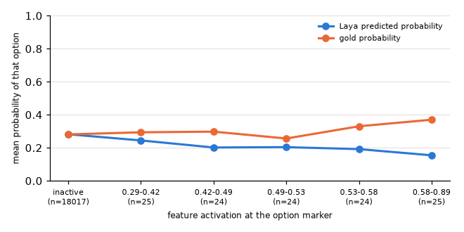

# Feature 12701

Critérios em que aparece: corr_error_stratified

**Interpretação (preencher):** 

---

## Maiores ativações

**tr_customer_service_000079 / category** (choice, customer_service) | ativação 2.730 em `estado` | opções ['account', 'billing', 'delivery', 'refund', 'technical'] | Laya: **refund** [0.019, 0.018, 0.01, 0.928, 0.024] | gabarito: **refund**

```
[CLS]choice question: What is this customer conversation primarily about?[SEP]
▸ [MASK] account: Login, plan changes, profile or access management.
▸ [MASK] billing: A charge, invoice, subscription or payment problem.
▸ [MASK] delivery: Shipping, fulfilment or delivery of a physical item.
▸ [MASK] refund: The customer is explicitly asking for money back.
▸ [MASK] technical: The product or service is not working as expected.

[SEP]

{"account": {"lifetime_value_usd": 621, "prior_tickets_90d": 0, "seats": 1, "tenure_months": 8, "tier": "standard"}, "thread": [{"role": "customer", "text": "I am checking on the status of a refund that was initiated last week. It has not appeared in my account yet."}, {"role": "agent", "text": "I can certainly look into that for you. Could you please provide the case number or the transaction ID associated with the refund?"}, {"role": "customer", "text": "The reference number is REF-88372-X. It was processed on the 12th according to your email."}, {"role": "agent", "text": "Thanks for providing that ID. I am currently pulling up the transaction details; could you verify the email⟦ address⟧ associated with your account?"}, {"role": "customer", "text": "It is j.smith@provider.com. Please let me know what you find."}]}[SEP]
```

**tr_customer_service_000079 / action** (choice, customer_service) | ativação 2.588 em `estado` | opções ['answer_directly', 'close_no_action', 'escalate_to_human', 'execute_refund', 'request_information'] | Laya: **execute_refund** [0.197, 0.247, 0.074, 0.266, 0.216] | gabarito: **answer_directly**

```
[CLS]choice question: What should the assistant do next with this conversation?[SEP]
▸ [MASK] answer_directly: The assistant can resolve this itself with information it already has.
▸ [MASK] close_no_action: No further action is warranted; the matter is settled.
▸ [MASK] escalate_to_human: Hand off to a human agent with the appropriate authority.
▸ [MASK] execute_refund: Issue the refund or credit the customer is owed.
▸ [MASK] request_information: More detail is needed from the customer before anything can be done.

[SEP]

{"account": {"lifetime_value_usd": 621, "prior_tickets_90d": 0, "seats": 1, "tenure_months": 8, "tier": "standard"}, "thread": [{"role": "customer", "text": "I am checking on the status of a refund that was initiated last week. It has not appeared in my account yet."}, {"role": "agent", "text": "I can certainly look into that for you. Could you please provide the case number or the transaction ID associated with the refund?"}, {"role": "customer", "text": "The reference number is REF-88372-X. It was processed on the 12th according to your email."}, {"role": "agent", "text": "Thanks for providing that ID. I am currently pulling up the transaction details; could you verify the email⟦ address⟧ associated with your account?"}, {"role": "customer", "text": "It is j.smith@provider.com. Please let me know what you find."}]}[SEP]
```

**tr_customer_service_000203 / urgency** (score, customer_service) | ativação 2.471 em `estado` | opções ['0', '1', '2', '3'] | Laya: **1** [0.019, 0.921, 0.042, 0.018] | gabarito: **1**

```
[CLS]score question: How time-sensitive is this conversation?[SEP]
▸ [MASK] level 0: No time pressure; can wait indefinitely.
▸ [MASK] level 1: Routine; handle within the normal queue.
▸ [MASK] level 2: Elevated; should be handled within the same week.
▸ [MASK] level 3: Critical; requires action within the same day.

[SEP]

{"account": {"lifetime_value_usd": 303, "prior_tickets_90d": 1, "se⟦ats⟧": 12, "tenure_months": 5, "tier": "premium"}, "thread": [{"role": "customer", "text": "Since the last update, the sync process has been taking around 15 minutes for a few megabytes, which is much slower than before."}]}[SEP]
```

**tr_customer_service_000140 / action** (choice, customer_service) | ativação 2.400 em `estado` | opções ['answer_directly', 'close_no_action', 'escalate_to_human', 'execute_refund', 'request_information'] | Laya: **close_no_action** [0.216, 0.329, 0.112, 0.144, 0.198] | gabarito: **request_information**

```
[CLS]choice question: What should the assistant do next with this conversation?[SEP]
▸ [MASK] answer_directly: The assistant can resolve this itself with information it already has.
▸ [MASK] close_no_action: No further action is warranted; the matter is settled.
▸ [MASK] escalate_to_human: Hand off to a human agent with the appropriate authority.
▸ [MASK] execute_refund: Issue the refund or credit the customer is owed.
▸ [MASK] request_information: More detail is needed from the customer before anything can be done.

[SEP]

{"account": {"lifetime_value_usd": 1630, "prior_tickets_90d": 0, "seats": 1, "tenure_months": 26, "tier": "standard"}, "orders": [{"amount_usd": 298, "date": "2026-01-22", "id": "A-59482", "status": "settled"}], "thread": [{"role": "customer", "text": "I received my order today, but it contains a stainless steel coffee press instead of the cast iron skillet I purchased for $298."}, {"role": "agent", "text": "I apologize for the confusion regarding your order. Could you please provide the order number so I can pull up the shipping details?"}, {"role": "customer", "text": "The order number is 88492-BX. I have been with you for 26 months and haven't⟦ had⟧ issues before, but this is the wrong item."}, {"role": "agent", "text": "Thank you for sharing that information. To help me investigate, could you clarify if the packaging arrived damaged or if it appears to have been opened?"}, {"role": "customer", "text": "The box was perfectly intact and sealed. It just seems like the wrong item was packed inside the box at your warehouse."}, {"role": "agent", "text": "Understood. I am looking into your account history now. Would you be able to upload a photo of the packing slip that was included in the box?"}, {"role": "customer", "text": "I can upload that. I need to know how we are going to correct this mistake soon."}]}[SEP]
```

**tr_customer_service_000262 / category** (choice, customer_service) | ativação 2.393 em `estado` | opções ['account', 'billing', 'delivery', 'refund', 'technical'] | Laya: **refund** [0.088, 0.361, 0.026, 0.394, 0.13] | gabarito: **billing**

```
[CLS]choice question: What is this customer conversation primarily about?[SEP]
▸ [MASK] account: Login, plan changes, profile or access management.
▸ [MASK] billing: A charge, invoice, subscription or payment problem.
▸ [MASK] delivery: Shipping, fulfilment or delivery of a physical item.
▸ [MASK] refund: The customer is explicitly asking for money back.
▸ [MASK] technical: The product or service is not working as expected.

[SEP]

{"account": {"lifetime_value_usd": 728, "prior_tickets_90d": 1, "seats": 1, "tenure_months": 19, "tier": "standard"}, "orders": [{"amount_usd": 18, "date": "2026-01-04", "id": "A-75798", "status": "settled"}, {"amount_usd": 18, "date": "2026-02-14", "id": "A-84810", "status": "failed"}, {"amount_usd": 18, "date": "2026-01-11", "id": "A-71488", "status": "settled"}], "thread": [{"role": "customer", "text": "I need help immediately. I've been a loyal customer for 19 months on the $18 standard plan, but I just noticed I've been downgraded to the free tier without my consent. This happened once before and was only half-fixed, and now I've lost access⟦ to⟧ my active projects."}, {"role": "agent", "text": "I see your account history here and recognize you've been with us for quite a while. To help me investigate the billing status, could you confirm if you received any automated emails regarding a failed payment recently?"}, {"role": "customer", "text": "No, there were no emails at all, and my card on file is perfectly fine. I have a team waiting on these files right now and we can't get anything done while the account says 'Basic'."}, {"role": "agent", "text": "Thank you for that information. Could you please provide the last four digits of the card you have on file so I can cross-reference it with our payment processor's logs?"}, {"role": "customer", "text": "It's 4492. Please, just check whatever you need to check quickly, because our entire workflow is stalled until those standard features are toggled back on."}]}[SEP]
```

## Ativações medianas (faixa 40-60%, mediana 0.651)

**tr_customer_service_000280 / urgency** (score, customer_service) | ativação 0.586 em `estado` | opções ['0', '1', '2', '3'] | Laya: **1** [0.112, 0.532, 0.185, 0.17] | gabarito: **2**

```
[CLS]score question: How time-sensitive is this conversation?[SEP]
▸ [MASK] level 0: No time pressure; can wait indefinitely.
▸ [MASK] level 1: Routine; handle within the normal queue.
▸ [MASK] level 2: Elevated; should be handled within the same week.
▸ [MASK] level 3: Critical; requires action within the same day.

[SEP]

⟦{"⟧account": {"lifetime_value_usd": 1324, "prior_tickets_90d": 5, "seats": 5, "tenure_months": 33, "tier": "premium"}, "thread": [{"role": "customer", "text": "Hey, I just saw a notification about a failed payment on my premium account, but I’ve been paying this same way for 33 months without any issues. I'm really not sure what changed?"}, {"role": "agent", "text": "I understand the confusion. To help me investigate why the transaction did not go through this time, could you confirm if you have recently updated any banking or card details?"}, {"role": "customer", "text": "I haven't touched my settings at all, everything looks exactly like it did last month. Do you think there is a glitch in the billing system?"}, {"role": "agent", "text": "That is a fair question. To get a better look, could you provide the last four digits of the payment method currently listed on your profile?"}, {"role": "customer", "text": "Let me check that for you—it ends in 4922. Is there anything else you need from my end to figure this out?"}]}[SEP]
```

**tr_security_incidents_000047 / urgency** (score, security_incidents) | ativação 0.648 em `estado` | opções ['0', '1', '2', '3'] | Laya: **1** [0.027, 0.751, 0.058, 0.164] | gabarito: **2**

```
[CLS]score question: How quickly must a responder act on this alert?[SEP]
▸ [MASK] level 0: No time pressure; can wait indefinitely.
▸ [MASK] level 1: Routine; handle within the normal queue.
▸ [MASK] level 2: Elevated; should be handled within the same week.
▸ [MASK] level 3: Critical; requires action within the same day.

[SEP]

{"alert": {"description": "audit logging was turned off on a host", "evidence": "Audit logging was disabled on host \"WIN-DB01\" at 2026-09-15 04:55:47 UTC when the service account \"svc_audit\" stopped the \"Windows Event Log\" service via PowerShell. The host resides on an allowlisted subnet, MFA is enabled for the account, a change window was open, and the account's credentials have not been rotated for 412 days.", "rule": "disabled_logging"}, "context": {"asset_criticality": "medium", "change_window_active": true, "source_on_allowlist": true}, "history": {"credential_rotation_days_ago": 412, "distinct_countries_30d": 3, "logins_30d": 1519, "prior_alerts_90d": 25}, "principal":⟦ {"⟧mfa_enrolled": true, "name": "adm-deploy-371", "privileges": ["deploy:production", "secrets:read"], "type": "service_account"}}[SEP]
```

**tr_agent_trace_observability_000264 / outcome** (choice, agent_trace_observability) | ativação 0.595 em `estado` | opções ['failure', 'harmful', 'partial', 'success'] | Laya: **success** [0.277, 0.068, 0.199, 0.456] | gabarito: **success**

```
[CLS]choice question: How did this agent run turn out?[SEP]
▸ [MASK] failure: The agent did not accomplish the task.
▸ [MASK] harmful: The agent took an action that caused damage or violated a constraint.
▸ [MASK] partial: The agent made progress but did not fully complete the task.
▸ [MASK] success: The agent completed the task correctly.

[SEP]

{"agent": {"autonomy": "checkpointed", "model": "internal-agent-v1"}, "constraints":⟦ ["⟧Never modify production without an approved change ticket", "Do not exceed a $50 spend on cloud resources"], "task": "Provision a read replica for the reporting database.", "trace_summary": {"constraint_violations": 0, "duration_s": 655.0, "irreversible_actions": 1, "steps": 7, "tool_errors": 1}}[SEP]
```

**tr_invoice_processing_000047 / urgency** (score, invoice_processing) | ativação 0.666 em `estado` | opções ['0', '1', '2', '3'] | Laya: **1** [0.235, 0.519, 0.148, 0.098] | gabarito: **3**

```
[CLS]score question: How time-sensitive is processing this invoice?[SEP]
▸ [MASK] level 0: No time pressure; can wait indefinitely.
▸ [MASK] level 1: Routine; handle within the normal queue.
▸ [MASK] level 2: Elevated; should be handled within the same week.
▸ [MASK] level 3: Critical; requires action within the same day.

[SEP]

{"delivery": {"condition": "accepted with exceptions", "date": "2026-03-06", "received_qty": 400}, "invoice": {"currency": "USD", "id": "INV-2026-2687", "lines": [{"qty": 400, "sku": "⟦SK⟧U-741", "total_usd": 96300.0, "unit_usd": 240.75}], "total_usd": 96300.0, "vendor": "Pallas Industrial"}, "payment": {"days_until_due": 2, "discount_expires_in_days": 6, "early_payment_discount_pct": 2.0, "status": "scheduled", "terms": "net 60"}, "purchase_order": {"freight_terms": "freight prepaid by vendor, not separately billable", "id": "PO-1827", "lines": [{"qty": 400, "unit_usd": 240.75}], "total_usd": 96300.0}, "vendor_history": {"disputes_12m": 2, "invoices_12m": 25, "prior_invoice_ids": ["INV-2026-2687", "INV-2026-6074", "INV-2026-7980"]}}[SEP]
```

**tr_security_incidents_000191 / urgency** (score, security_incidents) | ativação 0.624 em `opção` | opções ['0', '1', '2', '3'] | Laya: **1** [0.205, 0.46, 0.178, 0.157] | gabarito: **2**

```
[CLS]score question: How quickly must a responder act on this alert?[SEP]
▸ [MASK] level 0: No time pressure; can wait indefinitely.
▸ [MASK] level⟦ 1⟧: Routine; handle within the normal queue.
▸ [MASK] level 2: Elevated; should be handled within the same week.
▸ [MASK] level 3: Critical; requires action within the same day.

[SEP]

{"alert": {"description": "an unrecognised binary executed on a server", "evidence": "A binary named \"/tmp/xdg-setup\" was launched on host \"mail-srv-03\" at 2026-09-15 05:48:03 UTC under the shared_mailbox user, which has MFA enabled. The file’s SHA256 hash is a1b2c3d4e5f6… and it was fetched from source IP 192.0.2.55.", "rule": "suspicious_process"}, "context": {"asset_criticality": "low", "change_window_active": false, "source_on_allowlist": false}, "history": {"credential_rotation_days_ago": 3, "distinct_countries_30d": 2, "logins_30d": 1521, "prior_alerts_90d": 1}, "principal": {"mfa_enrolled": true, "name": "adm-analytics-202", "privileges": ["repo:read"], "type": "shared_mailbox"}}[SEP]
```

## Estatísticas (conjunto de descoberta, dev e teste)

**pred / error**

| split | decisões | ativas | ativas e Laya errou | taxa | lift | q (BH) | OR (CMH) | q (CMH) |
|---|---|---|---|---|---|---|---|---|
| discovery | 5100 | 5 | 2 | 0.400 | 0.63 | nan | nan | nan |
| dev | 900 | 1 | 1 | 1.000 | 1.52 | nan | nan | nan |
| test | 2000 | 2 | 2 | 1.000 | 1.57 | nan | nan | nan |

**corr / error**

| split | decisões | ativas | ativas e Laya errou | taxa | lift | q (BH) | OR (CMH) | q (CMH) |
|---|---|---|---|---|---|---|---|---|
| discovery | 5100 | 35 | 32 | 0.914 | 1.44 | 0.000561 | 6.05 | 0.000329 |
| dev | 900 | 4 | 4 | 1.000 | 1.52 | nan | nan | nan |
| test | 2000 | 5 | 5 | 1.000 | 1.57 | nan | nan | nan |

**state / error**

| split | decisões | ativas | ativas e Laya errou | taxa | lift | q (BH) | OR (CMH) | q (CMH) |
|---|---|---|---|---|---|---|---|---|
| discovery | 5100 | 3442 | 2133 | 0.620 | 0.97 | 0.0111 | 0.66 | 4.58e-07 |
| dev | 900 | 621 | 395 | 0.636 | 0.97 | 0.773 | 0.74 | 0.331 |
| test | 2000 | 1317 | 826 | 0.627 | 0.98 | 0.704 | 0.70 | 0.0165 |

Confusão mais sobre-representada (pred): `disposition|3>0` (n=1, lift 204.00, p=nan). Formato `pergunta|índice previsto>índice correto`.

Confusão mais sobre-representada (corr): `action|1>0` (n=22, lift 78.19, p=1.1e-40). Formato `pergunta|índice previsto>índice correto`.

Confusão mais sobre-representada (state): `true_positive|0>1` (n=98, lift 1.29, p=1.85e-06). Formato `pergunta|índice previsto>índice correto`.



