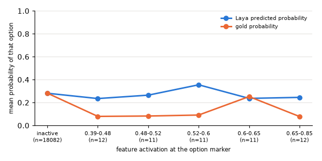

# Feature 12781

Critérios em que aparece: pred_error

**Interpretação (preencher):** 

---

## Maiores ativações

**tr_security_incidents_000213 / disposition** (choice, security_incidents) | ativação 4.980 em `estado` | opções ['close_benign', 'contain', 'investigate', 'monitor'] | Laya: **close_benign** [0.468, 0.17, 0.122, 0.24] | gabarito: **contain**

```
[CLS]choice question: How should this security alert be dispositioned?[SEP]
▸ [MASK] close_benign: Expected, explainable activity; close without analyst time.
▸ [MASK] contain: Contain the host or account immediately; do not wait for triage.
▸ [MASK] investigate: Warrants an analyst opening an investigation.
▸ [MASK] monitor: Not clearly malicious, but worth watching for recurrence.

[SEP]

{"alert": {"description": "an account granted itself or received elevated permissions", "evidence": "At 08:15 UTC, an unprivileged contractor account successfully assigned itself the 'Global Administrator' role from unrecognized IP 198.51.100.22. Although a change window was open, the account utilized credentials that had not been rotated for 700 days.", "rule": "privilege_escalation"}, "context": {"asset_criticality": "medium", "change_window_active": true, "source_on_allowlist": false}, "history": {"credential_rotation_days_ago":⟦ 700⟧, "distinct_countries_30d": 3, "logins_30d": 1417, "prior_alerts_90d": 3}, "principal": {"mfa_enrolled": true, "name": "usr-support-417", "privileges": ["repo:read"], "type": "contractor"}}[SEP]
```

**tr_security_incidents_000202 / severity** (score, security_incidents) | ativação 4.777 em `estado` | opções ['0', '1', '2', '3', '4'] | Laya: **2** [0.035, 0.306, 0.495, 0.109, 0.054] | gabarito: **2**

```
[CLS]score question: How severe is the potential impact if this alert is real?[SEP]
▸ [MASK] level 0: Negligible: no access to anything sensitive.
▸ [MASK] level 1: Low: limited access, easily reversed.
▸ [MASK] level 2: Moderate: access to internal systems or non-public data.
▸ [MASK] level 3: High: access to production, secrets or customer data.
▸ [MASK] level 4: Critical: active compromise of crown-jewel systems.

[SEP]

{"alert": {"description": "a long-unused account became active", "evidence": "A shared mailbox account that has been dormant for an extended period performed an authentication request. The account currently has MFA disabled, is not within a change window, and the credentials have not been updated for 700 days.", "rule": "dormant_account_use"}, "context": {"asset_criticality": "medium", "change_window_active": false, "source_on_allowlist": true}, "history": {"credential_rotation_days_ago":⟦ 700⟧, "distinct_countries_30d": 3, "logins_30d": 251, "prior_alerts_90d": 25}, "principal": {"mfa_enrolled": false, "name": "adm-support-872", "privileges": ["repo:read"], "type": "shared_mailbox"}}[SEP]
```

**tr_security_incidents_000202 / urgency** (score, security_incidents) | ativação 4.336 em `estado` | opções ['0', '1', '2', '3'] | Laya: **1** [0.038, 0.645, 0.077, 0.24] | gabarito: **1**

```
[CLS]score question: How quickly must a responder act on this alert?[SEP]
▸ [MASK] level 0: No time pressure; can wait indefinitely.
▸ [MASK] level 1: Routine; handle within the normal queue.
▸ [MASK] level 2: Elevated; should be handled within the same week.
▸ [MASK] level 3: Critical; requires action within the same day.

[SEP]

{"alert": {"description": "a long-unused account became active", "evidence": "A shared mailbox account that has been dormant for an extended period performed an authentication request. The account currently has MFA disabled, is not within a change window, and the credentials have not been updated for 700 days.", "rule": "dormant_account_use"}, "context": {"asset_criticality": "medium", "change_window_active": false, "source_on_allowlist": true}, "history": {"credential_rotation_days_ago":⟦ 700⟧, "distinct_countries_30d": 3, "logins_30d": 251, "prior_alerts_90d": 25}, "principal": {"mfa_enrolled": false, "name": "adm-support-872", "privileges": ["repo:read"], "type": "shared_mailbox"}}[SEP]
```

**tr_security_incidents_000054 / urgency** (score, security_incidents) | ativação 4.266 em `estado` | opções ['0', '1', '2', '3'] | Laya: **1** [0.081, 0.727, 0.127, 0.065] | gabarito: **1**

```
[CLS]score question: How quickly must a responder act on this alert?[SEP]
▸ [MASK] level 0: No time pressure; can wait indefinitely.
▸ [MASK] level 1: Routine; handle within the normal queue.
▸ [MASK] level 2: Elevated; should be handled within the same week.
▸ [MASK] level 3: Critical; requires action within the same day.

[SEP]

{"alert": {"description": "a first-ever sign-in from an unfamiliar country", "evidence": "An unprivileged ci_runner authenticated from an IP address in a new country at 04:30 UTC without MFA. The source is included on the allowlist, though no change window is active and the credentials were last rotated 30 days ago.", "rule": "new_country_login"}, "context": {"asset_criticality": "low", "change_window_active": false, "source_on_allowlist": true}, "history": {"credential_rotation_⟦days⟧_ago": 30, "distinct_countries_30d": 1, "logins_30d": 1911, "prior_alerts_90d": 0}, "principal": {"mfa_enrolled": false, "name": "ci-infra-676", "privileges": ["repo:read"], "type": "ci_runner"}}[SEP]
```

**tr_customer_service_000025 / needs_human** (noul, customer_service) | ativação 4.250 em `estado` | opções ['false', 'true'] | Laya: **true** [0.492, 0.508] | gabarito: **true**

```
[CLS]noul question: This conversation requires a human agent rather than automated handling.[SEP]
▸ [MASK] false: Automation can carry this to resolution.
▸ [MASK] true: A human must take over: judgement, authority or empathy is required.

[SEP]

{"account": {"lifetime_value_usd": 79, "prior_tickets_90d": 2, "seats": 1, "tenure_months": 5, "tier": "standard"}, "thread": [{"role": "customer", "text": "I am currently unable to log into my account. The system is rejecting my credentials even though they have not changed."}, {"role": "agent", "text": "I'm sorry to hear you're having trouble accessing the platform. Are you receiving a specific error message when you attempt to sign in?"}, {"role": "customer", "text": "It says 'Authentication Failed' in red text. This is the third time I've had to reach out about this same issue over the last five months, and it still isn't fixed."}, {"role": "agent", "text": "I see your previous tickets in the history. To help me narrow down the cause, have you tried clearing your browser cache or using an incognito window?"}, {"role": "customer", "text": "I have tried those steps and the result is the same. I have a hard deadline to submit my reports by the end of business today, so I need this resolved immediately."}, {"role": "agent", "text": "I understand the time⟦ constraint⟧ you are under. Could you tell me if you are using a VPN or a corporate firewall when trying to connect?"}, {"role": "customer", "text": "I am on a standard home network with no VPN. I am still locked out and I'm running out of time before my deadline."}]}[SEP]
```

## Ativações medianas (faixa 40-60%, mediana 0.850)

**tr_security_incidents_000209 / severity** (score, security_incidents) | ativação 0.914 em `estado` | opções ['0', '1', '2', '3', '4'] | Laya: **4** [0.034, 0.225, 0.243, 0.206, 0.291] | gabarito: **4**

```
[CLS]score question: How severe is the potential impact if this alert is real?[SEP]
▸ [MASK] level 0: Negligible: no access to anything sensitive.
▸ [MASK] level 1: Low: limited access, easily reversed.
▸ [MASK] level 2: Moderate: access to internal systems or non-public data.
▸ [MASK] level 3: High: access to production, secrets or customer data.
▸ [MASK] level 4: Critical: active compromise of crown-jewel systems.

[SEP]

{"alert": {"description": "a long-unused account became active", "evidence": "On 2026-09-13 at 09:45 UTC, the shared mailbox account finance_reports (last login 700 days prior) accessed the mailbox via Outlook.exe from source IP 192.0.2.55. This marked the first successful authentication for the account since its last activity. The login happened while a change window was in effect.", "rule": "dormant_account_use"}, "context": {"asset_criticality": "crown_jewel", "change_window_active": true, "source_on_allowlist": false}, "history": {"credential_rotation_days_⟦ago⟧": 700, "distinct_countries_30d": 4, "logins_30d": 1257, "prior_alerts_90d": 0}, "principal": {"mfa_enrolled": true, "name": "svc-billing-676", "privileges": ["deploy:production", "secrets:read"], "type": "shared_mailbox"}}[SEP]
```

**tr_security_incidents_000191 / urgency** (score, security_incidents) | ativação 0.783 em `opção` | opções ['0', '1', '2', '3'] | Laya: **1** [0.205, 0.46, 0.178, 0.157] | gabarito: **2**

```
[CLS]score question: How quickly must a responder act on this alert?[SEP]
▸ [MASK] level 0: No time pressure; can wait indefinitely.
▸ [MASK] level⟦ 1⟧: Routine; handle within the normal queue.
▸ [MASK] level 2: Elevated; should be handled within the same week.
▸ [MASK] level 3: Critical; requires action within the same day.

[SEP]

{"alert": {"description": "an unrecognised binary executed on a server", "evidence": "A binary named \"/tmp/xdg-setup\" was launched on host \"mail-srv-03\" at 2026-09-15 05:48:03 UTC under the shared_mailbox user, which has MFA enabled. The file’s SHA256 hash is a1b2c3d4e5f6… and it was fetched from source IP 192.0.2.55.", "rule": "suspicious_process"}, "context": {"asset_criticality": "low", "change_window_active": false, "source_on_allowlist": false}, "history": {"credential_rotation_days_ago": 3, "distinct_countries_30d": 2, "logins_30d": 1521, "prior_alerts_90d": 1}, "principal": {"mfa_enrolled": true, "name": "adm-analytics-202", "privileges": ["repo:read"], "type": "shared_mailbox"}}[SEP]
```

**tr_customer_service_000043 / urgency** (score, customer_service) | ativação 0.941 em `estado` | opções ['0', '1', '2', '3'] | Laya: **1** [0.157, 0.527, 0.115, 0.201] | gabarito: **0**

```
[CLS]score question: How time-sensitive is this conversation?[SEP]
▸ [MASK] level 0: No time pressure; can wait indefinitely.
▸ [MASK] level 1: Routine; handle within the normal queue.
▸ [MASK] level 2: Elevated; should be handled within the same week.
▸ [MASK] level 3: Critical; requires action within the same day.

[SEP]

{"account": {"lifetime_value_usd": 208, "prior_tickets_90d": 0, "seats": 1, "tenure_months": 3, "tier": "free"}, "orders": [{"amount_usd": 999, "date": "2026-03-09", "id": "A-17017", "status": "refunded"}, {"amount_usd":⟦ 999⟧, "date": "2026-01-04", "id": "A-58989", "status": "failed"}], "thread": [{"role": "customer", "text": "I need to get my data out of the system, but I’m not holding my breath—it probably won’t happen any time soon."}, {"role": "agent", "text": "I hear you. Could you tell me which parts of your account you’d like included in the export?"}, {"role": "customer", "text": "Just the basic account information—profile details and settings. Nothing fancy."}, {"role": "agent", "text": "Understood. Do you have a preferred format for the file—CSV, JSON, or something else?"}, {"role": "customer", "text": "Whatever you can manage, I don’t mind waiting."}]}[SEP]
```

**tr_invoice_processing_000067 / urgency** (score, invoice_processing) | ativação 0.776 em `estado` | opções ['0', '1', '2', '3'] | Laya: **1** [0.239, 0.484, 0.153, 0.124] | gabarito: **2**

```
[CLS]score question: How time-sensitive is processing this invoice?[SEP]
▸ [MASK] level 0: No time pressure; can wait indefinitely.
▸ [MASK] level 1: Routine; handle within the normal queue.
▸ [MASK] level 2: Elevated; should be handled within the same week.
▸ [MASK] level 3: Critical; requires action within the same day.

[SEP]

{"delivery": {"condition": "accepted with exceptions", "date": "2026-03-01", "received_qty": 400}, "invoice": {"currency": "USD", "id": "INV-2026-5971", "lines": [{"qty": 400, "sku": "SKU-570", "total_usd": 155760.0, "unit_usd": 389.4}], "total_usd": 155760.0, "vendor": "Acme Fabrication"},⟦ "⟧payment": {"days_until_due": 5, "discount_expires_in_days": null, "early_payment_discount_pct": null, "status": "scheduled", "terms": "net 60"}, "purchase_order": {"freight_terms": "freight prepaid by vendor, not separately billable", "id": "PO-9734", "lines": [{"qty": 400, "unit_usd": 389.4}], "total_usd": 155760.0}, "vendor_history": {"disputes_12m": 0, "invoices_12m": 31, "prior_invoice_ids": ["INV-2026-9790", "INV-2026-4957"]}}[SEP]
```

**tr_invoice_processing_000048 / duplicate** (noul, invoice_processing) | ativação 0.959 em `estado` | opções ['false', 'true'] | Laya: **true** [0.254, 0.746] | gabarito: **false**

```
[CLS]noul question: This invoice appears to duplicate an invoice already submitted.[SEP]
▸ [MASK] false: no, the statement does not hold
▸ [MASK] true: yes, the statement holds

[SEP]

{"delivery": {"condition": "accepted with exceptions", "date": "2026-03-04", "received_qty": 350}, "invoice": {"currency": "USD", "id": "INV-2026-9419", "lines": [{"qty":⟦ 350⟧, "sku": "SKU-227", "total_usd": 64333.5, "unit_usd": 183.81}], "total_usd": 64333.5, "vendor": "Orbit Logistics"}, "payment": {"days_until_due": -9, "discount_expires_in_days": null, "early_payment_discount_pct": null, "status": "overdue", "terms": "net 15"}, "purchase_order": {"freight_terms": "freight prepaid by vendor, not separately billable", "id": "PO-4204", "lines": [{"qty": 400, "unit_usd": 183.81}], "total_usd": 73524.0}, "vendor_history": {"disputes_12m": 0, "invoices_12m": 19, "prior_invoice_ids": ["INV-2026-2376", "INV-2026-6886"]}}[SEP]
```

## Estatísticas (conjunto de descoberta, dev e teste)

**pred / error**

| split | decisões | ativas | ativas e Laya errou | taxa | lift | q (BH) | OR (CMH) | q (CMH) |
|---|---|---|---|---|---|---|---|---|
| discovery | 5100 | 22 | 21 | 0.955 | 1.50 | 0.00297 | 0.00 | 0.238 |
| dev | 900 | 1 | 1 | 1.000 | 1.52 | nan | nan | nan |
| test | 2000 | 7 | 7 | 1.000 | 1.57 | nan | nan | nan |

**corr / error**

| split | decisões | ativas | ativas e Laya errou | taxa | lift | q (BH) | OR (CMH) | q (CMH) |
|---|---|---|---|---|---|---|---|---|
| discovery | 5100 | 6 | 5 | 0.833 | 1.31 | nan | nan | nan |
| dev | 900 | 0 | 0 | nan | nan | nan | nan | nan |
| test | 2000 | 0 | 0 | nan | nan | nan | nan | nan |

**state / error**

| split | decisões | ativas | ativas e Laya errou | taxa | lift | q (BH) | OR (CMH) | q (CMH) |
|---|---|---|---|---|---|---|---|---|
| discovery | 5100 | 3525 | 2246 | 0.637 | 1.00 | 0.984 | 1.22 | 0.0296 |
| dev | 900 | 611 | 409 | 0.669 | 1.02 | 1 | 1.36 | 0.283 |
| test | 2000 | 1379 | 894 | 0.648 | 1.02 | 0.573 | 1.20 | 0.317 |

Confusão mais sobre-representada (pred): `action|1>2` (n=11, lift 20.40, p=6.92e-13). Formato `pergunta|índice previsto>índice correto`.

Confusão mais sobre-representada (corr): `action|1>4` (n=3, lift 55.43, p=nan). Formato `pergunta|índice previsto>índice correto`.

Confusão mais sobre-representada (state): `duplicate|1>0` (n=193, lift 1.29, p=6.19e-13). Formato `pergunta|índice previsto>índice correto`.



