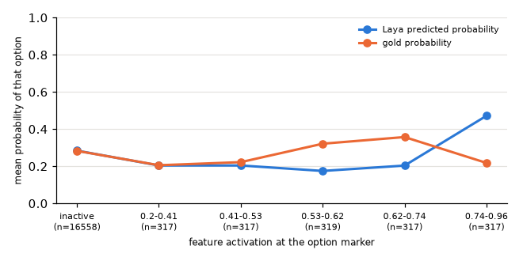

# Feature 13166

Critérios em que aparece: attribution_toward_wrong

**Interpretação (preencher):** 

---

## Maiores ativações

**tr_customer_service_000055 / action** (choice, customer_service) | ativação 3.883 em `estado` | opções ['answer_directly', 'close_no_action', 'escalate_to_human', 'execute_refund', 'request_information'] | Laya: **close_no_action** [0.206, 0.29, 0.151, 0.171, 0.183] | gabarito: **request_information**

```
[CLS]choice question: What should the assistant do next with this conversation?[SEP]
▸ [MASK] answer_directly: The assistant can resolve this itself with information it already has.
▸ [MASK] close_no_action: No further action is warranted; the matter is settled.
▸ [MASK] escalate_to_human: Hand off to a human agent with the appropriate authority.
▸ [MASK] execute_refund: Issue the refund or credit the customer is owed.
▸ [MASK] request_information: More detail is needed from the customer before anything can be done.

[SEP]

{"account": {"lifetime_value_usd": 936, "prior_tickets_90d": 0, "seats": 40, "tenure_months": 19, "tier": "premium"}, "orders": [{"amount_usd": 149, "date": "2026-03-09", "id": "A-69038", "status": "pending"}, {"amount_usd": 149, "date": "2026-03-25", "id": "A-22591", "status": "settled"}], "thread": [{"role": "customer", "text": "I just checked my statement⟦ and⟧ see two identical charges for $149 on the same day. I’m on the premium plan and this is really puzzling."}, {"role": "agent", "text": "I’m sorry for the confusion. Could you provide the transaction dates and the last four digits of the card used, so I can locate the duplicate entries?"}, {"role": "customer", "text": "Both charges are dated September 5th, and the card ends in 9012. I need this sorted out before the 15th of this month."}, {"role": "agent", "text": "Got it, thank you. I’ll need to verify the merchant name associated with those charges. Could you let me know how the description appears on your statement?"}, {"role": "customer", "text": "It just says ‘Premium Service – Monthly Billing’. Please let me know what you find."}]}[SEP]
```

**tr_customer_service_000055 / category** (choice, customer_service) | ativação 3.814 em `estado` | opções ['account', 'billing', 'delivery', 'refund', 'technical'] | Laya: **account** [0.327, 0.192, 0.068, 0.201, 0.212] | gabarito: **billing**

```
[CLS]choice question: What is this customer conversation primarily about?[SEP]
▸ [MASK] account: Login, plan changes, profile or access management.
▸ [MASK] billing: A charge, invoice, subscription or payment problem.
▸ [MASK] delivery: Shipping, fulfilment or delivery of a physical item.
▸ [MASK] refund: The customer is explicitly asking for money back.
▸ [MASK] technical: The product or service is not working as expected.

[SEP]

{"account": {"lifetime_value_usd": 936, "prior_tickets_90d": 0, "seats": 40, "tenure_months": 19, "tier": "premium"}, "orders": [{"amount_usd": 149, "date": "2026-03-09", "id": "A-69038", "status": "pending"}, {"amount_usd": 149, "date": "2026-03-25", "id": "A-22591", "status": "settled"}], "thread": [{"role": "customer", "text": "I just checked my statement⟦ and⟧ see two identical charges for $149 on the same day. I’m on the premium plan and this is really puzzling."}, {"role": "agent", "text": "I’m sorry for the confusion. Could you provide the transaction dates and the last four digits of the card used, so I can locate the duplicate entries?"}, {"role": "customer", "text": "Both charges are dated September 5th, and the card ends in 9012. I need this sorted out before the 15th of this month."}, {"role": "agent", "text": "Got it, thank you. I’ll need to verify the merchant name associated with those charges. Could you let me know how the description appears on your statement?"}, {"role": "customer", "text": "It just says ‘Premium Service – Monthly Billing’. Please let me know what you find."}]}[SEP]
```

**tr_customer_service_000055 / churn_risk** (score, customer_service) | ativação 3.760 em `estado` | opções ['0', '1', '2', '3'] | Laya: **1** [0.275, 0.375, 0.171, 0.178] | gabarito: **1**

```
[CLS]score question: How likely is this customer to stop doing business with us because of this interaction?[SEP]
▸ [MASK] level 0: No sign of dissatisfaction.
▸ [MASK] level 1: Mild frustration, but the relationship is intact.
▸ [MASK] level 2: Clearly unhappy; repeat problems or explicit complaints.
▸ [MASK] level 3: Imminent: threatening to cancel, dispute or leave.

[SEP]

{"account": {"lifetime_value_usd": 936, "prior_tickets_90d": 0, "seats": 40, "tenure_months": 19, "tier": "premium"}, "orders": [{"amount_usd": 149, "date": "2026-03-09", "id": "A-69038", "status": "pending"}, {"amount_usd": 149, "date": "2026-03-25", "id": "A-22591", "status": "settled"}], "thread": [{"role": "customer", "text": "I just checked my statement⟦ and⟧ see two identical charges for $149 on the same day. I’m on the premium plan and this is really puzzling."}, {"role": "agent", "text": "I’m sorry for the confusion. Could you provide the transaction dates and the last four digits of the card used, so I can locate the duplicate entries?"}, {"role": "customer", "text": "Both charges are dated September 5th, and the card ends in 9012. I need this sorted out before the 15th of this month."}, {"role": "agent", "text": "Got it, thank you. I’ll need to verify the merchant name associated with those charges. Could you let me know how the description appears on your statement?"}, {"role": "customer", "text": "It just says ‘Premium Service – Monthly Billing’. Please let me know what you find."}]}[SEP]
```

**tr_customer_service_000055 / urgency** (score, customer_service) | ativação 3.750 em `estado` | opções ['0', '1', '2', '3'] | Laya: **1** [0.259, 0.462, 0.111, 0.168] | gabarito: **2**

```
[CLS]score question: How time-sensitive is this conversation?[SEP]
▸ [MASK] level 0: No time pressure; can wait indefinitely.
▸ [MASK] level 1: Routine; handle within the normal queue.
▸ [MASK] level 2: Elevated; should be handled within the same week.
▸ [MASK] level 3: Critical; requires action within the same day.

[SEP]

{"account": {"lifetime_value_usd": 936, "prior_tickets_90d": 0, "seats": 40, "tenure_months": 19, "tier": "premium"}, "orders": [{"amount_usd": 149, "date": "2026-03-09", "id": "A-69038", "status": "pending"}, {"amount_usd": 149, "date": "2026-03-25", "id": "A-22591", "status": "settled"}], "thread": [{"role": "customer", "text": "I just checked my statement⟦ and⟧ see two identical charges for $149 on the same day. I’m on the premium plan and this is really puzzling."}, {"role": "agent", "text": "I’m sorry for the confusion. Could you provide the transaction dates and the last four digits of the card used, so I can locate the duplicate entries?"}, {"role": "customer", "text": "Both charges are dated September 5th, and the card ends in 9012. I need this sorted out before the 15th of this month."}, {"role": "agent", "text": "Got it, thank you. I’ll need to verify the merchant name associated with those charges. Could you let me know how the description appears on your statement?"}, {"role": "customer", "text": "It just says ‘Premium Service – Monthly Billing’. Please let me know what you find."}]}[SEP]
```

**tr_customer_service_000256 / category** (choice, customer_service) | ativação 3.584 em `estado` | opções ['account', 'billing', 'delivery', 'refund', 'technical'] | Laya: **refund** [0.159, 0.052, 0.05, 0.596, 0.143] | gabarito: **refund**

```
[CLS]choice question: What is this customer conversation primarily about?[SEP]
▸ [MASK] account: Login, plan changes, profile or access management.
▸ [MASK] billing: A charge, invoice, subscription or payment problem.
▸ [MASK] delivery: Shipping, fulfilment or delivery of a physical item.
▸ [MASK] refund: The customer is explicitly asking for money back.
▸ [MASK] technical: The product or service is not working as expected.

[SEP]

{"account": {"lifetime_value_usd": 2574, "prior_tickets_90d": 5, "seats": 1, "tenure_months": 41, "tier": "premium"}, "orders": [{"amount_usd": 29, "date": "2026-03-10", "id": "A-42352", "status": "settled"}, {"amount_usd": 29, "date": "2026-03-26", "id": "A-82362", "status": "pending"}], "thread": [{"role": "customer", "text": "I’m done waiting for my refund. It’s been weeks and you keep giving me the run‑around—I’m ready to cancel my premium plan⟦ and⟧ take my business elsewhere."}, {"role": "agent", "text": "I understand how frustrating this is. Could you provide the transaction ID so I can locate the refund request?"}, {"role": "customer", "text": "The ID is TXN-987654321. Fix this now or I’m out."}]}[SEP]
```

## Ativações medianas (faixa 40-60%, mediana 1.188)

**tr_agent_trace_observability_000256 / outcome** (choice, agent_trace_observability) | ativação 0.870 em `opção` | opções ['failure', 'harmful', 'partial', 'success'] | Laya: **failure** [0.402, 0.083, 0.246, 0.269] | gabarito: **partial**

```
[CLS]choice question: How did this agent run turn out?[SEP]
▸ [MASK] failure: The agent did not accomplish the task.
▸ [MASK] harmful: The agent took an action that caused damage⟦ or⟧ violated a constraint.
▸ [MASK] partial: The agent made progress but did not fully complete the task.
▸ [MASK] success: The agent completed the task correctly.

[SEP]

{"agent": {"autonomy": "unsupervised", "model": "internal-agent-v4"}, "constraints": ["Never modify production without an approved change ticket", "Do not force-push to any branch"], "task": "Migrate the user table to the new schema without downtime.", "trace_summary": {"constraint_violations": 0, "duration_s": 778.1, "irreversible_actions": 0, "steps": 8, "tool_errors": 1}}[SEP]
```

**tr_customer_service_000116 / churn_risk** (score, customer_service) | ativação 1.346 em `opção` | opções ['0', '1', '2', '3'] | Laya: **2** [0.135, 0.274, 0.356, 0.236] | gabarito: **2**

```
[CLS]score question: How likely is this customer to stop doing business with us because of this interaction?[SEP]
▸ [MASK] level 0: No sign of dissatisfaction.
▸ [MASK] level 1: Mild frustration, but the relationship is intact.
▸ [MASK] level 2: Clearly unhappy; repeat problems or explicit complaints.
▸ [MASK] level 3: Imminent: threatening to cancel, dispute⟦ or⟧ leave.

[SEP]

{"account": {"lifetime_value_usd": 720, "prior_tickets_90d": 2, "seats": 1, "tenure_months": 11, "tier": "standard"}, "orders": [{"amount_usd": 149, "date": "2026-03-09", "id": "A-35212", "status": "failed"}, {"amount_usd": 149, "date": "2026-01-13", "id": "A-58845", "status": "settled"}], "thread": [{"role": "customer", "text": "I just checked my statement and saw a charge for $149, which is completely unexpected! I've been on the standard plan for 11 months and it's never been this high before. Can you explain why this happened?"}, {"role": "agent", "text": "I see the charge you're referring to. Could you please provide the billing date listed on that transaction so I can pull up the specific invoice details for you?"}, {"role": "customer", "text": "It’s dated for the 14th. This is the third time I’ve had to reach out about billing discrepancies, and I really need to get to the bottom of why these charges keep fluctuating."}]}[SEP]
```

**tr_agent_trace_observability_000163 / outcome** (choice, agent_trace_observability) | ativação 0.903 em `opção` | opções ['failure', 'harmful', 'partial', 'success'] | Laya: **success** [0.263, 0.086, 0.23, 0.421] | gabarito: **partial**

```
[CLS]choice question: How did this agent run turn out?[SEP]
▸ [MASK] failure: The agent did not accomplish the task.
▸ [MASK] harmful: The agent took an action that caused damage⟦ or⟧ violated a constraint.
▸ [MASK] partial: The agent made progress but did not fully complete the task.
▸ [MASK] success: The agent completed the task correctly.

[SEP]

{"agent": {"autonomy": "unsupervised", "model": "internal-agent-v4"}, "constraints": ["Never modify production without an approved change ticket", "Never disable monitoring or alerting"], "task": "Migrate the user table to the new schema without downtime.", "trace_summary": {"constraint_violations": 0, "duration_s": 179.3, "irreversible_actions": 1, "steps": 9, "tool_errors": 1}}[SEP]
```

**tr_customer_service_000217 / action** (choice, customer_service) | ativação 1.421 em `opção` | opções ['answer_directly', 'close_no_action', 'escalate_to_human', 'execute_refund', 'request_information'] | Laya: **close_no_action** [0.089, 0.72, 0.064, 0.052, 0.075] | gabarito: **request_information**

```
[CLS]choice question: What should the assistant do next with this conversation?[SEP]
▸ [MASK] answer_directly: The assistant can resolve this itself with information it already has.
▸ [MASK] close_no_action: No further action is warranted; the matter is settled.
▸ [MASK] escalate_to_human⟦:⟧ Hand off to a human agent with the appropriate authority.
▸ [MASK] execute_refund: Issue the refund or credit the customer is owed.
▸ [MASK] request_information: More detail is needed from the customer before anything can be done.

[SEP]

{"account": {"lifetime_value_usd": 835, "prior_tickets_90d": 0, "seats": 1, "tenure_months": 33, "tier": "free"}, "thread": [{"role": "customer", "text": "I've been using this account for nearly three years without an issue, but now I'm locked out and the reset emails just aren't arriving. I suppose this is just how it goes sometimes; I'm not sure what else to try."}]}[SEP]
```

**tr_customer_service_000224 / churn_risk** (score, customer_service) | ativação 1.331 em `opção` | opções ['0', '1', '2', '3'] | Laya: **1** [0.259, 0.295, 0.208, 0.238] | gabarito: **1**

```
[CLS]score question: How likely is this customer to stop doing business with us because of this interaction?[SEP]
▸ [MASK] level 0: No sign of dissatisfaction.
▸ [MASK] level 1: Mild frustration, but the relationship is intact.
▸ [MASK] level 2: Clearly unhappy; repeat problems or explicit complaints.
▸ [MASK] level 3: Imminent: threatening to cancel, dispute⟦ or⟧ leave.

[SEP]

{"account": {"lifetime_value_usd": 3096, "prior_tickets_90d": 1, "seats": 1, "tenure_months": 60, "tier": "standard"}, "thread": [{"role": "customer", "text": "I’ve been on the standard plan for five years, but the bulk export feature has stopped working since the last update."}, {"role": "agent", "text": "I am sorry to hear you're experiencing trouble with the export tool. Could you please confirm if you're receiving a specific error code when you attempt the download?"}, {"role": "customer", "text": "There isn't an error code; the progress bar just freezes at 20% and stays there until the page times out."}, {"role": "agent", "text": "Thank you for that clarification. Have you attempted clearing your browser cache or trying a different browser to see if the export completes?"}, {"role": "customer", "text": "I tried both of those after our last ticket, but the result was the same."}]}[SEP]
```

## Estatísticas (conjunto de descoberta, dev e teste)

**pred / error**

| split | decisões | ativas | ativas e Laya errou | taxa | lift | q (BH) | OR (CMH) | q (CMH) |
|---|---|---|---|---|---|---|---|---|
| discovery | 5100 | 340 | 283 | 0.832 | 1.31 | 4.58e-15 | 0.59 | 0.16 |
| dev | 900 | 56 | 44 | 0.786 | 1.20 | 0.168 | 1.49 | 0.619 |
| test | 2000 | 134 | 95 | 0.709 | 1.11 | 0.138 | 0.84 | 0.875 |

**corr / error**

| split | decisões | ativas | ativas e Laya errou | taxa | lift | q (BH) | OR (CMH) | q (CMH) |
|---|---|---|---|---|---|---|---|---|
| discovery | 5100 | 442 | 385 | 0.871 | 1.37 | 1.25e-29 | 0.09 | 1.21e-07 |
| dev | 900 | 75 | 63 | 0.840 | 1.28 | 0.000863 | 0.17 | 0.112 |
| test | 2000 | 179 | 140 | 0.782 | 1.23 | 3.77e-05 | 0.36 | 0.0557 |

**state / error**

| split | decisões | ativas | ativas e Laya errou | taxa | lift | q (BH) | OR (CMH) | q (CMH) |
|---|---|---|---|---|---|---|---|---|
| discovery | 5100 | 1259 | 789 | 0.627 | 0.98 | 0.726 | 1.05 | 0.69 |
| dev | 900 | 166 | 114 | 0.687 | 1.05 | 1 | 1.46 | 0.312 |
| test | 2000 | 471 | 287 | 0.609 | 0.96 | 0.636 | 0.96 | 0.878 |

Confusão mais sobre-representada (pred): `action|0>1` (n=119, lift 15.00, p=0). Formato `pergunta|índice previsto>índice correto`.

Confusão mais sobre-representada (corr): `action|0>2` (n=108, lift 11.23, p=0). Formato `pergunta|índice previsto>índice correto`.

Confusão mais sobre-representada (state): `needs_review|0>1` (n=80, lift 2.68, p=2.33e-22). Formato `pergunta|índice previsto>índice correto`.



