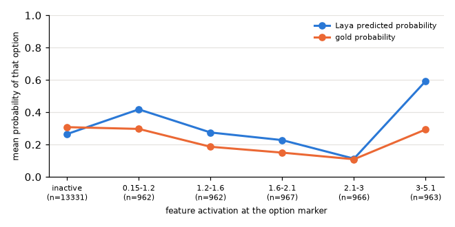

# Feature 13230

Critérios em que aparece: pred_error_stratified

**Interpretação (preencher):** 

---

## Maiores ativações

**tr_customer_service_000244 / urgency** (score, customer_service) | ativação 13.039 em `opção` | opções ['0', '1', '2', '3'] | Laya: **1** [0.053, 0.617, 0.175, 0.155] | gabarito: **2**

```
[CLS]score question: How time-sensitive is this conversation?[SEP]
▸ [MASK] level 0: No time pressure; can wait indefinitely.
▸ [MASK] level 1⟦:⟧ Routine; handle within the normal queue.
▸ [MASK] level 2: Elevated; should be handled within the same week.
▸ [MASK] level 3: Critical; requires action within the same day.

[SEP]

{"account": {"lifetime_value_usd": 91, "prior_tickets_90d": 0, "seats": 1, "tenure_months": 1, "tier": "standard"}, "thread": [{"role": "customer", "text": "Hi there! I just opened my package and noticed that I received the standard kit instead of the deluxe version I had ordered. I hate to be a pain, but I'm actually on a very tight schedule and need the specific components from the deluxe kit for a project deadline on Tuesday. Could you help me figure out how to get the right items sent out?"}]}[SEP]
```

**tr_customer_service_000153 / urgency** (score, customer_service) | ativação 13.016 em `opção` | opções ['0', '1', '2', '3'] | Laya: **1** [0.047, 0.785, 0.088, 0.08] | gabarito: **1**

```
[CLS]score question: How time-sensitive is this conversation?[SEP]
▸ [MASK] level 0: No time pressure; can wait indefinitely.
▸ [MASK] level 1⟦:⟧ Routine; handle within the normal queue.
▸ [MASK] level 2: Elevated; should be handled within the same week.
▸ [MASK] level 3: Critical; requires action within the same day.

[SEP]

{"account": {"lifetime_value_usd": 232, "prior_tickets_90d": 3, "seats": 1, "tenure_months": 8, "tier": "standard"}, "thread": [{"role": "customer", "text": "We've added three new team members and need to assign them seats in the admin portal. The current seat count shows six, but we should have nine."}, {"role": "agent", "text": "I see, thanks for the details. Could you confirm the email addresses of the new users?"}, {"role": "customer", "text": "Sure, they're alice@example.com, bob@example.com, and carol@example.com."}]}[SEP]
```

**tr_customer_service_000298 / urgency** (score, customer_service) | ativação 13.008 em `opção` | opções ['0', '1', '2', '3'] | Laya: **1** [0.033, 0.758, 0.156, 0.052] | gabarito: **1**

```
[CLS]score question: How time-sensitive is this conversation?[SEP]
▸ [MASK] level 0: No time pressure; can wait indefinitely.
▸ [MASK] level 1⟦:⟧ Routine; handle within the normal queue.
▸ [MASK] level 2: Elevated; should be handled within the same week.
▸ [MASK] level 3: Critical; requires action within the same day.

[SEP]

{"account": {"lifetime_value_usd": 58, "prior_tickets_90d": 0, "seats": 1, "tenure_months": 1, "tier": "enterprise"}, "thread": [{"role": "customer", "text": "The item arrived but it looks broken? I don't understand why it's shaped like this."}, {"role": "agent", "text": "I apologize for the confusion. Could you describe which specific part of the item appears to be damaged?"}, {"role": "customer", "text": "It's the main plastic casing, it's just kind of smashed in."}]}[SEP]
```

**tr_customer_service_000166 / urgency** (score, customer_service) | ativação 12.938 em `opção` | opções ['0', '1', '2', '3'] | Laya: **1** [0.113, 0.477, 0.179, 0.231] | gabarito: **2**

```
[CLS]score question: How time-sensitive is this conversation?[SEP]
▸ [MASK] level 0: No time pressure; can wait indefinitely.
▸ [MASK] level 1⟦:⟧ Routine; handle within the normal queue.
▸ [MASK] level 2: Elevated; should be handled within the same week.
▸ [MASK] level 3: Critical; requires action within the same day.

[SEP]

{"account": {"lifetime_value_usd": 102, "prior_tickets_90d": 1, "seats": 1, "tenure_months": 2, "tier": "standard"}, "orders": [{"amount_usd": 9, "date": "2026-03-23", "id": "A-71466", "status": "settled"}, {"amount_usd": 9, "date": "2026-01-21", "id": "A-62774", "status": "settled"}], "thread": [{"role": "customer", "text": "I am furious. I downgraded my plan weeks ago to avoid that extra $9 fee, yet here it is on my bill again. I already dealt with this exact issue once before, and I am sick of wasting my time."}, {"role": "agent", "text": "I am very sorry to hear that the charge has appeared again despite your previous interaction. Could you please confirm the date on which you requested the downgrade?"}, {"role": "customer", "text": "I don't have the date right in front of me, but I have the transcript from the last time I complained about this. Are you going to tell me you can't see that in your system?"}]}[SEP]
```

**tr_customer_service_000099 / urgency** (score, customer_service) | ativação 12.844 em `opção` | opções ['0', '1', '2', '3'] | Laya: **1** [0.106, 0.456, 0.167, 0.272] | gabarito: **3**

```
[CLS]score question: How time-sensitive is this conversation?[SEP]
▸ [MASK] level 0: No time pressure; can wait indefinitely.
▸ [MASK] level 1⟦:⟧ Routine; handle within the normal queue.
▸ [MASK] level 2: Elevated; should be handled within the same week.
▸ [MASK] level 3: Critical; requires action within the same day.

[SEP]

{"account": {"lifetime_value_usd": 210, "prior_tickets_90d": 0, "seats": 1, "tenure_months": 5, "tier": "standard"}, "thread": [{"role": "customer", "text": "I need to downgrade my account immediately. My budget is finalized at the end of the day today, so this needs to be handled right now."}, {"role": "agent", "text": "I understand that you have a time-sensitive deadline. To ensure I'm looking at the correct account, could you please verify the full name on the billing profile?"}, {"role": "customer", "text": "The name is Marcus Thorne. Please, I really don't have time to go back and forth on this today."}, {"role": "agent", "text": "Thank you, Marcus. I have your account pulled up. Could you please clarify if you are looking to move to the base tier or if you'd like to remove specific add-ons?"}, {"role": "customer", "text": "I just want the base tier, and I need this confirmed before the business day closes. Can you tell me if that's going to happen?"}]}[SEP]
```

## Ativações medianas (faixa 40-60%, mediana 2.880)

**tr_agent_trace_observability_000283 / urgency** (score, agent_trace_observability) | ativação 2.318 em `marcador` | opções ['0', '1', '2', '3'] | Laya: **1** [0.056, 0.756, 0.124, 0.064] | gabarito: **3**

```
[CLS]score question: How quickly does this trace need attention?[SEP]
▸ ⟦[MASK]⟧ level 0: No time pressure; can wait indefinitely.
▸ [MASK] level 1: Routine; handle within the normal queue.
▸ [MASK] level 2: Elevated; should be handled within the same week.
▸ [MASK] level 3: Critical; requires action within the same day.

[SEP]

{"agent": {"autonomy": "unsupervised", "model": "internal-agent-v3"}, "constraints": ["Never delete anything matching release/*"], "task": "Clean up stale feature branches merged more than 90 days ago.", "trace_summary": {"constraint_violations": 1, "duration_s": 374.7, "irreversible_actions": 1, "steps": 5, "tool_errors": 1}}[SEP]
```

**tr_security_incidents_000110 / severity** (score, security_incidents) | ativação 2.646 em `marcador` | opções ['0', '1', '2', '3', '4'] | Laya: **2** [0.032, 0.372, 0.459, 0.093, 0.044] | gabarito: **2**

```
[CLS]score question: How severe is the potential impact if this alert is real?[SEP]
▸ ⟦[MASK]⟧ level 0: Negligible: no access to anything sensitive.
▸ [MASK] level 1: Low: limited access, easily reversed.
▸ [MASK] level 2: Moderate: access to internal systems or non-public data.
▸ [MASK] level 3: High: access to production, secrets or customer data.
▸ [MASK] level 4: Critical: active compromise of crown-jewel systems.

[SEP]

{"alert": {"description": "many failed authentications followed by a success", "evidence": "Fifty‑seven failed RDP authentication attempts were logged against host WIN-DB01 (192.168.5.22) between 2026-09-15 14:10 and 14:18 UTC, followed by a successful login from the same source IP 172.16.8.44 at 14:19 UTC. The login used a shared_mailbox account with MFA enabled, unprivileged status, and a password that has not been rotated for 700 days; the source IP is present on the allowlist.", "rule": "brute_force"}, "context": {"asset_criticality": "high", "change_window_active": false, "source_on_allowlist": true}, "history": {"credential_rotation_days_ago": 700, "distinct_countries_30d": 1, "logins_30d": 1558, "prior_alerts_90d": 1}, "principal": {"mfa_enrolled": true, "name": "svc-billing-899", "privileges": ["repo:read"], "type": "shared_mailbox"}}[SEP]
```

**tr_agent_trace_observability_000162 / urgency** (score, agent_trace_observability) | ativação 2.955 em `opção` | opções ['0', '1', '2', '3'] | Laya: **1** [0.085, 0.757, 0.106, 0.052] | gabarito: **1**

```
[CLS]score question: How quickly does this trace need attention?[SEP]
▸ [MASK] level 0: No time pressure; can wait indefinitely.
▸ [MASK] level⟦ 1⟧: Routine; handle within the normal queue.
▸ [MASK] level 2: Elevated; should be handled within the same week.
▸ [MASK] level 3: Critical; requires action within the same day.

[SEP]

{"agent": {"autonomy": "unsupervised", "model": "internal-agent-v4"}, "constraints": ["Never modify production without an approved change ticket"], "task": "Triage and close duplicate issues in the support tracker.", "trace_summary": {"constraint_violations": 0, "duration_s": 506.8, "irreversible_actions": 0, "steps": 8, "tool_errors": 3}}[SEP]
```

**tr_security_incidents_000014 / severity** (score, security_incidents) | ativação 2.514 em `marcador` | opções ['0', '1', '2', '3', '4'] | Laya: **3** [0.033, 0.204, 0.34, 0.362, 0.061] | gabarito: **3**

```
[CLS]score question: How severe is the potential impact if this alert is real?[SEP]
▸ ⟦[MASK]⟧ level 0: Negligible: no access to anything sensitive.
▸ [MASK] level 1: Low: limited access, easily reversed.
▸ [MASK] level 2: Moderate: access to internal systems or non-public data.
▸ [MASK] level 3: High: access to production, secrets or customer data.
▸ [MASK] level 4: Critical: active compromise of crown-jewel systems.

[SEP]

{"alert": {"description": "an unusual volume of files read in a short window", "evidence": "Process \"powershell.exe\" (PID 5421) accessed 12,340 files on \\fileserver\\shared\\ between 2026-09-16T01:02:15Z and 2026-09-16T01:06:10Z, originating from IP 198.51.100.22. The activity was performed by privileged admin account \"admin_user\" with MFA enforced, and its credentials were last rotated 90 days ago. No change window was defined for this timeframe.", "rule": "mass_download"}, "context": {"asset_criticality": "high", "change_window_active": false, "source_on_allowlist": false}, "history": {"credential_rotation_days_ago": 90, "distinct_countries_30d": 2, "logins_30d": 1232, "prior_alerts_90d": 0}, "principal": {"mfa_enrolled": true, "name": "ci-billing-686", "privileges": ["deploy:production", "secrets:read"], "type": "admin"}}[SEP]
```

**tr_customer_service_000000 / churn_risk** (score, customer_service) | ativação 3.369 em `opção` | opções ['0', '1', '2', '3'] | Laya: **3** [0.318, 0.22, 0.129, 0.334] | gabarito: **3**

```
[CLS]score question: How likely is this customer to stop doing business with us because of this interaction?[SEP]
▸ [MASK] level 0: No sign of dissatisfaction.
▸ [MASK] level 1: Mild frustration, but the relationship is intact.
▸ [MASK] level 2⟦:⟧ Clearly unhappy; repeat problems or explicit complaints.
▸ [MASK] level 3: Imminent: threatening to cancel, dispute or leave.

[SEP]

{"account": {"lifetime_value_usd": 4642, "prior_tickets_90d": 2, "seats": 3, "tenure_months": 60, "tier": "enterprise"}, "thread": [{"role": "customer", "text": "Hello, after five years on the Enterprise plan I’ve decided it’s time to close my account. Could you please start the cancellation process?"}, {"role": "agent", "text": "I’m sorry to hear you want to leave. May I have the account number or the email associated with the subscription so I can locate it?"}, {"role": "customer", "text": "Sure, the account is registered to alice.smith@example.com, and the reference number is 987654. I’d appreciate a confirmation once the cancellation is underway."}, {"role": "agent", "text": "Thank you for that information. I’ve flagged the request; could you let me know if there’s any specific reason you’re closing, or any final data you need from us?"}, {"role": "customer", "text": "No particular issue, just moving to a different provider. I’ll wait for your follow‑up confirming the account is scheduled for termination."}]}[SEP]
```

## Estatísticas (conjunto de descoberta, dev e teste)

**pred / error**

| split | decisões | ativas | ativas e Laya errou | taxa | lift | q (BH) | OR (CMH) | q (CMH) |
|---|---|---|---|---|---|---|---|---|
| discovery | 5100 | 2108 | 1403 | 0.666 | 1.05 | 0.000756 | 1.87 | 0.000609 |
| dev | 900 | 383 | 257 | 0.671 | 1.02 | 0.774 | 1.62 | 0.29 |
| test | 2000 | 825 | 599 | 0.726 | 1.14 | 6.42e-11 | 2.40 | 0.00152 |

**corr / error**

| split | decisões | ativas | ativas e Laya errou | taxa | lift | q (BH) | OR (CMH) | q (CMH) |
|---|---|---|---|---|---|---|---|---|
| discovery | 5100 | 947 | 242 | 0.256 | 0.40 | 2.13e-153 | 3.08 | 0.0196 |
| dev | 900 | 170 | 44 | 0.259 | 0.39 | 5.28e-30 | 0.54 | 0.963 |
| test | 2000 | 338 | 112 | 0.331 | 0.52 | 2.58e-34 | 1.16 | 0.581 |

**state / error**

| split | decisões | ativas | ativas e Laya errou | taxa | lift | q (BH) | OR (CMH) | q (CMH) |
|---|---|---|---|---|---|---|---|---|
| discovery | 5100 | 671 | 381 | 0.568 | 0.89 | 0.00442 | 0.81 | 0.0881 |
| dev | 900 | 124 | 81 | 0.653 | 0.99 | 1 | 1.08 | 0.878 |
| test | 2000 | 229 | 135 | 0.590 | 0.93 | 0.575 | 0.88 | 0.658 |

Confusão mais sobre-representada (pred): `urgency|1>2` (n=279, lift 2.42, p=0). Formato `pergunta|índice previsto>índice correto`.

Confusão mais sobre-representada (corr): `urgency|1>0` (n=65, lift 5.39, p=0). Formato `pergunta|índice previsto>índice correto`.

Confusão mais sobre-representada (state): `matches_order|1>0` (n=36, lift 2.49, p=7.02e-08). Formato `pergunta|índice previsto>índice correto`.



