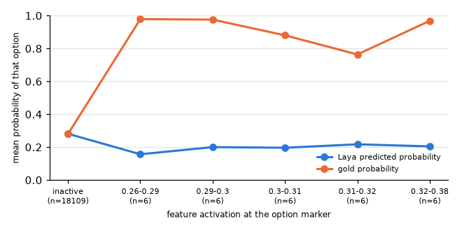

# Feature 13432

Critérios em que aparece: corr_error

**Interpretação (preencher):** 

---

## Maiores ativações

**tr_customer_service_000233 / needs_human** (noul, customer_service) | ativação 6.727 em `estado` | opções ['false', 'true'] | Laya: **true** [0.497, 0.503] | gabarito: **true**

```
[CLS]noul question: This conversation requires a human agent rather than automated handling.[SEP]
▸ [MASK] false: Automation can carry this to resolution.
▸ [MASK] true: A human must take over: judgement, authority or empathy is required.

[SEP]

{"account": {"lifetime_value_usd": 273, "prior_tickets_90d": 2, "seats": 1, "tenure_months": 14, "tier": "free"}, "orders": [{"amount_usd": 29, "date": "2026-02-02", "id": "A-72334", "status": "settled"}, {"amount_usd": 29, "date": "2026-01-16", "id": "A-43421", "status": "settled"}], "thread": [{"role": "customer", "text": "I just opened my delivery and you sent me the wrong replacement part, I ordered the $29 filter kit but I received a pack of gaskets instead. I have an inspection scheduled for tomorrow morning and I absolutely must have the right parts installed by then."}, {"role": "agent", "text": "I'm sorry to hear that the incorrect items were delivered. Could you please provide the order number located on your packing slip so I can check the shipment details?"}, {"role": "customer", "text": "The order number is 44921-A. This is the third time I've had to reach out about shipping errors in the last year and I'm really in a bind here. Is there any way to get the correct filter kit to me today?"}, {"role": "agent", "text": "I've pulled up the order and see the filter kit listed. For our records, could you please describe any labels or SKU numbers visible⟦ on⟧ the packaging of the gaskets you received by mistake?"}, {"role": "customer", "text": "The sticker says G-992-X, but I really don't have time for a back-and-forth investigation. I need to know immediately how we can fix this because the inspector will be here at 9 AM and the system won't pass without those specific filters."}]}[SEP]
```

**tr_customer_service_000233 / action** (choice, customer_service) | ativação 6.684 em `estado` | opções ['answer_directly', 'close_no_action', 'escalate_to_human', 'execute_refund', 'request_information'] | Laya: **close_no_action** [0.231, 0.416, 0.14, 0.084, 0.129] | gabarito: **escalate_to_human**

```
[CLS]choice question: What should the assistant do next with this conversation?[SEP]
▸ [MASK] answer_directly: The assistant can resolve this itself with information it already has.
▸ [MASK] close_no_action: No further action is warranted; the matter is settled.
▸ [MASK] escalate_to_human: Hand off to a human agent with the appropriate authority.
▸ [MASK] execute_refund: Issue the refund or credit the customer is owed.
▸ [MASK] request_information: More detail is needed from the customer before anything can be done.

[SEP]

{"account": {"lifetime_value_usd": 273, "prior_tickets_90d": 2, "seats": 1, "tenure_months": 14, "tier": "free"}, "orders": [{"amount_usd": 29, "date": "2026-02-02", "id": "A-72334", "status": "settled"}, {"amount_usd": 29, "date": "2026-01-16", "id": "A-43421", "status": "settled"}], "thread": [{"role": "customer", "text": "I just opened my delivery and you sent me the wrong replacement part, I ordered the $29 filter kit but I received a pack of gaskets instead. I have an inspection scheduled for tomorrow morning and I absolutely must have the right parts installed by then."}, {"role": "agent", "text": "I'm sorry to hear that the incorrect items were delivered. Could you please provide the order number located on your packing slip so I can check the shipment details?"}, {"role": "customer", "text": "The order number is 44921-A. This is the third time I've had to reach out about shipping errors in the last year and I'm really in a bind here. Is there any way to get the correct filter kit to me today?"}, {"role": "agent", "text": "I've pulled up the order and see the filter kit listed. For our records, could you please describe any labels or SKU numbers visible⟦ on⟧ the packaging of the gaskets you received by mistake?"}, {"role": "customer", "text": "The sticker says G-992-X, but I really don't have time for a back-and-forth investigation. I need to know immediately how we can fix this because the inspector will be here at 9 AM and the system won't pass without those specific filters."}]}[SEP]
```

**tr_customer_service_000233 / category** (choice, customer_service) | ativação 6.641 em `estado` | opções ['account', 'billing', 'delivery', 'refund', 'technical'] | Laya: **delivery** [0.106, 0.174, 0.37, 0.158, 0.192] | gabarito: **delivery**

```
[CLS]choice question: What is this customer conversation primarily about?[SEP]
▸ [MASK] account: Login, plan changes, profile or access management.
▸ [MASK] billing: A charge, invoice, subscription or payment problem.
▸ [MASK] delivery: Shipping, fulfilment or delivery of a physical item.
▸ [MASK] refund: The customer is explicitly asking for money back.
▸ [MASK] technical: The product or service is not working as expected.

[SEP]

{"account": {"lifetime_value_usd": 273, "prior_tickets_90d": 2, "seats": 1, "tenure_months": 14, "tier": "free"}, "orders": [{"amount_usd": 29, "date": "2026-02-02", "id": "A-72334", "status": "settled"}, {"amount_usd": 29, "date": "2026-01-16", "id": "A-43421", "status": "settled"}], "thread": [{"role": "customer", "text": "I just opened my delivery and you sent me the wrong replacement part, I ordered the $29 filter kit but I received a pack of gaskets instead. I have an inspection scheduled for tomorrow morning and I absolutely must have the right parts installed by then."}, {"role": "agent", "text": "I'm sorry to hear that the incorrect items were delivered. Could you please provide the order number located on your packing slip so I can check the shipment details?"}, {"role": "customer", "text": "The order number is 44921-A. This is the third time I've had to reach out about shipping errors in the last year and I'm really in a bind here. Is there any way to get the correct filter kit to me today?"}, {"role": "agent", "text": "I've pulled up the order and see the filter kit listed. For our records, could you please describe any labels or SKU numbers visible⟦ on⟧ the packaging of the gaskets you received by mistake?"}, {"role": "customer", "text": "The sticker says G-992-X, but I really don't have time for a back-and-forth investigation. I need to know immediately how we can fix this because the inspector will be here at 9 AM and the system won't pass without those specific filters."}]}[SEP]
```

**tr_customer_service_000233 / churn_risk** (score, customer_service) | ativação 6.551 em `estado` | opções ['0', '1', '2', '3'] | Laya: **2** [0.203, 0.248, 0.401, 0.147] | gabarito: **2**

```
[CLS]score question: How likely is this customer to stop doing business with us because of this interaction?[SEP]
▸ [MASK] level 0: No sign of dissatisfaction.
▸ [MASK] level 1: Mild frustration, but the relationship is intact.
▸ [MASK] level 2: Clearly unhappy; repeat problems or explicit complaints.
▸ [MASK] level 3: Imminent: threatening to cancel, dispute or leave.

[SEP]

{"account": {"lifetime_value_usd": 273, "prior_tickets_90d": 2, "seats": 1, "tenure_months": 14, "tier": "free"}, "orders": [{"amount_usd": 29, "date": "2026-02-02", "id": "A-72334", "status": "settled"}, {"amount_usd": 29, "date": "2026-01-16", "id": "A-43421", "status": "settled"}], "thread": [{"role": "customer", "text": "I just opened my delivery and you sent me the wrong replacement part, I ordered the $29 filter kit but I received a pack of gaskets instead. I have an inspection scheduled for tomorrow morning and I absolutely must have the right parts installed by then."}, {"role": "agent", "text": "I'm sorry to hear that the incorrect items were delivered. Could you please provide the order number located on your packing slip so I can check the shipment details?"}, {"role": "customer", "text": "The order number is 44921-A. This is the third time I've had to reach out about shipping errors in the last year and I'm really in a bind here. Is there any way to get the correct filter kit to me today?"}, {"role": "agent", "text": "I've pulled up the order and see the filter kit listed. For our records, could you please describe any labels or SKU numbers visible⟦ on⟧ the packaging of the gaskets you received by mistake?"}, {"role": "customer", "text": "The sticker says G-992-X, but I really don't have time for a back-and-forth investigation. I need to know immediately how we can fix this because the inspector will be here at 9 AM and the system won't pass without those specific filters."}]}[SEP]
```

**tr_customer_service_000233 / urgency** (score, customer_service) | ativação 6.523 em `estado` | opções ['0', '1', '2', '3'] | Laya: **1** [0.1, 0.527, 0.151, 0.222] | gabarito: **3**

```
[CLS]score question: How time-sensitive is this conversation?[SEP]
▸ [MASK] level 0: No time pressure; can wait indefinitely.
▸ [MASK] level 1: Routine; handle within the normal queue.
▸ [MASK] level 2: Elevated; should be handled within the same week.
▸ [MASK] level 3: Critical; requires action within the same day.

[SEP]

{"account": {"lifetime_value_usd": 273, "prior_tickets_90d": 2, "seats": 1, "tenure_months": 14, "tier": "free"}, "orders": [{"amount_usd": 29, "date": "2026-02-02", "id": "A-72334", "status": "settled"}, {"amount_usd": 29, "date": "2026-01-16", "id": "A-43421", "status": "settled"}], "thread": [{"role": "customer", "text": "I just opened my delivery and you sent me the wrong replacement part, I ordered the $29 filter kit but I received a pack of gaskets instead. I have an inspection scheduled for tomorrow morning and I absolutely must have the right parts installed by then."}, {"role": "agent", "text": "I'm sorry to hear that the incorrect items were delivered. Could you please provide the order number located on your packing slip so I can check the shipment details?"}, {"role": "customer", "text": "The order number is 44921-A. This is the third time I've had to reach out about shipping errors in the last year and I'm really in a bind here. Is there any way to get the correct filter kit to me today?"}, {"role": "agent", "text": "I've pulled up the order and see the filter kit listed. For our records, could you please describe any labels or SKU numbers visible⟦ on⟧ the packaging of the gaskets you received by mistake?"}, {"role": "customer", "text": "The sticker says G-992-X, but I really don't have time for a back-and-forth investigation. I need to know immediately how we can fix this because the inspector will be here at 9 AM and the system won't pass without those specific filters."}]}[SEP]
```

## Ativações medianas (faixa 40-60%, mediana 1.602)

**tr_customer_service_000120 / action** (choice, customer_service) | ativação 1.474 em `estado` | opções ['answer_directly', 'close_no_action', 'escalate_to_human', 'execute_refund', 'request_information'] | Laya: **close_no_action** [0.207, 0.234, 0.119, 0.224, 0.216] | gabarito: **escalate_to_human**

```
[CLS]choice question: What should the assistant do next with this conversation?[SEP]
▸ [MASK] answer_directly: The assistant can resolve this itself with information it already has.
▸ [MASK] close_no_action: No further action is warranted; the matter is settled.
▸ [MASK] escalate_to_human: Hand off to a human agent with the appropriate authority.
▸ [MASK] execute_refund: Issue the refund or credit the customer is owed.
▸ [MASK] request_information: More detail is needed from the customer before anything can be done.

[SEP]

{"account": {"lifetime_value_usd": 683, "prior_tickets_90d": 2, "seats": 1, "tenure_months": 8, "tier": "premium"}, "orders": [{"amount_usd": 29, "date": "2026-03-13", "id": "A-34569", "status": "pending"}, {"amount_usd": 29, "date": "2026-02-22", "id": "A-11297", "status": "refunded"}, {"amount_usd": 29, "date": "2026-01-21", "id": "A-20004", "status": "failed"}], "thread": [{"role": "customer", "text": "I am trying to remove two seats⟦ from⟧ my Premium plan, but the dashboard still shows them as active and billable for the next cycle. I've been a customer for eight months and this is the third time I've had to report this exact issue with the $29 per seat charge."}, {"role": "agent", "text": "I can certainly look into those seat settings for you. To clarify, are these seats currently assigned to specific users, or are they currently vacant in your dashboard?"}, {"role": "customer", "text": "They are vacant. I unassigned the users last week, but the total seat count refuses to decrease when I try to update the subscription preferences."}, {"role": "agent", "text": "Thank you for that detail. When you attempt to reduce the count, are you receiving a specific error message, or does the page simply refresh without saving the changes?"}, {"role": "customer", "text": "The page just refreshes. I've already had two tickets about this in the past that were resolved temporarily, but the bug seems to have returned."}, {"role": "agent", "text": "I see the history here in your account. Could you please provide a screenshot of the billing page as it appears now so I can verify the current seat allocation against our backend records?"}, {"role": "customer", "text": "I'll attach the screenshot now. I just need to ensure I am not billed for these two extra seats again because I shouldn't be paying for capacity I'm not using."}]}[SEP]
```

**tr_customer_service_000112 / needs_human** (noul, customer_service) | ativação 1.708 em `estado` | opções ['false', 'true'] | Laya: **true** [0.466, 0.534] | gabarito: **true**

```
[CLS]noul question: This conversation requires a human agent rather than automated handling.[SEP]
▸ [MASK] false: Automation can carry this to resolution.
▸ [MASK] true: A human must take over: judgement, authority or empathy is required.

[SEP]

{"account": {"lifetime_value_usd": 2088, "prior_tickets_90d": 5, "seats": 5, "tenure_months": 72, "tier": "premium"}, "thread": [{"role": "customer", "text": "I'm looking⟦ at⟧ my bank statement and I see two separate charges for my premium subscription again. This is the sixth time I've had to reach out about this specific double-billing issue, and I'm just tired of having to repeat the same conversation every month."}, {"role": "agent", "text": "I'm sorry to hear that you're seeing a duplicate transaction on your account again. To help me investigate, could you please confirm if both charges appeared on the same date?"}, {"role": "customer", "text": "They both showed up on the 14th. I've been a customer for six years and I really expected that after five previous tickets, someone would have found a permanent solution to stop this from happening."}, {"role": "agent", "text": "I appreciate your long-standing loyalty to our service. I'm looking into your billing history now; are you seeing two different invoice numbers in your account portal, or just one?"}, {"role": "customer", "text": "There is only one invoice listed in the portal, but the money has definitely left my account twice. I just want to know why this keeps recurring when I was told last month it was finally handled."}]}[SEP]
```

**tr_security_incidents_000243 / urgency** (score, security_incidents) | ativação 1.536 em `estado` | opções ['0', '1', '2', '3'] | Laya: **1** [0.093, 0.646, 0.105, 0.156] | gabarito: **2**

```
[CLS]score question: How quickly must a responder act on this alert?[SEP]
▸ [MASK] level 0: No time pressure; can wait indefinitely.
▸ [MASK] level 1: Routine; handle within the normal queue.
▸ [MASK] level 2: Elevated; should be handled within the same week.
▸ [MASK] level 3: Critical; requires action within the same day.

[SEP]

{"alert": {"description": "audit logging was turned off⟦ on⟧ a host", "evidence": "At 2026-09-15 02:13:47 UTC the audit logging service on host WIN-3A9B2C was disabled by modifying the registry key HKLM\\SYSTEM\\CurrentControlSet\\Services\\EventLog; the change was performed by the shared mailbox account \"shared_mailbox@contoso.com\" from IP 203.0.113.45, which is not listed in the known source inventory. The account has MFA enabled, is classified as unprivileged, the change occurred within an open change window, and its credentials were last rotated 30 days ago.", "rule": "disabled_logging"}, "context": {"asset_criticality": "medium", "change_window_active": true, "source_on_allowlist": false}, "history": {"credential_rotation_days_ago": 30, "distinct_countries_30d": 1, "logins_30d": 766, "prior_alerts_90d": 0}, "principal": {"mfa_enrolled": true, "name": "usr-infra-962", "privileges": ["repo:read"], "type": "shared_mailbox"}}[SEP]
```

**tr_security_incidents_000149 / severity** (score, security_incidents) | ativação 1.493 em `estado` | opções ['0', '1', '2', '3', '4'] | Laya: **2** [0.03, 0.258, 0.384, 0.297, 0.031] | gabarito: **4**

```
[CLS]score question: How severe is the potential impact if this alert is real?[SEP]
▸ [MASK] level 0: Negligible: no access to anything sensitive.
▸ [MASK] level 1: Low: limited access, easily reversed.
▸ [MASK] level 2: Moderate: access to internal systems or non-public data.
▸ [MASK] level 3: High: access to production, secrets or customer data.
▸ [MASK] level 4: Critical: active compromise of crown-jewel systems.

[SEP]

{"alert": {"description": "an account granted itself or received elevated permissions", "evidence": "A privilege change was recorded at 2026-09-16 08:09:12 UTC where user \"ADMIN_JONES\" was added to the \"Domain Admins\" group⟦ on⟧ the domain controller. The account already has privileged status, MFA is enabled, but the source of the request originates from an unrecognized endpoint; the credentials for this account were last rotated 14 days prior and the activity fell outside any scheduled change window.", "rule": "privilege_escalation"}, "context": {"asset_criticality": "low", "change_window_active": false, "source_on_allowlist": false}, "history": {"credential_rotation_days_ago": 14, "distinct_countries_30d": 4, "logins_30d": 1034, "prior_alerts_90d": 0}, "principal": {"mfa_enrolled": true, "name": "ci-analytics-841", "privileges": ["deploy:production", "secrets:read"], "type": "admin"}}[SEP]
```

**tr_customer_service_000127 / needs_human** (noul, customer_service) | ativação 1.442 em `estado` | opções ['false', 'true'] | Laya: **true** [0.437, 0.563] | gabarito: **true**

```
[CLS]noul question: This conversation requires a human agent rather than automated handling.[SEP]
▸ [MASK] false: Automation can carry this to resolution.
▸ [MASK] true: A human must take over: judgement, authority or empathy is required.

[SEP]

{"account": {"lifetime_value_usd": 283, "prior_tickets_90d": 1, "seats": 1, "tenure_months": 3, "tier": "premium"}, "orders": [{"amount_usd": 38, "date": "2026-03-03", "id": "A-56312", "status": "failed"}, {"amount_usd": 38, "date": "2026-01-05", "id": "A-75782", "status": "failed"}], "thread": [{"role": "customer", "text": "I’m still seeing the same sluggishness⟦ in⟧ the dashboard, even after the last ticket where you promised a fix. It’s really holding us up."}, {"role": "agent", "text": "I’m sorry you’re experiencing that. Could you tell me which parts of the dashboard are loading slowly?"}, {"role": "customer", "text": "The main analytics view takes ages to render, and with our deadline coming up I can’t afford the delay."}]}[SEP]
```

## Estatísticas (conjunto de descoberta, dev e teste)

**pred / error**

| split | decisões | ativas | ativas e Laya errou | taxa | lift | q (BH) | OR (CMH) | q (CMH) |
|---|---|---|---|---|---|---|---|---|
| discovery | 5100 | 0 | 0 | nan | nan | nan | nan | nan |
| dev | 900 | 0 | 0 | nan | nan | nan | nan | nan |
| test | 2000 | 0 | 0 | nan | nan | nan | nan | nan |

**corr / error**

| split | decisões | ativas | ativas e Laya errou | taxa | lift | q (BH) | OR (CMH) | q (CMH) |
|---|---|---|---|---|---|---|---|---|
| discovery | 5100 | 27 | 27 | 1.000 | 1.57 | 1.73e-05 | inf | 0.834 |
| dev | 900 | 7 | 7 | 1.000 | 1.52 | nan | nan | nan |
| test | 2000 | 9 | 9 | 1.000 | 1.57 | nan | nan | nan |

**state / error**

| split | decisões | ativas | ativas e Laya errou | taxa | lift | q (BH) | OR (CMH) | q (CMH) |
|---|---|---|---|---|---|---|---|---|
| discovery | 5100 | 810 | 511 | 0.631 | 0.99 | 0.931 | 1.38 | 0.0037 |
| dev | 900 | 107 | 69 | 0.645 | 0.98 | 1 | 1.22 | 0.696 |
| test | 2000 | 352 | 221 | 0.628 | 0.99 | 0.999 | 1.15 | 0.589 |

Confusão mais sobre-representada (corr): `duplicate|1>0` (n=27, lift 23.61, p=1.66e-38). Formato `pergunta|índice previsto>índice correto`.

Confusão mais sobre-representada (state): `action|1>2` (n=51, lift 2.57, p=1.18e-11). Formato `pergunta|índice previsto>índice correto`.



