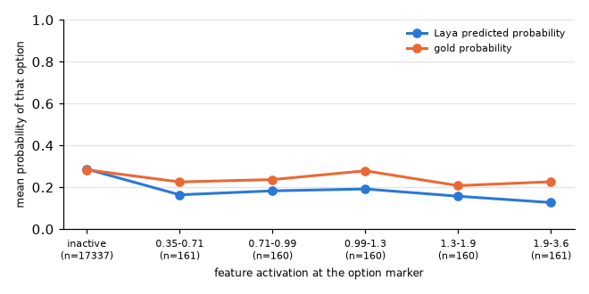

# Feature 13523

Critérios em que aparece: pred_error_stratified, corr_error_stratified

**Interpretação (preencher):** 

---

## Maiores ativações

**tr_customer_service_000023 / category** (choice, customer_service) | ativação 6.656 em `opção` | opções ['account', 'billing', 'delivery', 'refund', 'technical'] | Laya: **account** [0.29, 0.171, 0.105, 0.194, 0.24] | gabarito: **technical**

```
[CLS]choice question: What is this customer conversation primarily about?[SEP]
▸ [MASK] account: Login, plan changes, profile or access management.
▸ [MASK] billing: A charge, invoice, subscription or payment problem.
▸ [MASK] delivery: Shipping⟦,⟧ fulfilment or delivery of a physical item.
▸ [MASK] refund: The customer is explicitly asking for money back.
▸ [MASK] technical: The product or service is not working as expected.

[SEP]

{"account": {"lifetime_value_usd": 95, "prior_tickets_90d": 5, "seats": 1, "tenure_months": 5, "tier": "standard"}, "orders": [{"amount_usd": 149, "date": "2026-01-14", "id": "A-64525", "status": "failed"}], "thread": [{"role": "customer", "text": "My dashboard has been sluggish for the past day, and I’m not sure what’s causing it. The pages take forever to load."}, {"role": "agent", "text": "I hear you—that slowdown can be frustrating. When did you first notice the performance drop?"}, {"role": "customer", "text": "It started yesterday after the latest system update. Some screens now take about 30 seconds to render."}, {"role": "agent", "text": "Understood. Have you observed any error messages or console warnings while the pages load slowly?"}, {"role": "customer", "text": "No error dialogs, just a blank loading spinner that never disappears. I’d appreciate any insight you can share."}]}[SEP]
```

**tr_customer_service_000239 / category** (choice, customer_service) | ativação 6.348 em `opção` | opções ['account', 'billing', 'delivery', 'refund', 'technical'] | Laya: **technical** [0.274, 0.136, 0.121, 0.186, 0.282] | gabarito: **account**

```
[CLS]choice question: What is this customer conversation primarily about?[SEP]
▸ [MASK] account: Login, plan changes, profile or access management.
▸ [MASK] billing: A charge, invoice, subscription or payment problem.
▸ [MASK] delivery: Shipping⟦,⟧ fulfilment or delivery of a physical item.
▸ [MASK] refund: The customer is explicitly asking for money back.
▸ [MASK] technical: The product or service is not working as expected.

[SEP]

{"account": {"lifetime_value_usd": 672, "prior_tickets_90d": 5, "seats": 40, "tenure_months": 11, "tier": "enterprise"}, "orders": [{"amount_usd": 19, "date": "2026-03-14", "id": "A-50305", "status": "settled"}, {"amount_usd": 19, "date": "2026-02-11", "id": "A-78147", "status": "failed"}, {"amount_usd": 19, "date": "2026-02-26", "id": "A-68714", "status": "settled"}], "thread": [{"role": "customer", "text": "I’ve decided to downgrade my plan. I’ve reached out five times before about these billing issues, and at this point, I’m just tired of dealing with it."}, {"role": "agent", "text": "I am sorry to hear you've had such a difficult experience with us. Before I process that change, could you clarify which tier you would like to move to?"}, {"role": "customer", "text": "Just the basic tier. I’ve been here for eleven months, but I don’t think the enterprise features are worth the ongoing headache."}]}[SEP]
```

**tr_customer_service_000058 / category** (choice, customer_service) | ativação 6.277 em `opção` | opções ['account', 'billing', 'delivery', 'refund', 'technical'] | Laya: **refund** [0.226, 0.125, 0.142, 0.282, 0.224] | gabarito: **account**

```
[CLS]choice question: What is this customer conversation primarily about?[SEP]
▸ [MASK] account: Login, plan changes, profile or access management.
▸ [MASK] billing: A charge, invoice, subscription or payment problem.
▸ [MASK] delivery: Shipping⟦,⟧ fulfilment or delivery of a physical item.
▸ [MASK] refund: The customer is explicitly asking for money back.
▸ [MASK] technical: The product or service is not working as expected.

[SEP]

{"account": {"lifetime_value_usd": 386, "prior_tickets_90d": 0, "seats": 3, "tenure_months": 5, "tier": "enterprise"}, "orders": [{"amount_usd": 49, "date": "2026-03-18", "id": "A-70177", "status": "refunded"}, {"amount_usd": 49, "date": "2026-01-12", "id": "A-80512", "status": "refunded"}, {"amount_usd": 49, "date": "2026-03-04", "id": "A-71911", "status": "failed"}], "thread": [{"role": "customer", "text": "I’d like to request a data export from our account; I’m not in a rush, just need to know the steps."}, {"role": "agent", "text": "Sure thing. Which format would you prefer for the export?"}, {"role": "customer", "text": "CSV works for us. Also, could you tell me roughly how long the process takes?"}, {"role": "agent", "text": "I’ll check on the timing. Do you need the export for a specific date range?"}, {"role": "customer", "text": "Just the last month up to today, and I understand it may not be immediate."}, {"role": "agent", "text": "Thanks for confirming. I’ll queue the request and let you know when it’s ready. Anything else you’d like to add?"}, {"role": "customer", "text": "That’s all for now, thank you."}]}[SEP]
```

**tr_customer_service_000047 / category** (choice, customer_service) | ativação 6.273 em `opção` | opções ['account', 'billing', 'delivery', 'refund', 'technical'] | Laya: **account** [0.263, 0.217, 0.086, 0.211, 0.223] | gabarito: **billing**

```
[CLS]choice question: What is this customer conversation primarily about?[SEP]
▸ [MASK] account: Login, plan changes, profile or access management.
▸ [MASK] billing: A charge, invoice, subscription or payment problem.
▸ [MASK] delivery: Shipping⟦,⟧ fulfilment or delivery of a physical item.
▸ [MASK] refund: The customer is explicitly asking for money back.
▸ [MASK] technical: The product or service is not working as expected.

[SEP]

{"account": {"lifetime_value_usd": 88, "prior_tickets_90d": 1, "seats": 3, "tenure_months": 3, "tier": "enterprise"}, "orders": [{"amount_usd": 99, "date": "2026-02-21", "id": "A-23500", "status": "pending"}, {"amount_usd": 99, "date": "2026-03-06", "id": "A-63279", "status": "settled"}], "thread": [{"role": "customer", "text": "Our enterprise account just hit a payment snag and the charge was rejected—this is urgent, we can’t afford downtime."}, {"role": "agent", "text": "I see. Could you provide the transaction reference number and the email address associated with the account?"}, {"role": "customer", "text": "The reference is TXN‑938274, email is billing@mycompany.com, and the card was declined instantly. We need this cleared right away."}]}[SEP]
```

**tr_customer_service_000187 / category** (choice, customer_service) | ativação 6.266 em `opção` | opções ['account', 'billing', 'delivery', 'refund', 'technical'] | Laya: **account** [0.275, 0.143, 0.11, 0.24, 0.232] | gabarito: **technical**

```
[CLS]choice question: What is this customer conversation primarily about?[SEP]
▸ [MASK] account: Login, plan changes, profile or access management.
▸ [MASK] billing: A charge, invoice, subscription or payment problem.
▸ [MASK] delivery: Shipping⟦,⟧ fulfilment or delivery of a physical item.
▸ [MASK] refund: The customer is explicitly asking for money back.
▸ [MASK] technical: The product or service is not working as expected.

[SEP]

{"account": {"lifetime_value_usd": 1666, "prior_tickets_90d": 0, "seats": 1, "tenure_months": 49, "tier": "standard"}, "orders": [{"amount_usd": 447, "date": "2026-01-13", "id": "A-73036", "status": "settled"}, {"amount_usd": 447, "date": "2026-01-14", "id": "A-19724", "status": "refunded"}], "thread": [{"role": "customer", "text": "The seat allocation tool is a joke—my team can’t add anyone new and you keep throwing error code 502 at us!"}, {"role": "agent", "text": "I’m sorry the seat manager is failing you. Can you tell me exactly which action triggers the 502 response, and if you see any additional message details?"}, {"role": "customer", "text": "Every time I click ‘Add seat’ after typing the email it just crashes; I’ve tried it on Chrome and Firefox, same garbage."}, {"role": "agent", "text": "Thanks for the specifics. To investigate further, could you share the email addresses you attempted to add and the timestamps of those attempts?"}, {"role": "customer", "text": "We tried john.smith@company.com at 10:15 AM and lisa.brown@company.com at 10:17 AM today, and both blew up. This is delaying a project worth thousands."}, {"role": "agent", "text": "I’ve noted those details. While I can’t fix it instantly, I’ll forward this to our engineering squad. Meanwhile, could you confirm whether any other admin users are experiencing the same issue?"}, {"role": "customer", "text": "All of our admins get the same error, so it’s clearly a system problem—not just my account."}]}[SEP]
```

## Ativações medianas (faixa 40-60%, mediana 1.696)

**tr_customer_service_000288 / category** (choice, customer_service) | ativação 1.978 em `opção` | opções ['account', 'billing', 'delivery', 'refund', 'technical'] | Laya: **billing** [0.069, 0.629, 0.021, 0.22, 0.061] | gabarito: **refund**

```
[CLS]choice question: What is this customer conversation primarily about?[SEP]
▸ [MASK] account: Login, plan changes, profile or access management.
▸ [MASK] billing: A charge, invoice, subscription⟦ or⟧ payment problem.
▸ [MASK] delivery: Shipping, fulfilment or delivery of a physical item.
▸ [MASK] refund: The customer is explicitly asking for money back.
▸ [MASK] technical: The product or service is not working as expected.

[SEP]

{"account": {"lifetime_value_usd": 34, "prior_tickets_90d": 0, "seats": 1, "tenure_months": 2, "tier": "standard"}, "orders": [{"amount_usd": 999, "date": "2026-01-10", "id": "A-86378", "status": "settled"}], "thread": [{"role": "customer", "text": "I’m looking at my recent bank statement and there's a charge for $999, but I'm really confused because I thought I already requested a refund on my standard plan last week, so I'm not sure if I did it correctly or if it's just taking a while to show up?"}]}[SEP]
```

**tr_customer_service_000171 / category** (choice, customer_service) | ativação 1.586 em `opção` | opções ['account', 'billing', 'delivery', 'refund', 'technical'] | Laya: **refund** [0.254, 0.13, 0.141, 0.272, 0.203] | gabarito: **technical**

```
[CLS]choice question: What is this customer conversation primarily about?[SEP]
▸ [MASK] account: Login, plan changes, profile or access management.
▸ [MASK] billing: A charge, invoice, subscription or payment problem.
▸ [MASK] delivery: Shipping, fulfilment or delivery of a physical item.
▸ [MASK] refund: The customer is explicitly asking for money back⟦.⟧
▸ [MASK] technical: The product or service is not working as expected.

[SEP]

{"account": {"lifetime_value_usd": 2300, "prior_tickets_90d": 0, "seats": 1, "tenure_months": 26, "tier": "standard"}, "orders": [{"amount_usd": 49, "date": "2026-02-14", "id": "A-88180", "status": "refunded"}, {"amount_usd": 49, "date": "2026-02-22", "id": "A-79800", "status": "settled"}, {"amount_usd": 49, "date": "2026-02-08", "id": "A-91927", "status": "refunded"}], "thread": [{"role": "customer", "text": "The service is painfully slow right now—I'm on a deadline and can't get anything done."}, {"role": "agent", "text": "I hear the urgency. Can you tell me which device and operating system you’re using?"}, {"role": "customer", "text": "It’s a Windows 10 desktop, and the slowdown started after the latest update."}, {"role": "agent", "text": "Thanks for the details. Have you tried clearing the application cache or restarting the app?"}, {"role": "customer", "text": "Yes, I cleared everything and rebooted, but it’s still crawling. I need this resolved quickly."}]}[SEP]
```

**tr_customer_service_000234 / category** (choice, customer_service) | ativação 1.690 em `opção` | opções ['account', 'billing', 'delivery', 'refund', 'technical'] | Laya: **technical** [0.253, 0.078, 0.047, 0.223, 0.398] | gabarito: **account**

```
[CLS]choice question: What is this customer conversation primarily about?[SEP]
▸ [MASK] account: Login, plan changes, profile or access management.
▸ [MASK] billing:⟦ A⟧ charge, invoice, subscription or payment problem.
▸ [MASK] delivery: Shipping, fulfilment or delivery of a physical item.
▸ [MASK] refund: The customer is explicitly asking for money back.
▸ [MASK] technical: The product or service is not working as expected.

[SEP]

{"account": {"lifetime_value_usd": 1458, "prior_tickets_90d": 0, "seats": 3, "tenure_months": 33, "tier": "premium"}, "thread": [{"role": "customer", "text": "I’ve been paying for this premium plan for 33 months without a single hitch, but now I’m completely locked out and I have a hard deadline in two hours. Why is the login screen just spinning?"}, {"role": "agent", "text": "I’m sorry to hear you're experiencing this frustration right now. Could you please confirm the exact error message or code you are seeing when the page hangs?"}, {"role": "customer", "text": "There is no code! It’s just a blank page after I enter my credentials. I have a massive report due for my firm by noon and I can’t get in to export the data. This is ridiculous."}, {"role": "agent", "text": "I understand the urgency of this report. To help me narrow down the cause, are you accessing the portal through a browser or our desktop application?"}, {"role": "customer", "text": "I’m using Chrome on my desktop. I’ve already cleared my cache and tried an incognito window, so don't even suggest that. Fix this now."}]}[SEP]
```

**tr_customer_service_000004 / category** (choice, customer_service) | ativação 1.525 em `opção` | opções ['account', 'billing', 'delivery', 'refund', 'technical'] | Laya: **refund** [0.122, 0.051, 0.019, 0.672, 0.136] | gabarito: **account**

```
[CLS]choice question: What is this customer conversation primarily about?[SEP]
▸ [MASK] account: Login, plan changes, profile⟦ or⟧ access management.
▸ [MASK] billing: A charge, invoice, subscription or payment problem.
▸ [MASK] delivery: Shipping, fulfilment or delivery of a physical item.
▸ [MASK] refund: The customer is explicitly asking for money back.
▸ [MASK] technical: The product or service is not working as expected.

[SEP]

{"account": {"lifetime_value_usd": 3018, "prior_tickets_90d": 1, "seats": 1, "tenure_months": 60, "tier": "premium"}, "orders": [{"amount_usd": 147, "date": "2026-02-10", "id": "A-12312", "status": "settled"}, {"amount_usd": 147, "date": "2026-02-24", "id": "A-70365", "status": "refunded"}], "thread": [{"role": "customer", "text": "I'm back again because I still can't get into my account, and honestly, after the last ticket didn't go anywhere, I'm just expecting more of the same login loops."}]}[SEP]
```

**tr_customer_service_000146 / category** (choice, customer_service) | ativação 1.973 em `opção` | opções ['account', 'billing', 'delivery', 'refund', 'technical'] | Laya: **billing** [0.097, 0.544, 0.045, 0.255, 0.059] | gabarito: **billing**

```
[CLS]choice question: What is this customer conversation primarily about?[SEP]
▸ [MASK] account: Login, plan changes, profile or access management.
▸ [MASK] billing: A charge, invoice, subscription⟦ or⟧ payment problem.
▸ [MASK] delivery: Shipping, fulfilment or delivery of a physical item.
▸ [MASK] refund: The customer is explicitly asking for money back.
▸ [MASK] technical: The product or service is not working as expected.

[SEP]

{"account": {"lifetime_value_usd": 114, "prior_tickets_90d": 0, "seats": 12, "tenure_months": 2, "tier": "premium"}, "thread": [{"role": "customer", "text": "Good afternoon, could you please send me a copy of my most recent invoice? I’m on the Premium plan and have only been a customer for two months, so I need it for my records."}, {"role": "agent", "text": "Certainly, I can help with that. Which invoice are you looking for—the one from May or the one from June 2026?"}, {"role": "customer", "text": "I need the June 2026 invoice, please."}]}[SEP]
```

## Estatísticas (conjunto de descoberta, dev e teste)

**pred / error**

| split | decisões | ativas | ativas e Laya errou | taxa | lift | q (BH) | OR (CMH) | q (CMH) |
|---|---|---|---|---|---|---|---|---|
| discovery | 5100 | 86 | 61 | 0.709 | 1.11 | 0.26 | 3.92 | 0.000226 |
| dev | 900 | 9 | 4 | 0.444 | 0.68 | nan | nan | nan |
| test | 2000 | 37 | 20 | 0.541 | 0.85 | 0.382 | 4.31 | 0.0925 |

**corr / error**

| split | decisões | ativas | ativas e Laya errou | taxa | lift | q (BH) | OR (CMH) | q (CMH) |
|---|---|---|---|---|---|---|---|---|
| discovery | 5100 | 204 | 179 | 0.877 | 1.38 | 1.82e-14 | 6.09 | 5.68e-10 |
| dev | 900 | 28 | 23 | 0.821 | 1.25 | 0.126 | 34.50 | 0.0164 |
| test | 2000 | 85 | 68 | 0.800 | 1.26 | 0.00225 | 3.31 | 0.0234 |

**state / error**

| split | decisões | ativas | ativas e Laya errou | taxa | lift | q (BH) | OR (CMH) | q (CMH) |
|---|---|---|---|---|---|---|---|---|
| discovery | 5100 | 127 | 73 | 0.575 | 0.90 | 0.463 | 1.36 | 0.264 |
| dev | 900 | 21 | 11 | 0.524 | 0.80 | 1 | 0.84 | 0.876 |
| test | 2000 | 43 | 27 | 0.628 | 0.99 | 1 | 1.60 | 0.385 |

Confusão mais sobre-representada (pred): `category|0>4` (n=15, lift 46.82, p=2.6e-24). Formato `pergunta|índice previsto>índice correto`.

Confusão mais sobre-representada (corr): `action|1>2` (n=62, lift 12.40, p=0). Formato `pergunta|índice previsto>índice correto`.

Confusão mais sobre-representada (state): `category|0>4` (n=10, lift 21.14, p=4.91e-12). Formato `pergunta|índice previsto>índice correto`.



