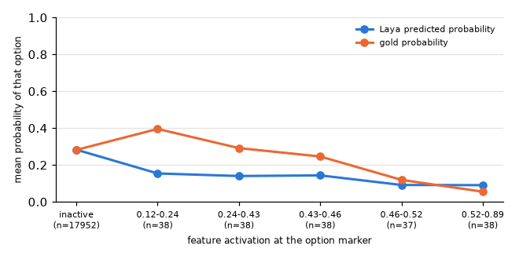

# Feature 13741

Critérios em que aparece: corr_error

**Interpretação (preencher):** 

---

## Maiores ativações

**tr_customer_service_000031 / churn_risk** (score, customer_service) | ativação 2.732 em `estado` | opções ['0', '1', '2', '3'] | Laya: **1** [0.213, 0.446, 0.182, 0.159] | gabarito: **1**

```
[CLS]score question: How likely is this customer to stop doing business with us because of this interaction?[SEP]
▸ [MASK] level 0: No sign of dissatisfaction.
▸ [MASK] level 1: Mild frustration, but the relationship is intact.
▸ [MASK] level 2: Clearly unhappy; repeat problems or explicit complaints.
▸ [MASK] level 3: Imminent: threatening to cancel, dispute or leave.

[SEP]

{"account": {"lifetime_value_usd": 581, "prior_tickets_90d": 0, "seats": 3, "tenure_months": 14, "tier": "enterprise"}, "thread": [{"role": "customer", "text": "I noticed two identical charges on my bank statement for this month's enterprise subscription. I suppose I'm not surprised, but I'd like to know why this happened."}, {"role": "agent", "text": "I am sorry to hear that you are seeing duplicate charges. To help me investigate this further, could you please share the transaction IDs associated with those charges?"}, {"role": "customer", "text": "I'm not sure where to find those IDs. I just see the two lines on my dashboard history that match the ones on my bank app."}, {"role": "agent", "text": "No problem at all. If you could⟦ send⟧ over a screenshot of your billing history page or the exact timestamps listed for those two transactions, I can start looking into the account logs."}, {"role": "customer", "text": "Here is the screenshot. It’s the same amount charged twice on the same day, which seems like a bit of a mess."}, {"role": "agent", "text": "Thank you for attaching that file. I’ve received the document, and I’m going to begin reviewing our payment processing records to see how these entries were generated."}, {"role": "customer", "text": "Alright, let me know what you find whenever you get around to it, I guess."}]}[SEP]
```

**tr_customer_service_000031 / action** (choice, customer_service) | ativação 2.682 em `estado` | opções ['answer_directly', 'close_no_action', 'escalate_to_human', 'execute_refund', 'request_information'] | Laya: **close_no_action** [0.203, 0.349, 0.197, 0.107, 0.144] | gabarito: **escalate_to_human**

```
[CLS]choice question: What should the assistant do next with this conversation?[SEP]
▸ [MASK] answer_directly: The assistant can resolve this itself with information it already has.
▸ [MASK] close_no_action: No further action is warranted; the matter is settled.
▸ [MASK] escalate_to_human: Hand off to a human agent with the appropriate authority.
▸ [MASK] execute_refund: Issue the refund or credit the customer is owed.
▸ [MASK] request_information: More detail is needed from the customer before anything can be done.

[SEP]

{"account": {"lifetime_value_usd": 581, "prior_tickets_90d": 0, "seats": 3, "tenure_months": 14, "tier": "enterprise"}, "thread": [{"role": "customer", "text": "I noticed two identical charges on my bank statement for this month's enterprise subscription. I suppose I'm not surprised, but I'd like to know why this happened."}, {"role": "agent", "text": "I am sorry to hear that you are seeing duplicate charges. To help me investigate this further, could you please share the transaction IDs associated with those charges?"}, {"role": "customer", "text": "I'm not sure where to find those IDs. I just see the two lines on my dashboard history that match the ones on my bank app."}, {"role": "agent", "text": "No problem at all. If you could⟦ send⟧ over a screenshot of your billing history page or the exact timestamps listed for those two transactions, I can start looking into the account logs."}, {"role": "customer", "text": "Here is the screenshot. It’s the same amount charged twice on the same day, which seems like a bit of a mess."}, {"role": "agent", "text": "Thank you for attaching that file. I’ve received the document, and I’m going to begin reviewing our payment processing records to see how these entries were generated."}, {"role": "customer", "text": "Alright, let me know what you find whenever you get around to it, I guess."}]}[SEP]
```

**tr_customer_service_000031 / urgency** (score, customer_service) | ativação 2.664 em `estado` | opções ['0', '1', '2', '3'] | Laya: **1** [0.173, 0.462, 0.16, 0.205] | gabarito: **1**

```
[CLS]score question: How time-sensitive is this conversation?[SEP]
▸ [MASK] level 0: No time pressure; can wait indefinitely.
▸ [MASK] level 1: Routine; handle within the normal queue.
▸ [MASK] level 2: Elevated; should be handled within the same week.
▸ [MASK] level 3: Critical; requires action within the same day.

[SEP]

{"account": {"lifetime_value_usd": 581, "prior_tickets_90d": 0, "seats": 3, "tenure_months": 14, "tier": "enterprise"}, "thread": [{"role": "customer", "text": "I noticed two identical charges on my bank statement for this month's enterprise subscription. I suppose I'm not surprised, but I'd like to know why this happened."}, {"role": "agent", "text": "I am sorry to hear that you are seeing duplicate charges. To help me investigate this further, could you please share the transaction IDs associated with those charges?"}, {"role": "customer", "text": "I'm not sure where to find those IDs. I just see the two lines on my dashboard history that match the ones on my bank app."}, {"role": "agent", "text": "No problem at all. If you could⟦ send⟧ over a screenshot of your billing history page or the exact timestamps listed for those two transactions, I can start looking into the account logs."}, {"role": "customer", "text": "Here is the screenshot. It’s the same amount charged twice on the same day, which seems like a bit of a mess."}, {"role": "agent", "text": "Thank you for attaching that file. I’ve received the document, and I’m going to begin reviewing our payment processing records to see how these entries were generated."}, {"role": "customer", "text": "Alright, let me know what you find whenever you get around to it, I guess."}]}[SEP]
```

**tr_customer_service_000031 / category** (choice, customer_service) | ativação 2.590 em `estado` | opções ['account', 'billing', 'delivery', 'refund', 'technical'] | Laya: **billing** [0.174, 0.301, 0.057, 0.227, 0.241] | gabarito: **billing**

```
[CLS]choice question: What is this customer conversation primarily about?[SEP]
▸ [MASK] account: Login, plan changes, profile or access management.
▸ [MASK] billing: A charge, invoice, subscription or payment problem.
▸ [MASK] delivery: Shipping, fulfilment or delivery of a physical item.
▸ [MASK] refund: The customer is explicitly asking for money back.
▸ [MASK] technical: The product or service is not working as expected.

[SEP]

{"account": {"lifetime_value_usd": 581, "prior_tickets_90d": 0, "seats": 3, "tenure_months": 14, "tier": "enterprise"}, "thread": [{"role": "customer", "text": "I noticed two identical charges on my bank statement for this month's enterprise subscription. I suppose I'm not surprised, but I'd like to know why this happened."}, {"role": "agent", "text": "I am sorry to hear that you are seeing duplicate charges. To help me investigate this further, could you please share the transaction IDs associated with those charges?"}, {"role": "customer", "text": "I'm not sure where to find those IDs. I just see the two lines on my dashboard history that match the ones on my bank app."}, {"role": "agent", "text": "No problem at all. If you could⟦ send⟧ over a screenshot of your billing history page or the exact timestamps listed for those two transactions, I can start looking into the account logs."}, {"role": "customer", "text": "Here is the screenshot. It’s the same amount charged twice on the same day, which seems like a bit of a mess."}, {"role": "agent", "text": "Thank you for attaching that file. I’ve received the document, and I’m going to begin reviewing our payment processing records to see how these entries were generated."}, {"role": "customer", "text": "Alright, let me know what you find whenever you get around to it, I guess."}]}[SEP]
```

**tr_customer_service_000155 / action** (choice, customer_service) | ativação 2.582 em `estado` | opções ['answer_directly', 'close_no_action', 'escalate_to_human', 'execute_refund', 'request_information'] | Laya: **close_no_action** [0.139, 0.523, 0.164, 0.082, 0.093] | gabarito: **escalate_to_human**

```
[CLS]choice question: What should the assistant do next with this conversation?[SEP]
▸ [MASK] answer_directly: The assistant can resolve this itself with information it already has.
▸ [MASK] close_no_action: No further action is warranted; the matter is settled.
▸ [MASK] escalate_to_human: Hand off to a human agent with the appropriate authority.
▸ [MASK] execute_refund: Issue the refund or credit the customer is owed.
▸ [MASK] request_information: More detail is needed from the customer before anything can be done.

[SEP]

{"account": {"lifetime_value_usd": 351, "prior_tickets_90d": 1, "seats": 1, "tenure_months": 8, "tier": "standard"}, "thread": [{"role": "customer", "text": "I need the CSV export of last month's transaction data right now; the system is still processing and it's holding up my audit."}, {"role": "agent", "text": "I understand the urgency. Could you tell me which account ID you’re exporting from?"}, {"role": "customer", "text": "It's account 45219;⟦ please⟧ expedite the export."}]}[SEP]
```

## Ativações medianas (faixa 40-60%, mediana 0.656)

**tr_agent_trace_observability_000225 / urgency** (score, agent_trace_observability) | ativação 0.589 em `estado` | opções ['0', '1', '2', '3'] | Laya: **1** [0.071, 0.785, 0.11, 0.034] | gabarito: **0**

```
[CLS]score question: How quickly does this trace need attention?[SEP]
▸ [MASK] level 0: No time pressure; can wait indefinitely.
▸ [MASK] level 1: Routine; handle within the normal queue.
▸ [MASK] level 2: Elevated; should be handled within the same week.
▸ [MASK] level 3: Critical; requires action within the same day.

[SEP]

{"agent": {"autonomy": "unsupervised", "model": "internal-agent-v1"}, "constraints": ["Do not exceed a $50 spend on cloud resources", "Do not touch customer data outside the named accounts", "Never delete anything matching release/*"], "⟦task⟧": "Clean up stale feature branches merged more than 90 days ago.", "trace_summary": {"constraint_violations": 0, "duration_s": 16.8, "irreversible_actions": 0, "steps": 5, "tool_errors": 0}}[SEP]
```

**tr_invoice_processing_000092 / disposition** (choice, invoice_processing) | ativação 0.630 em `estado` | opções ['approve', 'hold', 'manual_review', 'reject'] | Laya: **approve** [0.408, 0.246, 0.132, 0.214] | gabarito: **approve**

```
[CLS]choice question: How should this vendor invoice be dispositioned?[SEP]
▸ [MASK] approve: Matches the order and delivery; approve for payment.
▸ [MASK] hold: Something needs confirming before payment; hold pending clarification.
▸ [MASK] manual_review: A human in finance must review the discrepancy.
▸ [MASK] reject: Should not be paid: duplicate, unauthorised or materially wrong.

[SEP]

{"delivery": {"condition": "accepted⟦ with⟧ exceptions", "date": "2026-03-12", "received_qty": 400}, "invoice": {"currency": "USD", "id": "INV-2026-1498", "lines": [{"qty": 400, "sku": "SKU-530", "total_usd": 130404.0, "unit_usd": 326.01}], "total_usd": 130404.0, "vendor": "Kestrel Supply"}, "payment": {"days_until_due": -3, "discount_expires_in_days": null, "early_payment_discount_pct": null, "status": "overdue", "terms": "net 45"}, "purchase_order": {"freight_terms": "freight prepaid by vendor, not separately billable", "id": "PO-9335", "lines": [{"qty": 400, "unit_usd": 326.01}], "total_usd": 130404.0}, "vendor_history": {"disputes_12m": 0, "invoices_12m": 35, "prior_invoice_ids": ["INV-2026-6617", "INV-2026-4776", "INV-2026-9752", "INV-2026-1479"]}}[SEP]
```

**tr_customer_service_000144 / category** (choice, customer_service) | ativação 0.664 em `marcador` | opções ['account', 'billing', 'delivery', 'refund', 'technical'] | Laya: **refund** [0.166, 0.267, 0.04, 0.33, 0.196] | gabarito: **billing**

```
[CLS]choice question: What is this customer conversation primarily about?[SEP]
▸ [MASK] account: Login, plan changes, profile or access management.
▸ [MASK] billing: A charge, invoice, subscription or payment problem.
▸ ⟦[MASK]⟧ delivery: Shipping, fulfilment or delivery of a physical item.
▸ [MASK] refund: The customer is explicitly asking for money back.
▸ [MASK] technical: The product or service is not working as expected.

[SEP]

{"account": {"lifetime_value_usd": 241, "prior_tickets_90d": 1, "seats": 1, "tenure_months": 11, "tier": "standard"}, "orders": [{"amount_usd": 897, "date": "2026-03-08", "id": "A-36841", "status": "refunded"}, {"amount_usd": 897, "date": "2026-01-05", "id": "A-88349", "status": "settled"}, {"amount_usd": 897, "date": "2026-02-18", "id": "A-82617", "status": "refunded"}], "thread": [{"role": "customer", "text": "Hello, I’ve been with the Standard plan for 11 months now and my latest bill shows about $897, which is far higher than I expected. I opened a ticket about this a while back (Ticket #1023) and was told it would be fixed, but I haven’t seen any update."}, {"role": "agent", "text": "I’m sorry to hear the charge looks incorrect. I see the reference to Ticket #1023. Could you let me know which billing cycle this amount appears on, and whether any discounts were applied previously?"}, {"role": "customer", "text": "It’s the invoice dated June 2026. I didn’t have any promotional discount applied this time, but I was expecting the usual rate of around $75 per month."}]}[SEP]
```

**tr_agent_trace_observability_000133 / urgency** (score, agent_trace_observability) | ativação 0.609 em `estado` | opções ['0', '1', '2', '3'] | Laya: **1** [0.069, 0.78, 0.074, 0.077] | gabarito: **1**

```
[CLS]score question: How quickly does this trace need attention?[SEP]
▸ [MASK] level 0: No time pressure; can wait indefinitely.
▸ [MASK] level 1: Routine; handle within the normal queue.
▸ [MASK] level 2: Elevated; should be handled within the same week.
▸ [MASK] level 3: Critical; requires action within the same day.

[SEP]

{"agent": {"autonomy": "dry_run", "model": "internal-agent-v3"}, "constraints": ["Do not force-push to any branch", "⟦Never⟧ delete anything matching release/*"], "task": "Backfill missing analytics events for the last seven days.", "trace_summary": {"constraint_violations": 0, "duration_s": 155.3, "irreversible_actions": 0, "steps": 7, "tool_errors": 0}}[SEP]
```

**tr_invoice_processing_000001 / disposition** (choice, invoice_processing) | ativação 0.676 em `estado` | opções ['approve', 'hold', 'manual_review', 'reject'] | Laya: **approve** [0.385, 0.236, 0.129, 0.249] | gabarito: **hold**

```
[CLS]choice question: How should this vendor invoice be dispositioned?[SEP]
▸ [MASK] approve: Matches the order and delivery; approve for payment.
▸ [MASK] hold: Something needs confirming before payment; hold pending clarification.
▸ [MASK] manual_review: A human in finance must review the discrepancy.
▸ [MASK] reject: Should not be paid: duplicate, unauthorised or materially wrong.

[SEP]

{"delivery": {"condition": "accepted⟦ with⟧ exceptions", "date": "2026-03-08", "received_qty": 10}, "invoice": {"currency": "USD", "id": "INV-2026-8254", "lines": [{"qty": 10, "sku": "SKU-168", "total_usd": 940.7, "unit_usd": 94.07}], "total_usd": 940.7, "vendor": "Acme Fabrication"}, "payment": {"days_until_due": -21, "discount_expires_in_days": null, "early_payment_discount_pct": null, "status": "overdue", "terms": "net 45"}, "purchase_order": {"freight_terms": "freight prepaid by vendor, not separately billable", "id": "PO-1546", "lines": [{"qty": 10, "unit_usd": 94.07}], "total_usd": 940.7}, "vendor_history": {"disputes_12m": 0, "invoices_12m": 59, "prior_invoice_ids": ["INV-2026-2851", "INV-2026-4591", "INV-2026-9692", "INV-2026-3009"]}}[SEP]
```

## Estatísticas (conjunto de descoberta, dev e teste)

**pred / error**

| split | decisões | ativas | ativas e Laya errou | taxa | lift | q (BH) | OR (CMH) | q (CMH) |
|---|---|---|---|---|---|---|---|---|
| discovery | 5100 | 3 | 3 | 1.000 | 1.57 | nan | nan | nan |
| dev | 900 | 0 | 0 | nan | nan | nan | nan | nan |
| test | 2000 | 0 | 0 | nan | nan | nan | nan | nan |

**corr / error**

| split | decisões | ativas | ativas e Laya errou | taxa | lift | q (BH) | OR (CMH) | q (CMH) |
|---|---|---|---|---|---|---|---|---|
| discovery | 5100 | 45 | 45 | 1.000 | 1.57 | 6.12e-09 | inf | 0.674 |
| dev | 900 | 11 | 11 | 1.000 | 1.52 | nan | nan | nan |
| test | 2000 | 25 | 25 | 1.000 | 1.57 | 4.81e-05 | inf | 0.488 |

**state / error**

| split | decisões | ativas | ativas e Laya errou | taxa | lift | q (BH) | OR (CMH) | q (CMH) |
|---|---|---|---|---|---|---|---|---|
| discovery | 5100 | 3281 | 2061 | 0.628 | 0.99 | 0.361 | 0.81 | 0.00912 |
| dev | 900 | 545 | 356 | 0.653 | 0.99 | 1 | 0.87 | 0.647 |
| test | 2000 | 1300 | 826 | 0.635 | 1.00 | 1 | 0.93 | 0.695 |

Confusão mais sobre-representada (pred): `true_positive|0>1` (n=3, lift 45.13, p=nan). Formato `pergunta|índice previsto>índice correto`.

Confusão mais sobre-representada (corr): `urgency|1>2` (n=30, lift 12.19, p=4.96e-28). Formato `pergunta|índice previsto>índice correto`.

Confusão mais sobre-representada (state): `duplicate|1>0` (n=173, lift 1.24, p=1.91e-07). Formato `pergunta|índice previsto>índice correto`.



