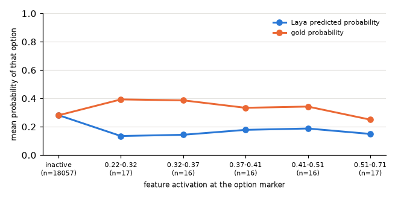

# Feature 13816

Critérios em que aparece: corr_error

**Interpretação (preencher):** 

---

## Maiores ativações

**tr_security_incidents_000056 / disposition** (choice, security_incidents) | ativação 1.432 em `estado` | opções ['close_benign', 'contain', 'investigate', 'monitor'] | Laya: **contain** [0.312, 0.322, 0.114, 0.251] | gabarito: **monitor**

```
[CLS]choice question: How should this security alert be dispositioned?[SEP]
▸ [MASK] close_benign: Expected, explainable activity; close without analyst time.
▸ [MASK] contain: Contain the host or account immediately; do not wait for triage.
▸ [MASK] investigate: Warrants an analyst opening an investigation.
▸ [MASK] monitor: Not clearly malicious, but worth watching for recurrence.

[SEP]

{"alert": {"description": "a first-ever sign-in from an unfamiliar country", "evidence": "A sign-in for an unprivileged⟦ ci⟧_runner originated from a new country at 22:10 UTC using MFA-protected credentials last rotated 700 days ago. The connection came from an allowlisted IP address while no scheduled change window was open.", "rule": "new_country_login"}, "context": {"asset_criticality": "medium", "change_window_active": false, "source_on_allowlist": true}, "history": {"credential_rotation_days_ago": 700, "distinct_countries_30d": 1, "logins_30d": 1194, "prior_alerts_90d": 0}, "principal": {"mfa_enrolled": true, "name": "usr-billing-180", "privileges": ["repo:read"], "type": "ci_runner"}}[SEP]
```

**tr_customer_service_000243 / urgency** (score, customer_service) | ativação 1.430 em `estado` | opções ['0', '1', '2', '3'] | Laya: **1** [0.135, 0.382, 0.176, 0.307] | gabarito: **2**

```
[CLS]score question: How time-sensitive is this conversation?[SEP]
▸ [MASK] level 0: No time pressure; can wait indefinitely.
▸ [MASK] level 1: Routine; handle within the normal queue.
▸ [MASK] level 2: Elevated; should be handled within the same week.
▸ [MASK] level 3: Critical; requires action within the same day.

[SEP]

{"account": {"lifetime_value_usd": 2942, "prior_tickets_90d": 0, "seats": 1, "tenure_months": 49, "tier": "standard"}, "orders": [{"amount_usd": 299, "date": "2026-01-20", "id": "A-16271", "status": "pending"}], "thread": [{"role": "customer", "text": "Look, I've been using this service for over four years now and I have never seen it this slow. Every time I try to load a report, the screen just hangs for nearly a minute. It’s making it impossible to get through my daily tasks."}, {"role": "agent", "text": "I understand how frustrating it is when the system isn't responsive. To better assist you, are you noticing this lag on all pages of the dashboard or just when running specific reports?"}, {"role": "customer", "text": "It’s pretty much everywhere, but the billing section is particularly painful. I spent almost $300 this month and I can't even view my own data without a massive delay. I've already tried restarting my router and it didn't help one bit."}, {"role": "agent", "text": "Thank you for that information. Could you please let me know if you are using a VPN or any specific browser extensions that might be active while you're accessing the site?"}, {"role": "customer", "text": "No VPN, just standard Chrome. I've even tried inc⟦ogn⟧ito mode and the performance is still abysmal. What are the next steps to get this actually looked at?"}]}[SEP]
```

**tr_security_incidents_000288 / credential_compromise** (noul, security_incidents) | ativação 1.417 em `estado` | opções ['false', 'true'] | Laya: **false** [0.61, 0.39] | gabarito: **false**

```
[CLS]noul question: The evidence indicates a credential or account has been compromised.[SEP]
▸ [MASK] false: no, the statement does not hold
▸ [MASK] true: yes, the statement holds

[SEP]

{"alert": {"description": "a first-ever sign-in from an unfamiliar country", "evidence": "At 2026-09-15 02:13:47 UTC a sign‑in originated from IP 203.0.113.45 (detected as Brazil), which is the first login for the⟦ ci⟧_runner_42 principal from that country. The account is unprivileged, has MFA enabled, and the credentials were last rotated on 2026-09-01; the sign‑in occurred while a change window was active and the source was not on the allowlist.", "rule": "new_country_login"}, "context": {"asset_criticality": "low", "change_window_active": true, "source_on_allowlist": false}, "history": {"credential_rotation_days_ago": 14, "distinct_countries_30d": 1, "logins_30d": 454, "prior_alerts_90d": 0}, "principal": {"mfa_enrolled": true, "name": "svc-billing-208", "privileges": ["repo:read"], "type": "ci_runner"}}[SEP]
```

**tr_security_incidents_000071 / credential_compromise** (noul, security_incidents) | ativação 1.402 em `estado` | opções ['false', 'true'] | Laya: **false** [0.511, 0.489] | gabarito: **false**

```
[CLS]noul question: The evidence indicates a credential or account has been compromised.[SEP]
▸ [MASK] false: no, the statement does not hold
▸ [MASK] true: yes, the statement holds

[SEP]

{"alert": {"description": "a session token was presented from a second address", "evidence": "During an active change window, a session token for a⟦ ci⟧_runner principal was observed at an unrecognized network address distinct from the original login source. This unprivileged account has MFA disabled and is utilizing a credential set that was last rotated 365 days ago.", "rule": "token_reuse"}, "context": {"asset_criticality": "low", "change_window_active": true, "source_on_allowlist": false}, "history": {"credential_rotation_days_ago": 365, "distinct_countries_30d": 2, "logins_30d": 1596, "prior_alerts_90d": 25}, "principal": {"mfa_enrolled": false, "name": "ci-deploy-913", "privileges": ["repo:read"], "type": "ci_runner"}}[SEP]
```

**tr_security_incidents_000056 / credential_compromise** (noul, security_incidents) | ativação 1.396 em `estado` | opções ['false', 'true'] | Laya: **true** [0.387, 0.613] | gabarito: **false**

```
[CLS]noul question: The evidence indicates a credential or account has been compromised.[SEP]
▸ [MASK] false: no, the statement does not hold
▸ [MASK] true: yes, the statement holds

[SEP]

{"alert": {"description": "a first-ever sign-in from an unfamiliar country", "evidence": "A sign-in for an unprivileged⟦ ci⟧_runner originated from a new country at 22:10 UTC using MFA-protected credentials last rotated 700 days ago. The connection came from an allowlisted IP address while no scheduled change window was open.", "rule": "new_country_login"}, "context": {"asset_criticality": "medium", "change_window_active": false, "source_on_allowlist": true}, "history": {"credential_rotation_days_ago": 700, "distinct_countries_30d": 1, "logins_30d": 1194, "prior_alerts_90d": 0}, "principal": {"mfa_enrolled": true, "name": "usr-billing-180", "privileges": ["repo:read"], "type": "ci_runner"}}[SEP]
```

## Ativações medianas (faixa 40-60%, mediana 0.588)

**tr_security_incidents_000190 / urgency** (score, security_incidents) | ativação 0.551 em `estado` | opções ['0', '1', '2', '3'] | Laya: **1** [0.083, 0.505, 0.338, 0.074] | gabarito: **3**

```
[CLS]score question: How quickly must a responder act on this alert?[SEP]
▸ [MASK] level 0: No time pressure; can wait indefinitely.
▸ [MASK] level 1: Routine; handle within the normal queue.
▸ [MASK] level 2: Elevated; should be handled within the same week.
▸ [MASK] level 3: Critical; requires action within the same day.

[SEP]

{"alert": {"description": "an account granted itself or received elevated permissions", "evidence": "CI runner \"runner-42\" was added to the \"docker-admin\" group on 2026-09-15 04:12:57 UTC originating from IP 198.51.100.22. The API token used for the change was last rotated on 2025-03-15.", "rule": "privilege_escalation"}, "context": {"asset_criticality": "high", "change_window_active": false, "source_on_allowlist": false}, "history": {"credential_rotation_days_ago": 180, "distinct_countries_30d": 1, "logins_30d": 451, "prior_alerts_90⟦d⟧": 8}, "principal": {"mfa_enrolled": true, "name": "svc-analytics-751", "privileges": ["repo:read"], "type": "ci_runner"}}[SEP]
```

**tr_customer_service_000264 / action** (choice, customer_service) | ativação 0.551 em `estado` | opções ['answer_directly', 'close_no_action', 'escalate_to_human', 'execute_refund', 'request_information'] | Laya: **close_no_action** [0.202, 0.331, 0.179, 0.145, 0.143] | gabarito: **escalate_to_human**

```
[CLS]choice question: What should the assistant do next with this conversation?[SEP]
▸ [MASK] answer_directly: The assistant can resolve this itself with information it already has.
▸ [MASK] close_no_action: No further action is warranted; the matter is settled.
▸ [MASK] escalate_to_human: Hand off to a human agent with the appropriate authority.
▸ [MASK] execute_refund: Issue the refund or credit the customer is owed.
▸ [MASK] request_information: More detail is needed from the customer before anything can be done.

[SEP]

{"account": {"lifetime_value_usd": 166, "prior_tickets_90d": 2, "seats": 1, "tenure_months": 3, "⟦tier⟧": "standard"}, "thread": [{"role": "customer", "text": "I’m looking at my statement and see I’ve been hit with another duplicate charge for my standard plan. This is the third time now, and those last two tickets I opened resulted in absolutely nothing but empty promises from your team."}, {"role": "agent", "text": "I understand how frustrating it is to see recurring billing issues like this, and I apologize that your previous experience hasn't met expectations. Could you please provide the dates of those specific charges so I can pull up the transaction history?"}, {"role": "customer", "text": "It’s happened on the 15th of each of the last three months. I've already sent these dates in twice before, so I’m really not sure why you need them again."}, {"role": "agent", "text": "Thank you for clarifying that timeline. I am currently cross-referencing your billing records with the account activity; could you confirm if you have received any automated notification emails regarding these specific transaction dates?"}, {"role": "customer", "text": "I haven't seen a single email about these charges, which is exactly why this is so confusing. I’m just trying to get this sorted out once and for all."}]}[SEP]
```

**tr_invoice_processing_000237 / matches_order** (noul, invoice_processing) | ativação 0.550 em `estado` | opções ['false', 'true'] | Laya: **true** [0.464, 0.536] | gabarito: **false**

```
[CLS]noul question: The invoice reconciles with the purchase order and the recorded delivery.[SEP]
▸ [MASK] false: There is a discrepancy against the order or the delivery.
▸ [MASK] true: Line items, quantities and amounts reconcile.

[SEP]

{"delivery": {"condition": "accepted", "date": "2026-03-02", "received_qty": 10}, "invoice": {"currency": "USD", "id": "INV-2026-3240", "lines": [{"qty": 10, "sku": "SKU-941", "total_usd": 2014.1, "unit_usd": 201.41}, {"qty": 1, "sku": "FREIGHT", "total_usd": 908.75, "unit_usd": 908.75}], "total_usd": 2922.85, "vendor": "Vantage Materials"}, "payment": {"days_until_due": 44, "discount_expires_in_days": null, "early_payment_discount_p⟦ct⟧": null, "status": "scheduled", "terms": "net 15"}, "purchase_order": {"freight_terms": "freight prepaid by vendor, not separately billable", "id": "PO-5065", "lines": [{"qty": 10, "unit_usd": 201.41}], "total_usd": 2014.1}, "vendor_history": {"disputes_12m": 5, "invoices_12m": 5, "prior_invoice_ids": ["INV-2026-6503"]}}[SEP]
```

**tr_security_incidents_000025 / urgency** (score, security_incidents) | ativação 0.625 em `estado` | opções ['0', '1', '2', '3'] | Laya: **1** [0.048, 0.782, 0.092, 0.078] | gabarito: **1**

```
[CLS]score question: How quickly must a responder act on this alert?[SEP]
▸ [MASK] level 0: No time pressure; can wait indefinitely.
▸ [MASK] level 1: Routine; handle within the normal queue.
▸ [MASK] level 2: Elevated; should be handled within the same week.
▸ [MASK] level 3: Critical; requires action within the same day.

[SEP]

{"alert": {"description": "two successful logins from distant locations too close together", "evidence": "Two successful logins for the shared mailbox occurred from geographically distant locations within a timeframe that precludes physical travel. Both connections originated from an IP address currently on the allowlist.", "rule": "impossible_travel"}, "context": {"asset_criticality": "crown_jewel", "change_window_active": false, "source_on_allowlist": true}, "history": {"credential_rotation_days_ago": 180, "distinct_countries_⟦30⟧d": 4, "logins_30d": 1031, "prior_alerts_90d": 3}, "principal": {"mfa_enrolled": true, "name": "adm-deploy-597", "privileges": ["repo:read"], "type": "shared_mailbox"}}[SEP]
```

**tr_customer_service_000261 / action** (choice, customer_service) | ativação 0.632 em `estado` | opções ['answer_directly', 'close_no_action', 'escalate_to_human', 'execute_refund', 'request_information'] | Laya: **close_no_action** [0.224, 0.249, 0.196, 0.182, 0.15] | gabarito: **escalate_to_human**

```
[CLS]choice question: What should the assistant do next with this conversation?[SEP]
▸ [MASK] answer_directly: The assistant can resolve this itself with information it already has.
▸ [MASK] close_no_action: No further action is warranted; the matter is settled.
▸ [MASK] escalate_to_human: Hand off to a human agent with the appropriate authority.
▸ [MASK] execute_refund: Issue the refund or credit the customer is owed.
▸ [MASK] request_information: More detail is needed from the customer before anything can be done.

[SEP]

{"account": {"lifetime_value_usd": 244, "prior_tickets_90d": 1, "seats": 40, "tenure_months": 5, "tier": "premium"}, "orders": [{"amount_usd": 57, "date": "2026-02-23", "id": "A-35156", "status": "refunded"}, {"amount_usd": 57, "date": "20⟦26⟧-01-11", "id": "A-26925", "status": "pending"}, {"amount_usd": 57, "date": "2026-01-04", "id": "A-63187", "status": "failed"}], "thread": [{"role": "customer", "text": "I’ve been paying for the $57 Premium plan for five months now, and the reporting feature is still completely broken. I opened a ticket about this weeks ago and was told it’d be fixed, but nothing has changed. If this isn't working by my presentation tomorrow morning, I’m canceling my subscription and moving to a competitor."}, {"role": "agent", "text": "I understand how critical that reporting feature is for your upcoming presentation. To help me look into this further, could you please clarify if you're seeing a specific error message or if the data simply isn't loading when you attempt to run the report?"}, {"role": "customer", "text": "It just hangs on a white screen every single time. I don't have time for more 'clarifications'—I need someone to actually look at why my account is failing before I lose my client."}]}[SEP]
```

## Estatísticas (conjunto de descoberta, dev e teste)

**pred / error**

| split | decisões | ativas | ativas e Laya errou | taxa | lift | q (BH) | OR (CMH) | q (CMH) |
|---|---|---|---|---|---|---|---|---|
| discovery | 5100 | 2 | 2 | 1.000 | 1.57 | nan | nan | nan |
| dev | 900 | 0 | 0 | nan | nan | nan | nan | nan |
| test | 2000 | 1 | 1 | 1.000 | 1.57 | nan | nan | nan |

**corr / error**

| split | decisões | ativas | ativas e Laya errou | taxa | lift | q (BH) | OR (CMH) | q (CMH) |
|---|---|---|---|---|---|---|---|---|
| discovery | 5100 | 28 | 28 | 1.000 | 1.57 | 1.12e-05 | inf | 0.785 |
| dev | 900 | 6 | 6 | 1.000 | 1.52 | nan | nan | nan |
| test | 2000 | 9 | 9 | 1.000 | 1.57 | nan | nan | nan |

**state / error**

| split | decisões | ativas | ativas e Laya errou | taxa | lift | q (BH) | OR (CMH) | q (CMH) |
|---|---|---|---|---|---|---|---|---|
| discovery | 5100 | 627 | 411 | 0.656 | 1.03 | 0.612 | 1.22 | 0.138 |
| dev | 900 | 127 | 93 | 0.732 | 1.12 | 0.783 | 1.56 | 0.282 |
| test | 2000 | 217 | 152 | 0.700 | 1.10 | 0.395 | 1.48 | 0.136 |

Confusão mais sobre-representada (pred): `urgency|2>3` (n=2, lift 637.50, p=nan). Formato `pergunta|índice previsto>índice correto`.

Confusão mais sobre-representada (corr): `urgency|1>2` (n=24, lift 15.67, p=3.31e-27). Formato `pergunta|índice previsto>índice correto`.

Confusão mais sobre-representada (state): `matches_order|1>0` (n=59, lift 4.36, p=2.96e-26). Formato `pergunta|índice previsto>índice correto`.



