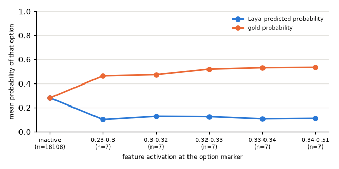

# Feature 13820

Critérios em que aparece: corr_error

**Interpretação (preencher):** 

---

## Maiores ativações

**tr_security_incidents_000232 / severity** (score, security_incidents) | ativação 1.904 em `estado` | opções ['0', '1', '2', '3', '4'] | Laya: **2** [0.087, 0.257, 0.34, 0.272, 0.044] | gabarito: **3**

```
[CLS]score question: How severe is the potential impact if this alert is real?[SEP]
▸ [MASK] level 0: Negligible: no access to anything sensitive.
▸ [MASK] level 1: Low: limited access, easily reversed.
▸ [MASK] level 2: Moderate: access to internal systems or non-public data.
▸ [MASK] level 3: High: access to production, secrets or customer data.
▸ [MASK] level 4: Critical: active compromise of crown-jewel systems.

[SEP]

{"alert": {"description": "a first-ever sign-in from an unfamiliar country", "evidence": "At 2026-09-15 14:02:57 UTC, privileged admin \"admin01@example.com\" logged into the Azure portal from IP 198.51.100.77, geolocated to Nairobi,⟦ Kenya⟧, a country with no prior successful logins for this account. The session passed MFA, the source IP is not present in the organization’s allowlist, and the login occurred during an active change window (2026-09-15 13:00–15:00 UTC); the admin’s credentials were last rotated on 2025-03-18 (180 days prior).", "rule": "new_country_login"}, "context": {"asset_criticality": "medium", "change_window_active": true, "source_on_allowlist": false}, "history": {"credential_rotation_days_ago": 180, "distinct_countries_30d": 2, "logins_30d": 1427, "prior_alerts_90d": 3}, "principal": {"mfa_enrolled": true, "name": "ci-deploy-221", "privileges": ["deploy:production", "secrets:read"], "type": "admin"}}[SEP]
```

**tr_customer_service_000165 / churn_risk** (score, customer_service) | ativação 1.788 em `estado` | opções ['0', '1', '2', '3'] | Laya: **1** [0.208, 0.314, 0.225, 0.252] | gabarito: **2**

```
[CLS]score question: How likely is this customer to stop doing business with us because of this interaction?[SEP]
▸ [MASK] level 0: No sign of dissatisfaction.
▸ [MASK] level 1: Mild frustration, but the relationship is intact.
▸ [MASK] level 2: Clearly unhappy; repeat problems or explicit complaints.
▸ [MASK] level 3: Imminent: threatening to cancel, dispute or leave.

[SEP]

{"account": {"lifetime_value_usd": 4890, "prior_tickets_90d": 3, "seats": 1, "tenure_months": 60, "tier": "premium"}, "orders": [{"amount_usd": 19, "date": "2026-01-24", "id": "A-27992", "status": "settled"}, {"amount_usd": 19, "date": "2026-02-04", "id": "A-63170", "status": "settled"}, {"amount_usd": 19, "date": "2026-02-15", "id": "A-75660", "status": "settled"}], "thread": [{"role": "customer", "text": "Hi, I was checking my bank statement and noticed two charges from you guys for the same $19 amount. I'm really confused—am I getting billed twice for the same premium subscription?"}, {"role": "agent", "text": "Hello, thank you for reaching out to us. I would be happy to look into these charges for you. Could you please confirm the dates of the transactions you are seeing?"}, {"role": "customer", "text": "They both hit on the 12th. I've been with you for five years now and I've had three previous tickets where things were promised but never actually followed through on, so I'm hoping this one is different."}, {"role": "agent", "text": "I appreciate your long-term membership and I⟦ sincerely⟧ apologize for any previous lapses in service. I am checking your billing ledger now; could you verify the email address associated with the account?"}, {"role": "customer", "text": "It’s under j.doe@email.com. I really just want to understand why my account would show two charges when I’ve only ever had one plan."}, {"role": "agent", "text": "Thank you for that information. I am currently reviewing your billing cycle. To ensure I'm looking at the right data, could you clarify if you recently made any changes to your payment method?"}, {"role": "customer", "text": "No, I haven't touched my settings in years. I’m just trying to make sense of why my balance is off."}]}[SEP]
```

**tr_security_incidents_000232 / urgency** (score, security_incidents) | ativação 1.781 em `estado` | opções ['0', '1', '2', '3'] | Laya: **1** [0.134, 0.398, 0.181, 0.288] | gabarito: **2**

```
[CLS]score question: How quickly must a responder act on this alert?[SEP]
▸ [MASK] level 0: No time pressure; can wait indefinitely.
▸ [MASK] level 1: Routine; handle within the normal queue.
▸ [MASK] level 2: Elevated; should be handled within the same week.
▸ [MASK] level 3: Critical; requires action within the same day.

[SEP]

{"alert": {"description": "a first-ever sign-in from an unfamiliar country", "evidence": "At 2026-09-15 14:02:57 UTC, privileged admin \"admin01@example.com\" logged into the Azure portal from IP 198.51.100.77, geolocated to Nairobi,⟦ Kenya⟧, a country with no prior successful logins for this account. The session passed MFA, the source IP is not present in the organization’s allowlist, and the login occurred during an active change window (2026-09-15 13:00–15:00 UTC); the admin’s credentials were last rotated on 2025-03-18 (180 days prior).", "rule": "new_country_login"}, "context": {"asset_criticality": "medium", "change_window_active": true, "source_on_allowlist": false}, "history": {"credential_rotation_days_ago": 180, "distinct_countries_30d": 2, "logins_30d": 1427, "prior_alerts_90d": 3}, "principal": {"mfa_enrolled": true, "name": "ci-deploy-221", "privileges": ["deploy:production", "secrets:read"], "type": "admin"}}[SEP]
```

**tr_customer_service_000165 / category** (choice, customer_service) | ativação 1.762 em `estado` | opções ['account', 'billing', 'delivery', 'refund', 'technical'] | Laya: **technical** [0.21, 0.204, 0.108, 0.228, 0.249] | gabarito: **billing**

```
[CLS]choice question: What is this customer conversation primarily about?[SEP]
▸ [MASK] account: Login, plan changes, profile or access management.
▸ [MASK] billing: A charge, invoice, subscription or payment problem.
▸ [MASK] delivery: Shipping, fulfilment or delivery of a physical item.
▸ [MASK] refund: The customer is explicitly asking for money back.
▸ [MASK] technical: The product or service is not working as expected.

[SEP]

{"account": {"lifetime_value_usd": 4890, "prior_tickets_90d": 3, "seats": 1, "tenure_months": 60, "tier": "premium"}, "orders": [{"amount_usd": 19, "date": "2026-01-24", "id": "A-27992", "status": "settled"}, {"amount_usd": 19, "date": "2026-02-04", "id": "A-63170", "status": "settled"}, {"amount_usd": 19, "date": "2026-02-15", "id": "A-75660", "status": "settled"}], "thread": [{"role": "customer", "text": "Hi, I was checking my bank statement and noticed two charges from you guys for the same $19 amount. I'm really confused—am I getting billed twice for the same premium subscription?"}, {"role": "agent", "text": "Hello, thank you for reaching out to us. I would be happy to look into these charges for you. Could you please confirm the dates of the transactions you are seeing?"}, {"role": "customer", "text": "They both hit on the 12th. I've been with you for five years now and I've had three previous tickets where things were promised but never actually followed through on, so I'm hoping this one is different."}, {"role": "agent", "text": "I appreciate your long-term membership and I⟦ sincerely⟧ apologize for any previous lapses in service. I am checking your billing ledger now; could you verify the email address associated with the account?"}, {"role": "customer", "text": "It’s under j.doe@email.com. I really just want to understand why my account would show two charges when I’ve only ever had one plan."}, {"role": "agent", "text": "Thank you for that information. I am currently reviewing your billing cycle. To ensure I'm looking at the right data, could you clarify if you recently made any changes to your payment method?"}, {"role": "customer", "text": "No, I haven't touched my settings in years. I’m just trying to make sense of why my balance is off."}]}[SEP]
```

**tr_security_incidents_000232 / true_positive** (noul, security_incidents) | ativação 1.756 em `estado` | opções ['false', 'true'] | Laya: **false** [0.64, 0.36] | gabarito: **false**

```
[CLS]noul question: This alert reflects genuinely malicious or unauthorised activity.[SEP]
▸ [MASK] false: Benign activity, a misconfiguration, or a known false positive.
▸ [MASK] true: The underlying behaviour is malicious or unauthorised.

[SEP]

{"alert": {"description": "a first-ever sign-in from an unfamiliar country", "evidence": "At 2026-09-15 14:02:57 UTC, privileged admin \"admin01@example.com\" logged into the Azure portal from IP 198.51.100.77, geolocated to Nairobi,⟦ Kenya⟧, a country with no prior successful logins for this account. The session passed MFA, the source IP is not present in the organization’s allowlist, and the login occurred during an active change window (2026-09-15 13:00–15:00 UTC); the admin’s credentials were last rotated on 2025-03-18 (180 days prior).", "rule": "new_country_login"}, "context": {"asset_criticality": "medium", "change_window_active": true, "source_on_allowlist": false}, "history": {"credential_rotation_days_ago": 180, "distinct_countries_30d": 2, "logins_30d": 1427, "prior_alerts_90d": 3}, "principal": {"mfa_enrolled": true, "name": "ci-deploy-221", "privileges": ["deploy:production", "secrets:read"], "type": "admin"}}[SEP]
```

## Ativações medianas (faixa 40-60%, mediana 0.496)

**tr_invoice_processing_000124 / matches_order** (noul, invoice_processing) | ativação 0.470 em `estado` | opções ['false', 'true'] | Laya: **true** [0.474, 0.526] | gabarito: **false**

```
[CLS]noul question: The invoice reconciles with the purchase order and the recorded delivery.[SEP]
▸ [MASK] false: There is a discrepancy against the order or the delivery.
▸ [MASK] true: Line items, quantities and amounts reconcile.

[SEP]

{"delivery": {"condition": "accepted", "date": "2026-03-17", "received_qty": 10}, "invoice": {"currency": "USD", "id": "INV-2026-6789", "lines": [{"qty": 10, "sku": "SKU-692", "total_usd": 2272.9, "unit_usd": 227.29}], "total_usd": 2272.9, "vendor": "Orbit Logistics"}, "payment": {"days_until_due": 5, "discount_expires_in_days": null, "early_payment_discount_⟦p⟧ct": null, "status": "scheduled", "terms": "net 30"}, "purchase_order": {"freight_terms": "freight prepaid by vendor, not separately billable", "id": "PO-2113", "lines": [{"qty": 10, "unit_usd": 220.67}], "total_usd": 2206.7}, "vendor_history": {"disputes_12m": 0, "invoices_12m": 1, "prior_invoice_ids": ["INV-2026-5780", "INV-2026-1144"]}}[SEP]
```

**tr_invoice_processing_000063 / duplicate** (noul, invoice_processing) | ativação 0.545 em `estado` | opções ['false', 'true'] | Laya: **true** [0.102, 0.898] | gabarito: **true**

```
[CLS]noul question: This invoice appears to duplicate an invoice already submitted.[SEP]
▸ [MASK] false: no, the statement does not hold
▸ [MASK] true: yes, the statement holds

[SEP]

{"delivery": {"condition": "accepted", "date": "2026-03-07", "received_qty": 400}, "invoice": {"currency": "USD", "id": "INV-2026-7799", "lines": [{"qty": 400, "sku": "SKU-971", "total_usd": 143124.0, "unit_usd": 357.81}], "total_usd": 143124.0, "vendor": "Northwind Components"}, "payment": {"days_until_due": 44, "discount_expires_in_days": null, "early_payment_discount_⟦p⟧ct": null, "status": "scheduled", "terms": "net 60"}, "purchase_order": {"freight_terms": "freight prepaid by vendor, not separately billable", "id": "PO-3158", "lines": [{"qty": 400, "unit_usd": 357.81}], "total_usd": 143124.0}, "vendor_history": {"disputes_12m": 5, "invoices_12m": 7, "prior_invoice_ids": ["INV-2026-7799", "INV-2026-6213"]}}[SEP]
```

**tr_customer_service_000214 / action** (choice, customer_service) | ativação 0.489 em `opção` | opções ['answer_directly', 'close_no_action', 'escalate_to_human', 'execute_refund', 'request_information'] | Laya: **close_no_action** [0.238, 0.312, 0.201, 0.036, 0.213] | gabarito: **request_information**

```
[CLS]choice question: What should the assistant do next with this conversation?[SEP]
▸ [MASK] answer_directly: The assistant can resolve this itself with information it already has.
▸ [MASK] close_no_action: No further action is warranted; the matter is settled.
▸ [MASK] escalate_to_human: Hand off to a human agent with the appropriate authority.
▸ [MASK] execute_refund: Issue the refund or credit⟦ the⟧ customer is owed.
▸ [MASK] request_information: More detail is needed from the customer before anything can be done.

[SEP]

{"account": {"lifetime_value_usd": 820, "prior_tickets_90d": 2, "seats": 1, "tenure_months": 19, "tier": "standard"}, "thread": [{"role": "customer", "text": "The platform has been crawling at a snail's pace all day—queries that used to return in seconds now take minutes, and I need this fixed before my deadline tomorrow."}, {"role": "agent", "text": "I understand how critical that is. Can you tell me which specific actions are lagging and if this slowdown is happening across all browsers?"}, {"role": "customer", "text": "Both the search bar and the analytics tab are sluggish, and it’s the same on Chrome and Firefox. I’ve been on the standard plan for 19 months and this is the first time I’ve seen anything this bad."}]}[SEP]
```

**tr_agent_trace_observability_000299 / action** (choice, agent_trace_observability) | ativação 0.522 em `estado` | opções ['continue', 'human_review', 'observe', 'stop'] | Laya: **continue** [0.601, 0.075, 0.219, 0.105] | gabarito: **observe**

```
[CLS]choice question: What should the observability system do with this trace?[SEP]
▸ [MASK] continue: Let the agent proceed without interruption.
▸ [MASK] human_review: Queue this trace for a human to review.
▸ [MASK] observe: Keep running, but flag the trace for later sampling.
▸ [MASK] stop: Halt the agent now.

[SEP]

{"agent": {"autonomy": "⟦un⟧supervised", "model": "internal-agent-v1"}, "constraints": ["Do not force-push to any branch"], "task": "Backfill missing analytics events for the last seven days.", "trace_summary": {"constraint_violations": 0, "duration_s": 717.5, "irreversible_actions": 1, "steps": 10, "tool_errors": 0}}[SEP]
```

**tr_agent_trace_observability_000135 / outcome** (choice, agent_trace_observability) | ativação 0.486 em `estado` | opções ['failure', 'harmful', 'partial', 'success'] | Laya: **success** [0.382, 0.073, 0.146, 0.399] | gabarito: **partial**

```
[CLS]choice question: How did this agent run turn out?[SEP]
▸ [MASK] failure: The agent did not accomplish the task.
▸ [MASK] harmful: The agent took an action that caused damage or violated a constraint.
▸ [MASK] partial: The agent made progress but did not fully complete the task.
▸ [MASK] success: The agent completed the task correctly.

[SEP]

{"agent": {"autonomy": "⟦un⟧supervised", "model": "internal-agent-v3"}, "constraints": ["Do not force-push to any branch", "Do not exceed a $50 spend on cloud resources", "Never delete anything matching release/*"], "task": "Migrate the user table to the new schema without downtime.", "trace_summary": {"constraint_violations": 0, "duration_s": 794.4, "irreversible_actions": 0, "steps": 4, "tool_errors": 0}}[SEP]
```

## Estatísticas (conjunto de descoberta, dev e teste)

**pred / error**

| split | decisões | ativas | ativas e Laya errou | taxa | lift | q (BH) | OR (CMH) | q (CMH) |
|---|---|---|---|---|---|---|---|---|
| discovery | 5100 | 0 | 0 | nan | nan | nan | nan | nan |
| dev | 900 | 0 | 0 | nan | nan | nan | nan | nan |
| test | 2000 | 0 | 0 | nan | nan | nan | nan | nan |

**corr / error**

| split | decisões | ativas | ativas e Laya errou | taxa | lift | q (BH) | OR (CMH) | q (CMH) |
|---|---|---|---|---|---|---|---|---|
| discovery | 5100 | 23 | 23 | 1.000 | 1.57 | 9.69e-05 | nan | nan |
| dev | 900 | 3 | 3 | 1.000 | 1.52 | nan | nan | nan |
| test | 2000 | 8 | 8 | 1.000 | 1.57 | nan | nan | nan |

**state / error**

| split | decisões | ativas | ativas e Laya errou | taxa | lift | q (BH) | OR (CMH) | q (CMH) |
|---|---|---|---|---|---|---|---|---|
| discovery | 5100 | 1397 | 920 | 0.659 | 1.04 | 0.214 | 0.98 | 0.881 |
| dev | 900 | 298 | 193 | 0.648 | 0.99 | 1 | 0.73 | 0.274 |
| test | 2000 | 561 | 376 | 0.670 | 1.05 | 0.442 | 1.00 | 0.989 |

Confusão mais sobre-representada (corr): `disposition|0>2` (n=20, lift 18.56, p=1.87e-24). Formato `pergunta|índice previsto>índice correto`.

Confusão mais sobre-representada (state): `duplicate|1>0` (n=171, lift 2.89, p=0). Formato `pergunta|índice previsto>índice correto`.



