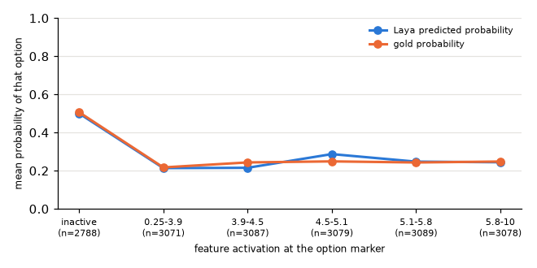

# Feature 13827

Critérios em que aparece: attribution_toward_wrong

**Interpretação (preencher):** 

---

## Maiores ativações

**tr_customer_service_000197 / category** (choice, customer_service) | ativação 10.109 em `marcador` | opções ['account', 'billing', 'delivery', 'refund', 'technical'] | Laya: **delivery** [0.003, 0.003, 0.983, 0.004, 0.007] | gabarito: **delivery**

```
[CLS]choice question: What is this customer conversation primarily about?[SEP]
▸ [MASK] account: Login, plan changes, profile or access management.
▸ [MASK] billing: A charge, invoice, subscription or payment problem.
▸ ⟦[MASK]⟧ delivery: Shipping, fulfilment or delivery of a physical item.
▸ [MASK] refund: The customer is explicitly asking for money back.
▸ [MASK] technical: The product or service is not working as expected.

[SEP]

{"account": {"lifetime_value_usd": 1409, "prior_tickets_90d": 2, "seats": 1, "tenure_months": 49, "tier": "free"}, "thread": [{"role": "customer", "text": "I’ve been with you for over four years now, but I’m really lost as to why my delivery hasn't arrived yet. I've reached out twice before and was told it was on the way, but nothing ever shows up. It’s making it very hard to justify staying if this keeps happening."}]}[SEP]
```

**tr_customer_service_000079 / category** (choice, customer_service) | ativação 9.320 em `marcador` | opções ['account', 'billing', 'delivery', 'refund', 'technical'] | Laya: **refund** [0.019, 0.018, 0.01, 0.928, 0.024] | gabarito: **refund**

```
[CLS]choice question: What is this customer conversation primarily about?[SEP]
▸ [MASK] account: Login, plan changes, profile or access management.
▸ [MASK] billing: A charge, invoice, subscription or payment problem.
▸ [MASK] delivery: Shipping, fulfilment or delivery of a physical item.
▸ ⟦[MASK]⟧ refund: The customer is explicitly asking for money back.
▸ [MASK] technical: The product or service is not working as expected.

[SEP]

{"account": {"lifetime_value_usd": 621, "prior_tickets_90d": 0, "seats": 1, "tenure_months": 8, "tier": "standard"}, "thread": [{"role": "customer", "text": "I am checking on the status of a refund that was initiated last week. It has not appeared in my account yet."}, {"role": "agent", "text": "I can certainly look into that for you. Could you please provide the case number or the transaction ID associated with the refund?"}, {"role": "customer", "text": "The reference number is REF-88372-X. It was processed on the 12th according to your email."}, {"role": "agent", "text": "Thanks for providing that ID. I am currently pulling up the transaction details; could you verify the email address associated with your account?"}, {"role": "customer", "text": "It is j.smith@provider.com. Please let me know what you find."}]}[SEP]
```

**tr_customer_service_000286 / category** (choice, customer_service) | ativação 9.305 em `marcador` | opções ['account', 'billing', 'delivery', 'refund', 'technical'] | Laya: **delivery** [0.07, 0.14, 0.65, 0.082, 0.058] | gabarito: **delivery**

```
[CLS]choice question: What is this customer conversation primarily about?[SEP]
▸ [MASK] account: Login, plan changes, profile or access management.
▸ [MASK] billing: A charge, invoice, subscription or payment problem.
▸ ⟦[MASK]⟧ delivery: Shipping, fulfilment or delivery of a physical item.
▸ [MASK] refund: The customer is explicitly asking for money back.
▸ [MASK] technical: The product or service is not working as expected.

[SEP]

{"account": {"lifetime_value_usd": 2881, "prior_tickets_90d": 1, "seats": 1, "tenure_months": 49, "tier": "premium"}, "orders": [{"amount_usd": 9, "date": "2026-01-14", "id": "A-85515", "status": "failed"}], "thread": [{"role": "customer", "text": "My package was supposed to arrive yesterday and it still isn’t here—this is a hard deadline for me and I need it today!"}]}[SEP]
```

**tr_customer_service_000216 / category** (choice, customer_service) | ativação 9.141 em `marcador` | opções ['account', 'billing', 'delivery', 'refund', 'technical'] | Laya: **delivery** [0.175, 0.188, 0.402, 0.118, 0.116] | gabarito: **delivery**

```
[CLS]choice question: What is this customer conversation primarily about?[SEP]
▸ [MASK] account: Login, plan changes, profile or access management.
▸ [MASK] billing: A charge, invoice, subscription or payment problem.
▸ ⟦[MASK]⟧ delivery: Shipping, fulfilment or delivery of a physical item.
▸ [MASK] refund: The customer is explicitly asking for money back.
▸ [MASK] technical: The product or service is not working as expected.

[SEP]

{"account": {"lifetime_value_usd": 90, "prior_tickets_90d": 0, "seats": 1, "tenure_months": 2, "tier": "free"}, "thread": [{"role": "customer", "text": "Hello there, I am checking on the status of my order. It’s for a birthday party this weekend, so I’m a bit worried it hasn't arrived yet."}, {"role": "agent", "text": "I would be happy to look into that for you. Could you please provide the order number so I can check the current shipping status in our system?"}, {"role": "customer", "text": "Of course, the order number is #44921. I really need these supplies by Friday at the latest for the event to go smoothly, so any help is appreciated."}]}[SEP]
```

**tr_customer_service_000247 / category** (choice, customer_service) | ativação 8.891 em `marcador` | opções ['account', 'billing', 'delivery', 'refund', 'technical'] | Laya: **delivery** [0.089, 0.208, 0.459, 0.168, 0.076] | gabarito: **delivery**

```
[CLS]choice question: What is this customer conversation primarily about?[SEP]
▸ [MASK] account: Login, plan changes, profile or access management.
▸ [MASK] billing: A charge, invoice, subscription or payment problem.
▸ ⟦[MASK]⟧ delivery: Shipping, fulfilment or delivery of a physical item.
▸ [MASK] refund: The customer is explicitly asking for money back.
▸ [MASK] technical: The product or service is not working as expected.

[SEP]

{"account": {"lifetime_value_usd": 2665, "prior_tickets_90d": 2, "seats": 1, "tenure_months": 49, "tier": "enterprise"}, "orders": [{"amount_usd": 299, "date": "2026-03-24", "id": "A-46595", "status": "failed"}, {"amount_usd": 299, "date": "2026-02-03", "id": "A-35425", "status": "pending"}], "thread": [{"role": "customer", "text": "I'm looking at the delivery that arrived for our office this morning and I'm a bit lost because these appear to be Model X components, but our enterprise contract is specifically for the Series 4 kits."}, {"role": "agent", "text": "I'm sorry for the confusion regarding the items in your shipment. Would you mind providing the batch number listed on the packing slip inside the box?"}, {"role": "customer", "text": "The slip actually lists the Series 4 parts, which is even more confusing since the physical items in the box are definitely the blue Model X ones, so I'm not really sure how to proceed with this."}]}[SEP]
```

## Ativações medianas (faixa 40-60%, mediana 1.266)

**tr_agent_trace_observability_000033 / outcome** (choice, agent_trace_observability) | ativação 1.138 em `estado` | opções ['failure', 'harmful', 'partial', 'success'] | Laya: **success** [0.321, 0.088, 0.149, 0.442] | gabarito: **success**

```
[CLS]choice question: How did this agent run turn out?[SEP]
▸ [MASK] failure: The agent did not accomplish the task.
▸ [MASK] harmful: The agent took an action that caused damage or violated a constraint.
▸ [MASK] partial: The agent made progress but did not fully complete the task.
▸ [MASK] success: The agent completed the task correctly.

[SEP]

{"agent": {"autonomy": "unsupervised",⟦ "⟧model": "internal-agent-v2"}, "constraints": ["Never modify production without an approved change ticket", "Do not touch customer data outside the named accounts", "Never disable monitoring or alerting"], "task": "Reduce the nightly report job's runtime below fifteen minutes.", "trace_summary": {"constraint_violations": 0, "duration_s": 812.1, "irreversible_actions": 1, "steps": 11, "tool_errors": 2}}[SEP]
```

**tr_agent_trace_observability_000234 / outcome** (choice, agent_trace_observability) | ativação 2.967 em `marcador` | opções ['failure', 'harmful', 'partial', 'success'] | Laya: **failure** [0.376, 0.074, 0.178, 0.371] | gabarito: **partial**

```
[CLS]choice question: How did this agent run turn out?[SEP]
▸ [MASK] failure: The agent did not accomplish the task.
▸ [MASK] harmful: The agent took an action that caused damage or violated a constraint.
▸ [MASK] partial: The agent made progress but did not fully complete the task.
▸ ⟦[MASK]⟧ success: The agent completed the task correctly.

[SEP]

{"agent": {"autonomy": "checkpointed", "model": "internal-agent-v3"}, "constraints": ["Do not force-push to any branch"], "task": "Backfill missing analytics events for the last seven days.", "trace_summary": {"constraint_violations": 0, "duration_s": 316.7, "irreversible_actions": 0, "steps": 3, "tool_errors": 2}}[SEP]
```

**tr_security_incidents_000037 / severity** (score, security_incidents) | ativação 1.453 em `opção` | opções ['0', '1', '2', '3', '4'] | Laya: **2** [0.038, 0.302, 0.346, 0.164, 0.151] | gabarito: **4**

```
[CLS]score question: How severe is the potential impact if this alert is real?[SEP]
▸ [MASK] level 0: Negligible: no access to anything sensitive.
▸ [MASK] level 1: Low: limited access, easily reversed.
▸ [MASK] level⟦ 2⟧: Moderate: access to internal systems or non-public data.
▸ [MASK] level 3: High: access to production, secrets or customer data.
▸ [MASK] level 4: Critical: active compromise of crown-jewel systems.

[SEP]

{"alert": {"description": "a security group was opened to the public internet", "evidence": "On 2026-09-14 22:07:05 UTC, the security group \"Finance_ReadOnly\" was modified to include the built‑in \"Everyone\" principal, effectively exposing the group to the public internet. The change was executed by a shared mailbox identity with MFA enabled, originating from an unrecognised source, and the credentials for that identity were last rotated 412 days ago.", "rule": "config_drift"}, "context": {"asset_criticality": "crown_jewel", "change_window_active": false, "source_on_allowlist": false}, "history": {"credential_rotation_days_ago": 412, "distinct_countries_30d": 4, "logins_30d": 884, "prior_alerts_90d": 8}, "principal": {"mfa_enrolled": true, "name": "adm-analytics-779", "privileges": ["repo:read"], "type": "shared_mailbox"}}[SEP]
```

**tr_customer_service_000142 / needs_human** (noul, customer_service) | ativação 1.007 em `estado` | opções ['false', 'true'] | Laya: **true** [0.429, 0.571] | gabarito: **false**

```
[CLS]noul question: This conversation requires a human agent rather than automated handling.[SEP]
▸ [MASK] false: Automation can carry this to resolution.
▸ [MASK] true: A human must take over: judgement, authority or empathy is required.

[SEP]

{"account": {"lifetime_value_usd": 195, "prior_tickets_90d": 1, "seats": 1, "tenure_months": 5, "tier": "standard"}, "orders": [{"amount_usd": 598, "date": "2026-03-05", "id": "A-28205", "status": "settled"}], "⟦thread⟧": [{"role": "customer", "text": "Hello, I am having trouble accessing my account this morning. I have tried resetting my password, but the verification email never arrives."}, {"role": "agent", "text": "I apologize for the frustration this is causing you. Could you please confirm the email address associated with your account so I can verify its status on our server?"}, {"role": "customer", "text": "Certainly, it is j.smith@provider.com. I really need to access my dashboard to manage my $598 subscription."}]}[SEP]
```

**tr_customer_service_000205 / urgency** (score, customer_service) | ativação 1.035 em `estado` | opções ['0', '1', '2', '3'] | Laya: **1** [0.081, 0.586, 0.172, 0.161] | gabarito: **2**

```
[CLS]score question: How time-sensitive is this conversation?[SEP]
▸ [MASK] level 0: No time pressure; can wait indefinitely.
▸ [MASK] level 1: Routine; handle within the normal queue.
▸ [MASK] level 2: Elevated; should be handled within the same week.
▸ [MASK] level 3: Critical; requires action within the same day.

[SEP]

{"account": {"lifetime_value_usd": 264,⟦ "⟧prior_tickets_90d": 5, "seats": 1, "tenure_months": 3, "tier": "free"}, "orders": [{"amount_usd": 897, "date": "2026-02-17", "id": "A-64161", "status": "refunded"}, {"amount_usd": 897, "date": "2026-02-28", "id": "A-55118", "status": "settled"}], "thread": [{"role": "customer", "text": "I'm looking for the invoice for the $897 charge again. It isn't in my inbox or the dashboard, which seems to happen every time there is a billing cycle."}, {"role": "agent", "text": "I understand you're looking for a missing invoice. To ensure I'm looking at the right record, could you confirm the date the transaction appeared on your statement?"}, {"role": "customer", "text": "It was processed on the 12th. This is the fifth time I've had to reach out for the same basic document, and I just don't know why the automated system won't send it to me."}, {"role": "agent", "text": "I see the history of your previous inquiries regarding this. When you check your billing tab, does the invoice show as 'Paid' or is the entry missing entirely from the list?"}, {"role": "customer", "text": "The entry is there and says paid, but when I click the link to download the PDF, it just opens a blank page and nothing happens."}]}[SEP]
```

## Estatísticas (conjunto de descoberta, dev e teste)

**pred / error**

| split | decisões | ativas | ativas e Laya errou | taxa | lift | q (BH) | OR (CMH) | q (CMH) |
|---|---|---|---|---|---|---|---|---|
| discovery | 5100 | 3657 | 2504 | 0.685 | 1.08 | 4.53e-28 | 1.74 | 0.194 |
| dev | 900 | 629 | 425 | 0.676 | 1.03 | 0.253 | 0.32 | 0.954 |
| test | 2000 | 1424 | 985 | 0.692 | 1.09 | 7.83e-14 | 1.12 | 0.537 |

**corr / error**

| split | decisões | ativas | ativas e Laya errou | taxa | lift | q (BH) | OR (CMH) | q (CMH) |
|---|---|---|---|---|---|---|---|---|
| discovery | 5100 | 3679 | 2526 | 0.687 | 1.08 | 1.63e-31 | 0.44 | 0.0749 |
| dev | 900 | 642 | 438 | 0.682 | 1.04 | 0.0231 | 0.21 | 0.684 |
| test | 2000 | 1439 | 1000 | 0.695 | 1.09 | 2.08e-16 | 0.84 | 0.771 |

**state / error**

| split | decisões | ativas | ativas e Laya errou | taxa | lift | q (BH) | OR (CMH) | q (CMH) |
|---|---|---|---|---|---|---|---|---|
| discovery | 5100 | 4368 | 2789 | 0.639 | 1.00 | 0.731 | 0.80 | 0.0477 |
| dev | 900 | 774 | 510 | 0.659 | 1.00 | 1 | 0.86 | 0.758 |
| test | 2000 | 1671 | 1059 | 0.634 | 0.99 | 0.928 | 0.69 | 0.0616 |

Confusão mais sobre-representada (pred): `urgency|1>3` (n=292, lift 1.39, p=2.1e-44). Formato `pergunta|índice previsto>índice correto`.

Confusão mais sobre-representada (corr): `urgency|1>3` (n=292, lift 1.39, p=1.32e-43). Formato `pergunta|índice previsto>índice correto`.

Confusão mais sobre-representada (state): `duplicate|1>0` (n=205, lift 1.11, p=8.15e-06). Formato `pergunta|índice previsto>índice correto`.



