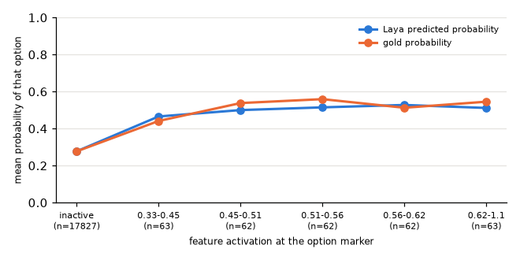

# Feature 14047

Critérios em que aparece: corr_error_stratified

**Interpretação (preencher):** 

---

## Maiores ativações

**tr_customer_service_000230 / action** (choice, customer_service) | ativação 5.031 em `estado` | opções ['answer_directly', 'close_no_action', 'escalate_to_human', 'execute_refund', 'request_information'] | Laya: **close_no_action** [0.215, 0.281, 0.154, 0.22, 0.13] | gabarito: **answer_directly**

```
[CLS]choice question: What should the assistant do next with this conversation?[SEP]
▸ [MASK] answer_directly: The assistant can resolve this itself with information it already has.
▸ [MASK] close_no_action: No further action is warranted; the matter is settled.
▸ [MASK] escalate_to_human: Hand off to a human agent with the appropriate authority.
▸ [MASK] execute_refund: Issue the refund or credit the customer is owed.
▸ [MASK] request_information: More detail is needed from the customer before anything can be done.

[SEP]

{"account": {"lifetime_value_usd": 284, "prior_tickets_90d": 1, "seats": 1, "tenure_months": 8, "tier": "free"}, "orders": [{"amount_usd": 18, "date": "2026-02-04", "id": "A-58579", "status": "refunded"}, {"amount_usd": 18, "date": "2026-02-26", "id": "A-36822", "status": "settled"}, {"amount_usd": 18, "date": "2026-02-07", "id": "A-33566", "status": "settled"}], "thread": [{"role": "customer", "text": "I’m furious that I still haven’t received the invoice copy for the $18 charge—this is the second time I’ve had to chase you about it!"}, {"role": "agent", "text": "I’m sorry you’ve had to follow up again. Could you tell me the date of the transaction or the invoice number you’re looking for?"}, {"role": "customer", "text": "It was on July 12, reference #FRE-2023-07-12. I opened a ticket about this last week and only got a vague reply, which didn’t include the document."}, {"role": "agent", "text": "Thank you for that information. Just to double‑check, is the email address jane.free@example.com still the best way to send the PDF?"}, {"role": "customer", "text": "Yes, that’s the address.⟦ Send⟧ me the proper invoice this time; I’m tired of being bounced around."}]}[SEP]
```

**tr_customer_service_000230 / category** (choice, customer_service) | ativação 4.707 em `estado` | opções ['account', 'billing', 'delivery', 'refund', 'technical'] | Laya: **refund** [0.246, 0.154, 0.109, 0.285, 0.206] | gabarito: **billing**

```
[CLS]choice question: What is this customer conversation primarily about?[SEP]
▸ [MASK] account: Login, plan changes, profile or access management.
▸ [MASK] billing: A charge, invoice, subscription or payment problem.
▸ [MASK] delivery: Shipping, fulfilment or delivery of a physical item.
▸ [MASK] refund: The customer is explicitly asking for money back.
▸ [MASK] technical: The product or service is not working as expected.

[SEP]

{"account": {"lifetime_value_usd": 284, "prior_tickets_90d": 1, "seats": 1, "tenure_months": 8, "tier": "free"}, "orders": [{"amount_usd": 18, "date": "2026-02-04", "id": "A-58579", "status": "refunded"}, {"amount_usd": 18, "date": "2026-02-26", "id": "A-36822", "status": "settled"}, {"amount_usd": 18, "date": "2026-02-07", "id": "A-33566", "status": "settled"}], "thread": [{"role": "customer", "text": "I’m furious that I still haven’t received the invoice copy for the $18 charge—this is the second time I’ve had to chase you about it!"}, {"role": "agent", "text": "I’m sorry you’ve had to follow up again. Could you tell me the date of the transaction or the invoice number you’re looking for?"}, {"role": "customer", "text": "It was on July 12, reference #FRE-2023-07-12. I opened a ticket about this last week and only got a vague reply, which didn’t include the document."}, {"role": "agent", "text": "Thank you for that information. Just to double‑check, is the email address jane.free@example.com still the best way to send the PDF?"}, {"role": "customer", "text": "Yes, that’s the address.⟦ Send⟧ me the proper invoice this time; I’m tired of being bounced around."}]}[SEP]
```

**tr_customer_service_000254 / needs_human** (noul, customer_service) | ativação 4.688 em `estado` | opções ['false', 'true'] | Laya: **true** [0.435, 0.565] | gabarito: **true**

```
[CLS]noul question: This conversation requires a human agent rather than automated handling.[SEP]
▸ [MASK] false: Automation can carry this to resolution.
▸ [MASK] true: A human must take over: judgement, authority or empathy is required.

[SEP]

{"account": {"lifetime_value_usd": 3273, "prior_tickets_90d": 0, "seats": 1, "tenure_months": 49, "tier": "free"}, "thread": [{"role": "customer", "text": "The export tool is completely broken and I have a hard deadline tonight. I’ve been using this free plan for 49 months and never seen it this bad."}, {"role": "agent", "text": "I am sorry to hear you are having trouble with the export tool. Could you please describe what happens exactly when you click the export button?"}, {"role": "customer", "text": "It just hangs indefinitely. I click it, the wheel spins, and nothing ever downloads."}, {"role": "agent", "text": "Thank you for clarifying. Are you seeing any notifications or pop-ups appear in the corner of your browser when the process stalls?"}, {"role": "customer", "text": "No, it’s just dead silence. Nothing happens at all, and I'm losing time."}, {"role": "agent", "text": "I appreciate you checking that. Which browser and version are you currently using to access the site?"}, {"role": "customer", "text": "I'm on Chrome, version 124.⟦ Get⟧ this moving, please."}]}[SEP]
```

**tr_customer_service_000254 / urgency** (score, customer_service) | ativação 4.605 em `estado` | opções ['0', '1', '2', '3'] | Laya: **1** [0.206, 0.474, 0.142, 0.178] | gabarito: **3**

```
[CLS]score question: How time-sensitive is this conversation?[SEP]
▸ [MASK] level 0: No time pressure; can wait indefinitely.
▸ [MASK] level 1: Routine; handle within the normal queue.
▸ [MASK] level 2: Elevated; should be handled within the same week.
▸ [MASK] level 3: Critical; requires action within the same day.

[SEP]

{"account": {"lifetime_value_usd": 3273, "prior_tickets_90d": 0, "seats": 1, "tenure_months": 49, "tier": "free"}, "thread": [{"role": "customer", "text": "The export tool is completely broken and I have a hard deadline tonight. I’ve been using this free plan for 49 months and never seen it this bad."}, {"role": "agent", "text": "I am sorry to hear you are having trouble with the export tool. Could you please describe what happens exactly when you click the export button?"}, {"role": "customer", "text": "It just hangs indefinitely. I click it, the wheel spins, and nothing ever downloads."}, {"role": "agent", "text": "Thank you for clarifying. Are you seeing any notifications or pop-ups appear in the corner of your browser when the process stalls?"}, {"role": "customer", "text": "No, it’s just dead silence. Nothing happens at all, and I'm losing time."}, {"role": "agent", "text": "I appreciate you checking that. Which browser and version are you currently using to access the site?"}, {"role": "customer", "text": "I'm on Chrome, version 124.⟦ Get⟧ this moving, please."}]}[SEP]
```

**tr_customer_service_000294 / action** (choice, customer_service) | ativação 4.598 em `estado` | opções ['answer_directly', 'close_no_action', 'escalate_to_human', 'execute_refund', 'request_information'] | Laya: **close_no_action** [0.179, 0.3, 0.162, 0.24, 0.119] | gabarito: **escalate_to_human**

```
[CLS]choice question: What should the assistant do next with this conversation?[SEP]
▸ [MASK] answer_directly: The assistant can resolve this itself with information it already has.
▸ [MASK] close_no_action: No further action is warranted; the matter is settled.
▸ [MASK] escalate_to_human: Hand off to a human agent with the appropriate authority.
▸ [MASK] execute_refund: Issue the refund or credit the customer is owed.
▸ [MASK] request_information: More detail is needed from the customer before anything can be done.

[SEP]

{"account": {"lifetime_value_usd": 3345, "prior_tickets_90d": 1, "seats": 1, "tenure_months": 41, "tier": "free"}, "orders": [{"amount_usd": 29, "date": "2026-02-13", "id": "A-72288", "status": "settled"}, {"amount_usd": 29, "date": "2026-02-07", "id": "A-13988", "status": "settled"}, {"amount_usd": 29, "date": "2026-03-22", "id": "A-75966", "status": "refunded"}], "thread": [{"role": "customer", "text": "I've had it—cancel my account immediately! I've been on your free plan for 41 months, paid roughly $29 a month, and you still can't sort out the billing mess. Ticket #12345 was only half‑fixed, and now you're making me think about leaving for good."}, {"role": "agent", "text": "I’m sorry you’re experiencing this frustration. Could you confirm the email address linked to the account and the exact issue you’d like us to address before we proceed with cancellation?"}, {"role": "customer", "text": "The issue is the same nonsense you tried to ‘partially fix’ before—random charges and a broken dashboard. I don’t want any more half‑measures; I want the account gone right now, or I’m posting a scathing review and moving my business elsewhere."}, {"role": "agent", "text": "I understand how aggravating that must be. To make sure we’re handling the correct profile, could you also let me know if you need a data export before we terminate the service?"}, {"role": "customer", "text": "Forget the export—just delete everything. I don’t care about my data; I just want you to stop billing me and shut the account down this instant."}, {"role": "agent", "text": "Got it, you’d like immediate termination without an export. For security, could you provide the last four digits of the payment method on file so I can verify the request?"}, {"role": "customer", "text": "I’m not giving you any more numbers.⟦ Do⟧ it now, or I’m taking this to your CEO and the press."}]}[SEP]
```

## Ativações medianas (faixa 40-60%, mediana 0.983)

**tr_customer_service_000154 / churn_risk** (score, customer_service) | ativação 1.082 em `estado` | opções ['0', '1', '2', '3'] | Laya: **2** [0.19, 0.298, 0.333, 0.18] | gabarito: **1**

```
[CLS]score question: How likely is this customer to stop doing business with us because of this interaction?[SEP]
▸ [MASK] level 0: No sign of dissatisfaction.
▸ [MASK] level 1: Mild frustration, but the relationship is intact.
▸ [MASK] level 2: Clearly unhappy; repeat problems or explicit complaints.
▸ [MASK] level 3: Imminent: threatening to cancel, dispute or leave.

[SEP]

{"account": {"lifetime_value_usd": 1803, "prior_tickets_90d": 0, "seats": 1, "tenure_months": 19, "tier": "free"}, "orders": [{"amount_usd": 198, "date": "2026-02-24", "id": "A-56491", "status": "refunded"}, {"amount_usd": 198, "date": "2026-02-25", "id": "A-17184", "status": "settled"}], "thread": [{"role": "customer", "text": "My attempt to upload a PDF to the project folder keeps timing out after a few seconds."}, {"role": "agent", "text": "Under⟦stood⟧. Are you seeing any error messages, or does the process simply stop?"}, {"role": "customer", "text": "It just stops; the spinner spins forever, no error text appears."}, {"role": "agent", "text": "Thanks for clarifying. Have you tried clearing your browser cache or using a different browser?"}, {"role": "customer", "text": "I tried Chrome incognito and it behaved the same way."}]}[SEP]
```

**tr_security_incidents_000197 / disposition** (choice, security_incidents) | ativação 1.040 em `opção` | opções ['close_benign', 'contain', 'investigate', 'monitor'] | Laya: **close_benign** [0.348, 0.216, 0.12, 0.317] | gabarito: **contain**

```
[CLS]choice question: How should this security alert be dispositioned?[SEP]
▸ [MASK] close_benign: Expected, explainable activity; close without analyst time.
▸ [MASK] contain:⟦ Cont⟧ain the host or account immediately; do not wait for triage.
▸ [MASK] investigate: Warrants an analyst opening an investigation.
▸ [MASK] monitor: Not clearly malicious, but worth watching for recurrence.

[SEP]

{"alert": {"description": "an unusual volume of files read in a short window", "evidence": "A privileged administrator session, authenticated via MFA and credentials last rotated 700 days ago, performed 8,420 file read operations within a ten-minute window. These requests originated from an unrecognized IP address while a maintenance change window was active.", "rule": "mass_download"}, "context": {"asset_criticality": "high", "change_window_active": true, "source_on_allowlist": false}, "history": {"credential_rotation_days_ago": 700, "distinct_countries_30d": 3, "logins_30d": 288, "prior_alerts_90d": 1}, "principal": {"mfa_enrolled": true, "name": "ci-infra-142", "privileges": ["deploy:production", "secrets:read"], "type": "admin"}}[SEP]
```

**tr_customer_service_000276 / needs_human** (noul, customer_service) | ativação 0.873 em `estado` | opções ['false', 'true'] | Laya: **true** [0.416, 0.584] | gabarito: **false**

```
[CLS]noul question: This conversation requires a human agent rather than automated handling.[SEP]
▸ [MASK] false: Automation can carry this to resolution.
▸ [MASK] true: A human must take over: judgement, authority or empathy is required.

[SEP]

{"account": {"lifetime_value_usd": 2578, "prior_tickets_90d": 2, "seats": 1, "tenure_months": 33, "tier": "free"}, "orders": [{"amount_usd": 19, "date": "2026-02-10", "id": "A-44819", "status": "pending"}, {"amount_usd": 19, "date": "2026-02-04", "id": "A-86947", "status": "refunded"}, {"amount_usd": 19, "date": "2026-03-02", "id": "A-96218", "status": "refunded"}], "thread": [{"role": "customer", "text": "Hi there. I’m checking in on the $19 refund I requested a while back. I’ve been with you for 33 months on the free plan, and since I have a hard deadline for my accounting this Friday, I was hoping for an update."}, {"role": "agent", "text": "Hello. I appreciate your long-standing loyalty over the last few years. I can certainly look into the status of that refund request for you; could you please provide the reference number from your previous inquiries?"}, {"role": "customer", "text": "I’ve opened two tickets already, but they seem to have stalled. I’m trying to keep my records clean before my deadline at the end of the week, so any movement on this would be greatly appreciated."}, {"role": "agent", "text": "Thank you for that clarification. I am currently reviewing your account history and the previous tickets mentioned to see where the hold-up might be occurring."}, {"role": "customer", "text": "I understand. I’m just really concerned about hitting that Friday cutoff, so⟦ please⟧ let me know as soon as you find anything out."}]}[SEP]
```

**tr_customer_service_000058 / category** (choice, customer_service) | ativação 0.974 em `estado` | opções ['account', 'billing', 'delivery', 'refund', 'technical'] | Laya: **refund** [0.226, 0.125, 0.142, 0.282, 0.224] | gabarito: **account**

```
[CLS]choice question: What is this customer conversation primarily about?[SEP]
▸ [MASK] account: Login, plan changes, profile or access management.
▸ [MASK] billing: A charge, invoice, subscription or payment problem.
▸ [MASK] delivery: Shipping, fulfilment or delivery of a physical item.
▸ [MASK] refund: The customer is explicitly asking for money back.
▸ [MASK] technical: The product or service is not working as expected.

[SEP]

{"account": {"lifetime_value_usd": 386, "prior_tickets_90d": 0, "seats": 3, "tenure_months": 5, "tier": "enterprise"}, "orders": [{"amount_usd": 49, "date": "2026-03-18", "id": "A-70177", "status": "refunded"}, {"amount_usd": 49, "date": "2026-01-12", "id": "A-80512", "status": "refunded"}, {"amount_usd": 49, "date": "2026-03-04", "id": "A-71911", "status": "failed"}], "thread": [{"role": "customer", "text": "I’d like to request a data export from our account; I’m not in a rush, just need to know the steps."}, {"role": "agent", "text": "Sure thing. Which format would you prefer for the export?"}, {"role": "customer", "text": "CSV works for us. Also, could you tell me roughly how long the process takes?"}, {"role": "agent", "text": "I’ll check on the timing. Do you need the export for a specific date range?"}, {"role": "customer", "text": "Just the last month up to today, and I⟦ understand⟧ it may not be immediate."}, {"role": "agent", "text": "Thanks for confirming. I’ll queue the request and let you know when it’s ready. Anything else you’d like to add?"}, {"role": "customer", "text": "That’s all for now, thank you."}]}[SEP]
```

**tr_customer_service_000224 / action** (choice, customer_service) | ativação 0.964 em `opção` | opções ['answer_directly', 'close_no_action', 'escalate_to_human', 'execute_refund', 'request_information'] | Laya: **answer_directly** [0.359, 0.263, 0.114, 0.073, 0.191] | gabarito: **escalate_to_human**

```
[CLS]choice question: What should the assistant do next with this conversation?[SEP]
▸ [MASK] answer_directly: The assistant can resolve this itself with information it already has.
▸ [MASK] close_no_action: No further action is warranted; the matter is settled.
▸ [MASK] escalate_to_human: Hand off to a human agent with the appropriate authority.
▸ [MASK] execute_refund:⟦ Issue⟧ the refund or credit the customer is owed.
▸ [MASK] request_information: More detail is needed from the customer before anything can be done.

[SEP]

{"account": {"lifetime_value_usd": 3096, "prior_tickets_90d": 1, "seats": 1, "tenure_months": 60, "tier": "standard"}, "thread": [{"role": "customer", "text": "I’ve been on the standard plan for five years, but the bulk export feature has stopped working since the last update."}, {"role": "agent", "text": "I am sorry to hear you're experiencing trouble with the export tool. Could you please confirm if you're receiving a specific error code when you attempt the download?"}, {"role": "customer", "text": "There isn't an error code; the progress bar just freezes at 20% and stays there until the page times out."}, {"role": "agent", "text": "Thank you for that clarification. Have you attempted clearing your browser cache or trying a different browser to see if the export completes?"}, {"role": "customer", "text": "I tried both of those after our last ticket, but the result was the same."}]}[SEP]
```

## Estatísticas (conjunto de descoberta, dev e teste)

**pred / error**

| split | decisões | ativas | ativas e Laya errou | taxa | lift | q (BH) | OR (CMH) | q (CMH) |
|---|---|---|---|---|---|---|---|---|
| discovery | 5100 | 230 | 111 | 0.483 | 0.76 | 6.45e-06 | 0.78 | 0.856 |
| dev | 900 | 54 | 30 | 0.556 | 0.85 | 0.374 | 1.06 | 0.972 |
| test | 2000 | 99 | 45 | 0.455 | 0.71 | 0.000724 | 0.60 | 0.83 |

**corr / error**

| split | decisões | ativas | ativas e Laya errou | taxa | lift | q (BH) | OR (CMH) | q (CMH) |
|---|---|---|---|---|---|---|---|---|
| discovery | 5100 | 159 | 40 | 0.252 | 0.40 | 1.27e-22 | 46.63 | 8.74e-09 |
| dev | 900 | 32 | 8 | 0.250 | 0.38 | 1.38e-05 | 26.78 | 0.0729 |
| test | 2000 | 70 | 16 | 0.229 | 0.36 | 1.38e-11 | 1.23 | 0.851 |

**state / error**

| split | decisões | ativas | ativas e Laya errou | taxa | lift | q (BH) | OR (CMH) | q (CMH) |
|---|---|---|---|---|---|---|---|---|
| discovery | 5100 | 1209 | 786 | 0.650 | 1.02 | 0.571 | 1.35 | 0.00127 |
| dev | 900 | 173 | 115 | 0.665 | 1.01 | 1 | 1.08 | 0.882 |
| test | 2000 | 453 | 294 | 0.649 | 1.02 | 0.949 | 1.27 | 0.211 |

Confusão mais sobre-representada (pred): `matches_order|1>0` (n=109, lift 21.97, p=0). Formato `pergunta|índice previsto>índice correto`.

Confusão mais sobre-representada (corr): `matches_order|0>1` (n=10, lift 32.08, p=6.56e-16). Formato `pergunta|índice previsto>índice correto`.

Confusão mais sobre-representada (state): `action|1>2` (n=72, lift 2.43, p=1.98e-16). Formato `pergunta|índice previsto>índice correto`.



