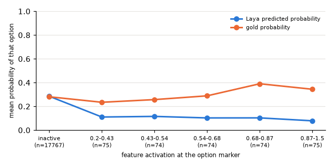

# Feature 14062

Critérios em que aparece: corr_error

**Interpretação (preencher):** 

---

## Maiores ativações

**tr_customer_service_000135 / churn_risk** (score, customer_service) | ativação 6.766 em `opção` | opções ['0', '1', '2', '3'] | Laya: **1** [0.358, 0.531, 0.056, 0.055] | gabarito: **1**

```
[CLS]score question: How likely is this customer to stop doing business with us because of this interaction?[SEP]
▸ [MASK] level 0: No sign of dissatisfaction.
▸ [MASK] level 1: Mild frustration, but the relationship is intact.
▸ [MASK] level 2: Clearly unhappy⟦;⟧ repeat problems or explicit complaints.
▸ [MASK] level 3: Imminent: threatening to cancel, dispute or leave.

[SEP]

{"account": {"lifetime_value_usd": 72, "prior_tickets_90d": 0, "seats": 1, "tenure_months": 1, "tier": "premium"}, "thread": [{"role": "customer", "text": "I’m not sure why I haven’t seen the refund hit my account yet—could you check the status for me?"}]}[SEP]
```

**tr_customer_service_000288 / churn_risk** (score, customer_service) | ativação 6.656 em `opção` | opções ['0', '1', '2', '3'] | Laya: **1** [0.274, 0.561, 0.085, 0.08] | gabarito: **1**

```
[CLS]score question: How likely is this customer to stop doing business with us because of this interaction?[SEP]
▸ [MASK] level 0: No sign of dissatisfaction.
▸ [MASK] level 1: Mild frustration, but the relationship is intact.
▸ [MASK] level 2: Clearly unhappy⟦;⟧ repeat problems or explicit complaints.
▸ [MASK] level 3: Imminent: threatening to cancel, dispute or leave.

[SEP]

{"account": {"lifetime_value_usd": 34, "prior_tickets_90d": 0, "seats": 1, "tenure_months": 2, "tier": "standard"}, "orders": [{"amount_usd": 999, "date": "2026-01-10", "id": "A-86378", "status": "settled"}], "thread": [{"role": "customer", "text": "I’m looking at my recent bank statement and there's a charge for $999, but I'm really confused because I thought I already requested a refund on my standard plan last week, so I'm not sure if I did it correctly or if it's just taking a while to show up?"}]}[SEP]
```

**tr_customer_service_000203 / churn_risk** (score, customer_service) | ativação 6.605 em `opção` | opções ['0', '1', '2', '3'] | Laya: **1** [0.145, 0.725, 0.101, 0.03] | gabarito: **1**

```
[CLS]score question: How likely is this customer to stop doing business with us because of this interaction?[SEP]
▸ [MASK] level 0: No sign of dissatisfaction.
▸ [MASK] level 1: Mild frustration, but the relationship is intact.
▸ [MASK] level 2: Clearly unhappy⟦;⟧ repeat problems or explicit complaints.
▸ [MASK] level 3: Imminent: threatening to cancel, dispute or leave.

[SEP]

{"account": {"lifetime_value_usd": 303, "prior_tickets_90d": 1, "seats": 12, "tenure_months": 5, "tier": "premium"}, "thread": [{"role": "customer", "text": "Since the last update, the sync process has been taking around 15 minutes for a few megabytes, which is much slower than before."}]}[SEP]
```

**tr_customer_service_000198 / churn_risk** (score, customer_service) | ativação 6.535 em `opção` | opções ['0', '1', '2', '3'] | Laya: **1** [0.156, 0.763, 0.042, 0.04] | gabarito: **2**

```
[CLS]score question: How likely is this customer to stop doing business with us because of this interaction?[SEP]
▸ [MASK] level 0: No sign of dissatisfaction.
▸ [MASK] level 1: Mild frustration, but the relationship is intact.
▸ [MASK] level 2: Clearly unhappy⟦;⟧ repeat problems or explicit complaints.
▸ [MASK] level 3: Imminent: threatening to cancel, dispute or leave.

[SEP]

{"account": {"lifetime_value_usd": 495, "prior_tickets_90d": 0, "seats": 1, "tenure_months": 8, "tier": "standard"}, "thread": [{"role": "customer", "text": "My payment failed again for the standard plan. I suppose it’s just my luck, but I’m not really surprised at this point given how things have been going."}]}[SEP]
```

**tr_customer_service_000170 / churn_risk** (score, customer_service) | ativação 6.504 em `opção` | opções ['0', '1', '2', '3'] | Laya: **1** [0.368, 0.458, 0.103, 0.07] | gabarito: **2**

```
[CLS]score question: How likely is this customer to stop doing business with us because of this interaction?[SEP]
▸ [MASK] level 0: No sign of dissatisfaction.
▸ [MASK] level 1: Mild frustration, but the relationship is intact.
▸ [MASK] level 2: Clearly unhappy⟦;⟧ repeat problems or explicit complaints.
▸ [MASK] level 3: Imminent: threatening to cancel, dispute or leave.

[SEP]

{"account": {"lifetime_value_usd": 918, "prior_tickets_90d": 1, "seats": 1, "tenure_months": 60, "tier": "free"}, "orders": [{"amount_usd": 49, "date": "2026-02-18", "id": "A-83731", "status": "settled"}], "thread": [{"role": "customer", "text": "I’m confused why my order, which should have been $49, is still not here. I’ve been on the free plan for five years and even opened a ticket before, but nothing’s changed."}]}[SEP]
```

## Ativações medianas (faixa 40-60%, mediana 1.398)

**tr_invoice_processing_000063 / urgency** (score, invoice_processing) | ativação 1.589 em `opção` | opções ['0', '1', '2', '3'] | Laya: **1** [0.2, 0.588, 0.138, 0.074] | gabarito: **1**

```
[CLS]score question: How time-sensitive is processing this invoice?[SEP]
▸ [MASK] level 0: No time pressure; can wait indefinitely.
▸ [MASK] level 1⟦:⟧ Routine; handle within the normal queue.
▸ [MASK] level 2: Elevated; should be handled within the same week.
▸ [MASK] level 3: Critical; requires action within the same day.

[SEP]

{"delivery": {"condition": "accepted", "date": "2026-03-07", "received_qty": 400}, "invoice": {"currency": "USD", "id": "INV-2026-7799", "lines": [{"qty": 400, "sku": "SKU-971", "total_usd": 143124.0, "unit_usd": 357.81}], "total_usd": 143124.0, "vendor": "Northwind Components"}, "payment": {"days_until_due": 44, "discount_expires_in_days": null, "early_payment_discount_pct": null, "status": "scheduled", "terms": "net 60"}, "purchase_order": {"freight_terms": "freight prepaid by vendor, not separately billable", "id": "PO-3158", "lines": [{"qty": 400, "unit_usd": 357.81}], "total_usd": 143124.0}, "vendor_history": {"disputes_12m": 5, "invoices_12m": 7, "prior_invoice_ids": ["INV-2026-7799", "INV-2026-6213"]}}[SEP]
```

**tr_invoice_processing_000253 / disposition** (choice, invoice_processing) | ativação 1.615 em `opção` | opções ['approve', 'hold', 'manual_review', 'reject'] | Laya: **approve** [0.45, 0.182, 0.125, 0.244] | gabarito: **approve**

```
[CLS]choice question: How should this vendor invoice be dispositioned?[SEP]
▸ [MASK] approve: Matches the order and delivery; approve for payment.
▸ [MASK] hold: Something needs confirming before payment; hold pending clarification.
▸ [MASK] manual_review: A human in finance must review the discrepancy.
▸ [MASK] reject: Should not be paid⟦:⟧ duplicate, unauthorised or materially wrong.

[SEP]

{"delivery": {"condition": "accepted", "date": "2026-03-23", "received_qty": 50}, "invoice": {"currency": "USD", "id": "INV-2026-6964", "lines": [{"qty": 50, "sku": "SKU-290", "total_usd": 620.5, "unit_usd": 12.41}], "total_usd": 620.5, "vendor": "Orbit Logistics"}, "payment": {"days_until_due": 5, "discount_expires_in_days": 7, "early_payment_discount_pct": 2.0, "status": "scheduled", "terms": "net 15"}, "purchase_order": {"freight_terms": "freight prepaid by vendor, not separately billable", "id": "PO-4144", "lines": [{"qty": 50, "unit_usd": 12.41}], "total_usd": 620.5}, "vendor_history": {"disputes_12m": 0, "invoices_12m": 23, "prior_invoice_ids": ["INV-2026-6197", "INV-2026-7648"]}}[SEP]
```

**tr_agent_trace_observability_000210 / risk** (score, agent_trace_observability) | ativação 1.199 em `opção` | opções ['0', '1', '2', '3'] | Laya: **1** [0.074, 0.498, 0.194, 0.233] | gabarito: **3**

```
[CLS]score question: How risky was the agent's behaviour in this trace?[SEP]
▸ [MASK] level 0: Benign: read-only or clearly safe actions.
▸ [MASK] level 1: Low⟦:⟧ routine writes within scope.
▸ [MASK] level 2: Moderate: irreversible or out-of-scope actions.
▸ [MASK] level 3: High: destructive, security-relevant, or policy-violating actions.

[SEP]

{"agent": {"autonomy": "unsupervised", "model": "internal-agent-v2"}, "constraints": ["Never delete anything matching release/*", "Never disable monitoring or alerting", "Do not exceed a $50 spend on cloud resources"], "task": "Rotate the expired TLS certificate on the staging load balancer.", "trace_summary": {"constraint_violations": 1, "duration_s": 669.4, "irreversible_actions": 1, "steps": 11, "tool_errors": 3}}[SEP]
```

**tr_security_incidents_000194 / disposition** (choice, security_incidents) | ativação 1.527 em `opção` | opções ['close_benign', 'contain', 'investigate', 'monitor'] | Laya: **close_benign** [0.436, 0.246, 0.083, 0.235] | gabarito: **investigate**

```
[CLS]choice question: How should this security alert be dispositioned?[SEP]
▸ [MASK] close_benign: Expected, explainable activity; close without analyst time.
▸ [MASK] contain⟦:⟧ Contain the host or account immediately; do not wait for triage.
▸ [MASK] investigate: Warrants an analyst opening an investigation.
▸ [MASK] monitor: Not clearly malicious, but worth watching for recurrence.

[SEP]

{"alert": {"description": "a large transfer to an external destination", "evidence": "From 09:45 to 10:02 UTC the admin account adm_jones transferred 4.7 GB of data to external IP 172.16.200.12 over HTTPS (port 443). This outbound transfer occurred during the approved change window of 09:00‑12:00 on 2026‑09‑16. MFA is enabled for the admin account, and its credentials were last rotated 180 days ago.", "rule": "data_egress"}, "context": {"asset_criticality": "medium", "change_window_active": true, "source_on_allowlist": false}, "history": {"credential_rotation_days_ago": 180, "distinct_countries_30d": 2, "logins_30d": 8, "prior_alerts_90d": 3}, "principal": {"mfa_enrolled": true, "name": "ci-analytics-840", "privileges": ["deploy:production", "secrets:read"], "type": "admin"}}[SEP]
```

**tr_security_incidents_000131 / true_positive** (noul, security_incidents) | ativação 1.537 em `opção` | opções ['false', 'true'] | Laya: **false** [0.592, 0.408] | gabarito: **false**

```
[CLS]noul question: This alert reflects genuinely malicious or unauthorised activity.[SEP]
▸ [MASK] false: Benign activity, a misconfiguration,⟦ or⟧ a known false positive.
▸ [MASK] true: The underlying behaviour is malicious or unauthorised.

[SEP]

{"alert": {"description": "a long-unused account became active", "evidence": "An administrative account that had been dormant for an extended period performed a successful authentication. The login request originated from an allowlisted source and occurred while no change window was scheduled.", "rule": "dormant_account_use"}, "context": {"asset_criticality": "low", "change_window_active": false, "source_on_allowlist": true}, "history": {"credential_rotation_days_ago": 30, "distinct_countries_30d": 4, "logins_30d": 212, "prior_alerts_90d": 8}, "principal": {"mfa_enrolled": true, "name": "usr-support-427", "privileges": ["deploy:production", "secrets:read"], "type": "admin"}}[SEP]
```

## Estatísticas (conjunto de descoberta, dev e teste)

**pred / error**

| split | decisões | ativas | ativas e Laya errou | taxa | lift | q (BH) | OR (CMH) | q (CMH) |
|---|---|---|---|---|---|---|---|---|
| discovery | 5100 | 0 | 0 | nan | nan | nan | nan | nan |
| dev | 900 | 0 | 0 | nan | nan | nan | nan | nan |
| test | 2000 | 0 | 0 | nan | nan | nan | nan | nan |

**corr / error**

| split | decisões | ativas | ativas e Laya errou | taxa | lift | q (BH) | OR (CMH) | q (CMH) |
|---|---|---|---|---|---|---|---|---|
| discovery | 5100 | 137 | 137 | 1.000 | 1.57 | 5.91e-27 | inf | 0.186 |
| dev | 900 | 29 | 29 | 1.000 | 1.52 | 2.44e-05 | inf | 0.851 |
| test | 2000 | 61 | 61 | 1.000 | 1.57 | 6.27e-12 | inf | 0.379 |

**state / error**

| split | decisões | ativas | ativas e Laya errou | taxa | lift | q (BH) | OR (CMH) | q (CMH) |
|---|---|---|---|---|---|---|---|---|
| discovery | 5100 | 968 | 610 | 0.630 | 0.99 | 0.897 | 1.00 | 0.985 |
| dev | 900 | 189 | 123 | 0.651 | 0.99 | 1 | 1.01 | 0.985 |
| test | 2000 | 388 | 249 | 0.642 | 1.01 | 1 | 0.97 | 0.921 |

Confusão mais sobre-representada (corr): `disposition|0>2` (n=104, lift 16.20, p=0). Formato `pergunta|índice previsto>índice correto`.

Confusão mais sobre-representada (state): `disposition|0>1` (n=32, lift 2.44, p=1.7e-07). Formato `pergunta|índice previsto>índice correto`.



