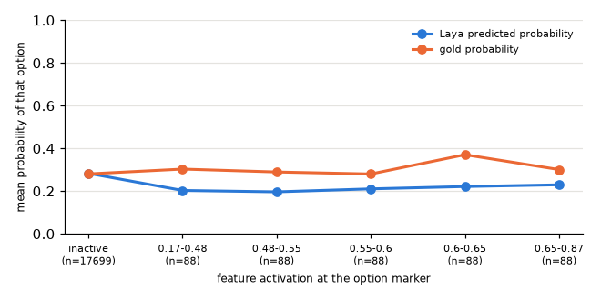

# Feature 14140

Critérios em que aparece: corr_error_stratified

**Interpretação (preencher):** 

---

## Maiores ativações

**tr_customer_service_000189 / urgency** (score, customer_service) | ativação 7.684 em `estado` | opções ['0', '1', '2', '3'] | Laya: **3** [0.138, 0.34, 0.172, 0.35] | gabarito: **2**

```
[CLS]score question: How time-sensitive is this conversation?[SEP]
▸ [MASK] level 0: No time pressure; can wait indefinitely.
▸ [MASK] level 1: Routine; handle within the normal queue.
▸ [MASK] level 2: Elevated; should be handled within the same week.
▸ [MASK] level 3: Critical; requires action within the same day.

[SEP]

{"account": {"lifetime_value_usd": 3857, "prior_tickets_90d": 0, "seats": 1, "tenure_months": 41, "tier": "standard"}, "thread": [{"role": "customer", "text": "I’m fed up with seeing the same charge hit my card again. My standard plan has been active for 41 months and this is the first time I’ve been billed twice for the same period. I need this fixed before the end⟦ of⟧ the week or my budget’s ruined."}, {"role": "agent", "text": "I understand how irritating that must be. Could you provide the date of the transactions and the last four digits of the card you used?"}, {"role": "customer", "text": "The charges both show up on September 3rd, and the last four digits are 8421. I’ve attached the statement screenshot."}, {"role": "agent", "text": "Thanks for the details. I’ll look into why the duplicate appeared. Just to confirm, are there any other recent charges on the account that seem off?"}, {"role": "customer", "text": "No, just the two identical ones. I really need this cleared up by Friday because I have to reconcile my accounts."}]}[SEP]
```

**tr_customer_service_000099 / churn_risk** (score, customer_service) | ativação 7.664 em `estado` | opções ['0', '1', '2', '3'] | Laya: **3** [0.09, 0.287, 0.24, 0.383] | gabarito: **2**

```
[CLS]score question: How likely is this customer to stop doing business with us because of this interaction?[SEP]
▸ [MASK] level 0: No sign of dissatisfaction.
▸ [MASK] level 1: Mild frustration, but the relationship is intact.
▸ [MASK] level 2: Clearly unhappy; repeat problems or explicit complaints.
▸ [MASK] level 3: Imminent: threatening to cancel, dispute or leave.

[SEP]

{"account": {"lifetime_value_usd": 210, "prior_tickets_90d": 0, "seats": 1, "tenure_months": 5, "tier": "standard"}, "thread": [{"role": "customer", "text": "I need to downgrade my account immediately. My budget is finalized at the end⟦ of⟧ the day today, so this needs to be handled right now."}, {"role": "agent", "text": "I understand that you have a time-sensitive deadline. To ensure I'm looking at the correct account, could you please verify the full name on the billing profile?"}, {"role": "customer", "text": "The name is Marcus Thorne. Please, I really don't have time to go back and forth on this today."}, {"role": "agent", "text": "Thank you, Marcus. I have your account pulled up. Could you please clarify if you are looking to move to the base tier or if you'd like to remove specific add-ons?"}, {"role": "customer", "text": "I just want the base tier, and I need this confirmed before the business day closes. Can you tell me if that's going to happen?"}]}[SEP]
```

**tr_customer_service_000189 / churn_risk** (score, customer_service) | ativação 7.660 em `estado` | opções ['0', '1', '2', '3'] | Laya: **2** [0.061, 0.182, 0.578, 0.179] | gabarito: **2**

```
[CLS]score question: How likely is this customer to stop doing business with us because of this interaction?[SEP]
▸ [MASK] level 0: No sign of dissatisfaction.
▸ [MASK] level 1: Mild frustration, but the relationship is intact.
▸ [MASK] level 2: Clearly unhappy; repeat problems or explicit complaints.
▸ [MASK] level 3: Imminent: threatening to cancel, dispute or leave.

[SEP]

{"account": {"lifetime_value_usd": 3857, "prior_tickets_90d": 0, "seats": 1, "tenure_months": 41, "tier": "standard"}, "thread": [{"role": "customer", "text": "I’m fed up with seeing the same charge hit my card again. My standard plan has been active for 41 months and this is the first time I’ve been billed twice for the same period. I need this fixed before the end⟦ of⟧ the week or my budget’s ruined."}, {"role": "agent", "text": "I understand how irritating that must be. Could you provide the date of the transactions and the last four digits of the card you used?"}, {"role": "customer", "text": "The charges both show up on September 3rd, and the last four digits are 8421. I’ve attached the statement screenshot."}, {"role": "agent", "text": "Thanks for the details. I’ll look into why the duplicate appeared. Just to confirm, are there any other recent charges on the account that seem off?"}, {"role": "customer", "text": "No, just the two identical ones. I really need this cleared up by Friday because I have to reconcile my accounts."}]}[SEP]
```

**tr_customer_service_000189 / action** (choice, customer_service) | ativação 7.648 em `estado` | opções ['answer_directly', 'close_no_action', 'escalate_to_human', 'execute_refund', 'request_information'] | Laya: **close_no_action** [0.291, 0.294, 0.219, 0.102, 0.094] | gabarito: **execute_refund**

```
[CLS]choice question: What should the assistant do next with this conversation?[SEP]
▸ [MASK] answer_directly: The assistant can resolve this itself with information it already has.
▸ [MASK] close_no_action: No further action is warranted; the matter is settled.
▸ [MASK] escalate_to_human: Hand off to a human agent with the appropriate authority.
▸ [MASK] execute_refund: Issue the refund or credit the customer is owed.
▸ [MASK] request_information: More detail is needed from the customer before anything can be done.

[SEP]

{"account": {"lifetime_value_usd": 3857, "prior_tickets_90d": 0, "seats": 1, "tenure_months": 41, "tier": "standard"}, "thread": [{"role": "customer", "text": "I’m fed up with seeing the same charge hit my card again. My standard plan has been active for 41 months and this is the first time I’ve been billed twice for the same period. I need this fixed before the end⟦ of⟧ the week or my budget’s ruined."}, {"role": "agent", "text": "I understand how irritating that must be. Could you provide the date of the transactions and the last four digits of the card you used?"}, {"role": "customer", "text": "The charges both show up on September 3rd, and the last four digits are 8421. I’ve attached the statement screenshot."}, {"role": "agent", "text": "Thanks for the details. I’ll look into why the duplicate appeared. Just to confirm, are there any other recent charges on the account that seem off?"}, {"role": "customer", "text": "No, just the two identical ones. I really need this cleared up by Friday because I have to reconcile my accounts."}]}[SEP]
```

**tr_customer_service_000197 / category** (choice, customer_service) | ativação 7.547 em `opção` | opções ['account', 'billing', 'delivery', 'refund', 'technical'] | Laya: **delivery** [0.003, 0.003, 0.983, 0.004, 0.007] | gabarito: **delivery**

```
[CLS]choice question: What is this customer conversation primarily about?[SEP]
▸ [MASK] account: Login, plan changes, profile or access management.
▸ [MASK] billing: A charge, invoice, subscription or payment problem.
▸ [MASK] delivery: Shipping, fulfilment or delivery⟦ of⟧ a physical item.
▸ [MASK] refund: The customer is explicitly asking for money back.
▸ [MASK] technical: The product or service is not working as expected.

[SEP]

{"account": {"lifetime_value_usd": 1409, "prior_tickets_90d": 2, "seats": 1, "tenure_months": 49, "tier": "free"}, "thread": [{"role": "customer", "text": "I’ve been with you for over four years now, but I’m really lost as to why my delivery hasn't arrived yet. I've reached out twice before and was told it was on the way, but nothing ever shows up. It’s making it very hard to justify staying if this keeps happening."}]}[SEP]
```

## Ativações medianas (faixa 40-60%, mediana 1.127)

**tr_customer_service_000056 / category** (choice, customer_service) | ativação 1.341 em `estado` | opções ['account', 'billing', 'delivery', 'refund', 'technical'] | Laya: **account** [0.284, 0.168, 0.084, 0.236, 0.227] | gabarito: **delivery**

```
[CLS]choice question: What is this customer conversation primarily about?[SEP]
▸ [MASK] account: Login, plan changes, profile or access management.
▸ [MASK] billing: A charge, invoice, subscription or payment problem.
▸ [MASK] delivery: Shipping, fulfilment or delivery of a physical item.
▸ [MASK] refund: The customer is explicitly asking for money back.
▸ [MASK] technical: The product or service is not working as expected.

[SEP]

{"account": {"lifetime_value_usd": 2311, "prior_tickets_90d": 1, "seats": 1, "tenure_months": 26, "tier": "premium"}, "thread": [{"role": "customer", "text": "I’ve been a premium member for 26 months and the package I got today is completely wrong – it’s not even the model I ordered."}, {"role": "agent", "text": "I’m sorry to hear that. Could you share the order number so I can look into it?"}, {"role": "customer", "text": "It’s the same issue we fought over in ticket #12345 – you promised it would be fixed and now you’ve shipped the wrong item again. I’m done with this."}, {"role": "agent", "text": "I understand your frustration. Would you be able to send a photo of what you received?"}, {"role": "customer", "text": "I’ve been paying for the premium plan for over two years and I expect this to be sorted out fast, otherwise I’m walking away."}, {"role": "agent", "text": "I hear you. I’ll forward this to our escalation team right away. Could you confirm the shipping address⟦ on⟧ the account?"}, {"role": "customer", "text": "I need this sorted now, or I’m out."}]}[SEP]
```

**tr_customer_service_000248 / urgency** (score, customer_service) | ativação 3.123 em `estado` | opções ['0', '1', '2', '3'] | Laya: **1** [0.095, 0.636, 0.201, 0.068] | gabarito: **1**

```
[CLS]score question: How time-sensitive is this conversation?[SEP]
▸ [MASK] level 0: No time pressure; can wait indefinitely.
▸ [MASK] level 1: Routine; handle within the normal queue.
▸ [MASK] level 2: Elevated; should be handled within the same week.
▸ [MASK] level 3: Critical; requires action within the same day.

[SEP]

{"account": {"lifetime_value_usd": 5956, "prior_tickets_90d": 0, "seats": 1, "tenure_months": 72, "tier": "standard"}, "orders": [{"amount_usd": 19, "date": "2026-02-20", "id": "A-97410", "status": "pending"}], "thread": [{"role": "customer", "text": "I just opened my package and I'm quite puzzled, I ordered the matte black frame but the one in the box is a very bright glossy silver."}, {"role": "agent", "text": "I appreciate you reaching out about this discrepancy. Could you let me know if the SKU number printed on the external packaging matches your order confirmation?"}, {"role": "customer", "text": "Let's see... the box says SKU-992, but I'm looking at the email I got when I ordered it and that says I should have received SKU-995."}, {"role": "agent", "text": "Thank you for checking that. Besides the color being incorrect, does the frame appear to be the correct size that you requested, or is that different as well?"}, {"role": "customer", "text": "The size seems to be the 11x14 I wanted, it's just the finish that's totally wrong and won't work for where I wanted to hang it."}, {"role": "agent", "text": "I understand. To help me document this correctly for our warehouse team, could you describe any other labels or markings you see on the inner protective wrapping?"}, {"role": "customer", "text": "There aren't really any other labels on the inside, just the clear plastic sleeve, so I'm still trying to figure out how I ended up with silver instead⟦ of⟧ black."}]}[SEP]
```

**tr_customer_service_000078 / urgency** (score, customer_service) | ativação 1.057 em `estado` | opções ['0', '1', '2', '3'] | Laya: **1** [0.176, 0.545, 0.102, 0.177] | gabarito: **3**

```
[CLS]score question: How time-sensitive is this conversation?[SEP]
▸ [MASK] level 0: No time pressure; can wait indefinitely.
▸ [MASK] level 1: Routine; handle within the normal queue.
▸ [MASK] level 2: Elevated; should be handled within the same week.
▸ [MASK] level 3: Critical; requires action within the same day.

[SEP]

{"account": {"lifetime_value_usd": 1592, "prior_tickets_90d": 0, "seats": 12, "tenure_months": 60, "tier": "premium"}, "orders": [{"amount_usd": 598, "date": "2026-01-10", "id": "A-12739", "status": "refunded"}, {"amount_usd": 598, "date": "2026-03-19", "id": "A-59410", "status": "failed"}, {"amount_usd": 598, "date": "2026-01-16", "id": "A-91127", "status": "failed"}], "thread": [{"role": "customer", "text": "Hello, I am a long-time premium member and my latest order of $598 just arrived with significant damage to the exterior packaging and the item itself. I have an event this Friday and really need this resolved."}, {"role": "agent", "text": "I am very sorry to hear that your order arrived in that condition. To help me understand the extent of the damage, could you please describe exactly what looks broken?"}, {"role": "customer", "text": "The glass display is completely shattered, and there is a deep dent⟦ on⟧ the base unit. It looks like it was crushed during transit."}, {"role": "agent", "text": "Thank you for those details. Would you be able to upload a few clear photographs of the damage to this chat so I can review them?"}, {"role": "customer", "text": "I have taken photos of the unit from several angles. Please let me know if there's anything else you need from me before the end of the day."}]}[SEP]
```

**tr_customer_service_000282 / category** (choice, customer_service) | ativação 1.384 em `estado` | opções ['account', 'billing', 'delivery', 'refund', 'technical'] | Laya: **refund** [0.006, 0.015, 0.005, 0.963, 0.01] | gabarito: **refund**

```
[CLS]choice question: What is this customer conversation primarily about?[SEP]
▸ [MASK] account: Login, plan changes, profile or access management.
▸ [MASK] billing: A charge, invoice, subscription or payment problem.
▸ [MASK] delivery: Shipping, fulfilment or delivery of a physical item.
▸ [MASK] refund: The customer is explicitly asking for money back.
▸ [MASK] technical: The product or service is not working as expected.

[SEP]

{"account": {"lifetime_value_usd": 53, "prior_tickets_90d": 0, "seats": 3, "tenure_months": 1, "tier": "premium"}, "thread": [{"role": "customer", "text": "I've been waiting for my refund to hit my account for days now and there's still nothing showing up. I signed up for the Premium plan last month and it's been nothing but a headache."}, {"role": "agent", "text": "I understand how concerning it is when expected funds don't appear. Could you please confirm the date you initially requested the transaction reversal?"}, {"role": "customer", "text": "I did it last Tuesday! It's ridiculous that I'm even having to ask about this because the confirmation email said it was processed immediately."}, {"role": "agent", "text": "Thank you for that information. To help me look into the status on our end, are you able to provide the transaction ID⟦ from⟧ that confirmation email?"}, {"role": "customer", "text": "I'm looking for it now, but I shouldn't have to jump through hoops just to get my money back from a service I barely used for four weeks."}]}[SEP]
```

**tr_security_incidents_000240 / severity** (score, security_incidents) | ativação 0.930 em `opção` | opções ['0', '1', '2', '3', '4'] | Laya: **2** [0.045, 0.339, 0.399, 0.164, 0.053] | gabarito: **2**

```
[CLS]score question: How severe is the potential impact if this alert is real?[SEP]
▸ [MASK] level 0: Negligible: no access⟦ to⟧ anything sensitive.
▸ [MASK] level 1: Low: limited access, easily reversed.
▸ [MASK] level 2: Moderate: access to internal systems or non-public data.
▸ [MASK] level 3: High: access to production, secrets or customer data.
▸ [MASK] level 4: Critical: active compromise of crown-jewel systems.

[SEP]

{"alert": {"description": "a security group was opened to the public internet", "evidence": "The shared mailbox account modified a security group to allow inbound traffic from 0.0.0.0/0 outside of a scheduled change window. The request originated from an unrecognized IP address, and the account's credentials have not been rotated in 700 days.", "rule": "config_drift"}, "context": {"asset_criticality": "medium", "change_window_active": false, "source_on_allowlist": false}, "history": {"credential_rotation_days_ago": 700, "distinct_countries_30d": 4, "logins_30d": 1860, "prior_alerts_90d": 0}, "principal": {"mfa_enrolled": true, "name": "adm-infra-625", "privileges": ["repo:read"], "type": "shared_mailbox"}}[SEP]
```

## Estatísticas (conjunto de descoberta, dev e teste)

**pred / error**

| split | decisões | ativas | ativas e Laya errou | taxa | lift | q (BH) | OR (CMH) | q (CMH) |
|---|---|---|---|---|---|---|---|---|
| discovery | 5100 | 41 | 21 | 0.512 | 0.80 | 0.199 | 1.46 | 0.548 |
| dev | 900 | 7 | 4 | 0.571 | 0.87 | nan | nan | nan |
| test | 2000 | 20 | 11 | 0.550 | 0.86 | 0.643 | 1.47 | 0.826 |

**corr / error**

| split | decisões | ativas | ativas e Laya errou | taxa | lift | q (BH) | OR (CMH) | q (CMH) |
|---|---|---|---|---|---|---|---|---|
| discovery | 5100 | 142 | 122 | 0.859 | 1.35 | 8.42e-09 | 4.04 | 2.96e-05 |
| dev | 900 | 25 | 22 | 0.880 | 1.34 | 0.0344 | 2.80 | 0.559 |
| test | 2000 | 60 | 51 | 0.850 | 1.33 | 0.000691 | 2.61 | 0.122 |

**state / error**

| split | decisões | ativas | ativas e Laya errou | taxa | lift | q (BH) | OR (CMH) | q (CMH) |
|---|---|---|---|---|---|---|---|---|
| discovery | 5100 | 1933 | 1210 | 0.626 | 0.98 | 0.548 | 1.25 | 0.0082 |
| dev | 900 | 321 | 214 | 0.667 | 1.02 | 1 | 1.41 | 0.233 |
| test | 2000 | 696 | 444 | 0.638 | 1.00 | 1 | 1.38 | 0.0433 |

Confusão mais sobre-representada (pred): `urgency|3>2` (n=3, lift 41.46, p=3.92e-05). Formato `pergunta|índice previsto>índice correto`.

Confusão mais sobre-representada (corr): `churn_risk|1>2` (n=32, lift 20.90, p=4.87e-37). Formato `pergunta|índice previsto>índice correto`.

Confusão mais sobre-representada (state): `action|1>2` (n=97, lift 2.05, p=5.91e-20). Formato `pergunta|índice previsto>índice correto`.



