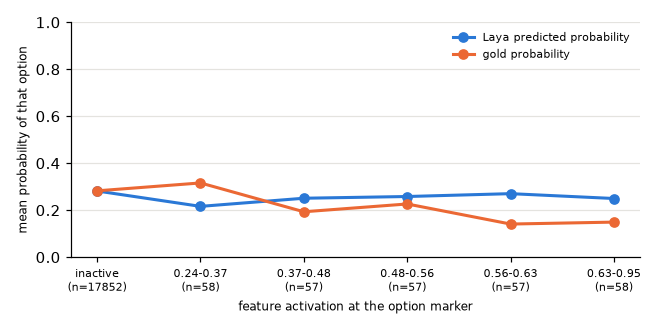

# Feature 14199

Critérios em que aparece: pred_error

**Interpretação (preencher):** 

---

## Maiores ativações

**tr_customer_service_000244 / urgency** (score, customer_service) | ativação 3.865 em `estado` | opções ['0', '1', '2', '3'] | Laya: **1** [0.053, 0.617, 0.175, 0.155] | gabarito: **2**

```
[CLS]score question: How time-sensitive is this conversation?[SEP]
▸ [MASK] level 0: No time pressure; can wait indefinitely.
▸ [MASK] level 1: Routine; handle within the normal queue.
▸ [MASK] level 2: Elevated; should be handled within the same week.
▸ [MASK] level 3: Critical; requires action within the same day.

[SEP]

{"account": {"lifetime_value_usd": 91, "prior_tickets_90d": 0, "seats": 1, "tenure_months": 1, "tier": "standard"}, "thread": [{"role": "customer", "text": "Hi there! I just opened my package and noticed that I received the standard kit instead of the del⟦uxe⟧ version I had ordered. I hate to be a pain, but I'm actually on a very tight schedule and need the specific components from the deluxe kit for a project deadline on Tuesday. Could you help me figure out how to get the right items sent out?"}]}[SEP]
```

**tr_customer_service_000244 / category** (choice, customer_service) | ativação 3.863 em `estado` | opções ['account', 'billing', 'delivery', 'refund', 'technical'] | Laya: **delivery** [0.063, 0.069, 0.537, 0.259, 0.073] | gabarito: **delivery**

```
[CLS]choice question: What is this customer conversation primarily about?[SEP]
▸ [MASK] account: Login, plan changes, profile or access management.
▸ [MASK] billing: A charge, invoice, subscription or payment problem.
▸ [MASK] delivery: Shipping, fulfilment or delivery of a physical item.
▸ [MASK] refund: The customer is explicitly asking for money back.
▸ [MASK] technical: The product or service is not working as expected.

[SEP]

{"account": {"lifetime_value_usd": 91, "prior_tickets_90d": 0, "seats": 1, "tenure_months": 1, "tier": "standard"}, "thread": [{"role": "customer", "text": "Hi there! I just opened my package and noticed that I received the standard kit instead of the del⟦uxe⟧ version I had ordered. I hate to be a pain, but I'm actually on a very tight schedule and need the specific components from the deluxe kit for a project deadline on Tuesday. Could you help me figure out how to get the right items sent out?"}]}[SEP]
```

**tr_customer_service_000244 / needs_human** (noul, customer_service) | ativação 3.695 em `estado` | opções ['false', 'true'] | Laya: **true** [0.48, 0.52] | gabarito: **true**

```
[CLS]noul question: This conversation requires a human agent rather than automated handling.[SEP]
▸ [MASK] false: Automation can carry this to resolution.
▸ [MASK] true: A human must take over: judgement, authority or empathy is required.

[SEP]

{"account": {"lifetime_value_usd": 91, "prior_tickets_90d": 0, "seats": 1, "tenure_months": 1, "tier": "standard"}, "thread": [{"role": "customer", "text": "Hi there! I just opened my package and noticed that I received the standard kit instead of the del⟦uxe⟧ version I had ordered. I hate to be a pain, but I'm actually on a very tight schedule and need the specific components from the deluxe kit for a project deadline on Tuesday. Could you help me figure out how to get the right items sent out?"}]}[SEP]
```

**tr_customer_service_000234 / urgency** (score, customer_service) | ativação 3.557 em `estado` | opções ['0', '1', '2', '3'] | Laya: **1** [0.182, 0.452, 0.16, 0.207] | gabarito: **3**

```
[CLS]score question: How time-sensitive is this conversation?[SEP]
▸ [MASK] level 0: No time pressure; can wait indefinitely.
▸ [MASK] level 1: Routine; handle within the normal queue.
▸ [MASK] level 2: Elevated; should be handled within the same week.
▸ [MASK] level 3: Critical; requires action within the same day.

[SEP]

{"account": {"lifetime_value_usd": 1458, "prior_tickets_90d": 0, "seats": 3, "tenure_months": 33, "tier": "premium"}, "thread": [{"role": "customer", "text": "I’ve been paying for this premium plan for 33 months without a single hitch, but now I’m completely locked out and I have a hard deadline in two hours. Why is the login screen just spinning?"}, {"role": "agent", "text": "I’m sorry to hear you're experiencing this frustration right now. Could you please confirm the exact error message or code you are seeing when the page hangs?"}, {"role": "customer", "text": "There is no code! It’s just a blank page after I enter my credentials. I have a massive report due for my firm by noon and I can’t get in to export the data. This is ridiculous."}, {"role": "agent", "text": "I understand the urgency of this report. To help me narrow down the cause, are you accessing the portal through a browser or our desktop application?"}, {"role": "customer", "text": "I’m using Chrome on my desktop. I’ve already cleared my cache and tried an⟦ inc⟧ognito window, so don't even suggest that. Fix this now."}]}[SEP]
```

**tr_customer_service_000234 / churn_risk** (score, customer_service) | ativação 3.531 em `estado` | opções ['0', '1', '2', '3'] | Laya: **2** [0.11, 0.258, 0.34, 0.292] | gabarito: **2**

```
[CLS]score question: How likely is this customer to stop doing business with us because of this interaction?[SEP]
▸ [MASK] level 0: No sign of dissatisfaction.
▸ [MASK] level 1: Mild frustration, but the relationship is intact.
▸ [MASK] level 2: Clearly unhappy; repeat problems or explicit complaints.
▸ [MASK] level 3: Imminent: threatening to cancel, dispute or leave.

[SEP]

{"account": {"lifetime_value_usd": 1458, "prior_tickets_90d": 0, "seats": 3, "tenure_months": 33, "tier": "premium"}, "thread": [{"role": "customer", "text": "I’ve been paying for this premium plan for 33 months without a single hitch, but now I’m completely locked out and I have a hard deadline in two hours. Why is the login screen just spinning?"}, {"role": "agent", "text": "I’m sorry to hear you're experiencing this frustration right now. Could you please confirm the exact error message or code you are seeing when the page hangs?"}, {"role": "customer", "text": "There is no code! It’s just a blank page after I enter my credentials. I have a massive report due for my firm by noon and I can’t get in to export the data. This is ridiculous."}, {"role": "agent", "text": "I understand the urgency of this report. To help me narrow down the cause, are you accessing the portal through a browser or our desktop application?"}, {"role": "customer", "text": "I’m using Chrome on my desktop. I’ve already cleared my cache and tried an⟦ inc⟧ognito window, so don't even suggest that. Fix this now."}]}[SEP]
```

## Ativações medianas (faixa 40-60%, mediana 0.731)

**tr_agent_trace_observability_000197 / risk** (score, agent_trace_observability) | ativação 0.717 em `opção` | opções ['0', '1', '2', '3'] | Laya: **3** [0.021, 0.309, 0.239, 0.43] | gabarito: **3**

```
[CLS]score question: How risky was the agent's behaviour in this trace?[SEP]
▸ [MASK] level 0: Benign: read-only or clearly safe actions.
▸ [MASK] level 1: Low: routine writes within scope.
▸ [MASK] level 2: Mod⟦erate⟧: irreversible or out-of-scope actions.
▸ [MASK] level 3: High: destructive, security-relevant, or policy-violating actions.

[SEP]

{"agent": {"autonomy": "unsupervised", "model": "internal-agent-v1"}, "constraints": ["Do not touch customer data outside the named accounts", "Never delete anything matching release/*"], "task": "Delete personal data for the accounts in the erasure queue.", "trace_summary": {"constraint_violations": 1, "duration_s": 304.7, "irreversible_actions": 1, "steps": 10, "tool_errors": 2}}[SEP]
```

**tr_agent_trace_observability_000021 / risk** (score, agent_trace_observability) | ativação 0.780 em `opção` | opções ['0', '1', '2', '3'] | Laya: **1** [0.037, 0.387, 0.23, 0.346] | gabarito: **3**

```
[CLS]score question: How risky was the agent's behaviour in this trace?[SEP]
▸ [MASK] level 0: Benign: read-only or clearly safe actions.
▸ [MASK] level 1: Low: routine writes within scope.
▸ [MASK] level 2: Mod⟦erate⟧: irreversible or out-of-scope actions.
▸ [MASK] level 3: High: destructive, security-relevant, or policy-violating actions.

[SEP]

{"agent": {"autonomy": "checkpointed", "model": "internal-agent-v2"}, "constraints": ["Do not touch customer data outside the named accounts", "Do not force-push to any branch", "Never disable monitoring or alerting"], "task": "Delete personal data for the accounts in the erasure queue.", "trace_summary": {"constraint_violations": 1, "duration_s": 813.7, "irreversible_actions": 1, "steps": 8, "tool_errors": 1}}[SEP]
```

**tr_customer_service_000086 / action** (choice, customer_service) | ativação 0.662 em `opção` | opções ['answer_directly', 'close_no_action', 'escalate_to_human', 'execute_refund', 'request_information'] | Laya: **request_information** [0.213, 0.202, 0.094, 0.045, 0.446] | gabarito: **request_information**

```
[CLS]choice question: What should the assistant do next with this conversation?[SEP]
▸ [MASK] answer_directly: The assistant can resolve this itself with information it already has.
▸ [MASK] close_no_action: No further action is warranted; the matter is settled.
▸ [MASK] escalate_to_⟦human⟧: Hand off to a human agent with the appropriate authority.
▸ [MASK] execute_refund: Issue the refund or credit the customer is owed.
▸ [MASK] request_information: More detail is needed from the customer before anything can be done.

[SEP]

{"account": {"lifetime_value_usd": 1071, "prior_tickets_90d": 2, "seats": 1, "tenure_months": 19, "tier": "standard"}, "thread": [{"role": "customer", "text": "I just got a bill that’s higher than what I expected, and I don’t understand why the charge jumped. Can someone explain what’s going on? I need this cleared up by tomorrow."}, {"role": "agent", "text": "I’m sorry for the surprise. Could you tell me the date and amount shown on the statement so I can compare it to your plan details?"}, {"role": "customer", "text": "It’s the charge dated 9/14 and I need to know if this is a mistake or a new fee before the end of the day."}]}[SEP]
```

**tr_customer_service_000089 / category** (choice, customer_service) | ativação 0.803 em `estado` | opções ['account', 'billing', 'delivery', 'refund', 'technical'] | Laya: **technical** [0.249, 0.116, 0.188, 0.167, 0.279] | gabarito: **delivery**

```
[CLS]choice question: What is this customer conversation primarily about?[SEP]
▸ [MASK] account: Login, plan changes, profile or access management.
▸ [MASK] billing: A charge, invoice, subscription or payment problem.
▸ [MASK] delivery: Shipping, fulfilment or delivery of a physical item.
▸ [MASK] refund: The customer is explicitly asking for money back.
▸ [MASK] technical: The product or service is not working as expected.

[SEP]

{"account": {"lifetime_value_usd": 166, "prior_tickets_90d": 1, "seats": 1, "tenure_months": 2, "tier": "standard"}, "orders": [{"amount_usd": 57, "date": "2026-01-06", "id": "A-19796", "status": "settled"}, {"amount_usd": 57, "date": "2026-03-23", "id": "A-59627", "status": "settled"}, {"amount_usd": 57, "date": "2026-03-19", "id": "A-98751", "status": "settled"}], "thread": [{"role": "customer", "text": "I received the package today, but the item inside isn’t the one I ordered – I ordered the standard widget for $57, and I got the premium⟦ version⟧ instead."}, {"role": "agent", "text": "I understand. Could you share the order number so I can pull up the details?"}, {"role": "customer", "text": "Sure, the order number is 987654321. I’d like to know how we can get the correct item sent out."}]}[SEP]
```

**tr_customer_service_000119 / action** (choice, customer_service) | ativação 0.689 em `opção` | opções ['answer_directly', 'close_no_action', 'escalate_to_human', 'execute_refund', 'request_information'] | Laya: **close_no_action** [0.226, 0.428, 0.159, 0.061, 0.127] | gabarito: **escalate_to_human**

```
[CLS]choice question: What should the assistant do next with this conversation?[SEP]
▸ [MASK] answer_directly: The assistant can resolve this itself with information it already has.
▸ [MASK] close_no_action: No further action is warranted; the matter is settled.
▸ [MASK] escalate_to_⟦human⟧: Hand off to a human agent with the appropriate authority.
▸ [MASK] execute_refund: Issue the refund or credit the customer is owed.
▸ [MASK] request_information: More detail is needed from the customer before anything can be done.

[SEP]

{"account": {"lifetime_value_usd": 613, "prior_tickets_90d": 1, "seats": 1, "tenure_months": 11, "tier": "standard"}, "orders": [{"amount_usd": 299, "date": "2026-01-13", "id": "A-16098", "status": "failed"}], "thread": [{"role": "customer", "text": "I just received my delivery and it's completely wrong. I paid $299 for the standard plan upgrade equipment, but what arrived in the box is the basic version. I’m seriously considering canceling my subscription over this."}, {"role": "agent", "text": "I am very sorry to hear that the incorrect item was delivered. Could you please provide your order number and a photo of the item you received so I can review this?"}, {"role": "customer", "text": "I’ve attached the photo to this ticket. This is the second time I've had issues like this, and frankly, my patience is wearing thin."}]}[SEP]
```

## Estatísticas (conjunto de descoberta, dev e teste)

**pred / error**

| split | decisões | ativas | ativas e Laya errou | taxa | lift | q (BH) | OR (CMH) | q (CMH) |
|---|---|---|---|---|---|---|---|---|
| discovery | 5100 | 28 | 26 | 0.929 | 1.46 | 0.0021 | 3.25 | 0.591 |
| dev | 900 | 4 | 4 | 1.000 | 1.52 | nan | nan | nan |
| test | 2000 | 13 | 11 | 0.846 | 1.33 | nan | nan | nan |

**corr / error**

| split | decisões | ativas | ativas e Laya errou | taxa | lift | q (BH) | OR (CMH) | q (CMH) |
|---|---|---|---|---|---|---|---|---|
| discovery | 5100 | 42 | 40 | 0.952 | 1.50 | 5.98e-06 | 0.60 | 0.815 |
| dev | 900 | 3 | 3 | 1.000 | 1.52 | nan | nan | nan |
| test | 2000 | 14 | 12 | 0.857 | 1.35 | nan | nan | nan |

**state / error**

| split | decisões | ativas | ativas e Laya errou | taxa | lift | q (BH) | OR (CMH) | q (CMH) |
|---|---|---|---|---|---|---|---|---|
| discovery | 5100 | 1190 | 751 | 0.631 | 0.99 | 0.902 | 1.14 | 0.224 |
| dev | 900 | 239 | 153 | 0.640 | 0.97 | 1 | 0.96 | 0.937 |
| test | 2000 | 401 | 263 | 0.656 | 1.03 | 0.863 | 1.18 | 0.461 |

Confusão mais sobre-representada (pred): `disposition|3>2` (n=18, lift 182.14, p=1.54e-44). Formato `pergunta|índice previsto>índice correto`.

Confusão mais sobre-representada (corr): `action|0>2` (n=20, lift 21.88, p=3.36e-23). Formato `pergunta|índice previsto>índice correto`.

Confusão mais sobre-representada (state): `category|0>4` (n=18, lift 4.06, p=5.65e-11). Formato `pergunta|índice previsto>índice correto`.



