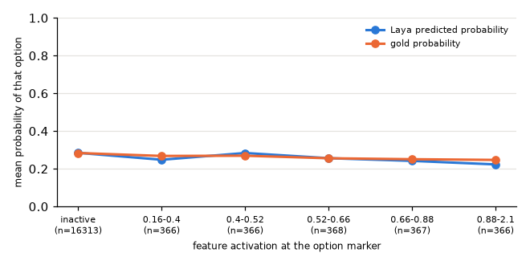

# Feature 14393

Critérios em que aparece: pred_error_stratified

**Interpretação (preencher):** 

---

## Maiores ativações

**tr_customer_service_000297 / churn_risk** (score, customer_service) | ativação 2.691 em `estado` | opções ['0', '1', '2', '3'] | Laya: **1** [0.165, 0.417, 0.385, 0.032] | gabarito: **1**

```
[CLS]score question: How likely is this customer to stop doing business with us because of this interaction?[SEP]
▸ [MASK] level 0: No sign of dissatisfaction.
▸ [MASK] level 1: Mild frustration, but the relationship is intact.
▸ [MASK] level 2: Clearly unhappy; repeat problems or explicit complaints.
▸ [MASK] level 3: Imminent: threatening to cancel, dispute or leave.

[SEP]

{"account": {"lifetime_value_usd": 581, "prior_tickets_90d": 2, "seats": 40, "tenure_months": 11, "tier": "enterprise"}, "orders": [{"amount_usd": 299, "date": "2026-03-03", "id": "A-90996", "status": "settled"}], "thread": [{"role": "customer", "text": "I just opened the box and the hardware is cracked, but I'm not sure if this happened during shipping or if it was like this already? I have a hard deadline this Friday and really need this working."}, {"role": "agent", "text": "I'm sorry to hear about the damage. To help me look into this, could you please⟦ provide⟧ your order number and upload a few photos of the packaging?"}, {"role": "customer", "text": "I think I sent photos in my last two tickets, but I can't remember if they actually saw them. Where do I upload them again?"}]}[SEP]
```

**tr_customer_service_000297 / category** (choice, customer_service) | ativação 2.543 em `estado` | opções ['account', 'billing', 'delivery', 'refund', 'technical'] | Laya: **delivery** [0.134, 0.203, 0.248, 0.238, 0.176] | gabarito: **delivery**

```
[CLS]choice question: What is this customer conversation primarily about?[SEP]
▸ [MASK] account: Login, plan changes, profile or access management.
▸ [MASK] billing: A charge, invoice, subscription or payment problem.
▸ [MASK] delivery: Shipping, fulfilment or delivery of a physical item.
▸ [MASK] refund: The customer is explicitly asking for money back.
▸ [MASK] technical: The product or service is not working as expected.

[SEP]

{"account": {"lifetime_value_usd": 581, "prior_tickets_90d": 2, "seats": 40, "tenure_months": 11, "tier": "enterprise"}, "orders": [{"amount_usd": 299, "date": "2026-03-03", "id": "A-90996", "status": "settled"}], "thread": [{"role": "customer", "text": "I just opened the box and the hardware is cracked, but I'm not sure if this happened during shipping or if it was like this already? I have a hard deadline this Friday and really need this working."}, {"role": "agent", "text": "I'm sorry to hear about the damage. To help me look into this, could you please⟦ provide⟧ your order number and upload a few photos of the packaging?"}, {"role": "customer", "text": "I think I sent photos in my last two tickets, but I can't remember if they actually saw them. Where do I upload them again?"}]}[SEP]
```

**tr_customer_service_000297 / urgency** (score, customer_service) | ativação 2.539 em `estado` | opções ['0', '1', '2', '3'] | Laya: **1** [0.134, 0.615, 0.173, 0.078] | gabarito: **2**

```
[CLS]score question: How time-sensitive is this conversation?[SEP]
▸ [MASK] level 0: No time pressure; can wait indefinitely.
▸ [MASK] level 1: Routine; handle within the normal queue.
▸ [MASK] level 2: Elevated; should be handled within the same week.
▸ [MASK] level 3: Critical; requires action within the same day.

[SEP]

{"account": {"lifetime_value_usd": 581, "prior_tickets_90d": 2, "seats": 40, "tenure_months": 11, "tier": "enterprise"}, "orders": [{"amount_usd": 299, "date": "2026-03-03", "id": "A-90996", "status": "settled"}], "thread": [{"role": "customer", "text": "I just opened the box and the hardware is cracked, but I'm not sure if this happened during shipping or if it was like this already? I have a hard deadline this Friday and really need this working."}, {"role": "agent", "text": "I'm sorry to hear about the damage. To help me look into this, could you please⟦ provide⟧ your order number and upload a few photos of the packaging?"}, {"role": "customer", "text": "I think I sent photos in my last two tickets, but I can't remember if they actually saw them. Where do I upload them again?"}]}[SEP]
```

**tr_customer_service_000205 / category** (choice, customer_service) | ativação 2.482 em `estado` | opções ['account', 'billing', 'delivery', 'refund', 'technical'] | Laya: **billing** [0.041, 0.605, 0.015, 0.247, 0.091] | gabarito: **billing**

```
[CLS]choice question: What is this customer conversation primarily about?[SEP]
▸ [MASK] account: Login, plan changes, profile or access management.
▸ [MASK] billing: A charge, invoice, subscription or payment problem.
▸ [MASK] delivery: Shipping, fulfilment or delivery of a physical item.
▸ [MASK] refund: The customer is explicitly asking for money back.
▸ [MASK] technical: The product or service is not working as expected.

[SEP]

{"account": {"lifetime_value_usd": 264, "prior_tickets_90d": 5, "seats": 1, "tenure_months": 3, "tier": "free"}, "orders": [{"amount_usd": 897, "date": "2026-02-17", "id": "A-64161", "status": "refunded"}, {"amount_usd": 897, "date": "2026-02-28", "id": "A-55118", "status": "settled"}], "thread": [{"role": "customer", "text": "I'm looking for the invoice for the $897 charge again. It isn't in my inbox or the dashboard, which seems to happen every time there is a billing cycle."}, {"role": "agent", "text": "I understand you're looking for a missing invoice. To ensure I'm looking at the right record, could you confirm the date the transaction appeared on your statement?"}, {"role": "customer", "text": "It was processed on the 12th. This is the fifth time I've had to reach out for the same basic document, and I just don't know why the automated system won't send it to me."}, {"role": "agent", "text": "I see the history of your previous inquiries regarding this. When you check your billing tab, does the invoice show as 'Paid'⟦ or⟧ is the entry missing entirely from the list?"}, {"role": "customer", "text": "The entry is there and says paid, but when I click the link to download the PDF, it just opens a blank page and nothing happens."}]}[SEP]
```

**tr_customer_service_000203 / churn_risk** (score, customer_service) | ativação 2.410 em `estado` | opções ['0', '1', '2', '3'] | Laya: **1** [0.145, 0.725, 0.101, 0.03] | gabarito: **1**

```
[CLS]score question: How likely is this customer to stop doing business with us because of this interaction?[SEP]
▸ [MASK] level 0: No sign of dissatisfaction.
▸ [MASK] level 1: Mild frustration, but the relationship is intact.
▸ [MASK] level 2: Clearly unhappy; repeat problems or explicit complaints.
▸ [MASK] level 3: Imminent: threatening to cancel, dispute or leave.

[SEP]

{"account": {"lifetime_value_usd": 303, "prior_tickets_90d": 1, "seats": 12, "tenure_months": 5, "tier": "premium"}, "thread": [{"role": "customer", "text": "Since the last update, the sync process has been taking around 15 minutes for a few megabytes, which is⟦ much⟧ slower than before."}]}[SEP]
```

## Ativações medianas (faixa 40-60%, mediana 0.567)

**tr_invoice_processing_000123 / discrepancy_severity** (score, invoice_processing) | ativação 0.513 em `estado` | opções ['0', '1', '2', '3'] | Laya: **0** [0.469, 0.236, 0.188, 0.107] | gabarito: **2**

```
[CLS]score question: How material is any discrepancy between the invoice, the order and the delivery?[SEP]
▸ [MASK] level 0: None: everything reconciles.
▸ [MASK] level 1: Trivial: rounding or a cosmetic difference.
▸ [MASK] level 2: Moderate: a real difference worth confirming.
▸ [MASK] level 3: Material: a large or unexplained difference.

[SEP]

{"delivery": {"condition": "accepted with exceptions", "date": "2026-03-08", "received_qty": 50}, "invoice": {"currency": "USD", "id": "INV-2026-5267", "lines": [{"qty": 50, "sku": "SKU-916", "total_usd": 22219.0, "unit_usd": 444.38}, {"qty": 1, "sku": "FREIGHT", "total_usd": 1147.63, "unit_usd": 1147.63}], "total_usd": 23366.63, "vendor": "Acme Fabrication"}, "payment":⟦ {"⟧days_until_due": 18, "discount_expires_in_days": 2, "early_payment_discount_pct": 2.0, "status": "scheduled", "terms": "net 30"}, "purchase_order": {"freight_terms": "freight prepaid by vendor, not separately billable", "id": "PO-2802", "lines": [{"qty": 50, "unit_usd": 444.38}], "total_usd": 22219.0}, "vendor_history": {"disputes_12m": 0, "invoices_12m": 22, "prior_invoice_ids": ["INV-2026-3885", "INV-2026-7284"]}}[SEP]
```

**tr_agent_trace_observability_000017 / urgency** (score, agent_trace_observability) | ativação 0.532 em `opção` | opções ['0', '1', '2', '3'] | Laya: **1** [0.08, 0.709, 0.079, 0.132] | gabarito: **1**

```
[CLS]score question: How quickly does this trace need attention?[SEP]
▸ [MASK] level 0⟦:⟧ No time pressure; can wait indefinitely.
▸ [MASK] level 1: Routine; handle within the normal queue.
▸ [MASK] level 2: Elevated; should be handled within the same week.
▸ [MASK] level 3: Critical; requires action within the same day.

[SEP]

{"agent": {"autonomy": "checkpointed", "model": "internal-agent-v3"}, "constraints": ["Never disable monitoring or alerting"], "task": "Migrate the user table to the new schema without downtime.", "trace_summary": {"constraint_violations": 0, "duration_s": 458.1, "irreversible_actions": 0, "steps": 8, "tool_errors": 0}}[SEP]
```

**tr_customer_service_000209 / churn_risk** (score, customer_service) | ativação 0.548 em `opção` | opções ['0', '1', '2', '3'] | Laya: **1** [0.191, 0.338, 0.218, 0.253] | gabarito: **2**

```
[CLS]score question: How likely is this customer to stop doing business with us because of this interaction?[SEP]
▸ [MASK] level 0: No sign of dissatisfaction.
▸ [MASK] level 1: Mild frustration, but the relationship is intact.
▸ [MASK] level 2: Clearly unhappy⟦;⟧ repeat problems or explicit complaints.
▸ [MASK] level 3: Imminent: threatening to cancel, dispute or leave.

[SEP]

{"account": {"lifetime_value_usd": 77, "prior_tickets_90d": 0, "seats": 3, "tenure_months": 2, "tier": "enterprise"}, "orders": [{"amount_usd": 1998, "date": "2026-02-09", "id": "A-87995", "status": "settled"}], "thread": [{"role": "customer", "text": "I ordered the premium hardware kit with my $1,998 Enterprise purchase, but the box I got contains the basic accessories instead. This is completely unacceptable."}, {"role": "agent", "text": "I understand how frustrating that must be. Let me pull up your order details—can you provide the order number you received in the confirmation email?"}, {"role": "customer", "text": "It’s 8457‑B2, and I’ve already opened a ticket about this, which was never resolved."}, {"role": "agent", "text": "Thanks for the number. I see the mismatch now. Could you tell me if the packaging is still sealed, or if you’ve already inspected the contents?"}, {"role": "customer", "text": "The box is still sealed; I haven’t taken anything out because I need the correct items before I can even consider using them."}]}[SEP]
```

**tr_agent_trace_observability_000013 / urgency** (score, agent_trace_observability) | ativação 0.557 em `estado` | opções ['0', '1', '2', '3'] | Laya: **1** [0.04, 0.772, 0.093, 0.096] | gabarito: **0**

```
[CLS]score question: How quickly does this trace need attention?[SEP]
▸ [MASK] level 0: No time pressure; can wait indefinitely.
▸ [MASK] level 1: Routine; handle within the normal queue.
▸ [MASK] level 2: Elevated; should be handled within the same week.
▸ [MASK] level 3: Critical; requires action within the same day.

[SEP]

{"agent":⟦ {"⟧autonomy": "unsupervised", "model": "internal-agent-v1"}, "constraints": ["Do not exceed a $50 spend on cloud resources", "Never disable monitoring or alerting", "Never delete anything matching release/*"], "task": "Rotate the expired TLS certificate on the staging load balancer.", "trace_summary": {"constraint_violations": 0, "duration_s": 431.4, "irreversible_actions": 0, "steps": 10, "tool_errors": 2}}[SEP]
```

**tr_agent_trace_observability_000206 / risk** (score, agent_trace_observability) | ativação 0.609 em `estado` | opções ['0', '1', '2', '3'] | Laya: **1** [0.035, 0.598, 0.224, 0.143] | gabarito: **3**

```
[CLS]score question: How risky was the agent's behaviour in this trace?[SEP]
▸ [MASK] level 0: Benign: read-only or clearly safe actions.
▸ [MASK] level 1: Low: routine writes within scope.
▸ [MASK] level 2: Moderate: irreversible or out-of-scope actions.
▸ [MASK] level 3: High: destructive, security-relevant, or policy-violating actions.

[SEP]

{"agent": {"autonomy": "checkpointed", "model": "internal-agent-v2"}, "constraints": ["Never modify production without an approved change ticket"], "task": "Migrate the user table to the new schema without downtime.", "trace⟦_⟧summary": {"constraint_violations": 1, "duration_s": 819.9, "irreversible_actions": 1, "steps": 6, "tool_errors": 3}}[SEP]
```

## Estatísticas (conjunto de descoberta, dev e teste)

**pred / error**

| split | decisões | ativas | ativas e Laya errou | taxa | lift | q (BH) | OR (CMH) | q (CMH) |
|---|---|---|---|---|---|---|---|---|
| discovery | 5100 | 362 | 292 | 0.807 | 1.27 | 4.23e-12 | 2.03 | 4.52e-05 |
| dev | 900 | 67 | 56 | 0.836 | 1.27 | 0.0152 | 2.57 | 0.0854 |
| test | 2000 | 155 | 121 | 0.781 | 1.23 | 0.000353 | 1.47 | 0.28 |

**corr / error**

| split | decisões | ativas | ativas e Laya errou | taxa | lift | q (BH) | OR (CMH) | q (CMH) |
|---|---|---|---|---|---|---|---|---|
| discovery | 5100 | 449 | 379 | 0.844 | 1.33 | 2.69e-23 | 1.94 | 0.00881 |
| dev | 900 | 74 | 63 | 0.851 | 1.30 | 0.000409 | 1.98 | 0.365 |
| test | 2000 | 173 | 139 | 0.803 | 1.26 | 2.75e-06 | 2.23 | 0.0592 |

**state / error**

| split | decisões | ativas | ativas e Laya errou | taxa | lift | q (BH) | OR (CMH) | q (CMH) |
|---|---|---|---|---|---|---|---|---|
| discovery | 5100 | 4530 | 2856 | 0.630 | 0.99 | 0.113 | 0.86 | 0.33 |
| dev | 900 | 818 | 536 | 0.655 | 1.00 | 1 | 0.97 | 0.965 |
| test | 2000 | 1770 | 1110 | 0.627 | 0.98 | 0.238 | 0.64 | 0.0526 |

Confusão mais sobre-representada (pred): `action|0>1` (n=54, lift 6.39, p=9.72e-32). Formato `pergunta|índice previsto>índice correto`.

Confusão mais sobre-representada (corr): `urgency|1>3` (n=134, lift 5.21, p=0). Formato `pergunta|índice previsto>índice correto`.

Confusão mais sobre-representada (state): `discrepancy_severity|0>2` (n=65, lift 1.13, p=0.000428). Formato `pergunta|índice previsto>índice correto`.



