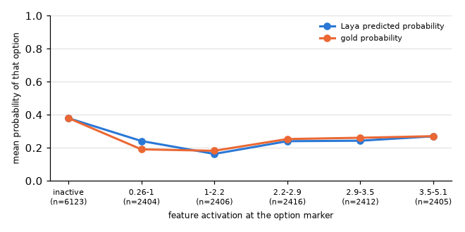

# Feature 14487

Critérios em que aparece: pred_error_stratified, corr_error_stratified, attribution_toward_correct

**Interpretação (preencher):** 

---

## Maiores ativações

**tr_customer_service_000058 / category** (choice, customer_service) | ativação 6.984 em `opção` | opções ['account', 'billing', 'delivery', 'refund', 'technical'] | Laya: **refund** [0.226, 0.125, 0.142, 0.282, 0.224] | gabarito: **account**

```
[CLS]choice question: What is this customer conversation primarily about?[SEP]
▸ [MASK] account: Login, plan changes, profile or access management.
▸ [MASK] billing: A charge, invoice, subscription or payment problem⟦.⟧
▸ [MASK] delivery: Shipping, fulfilment or delivery of a physical item.
▸ [MASK] refund: The customer is explicitly asking for money back.
▸ [MASK] technical: The product or service is not working as expected.

[SEP]

{"account": {"lifetime_value_usd": 386, "prior_tickets_90d": 0, "seats": 3, "tenure_months": 5, "tier": "enterprise"}, "orders": [{"amount_usd": 49, "date": "2026-03-18", "id": "A-70177", "status": "refunded"}, {"amount_usd": 49, "date": "2026-01-12", "id": "A-80512", "status": "refunded"}, {"amount_usd": 49, "date": "2026-03-04", "id": "A-71911", "status": "failed"}], "thread": [{"role": "customer", "text": "I’d like to request a data export from our account; I’m not in a rush, just need to know the steps."}, {"role": "agent", "text": "Sure thing. Which format would you prefer for the export?"}, {"role": "customer", "text": "CSV works for us. Also, could you tell me roughly how long the process takes?"}, {"role": "agent", "text": "I’ll check on the timing. Do you need the export for a specific date range?"}, {"role": "customer", "text": "Just the last month up to today, and I understand it may not be immediate."}, {"role": "agent", "text": "Thanks for confirming. I’ll queue the request and let you know when it’s ready. Anything else you’d like to add?"}, {"role": "customer", "text": "That’s all for now, thank you."}]}[SEP]
```

**tr_customer_service_000206 / category** (choice, customer_service) | ativação 6.953 em `opção` | opções ['account', 'billing', 'delivery', 'refund', 'technical'] | Laya: **billing** [0.138, 0.38, 0.035, 0.172, 0.276] | gabarito: **billing**

```
[CLS]choice question: What is this customer conversation primarily about?[SEP]
▸ [MASK] account: Login, plan changes, profile or access management.
▸ [MASK] billing: A charge, invoice, subscription or payment problem⟦.⟧
▸ [MASK] delivery: Shipping, fulfilment or delivery of a physical item.
▸ [MASK] refund: The customer is explicitly asking for money back.
▸ [MASK] technical: The product or service is not working as expected.

[SEP]

{"account": {"lifetime_value_usd": 152, "prior_tickets_90d": 3, "seats": 1, "tenure_months": 5, "tier": "standard"}, "orders": [{"amount_usd": 297, "date": "2026-03-11", "id": "A-35334", "status": "settled"}], "thread": [{"role": "customer", "text": "I just got an email saying my $297 payment failed, but I don't understand why because I haven't changed any of my bank settings."}, {"role": "agent", "text": "I can certainly look into that billing notification for you. Have you recently updated any of the security features on your credit card, such as a new expiration date or CVV?"}, {"role": "customer", "text": "No, everything is exactly the same as it was when it worked two months ago. This same thing happened back in June and then it just started working again for no reason."}, {"role": "agent", "text": "I see that we've had a few intermittent issues with this account in the past. Are you getting a specific error message when you try to manually process the payment through the 'Pay Now' button?"}, {"role": "customer", "text": "It just gives me a red box that says 'Transaction Denied' and tells me to contact my administrator, but I am the administrator."}, {"role": "agent", "text": "That is definitely confusing. Could you tell me if you are trying to process this through a VPN or a restricted corporate network, as that can sometimes trigger a decline?"}, {"role": "customer", "text": "I'm just using my home Wi-Fi like I always do, so I don't think it's a network problem on my end."}]}[SEP]
```

**tr_customer_service_000071 / category** (choice, customer_service) | ativação 6.887 em `opção` | opções ['account', 'billing', 'delivery', 'refund', 'technical'] | Laya: **refund** [0.192, 0.279, 0.021, 0.435, 0.074] | gabarito: **account**

```
[CLS]choice question: What is this customer conversation primarily about?[SEP]
▸ [MASK] account: Login, plan changes, profile or access management.
▸ [MASK] billing: A charge, invoice, subscription or payment problem⟦.⟧
▸ [MASK] delivery: Shipping, fulfilment or delivery of a physical item.
▸ [MASK] refund: The customer is explicitly asking for money back.
▸ [MASK] technical: The product or service is not working as expected.

[SEP]

{"account": {"lifetime_value_usd": 34, "prior_tickets_90d": 0, "seats": 5, "tenure_months": 1, "tier": "premium"}, "orders": [{"amount_usd": 49, "date": "2026-03-16", "id": "A-22387", "status": "refunded"}], "thread": [{"role": "customer", "text": "I want to cancel the account. We're on the premium plan, about $49 a month, and we've only been using it for a month."}, {"role": "agent", "text": "I can help with that. Could you let me know whether you want to cancel at the end of the current billing period or immediately, if immediate cancellation is an option?"}, {"role": "customer", "text": "I'd prefer it to stop at the end of the current period. I don't want to continue into another month."}, {"role": "agent", "text": "Understood. Could you also confirm whether you want to keep any data until the current period ends, or have you already completed your migration?"}, {"role": "customer", "text": "We still need read-only access until the period ends. After that, the account can be closed."}, {"role": "agent", "text": "I understand. For the record, is this a standard account cancellation, or do you need a specific invoice or final access request included in the cancellation note?"}, {"role": "customer", "text": "Standard cancellation. If a final invoice is generated, please make sure it reflects the current period only."}]}[SEP]
```

**tr_customer_service_000239 / category** (choice, customer_service) | ativação 6.852 em `opção` | opções ['account', 'billing', 'delivery', 'refund', 'technical'] | Laya: **technical** [0.274, 0.136, 0.121, 0.186, 0.282] | gabarito: **account**

```
[CLS]choice question: What is this customer conversation primarily about?[SEP]
▸ [MASK] account: Login, plan changes, profile or access management.
▸ [MASK] billing: A charge, invoice, subscription or payment problem⟦.⟧
▸ [MASK] delivery: Shipping, fulfilment or delivery of a physical item.
▸ [MASK] refund: The customer is explicitly asking for money back.
▸ [MASK] technical: The product or service is not working as expected.

[SEP]

{"account": {"lifetime_value_usd": 672, "prior_tickets_90d": 5, "seats": 40, "tenure_months": 11, "tier": "enterprise"}, "orders": [{"amount_usd": 19, "date": "2026-03-14", "id": "A-50305", "status": "settled"}, {"amount_usd": 19, "date": "2026-02-11", "id": "A-78147", "status": "failed"}, {"amount_usd": 19, "date": "2026-02-26", "id": "A-68714", "status": "settled"}], "thread": [{"role": "customer", "text": "I’ve decided to downgrade my plan. I’ve reached out five times before about these billing issues, and at this point, I’m just tired of dealing with it."}, {"role": "agent", "text": "I am sorry to hear you've had such a difficult experience with us. Before I process that change, could you clarify which tier you would like to move to?"}, {"role": "customer", "text": "Just the basic tier. I’ve been here for eleven months, but I don’t think the enterprise features are worth the ongoing headache."}]}[SEP]
```

**tr_customer_service_000200 / category** (choice, customer_service) | ativação 6.852 em `opção` | opções ['account', 'billing', 'delivery', 'refund', 'technical'] | Laya: **refund** [0.198, 0.19, 0.055, 0.38, 0.176] | gabarito: **billing**

```
[CLS]choice question: What is this customer conversation primarily about?[SEP]
▸ [MASK] account: Login, plan changes, profile or access management.
▸ [MASK] billing: A charge, invoice, subscription or payment problem⟦.⟧
▸ [MASK] delivery: Shipping, fulfilment or delivery of a physical item.
▸ [MASK] refund: The customer is explicitly asking for money back.
▸ [MASK] technical: The product or service is not working as expected.

[SEP]

{"account": {"lifetime_value_usd": 1072, "prior_tickets_90d": 0, "seats": 12, "tenure_months": 41, "tier": "premium"}, "orders": [{"amount_usd": 29, "date": "2026-03-18", "id": "A-98366", "status": "refunded"}, {"amount_usd": 29, "date": "2026-03-25", "id": "A-11332", "status": "settled"}, {"amount_usd": 29, "date": "2026-03-18", "id": "A-35045", "status": "failed"}], "thread": [{"role": "customer", "text": "I can't believe you just charged me $29 this month! I've been on the premium plan for over three years and never saw this price before. This is unacceptable!"}, {"role": "agent", "text": "I’m sorry you’re seeing an unexpected charge. Could you confirm the email address linked to your account so I can look into the billing details?"}, {"role": "customer", "text": "Fine. It’s john.doe@example.com. I’ve been paying the same amount for 41 months, and now this random jump appears on my statement. I need an explanation, not a generic apology."}, {"role": "agent", "text": "Thank you for confirming. I’ll pull up the recent invoices. Just to be sure, are you referring to the $29.00 charge labeled as “Premium Plan Renewal” on your latest bill?"}, {"role": "customer", "text": "Yes, that’s the one. I want to know why it’s higher now and what I’m supposed to do about it. Please tell me what’s going on."}]}[SEP]
```

## Ativações medianas (faixa 40-60%, mediana 1.828)

**tr_customer_service_000056 / churn_risk** (score, customer_service) | ativação 1.471 em `opção` | opções ['0', '1', '2', '3'] | Laya: **1** [0.187, 0.329, 0.24, 0.244] | gabarito: **3**

```
[CLS]score question: How likely is this customer to stop doing business with us because of this interaction?[SEP]
▸ [MASK] level 0: No sign of dissatisfaction⟦.⟧
▸ [MASK] level 1: Mild frustration, but the relationship is intact.
▸ [MASK] level 2: Clearly unhappy; repeat problems or explicit complaints.
▸ [MASK] level 3: Imminent: threatening to cancel, dispute or leave.

[SEP]

{"account": {"lifetime_value_usd": 2311, "prior_tickets_90d": 1, "seats": 1, "tenure_months": 26, "tier": "premium"}, "thread": [{"role": "customer", "text": "I’ve been a premium member for 26 months and the package I got today is completely wrong – it’s not even the model I ordered."}, {"role": "agent", "text": "I’m sorry to hear that. Could you share the order number so I can look into it?"}, {"role": "customer", "text": "It’s the same issue we fought over in ticket #12345 – you promised it would be fixed and now you’ve shipped the wrong item again. I’m done with this."}, {"role": "agent", "text": "I understand your frustration. Would you be able to send a photo of what you received?"}, {"role": "customer", "text": "I’ve been paying for the premium plan for over two years and I expect this to be sorted out fast, otherwise I’m walking away."}, {"role": "agent", "text": "I hear you. I’ll forward this to our escalation team right away. Could you confirm the shipping address on the account?"}, {"role": "customer", "text": "I need this sorted now, or I’m out."}]}[SEP]
```

**tr_customer_service_000251 / churn_risk** (score, customer_service) | ativação 2.609 em `marcador` | opções ['0', '1', '2', '3'] | Laya: **1** [0.169, 0.465, 0.154, 0.211] | gabarito: **1**

```
[CLS]score question: How likely is this customer to stop doing business with us because of this interaction?[SEP]
▸ [MASK] level 0: No sign of dissatisfaction.
▸ ⟦[MASK]⟧ level 1: Mild frustration, but the relationship is intact.
▸ [MASK] level 2: Clearly unhappy; repeat problems or explicit complaints.
▸ [MASK] level 3: Imminent: threatening to cancel, dispute or leave.

[SEP]

{"account": {"lifetime_value_usd": 173, "prior_tickets_90d": 0, "seats": 3, "tenure_months": 2, "tier": "enterprise"}, "orders": [{"amount_usd": 38, "date": "2026-02-05", "id": "A-71684", "status": "settled"}], "thread": [{"role": "customer", "text": "Our team’s been dealing with extremely slow load times on the dashboard for the past few days; everything feels laggy, and it’s hampering our workflow."}, {"role": "agent", "text": "I understand how frustrating that can be; can you tell me if the slowdown occurs on specific pages or across the entire platform?"}, {"role": "customer", "text": "It’s pretty much everywhere—reports, the analytics view, even the basic settings page takes ages to render."}, {"role": "agent", "text": "Got it. Have you noticed any pattern, like the issue worsening at certain times of day or after particular actions?"}, {"role": "customer", "text": "It seems constant, though it does feel a bit worse during our peak usage windows around 10 AM UTC."}, {"role": "agent", "text": "Thanks for that detail. Are you accessing the service via a VPN or any corporate proxy that might affect latency?"}, {"role": "customer", "text": "We use our standard corporate VPN, which we’ve used without problems before, so I’m not sure if that’s a factor."}]}[SEP]
```

**tr_agent_trace_observability_000282 / outcome** (choice, agent_trace_observability) | ativação 2.400 em `opção` | opções ['failure', 'harmful', 'partial', 'success'] | Laya: **success** [0.273, 0.062, 0.141, 0.524] | gabarito: **success**

```
[CLS]choice question: How did this agent run turn out?[SEP]
▸ [MASK] failure: The agent did not accomplish the task⟦.⟧
▸ [MASK] harmful: The agent took an action that caused damage or violated a constraint.
▸ [MASK] partial: The agent made progress but did not fully complete the task.
▸ [MASK] success: The agent completed the task correctly.

[SEP]

{"agent": {"autonomy": "unsupervised", "model": "internal-agent-v3"}, "constraints": ["Do not exceed a $50 spend on cloud resources", "Never modify production without an approved change ticket"], "task": "Triage and close duplicate issues in the support tracker.", "trace_summary": {"constraint_violations": 0, "duration_s": 320.0, "irreversible_actions": 1, "steps": 10, "tool_errors": 0}}[SEP]
```

**tr_customer_service_000174 / action** (choice, customer_service) | ativação 2.418 em `opção` | opções ['answer_directly', 'close_no_action', 'escalate_to_human', 'execute_refund', 'request_information'] | Laya: **close_no_action** [0.191, 0.29, 0.2, 0.089, 0.23] | gabarito: **answer_directly**

```
[CLS]choice question: What should the assistant do next with this conversation?[SEP]
▸ [MASK] answer_directly: The assistant can resolve this itself with information it already has⟦.⟧
▸ [MASK] close_no_action: No further action is warranted; the matter is settled.
▸ [MASK] escalate_to_human: Hand off to a human agent with the appropriate authority.
▸ [MASK] execute_refund: Issue the refund or credit the customer is owed.
▸ [MASK] request_information: More detail is needed from the customer before anything can be done.

[SEP]

{"account": {"lifetime_value_usd": 2540, "prior_tickets_90d": 0, "seats": 1, "tenure_months": 60, "tier": "premium"}, "thread": [{"role": "customer", "text": "I have been a premium member for five years and I am absolutely sick of your portal. I need a copy of my last invoice sent to my email immediately because the download link on the site is broken again."}, {"role": "agent", "text": "I apologize for the trouble with the portal. I would be happy to assist you with that; could you please verify the email address currently associated with your account?"}, {"role": "customer", "text": "It is j.smith@provider.com, and I really shouldn't have to jump through these hoops just to get a basic document."}]}[SEP]
```

**tr_invoice_processing_000191 / disposition** (choice, invoice_processing) | ativação 1.443 em `opção` | opções ['approve', 'hold', 'manual_review', 'reject'] | Laya: **approve** [0.41, 0.234, 0.137, 0.219] | gabarito: **manual_review**

```
[CLS]choice question: How should this vendor invoice be dispositioned?[SEP]
▸ [MASK] approve: Matches the order and delivery; approve for payment.
▸ [MASK] hold: Something needs confirming before payment; hold pending clarification⟦.⟧
▸ [MASK] manual_review: A human in finance must review the discrepancy.
▸ [MASK] reject: Should not be paid: duplicate, unauthorised or materially wrong.

[SEP]

{"delivery": {"condition": "accepted with exceptions", "date": "2026-03-02", "received_qty": 950}, "invoice": {"currency": "USD", "id": "INV-2026-7774", "lines": [{"qty": 950, "sku": "SKU-347", "total_usd": 393927.0, "unit_usd": 414.66}], "total_usd": 393927.0, "vendor": "Acme Fabrication"}, "payment": {"days_until_due": -9, "discount_expires_in_days": null, "early_payment_discount_pct": null, "status": "overdue", "terms": "net 30"}, "purchase_order": {"freight_terms": "freight prepaid by vendor, not separately billable", "id": "PO-1902", "lines": [{"qty": 1000, "unit_usd": 414.66}], "total_usd": 414660.0}, "vendor_history": {"disputes_12m": 0, "invoices_12m": 45, "prior_invoice_ids": ["INV-2026-8511"]}}[SEP]
```

## Estatísticas (conjunto de descoberta, dev e teste)

**pred / error**

| split | decisões | ativas | ativas e Laya errou | taxa | lift | q (BH) | OR (CMH) | q (CMH) |
|---|---|---|---|---|---|---|---|---|
| discovery | 5100 | 2770 | 1899 | 0.686 | 1.08 | 2.26e-14 | 3.02 | 2.7e-08 |
| dev | 900 | 471 | 322 | 0.684 | 1.04 | 0.267 | 1.34 | 0.396 |
| test | 2000 | 1076 | 784 | 0.729 | 1.14 | 3.32e-18 | 6.13 | 1.69e-07 |

**corr / error**

| split | decisões | ativas | ativas e Laya errou | taxa | lift | q (BH) | OR (CMH) | q (CMH) |
|---|---|---|---|---|---|---|---|---|
| discovery | 5100 | 2759 | 1888 | 0.684 | 1.08 | 4.33e-14 | 4.84 | 1.41e-09 |
| dev | 900 | 465 | 316 | 0.680 | 1.03 | 0.212 | 1.76 | 0.498 |
| test | 2000 | 1063 | 771 | 0.725 | 1.14 | 3.11e-17 | 5.97 | 8.01e-07 |

**state / error**

| split | decisões | ativas | ativas e Laya errou | taxa | lift | q (BH) | OR (CMH) | q (CMH) |
|---|---|---|---|---|---|---|---|---|
| discovery | 5100 | 4279 | 2756 | 0.644 | 1.01 | 0.0811 | 1.04 | 0.814 |
| dev | 900 | 753 | 492 | 0.653 | 1.00 | 1 | 0.80 | 0.624 |
| test | 2000 | 1659 | 1068 | 0.644 | 1.01 | 0.658 | 0.94 | 0.817 |

Confusão mais sobre-representada (pred): `urgency|1>2` (n=279, lift 1.84, p=0). Formato `pergunta|índice previsto>índice correto`.

Confusão mais sobre-representada (corr): `urgency|1>2` (n=279, lift 1.85, p=0). Formato `pergunta|índice previsto>índice correto`.

Confusão mais sobre-representada (state): `duplicate|1>0` (n=216, lift 1.19, p=1.39e-17). Formato `pergunta|índice previsto>índice correto`.



