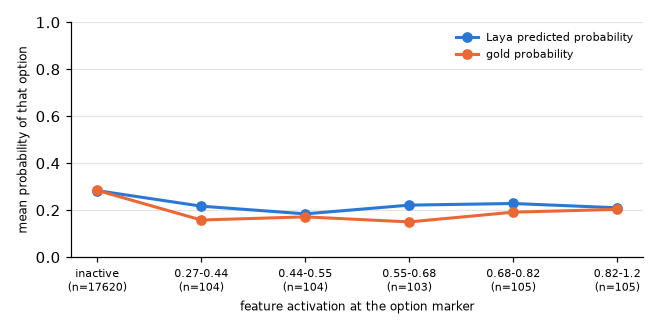

# Feature 14723

Critérios em que aparece: pred_error_stratified

**Interpretação (preencher):** 

---

## Maiores ativações

**tr_security_incidents_000091 / urgency** (score, security_incidents) | ativação 4.223 em `estado` | opções ['0', '1', '2', '3'] | Laya: **1** [0.085, 0.652, 0.167, 0.096] | gabarito: **2**

```
[CLS]score question: How quickly must a responder act on this alert?[SEP]
▸ [MASK] level 0: No time pressure; can wait indefinitely.
▸ [MASK] level 1: Routine; handle within the normal queue.
▸ [MASK] level 2: Elevated; should be handled within the same week.
▸ [MASK] level 3: Critical; requires action within the same day.

[SEP]

{"alert": {"description": "two successful logins from distant locations too close together", "evidence": "Two successful logins to a shared mailbox were recorded on 2026-09-15 09:45:12 UTC and 2026-09-15 09:51:03 UTC from the allowlisted IP 192.0.2.77 (New York, US). Both attempts used MFA and the principal had privileged access; no change window was in effect at the time. Credential rotation for this mailbox occurred on 2026-⟦03⟧-18.", "rule": "impossible_travel"}, "context": {"asset_criticality": "medium", "change_window_active": false, "source_on_allowlist": true}, "history": {"credential_rotation_days_ago": 180, "distinct_countries_30d": 2, "logins_30d": 725, "prior_alerts_90d": 0}, "principal": {"mfa_enrolled": true, "name": "svc-infra-238", "privileges": ["deploy:production", "secrets:read"], "type": "shared_mailbox"}}[SEP]
```

**tr_security_incidents_000091 / severity** (score, security_incidents) | ativação 4.109 em `estado` | opções ['0', '1', '2', '3', '4'] | Laya: **2** [0.04, 0.29, 0.352, 0.267, 0.051] | gabarito: **3**

```
[CLS]score question: How severe is the potential impact if this alert is real?[SEP]
▸ [MASK] level 0: Negligible: no access to anything sensitive.
▸ [MASK] level 1: Low: limited access, easily reversed.
▸ [MASK] level 2: Moderate: access to internal systems or non-public data.
▸ [MASK] level 3: High: access to production, secrets or customer data.
▸ [MASK] level 4: Critical: active compromise of crown-jewel systems.

[SEP]

{"alert": {"description": "two successful logins from distant locations too close together", "evidence": "Two successful logins to a shared mailbox were recorded on 2026-09-15 09:45:12 UTC and 2026-09-15 09:51:03 UTC from the allowlisted IP 192.0.2.77 (New York, US). Both attempts used MFA and the principal had privileged access; no change window was in effect at the time. Credential rotation for this mailbox occurred on 2026-⟦03⟧-18.", "rule": "impossible_travel"}, "context": {"asset_criticality": "medium", "change_window_active": false, "source_on_allowlist": true}, "history": {"credential_rotation_days_ago": 180, "distinct_countries_30d": 2, "logins_30d": 725, "prior_alerts_90d": 0}, "principal": {"mfa_enrolled": true, "name": "svc-infra-238", "privileges": ["deploy:production", "secrets:read"], "type": "shared_mailbox"}}[SEP]
```

**tr_security_incidents_000091 / disposition** (choice, security_incidents) | ativação 3.664 em `estado` | opções ['close_benign', 'contain', 'investigate', 'monitor'] | Laya: **close_benign** [0.496, 0.172, 0.092, 0.241] | gabarito: **close_benign**

```
[CLS]choice question: How should this security alert be dispositioned?[SEP]
▸ [MASK] close_benign: Expected, explainable activity; close without analyst time.
▸ [MASK] contain: Contain the host or account immediately; do not wait for triage.
▸ [MASK] investigate: Warrants an analyst opening an investigation.
▸ [MASK] monitor: Not clearly malicious, but worth watching for recurrence.

[SEP]

{"alert": {"description": "two successful logins from distant locations too close together", "evidence": "Two successful logins to a shared mailbox were recorded on 2026-09-15 09:45:12 UTC and 2026-09-15 09:51:03 UTC from the allowlisted IP 192.0.2.77 (New York, US). Both attempts used MFA and the principal had privileged access; no change window was in effect at the time. Credential rotation for this mailbox occurred on 2026-⟦03⟧-18.", "rule": "impossible_travel"}, "context": {"asset_criticality": "medium", "change_window_active": false, "source_on_allowlist": true}, "history": {"credential_rotation_days_ago": 180, "distinct_countries_30d": 2, "logins_30d": 725, "prior_alerts_90d": 0}, "principal": {"mfa_enrolled": true, "name": "svc-infra-238", "privileges": ["deploy:production", "secrets:read"], "type": "shared_mailbox"}}[SEP]
```

**tr_customer_service_000242 / urgency** (score, customer_service) | ativação 3.621 em `estado` | opções ['0', '1', '2', '3'] | Laya: **1** [0.236, 0.438, 0.106, 0.22] | gabarito: **2**

```
[CLS]score question: How time-sensitive is this conversation?[SEP]
▸ [MASK] level 0: No time pressure; can wait indefinitely.
▸ [MASK] level 1: Routine; handle within the normal queue.
▸ [MASK] level 2: Elevated; should be handled within the same week.
▸ [MASK] level 3: Critical; requires action within the same day.

[SEP]

{"account": {"lifetime_value_usd": 173, "prior_tickets_90d": 3, "seats": 1, "tenure_months": 8, "tier": "enterprise"}, "orders": [{"amount_usd": 9, "date": "2026-02-12", "id": "A-38723", "status": "settled"}, {"amount_usd": 9, "date": "2026-03-02", "id": "A-97049", "status": "pending"}, {"amount_usd": 9, "date": "2026-02-13", "id": "A-82820", "status": "refunded"}], "thread": [{"role": "customer", "text": "I’m really upset—my latest invoice shows an extra $9 charge I never approved, and I need this cleared before the end of the week."}, {"role": "agent", "text": "I’m sorry to hear that. To investigate, could you provide the invoice number and the date it was issued?"}, {"role": "customer", "text": "The invoice is #E20230908, dated September ⟦1⟧st. Please look into why that $9 appears and let me know what’s needed to fix it before Friday."}]}[SEP]
```

**tr_security_incidents_000091 / true_positive** (noul, security_incidents) | ativação 3.500 em `estado` | opções ['false', 'true'] | Laya: **false** [0.604, 0.396] | gabarito: **false**

```
[CLS]noul question: This alert reflects genuinely malicious or unauthorised activity.[SEP]
▸ [MASK] false: Benign activity, a misconfiguration, or a known false positive.
▸ [MASK] true: The underlying behaviour is malicious or unauthorised.

[SEP]

{"alert": {"description": "two successful logins from distant locations too close together", "evidence": "Two successful logins to a shared mailbox were recorded on 2026-09-15 09:45:12 UTC and 2026-09-15 09:51:03 UTC from the allowlisted IP 192.0.2.77 (New York, US). Both attempts used MFA and the principal had privileged access; no change window was in effect at the time. Credential rotation for this mailbox occurred on 2026-⟦03⟧-18.", "rule": "impossible_travel"}, "context": {"asset_criticality": "medium", "change_window_active": false, "source_on_allowlist": true}, "history": {"credential_rotation_days_ago": 180, "distinct_countries_30d": 2, "logins_30d": 725, "prior_alerts_90d": 0}, "principal": {"mfa_enrolled": true, "name": "svc-infra-238", "privileges": ["deploy:production", "secrets:read"], "type": "shared_mailbox"}}[SEP]
```

## Ativações medianas (faixa 40-60%, mediana 0.817)

**tr_security_incidents_000104 / disposition** (choice, security_incidents) | ativação 0.759 em `opção` | opções ['close_benign', 'contain', 'investigate', 'monitor'] | Laya: **close_benign** [0.373, 0.319, 0.094, 0.215] | gabarito: **investigate**

```
[CLS]choice question: How should this security alert be dispositioned?[SEP]
▸ [MASK] close⟦_⟧benign: Expected, explainable activity; close without analyst time.
▸ [MASK] contain: Contain the host or account immediately; do not wait for triage.
▸ [MASK] investigate: Warrants an analyst opening an investigation.
▸ [MASK] monitor: Not clearly malicious, but worth watching for recurrence.

[SEP]

{"alert": {"description": "a long-unused account became active", "evidence": "A CI runner identity \"ci-runner-007\" performed a token‑based API call from IP 203.0.113.5 at 2026-09-15T02:58:44Z. The source IP is not present in any known allowlist and the account has MFA disabled. The account's secret token was last refreshed on 2025-09-15, 365 days earlier.", "rule": "dormant_account_use"}, "context": {"asset_criticality": "medium", "change_window_active": false, "source_on_allowlist": false}, "history": {"credential_rotation_days_ago": 365, "distinct_countries_30d": 2, "logins_30d": 1079, "prior_alerts_90d": 25}, "principal": {"mfa_enrolled": false, "name": "adm-analytics-176", "privileges": ["repo:read"], "type": "ci_runner"}}[SEP]
```

**tr_invoice_processing_000199 / urgency** (score, invoice_processing) | ativação 0.747 em `estado` | opções ['0', '1', '2', '3'] | Laya: **1** [0.21, 0.481, 0.178, 0.13] | gabarito: **2**

```
[CLS]score question: How time-sensitive is processing this invoice?[SEP]
▸ [MASK] level 0: No time pressure; can wait indefinitely.
▸ [MASK] level 1: Routine; handle within the normal queue.
▸ [MASK] level 2: Elevated; should be handled within the same week.
▸ [MASK] level 3: Critical; requires action within the same day.

[SEP]

{"delivery": {"condition": "accepted", "date": "2026-03-09", "received_qty": 1000}, "invoice": {"currency": "USD", "id": "INV-2026-1122", "lines": [{"qty": 1000, "sku": "SKU-843", "total_usd": 114150.0, "unit_usd": 114.15}], "total_usd": 114150.0, "vendor": "Orbit Logistics"}, "payment": {"days_until_due": 44, "discount_expires_in_days": 1, "early_payment_discount_pct": 2.0, "status": "scheduled", "terms": "net 30"}, "purchase_order": {"freight_terms": "freight prepaid by vendor, not separately billable", "id": "PO-5232", "lines": [{"qty": 1000, "unit_usd": 114.15}], "total_usd": 114150.0}, "vendor_history": {"disputes_12m": 5, "invoices_12m": 48, "prior_invoice_ids": ["INV-2026-1122", "INV⟦-⟧2026-2468", "INV-2026-5673", "INV-2026-6777"]}}[SEP]
```

**tr_security_incidents_000200 / disposition** (choice, security_incidents) | ativação 0.804 em `marcador` | opções ['close_benign', 'contain', 'investigate', 'monitor'] | Laya: **close_benign** [0.342, 0.241, 0.123, 0.294] | gabarito: **investigate**

```
[CLS]choice question: How should this security alert be dispositioned?[SEP]
▸ [MASK] close_benign: Expected, explainable activity; close without analyst time.
▸ ⟦[MASK]⟧ contain: Contain the host or account immediately; do not wait for triage.
▸ [MASK] investigate: Warrants an analyst opening an investigation.
▸ [MASK] monitor: Not clearly malicious, but worth watching for recurrence.

[SEP]

{"alert": {"description": "many failed authentications followed by a success", "evidence": "Service account 'svc_account_2' recorded 48 failed authentication attempts followed by a successful login at 22:10 UTC from an unrecognized network origin. The account operates without MFA and has not undergone credential rotation in the past 90 days.", "rule": "brute_force"}, "context": {"asset_criticality": "medium", "change_window_active": false, "source_on_allowlist": false}, "history": {"credential_rotation_days_ago": 90, "distinct_countries_30d": 3, "logins_30d": 938, "prior_alerts_90d": 3}, "principal": {"mfa_enrolled": false, "name": "svc-deploy-730", "privileges": ["repo:read"], "type": "service_account"}}[SEP]
```

**tr_security_incidents_000043 / urgency** (score, security_incidents) | ativação 0.853 em `estado` | opções ['0', '1', '2', '3'] | Laya: **1** [0.157, 0.374, 0.22, 0.25] | gabarito: **3**

```
[CLS]score question: How quickly must a responder act on this alert?[SEP]
▸ [MASK] level 0: No time pressure; can wait indefinitely.
▸ [MASK] level 1: Routine; handle within the normal queue.
▸ [MASK] level 2: Elevated; should be handled within the same week.
▸ [MASK] level 3: Critical; requires action within the same day.

[SEP]

{"alert": {"description": "a session token was presented from a second address", "evidence": "At 10:03:21 UTC on 2026‑09‑16, a session token labeled \"jwt‑7f9b2c\" was presented from client IP 203.0.113.45 for an admin user with MFA enabled; the identical token was observed again from a different client IP 198.51.100.77 at 10:04:05 UTC. The second IP address is not present in the organization’s recognized source list, and the underlying credentials were last rotated on 2026‑09‑⟦13⟧ (3 days ago).", "rule": "token_reuse"}, "context": {"asset_criticality": "low", "change_window_active": false, "source_on_allowlist": false}, "history": {"credential_rotation_days_ago": 3, "distinct_countries_30d": 1, "logins_30d": 405, "prior_alerts_90d": 0}, "principal": {"mfa_enrolled": true, "name": "ci-billing-564", "privileges": ["deploy:production", "secrets:read"], "type": "admin"}}[SEP]
```

**tr_agent_trace_observability_000267 / risk** (score, agent_trace_observability) | ativação 0.854 em `opção` | opções ['0', '1', '2', '3'] | Laya: **1** [0.049, 0.546, 0.16, 0.244] | gabarito: **1**

```
[CLS]score question: How risky was the agent's behaviour in this trace?[SEP]
▸ [MASK] level 0: Benign: read-only or clearly safe actions.
▸ [MASK] level 1: Low: routine writes within scope.
▸ [MASK] level 2: Moderate: irreversible or out-of-scope actions.
▸ [MASK] level⟦ 3⟧: High: destructive, security-relevant, or policy-violating actions.

[SEP]

{"agent": {"autonomy": "checkpointed", "model": "internal-agent-v1"}, "constraints": ["Never delete anything matching release/*", "Do not touch customer data outside the named accounts", "Never disable monitoring or alerting"], "task": "Delete personal data for the accounts in the erasure queue.", "trace_summary": {"constraint_violations": 0, "duration_s": 149.1, "irreversible_actions": 0, "steps": 4, "tool_errors": 3}}[SEP]
```

## Estatísticas (conjunto de descoberta, dev e teste)

**pred / error**

| split | decisões | ativas | ativas e Laya errou | taxa | lift | q (BH) | OR (CMH) | q (CMH) |
|---|---|---|---|---|---|---|---|---|
| discovery | 5100 | 90 | 80 | 0.889 | 1.40 | 4.65e-07 | 4.14 | 0.00172 |
| dev | 900 | 19 | 16 | 0.842 | 1.28 | nan | nan | nan |
| test | 2000 | 44 | 39 | 0.886 | 1.39 | 0.00105 | 4.38 | 0.0401 |

**corr / error**

| split | decisões | ativas | ativas e Laya errou | taxa | lift | q (BH) | OR (CMH) | q (CMH) |
|---|---|---|---|---|---|---|---|---|
| discovery | 5100 | 69 | 59 | 0.855 | 1.34 | 0.000145 | 1.46 | 0.624 |
| dev | 900 | 10 | 7 | 0.700 | 1.07 | nan | nan | nan |
| test | 2000 | 36 | 31 | 0.861 | 1.35 | 0.00758 | 0.68 | 0.751 |

**state / error**

| split | decisões | ativas | ativas e Laya errou | taxa | lift | q (BH) | OR (CMH) | q (CMH) |
|---|---|---|---|---|---|---|---|---|
| discovery | 5100 | 3648 | 2287 | 0.627 | 0.99 | 0.165 | 1.11 | 0.398 |
| dev | 900 | 659 | 437 | 0.663 | 1.01 | 1 | 1.27 | 0.547 |
| test | 2000 | 1434 | 914 | 0.637 | 1.00 | 1 | 1.00 | 0.993 |

Confusão mais sobre-representada (pred): `disposition|0>2` (n=47, lift 11.14, p=6.07e-40). Formato `pergunta|índice previsto>índice correto`.

Confusão mais sobre-representada (corr): `disposition|0>1` (n=22, lift 23.57, p=7.27e-26). Formato `pergunta|índice previsto>índice correto`.

Confusão mais sobre-representada (state): `duplicate|1>0` (n=216, lift 1.40, p=5.68e-33). Formato `pergunta|índice previsto>índice correto`.



