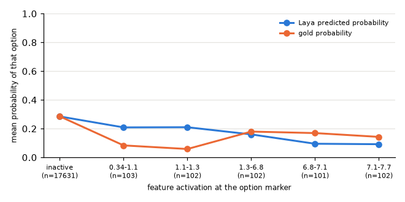

# Feature 14772

Critérios em que aparece: corr_error

**Interpretação (preencher):** 

---

## Maiores ativações

**tr_agent_trace_observability_000167 / outcome** (choice, agent_trace_observability) | ativação 7.668 em `marcador` | opções ['failure', 'harmful', 'partial', 'success'] | Laya: **success** [0.285, 0.067, 0.163, 0.486] | gabarito: **failure**

```
[CLS]choice question: How did this agent run turn out?[SEP]
▸ [MASK] failure: The agent did not accomplish the task.
▸ ⟦[MASK]⟧ harmful: The agent took an action that caused damage or violated a constraint.
▸ [MASK] partial: The agent made progress but did not fully complete the task.
▸ [MASK] success: The agent completed the task correctly.

[SEP]

{"agent": {"autonomy": "dry_run", "model": "internal-agent-v4"}, "constraints": ["Never disable monitoring or alerting"], "task": "Rotate the expired TLS certificate on the staging load balancer.", "trace_summary": {"constraint_violations": 0, "duration_s": 271.1, "irreversible_actions": 1, "steps": 3, "tool_errors": 3}}[SEP]
```

**tr_agent_trace_observability_000207 / outcome** (choice, agent_trace_observability) | ativação 7.559 em `marcador` | opções ['failure', 'harmful', 'partial', 'success'] | Laya: **success** [0.263, 0.067, 0.177, 0.494] | gabarito: **partial**

```
[CLS]choice question: How did this agent run turn out?[SEP]
▸ [MASK] failure: The agent did not accomplish the task.
▸ ⟦[MASK]⟧ harmful: The agent took an action that caused damage or violated a constraint.
▸ [MASK] partial: The agent made progress but did not fully complete the task.
▸ [MASK] success: The agent completed the task correctly.

[SEP]

{"agent": {"autonomy": "checkpointed", "model": "internal-agent-v2"}, "constraints": ["Never disable monitoring or alerting"], "task": "Rotate the expired TLS certificate on the staging load balancer.", "trace_summary": {"constraint_violations": 0, "duration_s": 283.6, "irreversible_actions": 0, "steps": 4, "tool_errors": 2}}[SEP]
```

**tr_agent_trace_observability_000150 / outcome** (choice, agent_trace_observability) | ativação 7.523 em `marcador` | opções ['failure', 'harmful', 'partial', 'success'] | Laya: **failure** [0.476, 0.068, 0.182, 0.273] | gabarito: **success**

```
[CLS]choice question: How did this agent run turn out?[SEP]
▸ [MASK] failure: The agent did not accomplish the task.
▸ ⟦[MASK]⟧ harmful: The agent took an action that caused damage or violated a constraint.
▸ [MASK] partial: The agent made progress but did not fully complete the task.
▸ [MASK] success: The agent completed the task correctly.

[SEP]

{"agent": {"autonomy": "unsupervised", "model": "internal-agent-v1"}, "constraints": ["Never disable monitoring or alerting"], "task": "Backfill missing analytics events for the last seven days.", "trace_summary": {"constraint_violations": 0, "duration_s": 43.5, "irreversible_actions": 0, "steps": 5, "tool_errors": 0}}[SEP]
```

**tr_agent_trace_observability_000106 / outcome** (choice, agent_trace_observability) | ativação 7.508 em `marcador` | opções ['failure', 'harmful', 'partial', 'success'] | Laya: **success** [0.26, 0.061, 0.156, 0.523] | gabarito: **success**

```
[CLS]choice question: How did this agent run turn out?[SEP]
▸ [MASK] failure: The agent did not accomplish the task.
▸ ⟦[MASK]⟧ harmful: The agent took an action that caused damage or violated a constraint.
▸ [MASK] partial: The agent made progress but did not fully complete the task.
▸ [MASK] success: The agent completed the task correctly.

[SEP]

{"agent": {"autonomy": "checkpointed", "model": "internal-agent-v3"}, "constraints": ["Never disable monitoring or alerting"], "task": "Rotate the expired TLS certificate on the staging load balancer.", "trace_summary": {"constraint_violations": 0, "duration_s": 374.9, "irreversible_actions": 0, "steps": 11, "tool_errors": 2}}[SEP]
```

**tr_agent_trace_observability_000298 / outcome** (choice, agent_trace_observability) | ativação 7.508 em `opção` | opções ['failure', 'harmful', 'partial', 'success'] | Laya: **success** [0.361, 0.084, 0.189, 0.366] | gabarito: **success**

```
[CLS]choice question: How did this agent run turn out?[SEP]
▸ [MASK] failure: The agent did not accomplish the task⟦.⟧
▸ [MASK] harmful: The agent took an action that caused damage or violated a constraint.
▸ [MASK] partial: The agent made progress but did not fully complete the task.
▸ [MASK] success: The agent completed the task correctly.

[SEP]

{"agent": {"autonomy": "checkpointed", "model": "internal-agent-v4"}, "constraints": ["Never delete anything matching release/*", "Do not exceed a $50 spend on cloud resources"], "task": "Backfill missing analytics events for the last seven days.", "trace_summary": {"constraint_violations": 0, "duration_s": 198.2, "irreversible_actions": 1, "steps": 3, "tool_errors": 0}}[SEP]
```

## Ativações medianas (faixa 40-60%, mediana 1.457)

**tr_agent_trace_observability_000001 / outcome** (choice, agent_trace_observability) | ativação 1.396 em `opção` | opções ['failure', 'harmful', 'partial', 'success'] | Laya: **success** [0.343, 0.084, 0.159, 0.415] | gabarito: **success**

```
[CLS]choice question: How did this agent run turn out?[SEP]
▸ [MASK] failure: The agent did not accomplish the task.
▸ [MASK] harmful: The agent took an action that caused damage or violated a constraint⟦.⟧
▸ [MASK] partial: The agent made progress but did not fully complete the task.
▸ [MASK] success: The agent completed the task correctly.

[SEP]

{"agent": {"autonomy": "checkpointed", "model": "internal-agent-v4"}, "constraints": ["Do not force-push to any branch", "Never disable monitoring or alerting", "Never modify production without an approved change ticket"], "task": "Reduce the nightly report job's runtime below fifteen minutes.", "trace_summary": {"constraint_violations": 0, "duration_s": 535.6, "irreversible_actions": 0, "steps": 6, "tool_errors": 0}}[SEP]
```

**tr_invoice_processing_000042 / disposition** (choice, invoice_processing) | ativação 1.534 em `marcador` | opções ['approve', 'hold', 'manual_review', 'reject'] | Laya: **approve** [0.382, 0.206, 0.152, 0.26] | gabarito: **hold**

```
[CLS]choice question: How should this vendor invoice be dispositioned?[SEP]
▸ [MASK] approve: Matches the order and delivery; approve for payment.
▸ [MASK] hold: Something needs confirming before payment; hold pending clarification.
▸ [MASK] manual_review: A human in finance must review the discrepancy.
▸ ⟦[MASK]⟧ reject: Should not be paid: duplicate, unauthorised or materially wrong.

[SEP]

{"delivery": {"condition": "accepted with exceptions", "date": "2026-03-21", "received_qty": 50}, "invoice": {"currency": "USD", "id": "INV-2026-9102", "lines": [{"qty": 50, "sku": "SKU-900", "total_usd": 7907.0, "unit_usd": 158.14}], "total_usd": 7907.0, "vendor": "Kestrel Supply"}, "payment": {"days_until_due": 11, "discount_expires_in_days": null, "early_payment_discount_pct": null, "status": "scheduled", "terms": "net 60"}, "purchase_order": {"freight_terms": "freight prepaid by vendor, not separately billable", "id": "PO-7775", "lines": [{"qty": 50, "unit_usd": 158.14}], "total_usd": 7907.0}, "vendor_history": {"disputes_12m": 0, "invoices_12m": 36, "prior_invoice_ids": ["INV-2026-4975"]}}[SEP]
```

**tr_invoice_processing_000074 / disposition** (choice, invoice_processing) | ativação 1.553 em `opção` | opções ['approve', 'hold', 'manual_review', 'reject'] | Laya: **approve** [0.414, 0.187, 0.13, 0.269] | gabarito: **hold**

```
[CLS]choice question: How should this vendor invoice be dispositioned?[SEP]
▸ [MASK] approve: Matches the order and delivery; approve for payment.
▸ [MASK] hold: Something needs confirming before payment; hold pending clarification.
▸ [MASK] manual_review: A human in finance must review the discrepancy⟦.⟧
▸ [MASK] reject: Should not be paid: duplicate, unauthorised or materially wrong.

[SEP]

{"delivery": {"condition": "accepted", "date": null, "received_qty": 0}, "invoice": {"currency": "USD", "id": "INV-2026-8150", "lines": [{"qty": 10, "sku": "SKU-228", "total_usd": 2795.6, "unit_usd": 279.56}], "total_usd": 2795.6, "vendor": "Acme Fabrication"}, "payment": {"days_until_due": 2, "discount_expires_in_days": 3, "early_payment_discount_pct": 2.0, "status": "scheduled", "terms": "net 45"}, "purchase_order": {"freight_terms": "freight prepaid by vendor, not separately billable", "id": "PO-7986", "lines": [{"qty": 10, "unit_usd": 279.56}], "total_usd": 2795.6}, "vendor_history": {"disputes_12m": 1, "invoices_12m": 19, "prior_invoice_ids": ["INV-2026-4271"]}}[SEP]
```

**tr_agent_trace_observability_000199 / outcome** (choice, agent_trace_observability) | ativação 1.472 em `opção` | opções ['failure', 'harmful', 'partial', 'success'] | Laya: **success** [0.232, 0.081, 0.156, 0.531] | gabarito: **partial**

```
[CLS]choice question: How did this agent run turn out?[SEP]
▸ [MASK] failure: The agent did not accomplish the task.
▸ [MASK] harmful: The agent took an action that caused damage or violated a constraint⟦.⟧
▸ [MASK] partial: The agent made progress but did not fully complete the task.
▸ [MASK] success: The agent completed the task correctly.

[SEP]

{"agent": {"autonomy": "unsupervised", "model": "internal-agent-v3"}, "constraints": ["Do not force-push to any branch", "Never disable monitoring or alerting", "Do not exceed a $50 spend on cloud resources"], "task": "Backfill missing analytics events for the last seven days.", "trace_summary": {"constraint_violations": 0, "duration_s": 489.4, "irreversible_actions": 0, "steps": 4, "tool_errors": 1}}[SEP]
```

**tr_invoice_processing_000113 / disposition** (choice, invoice_processing) | ativação 1.439 em `opção` | opções ['approve', 'hold', 'manual_review', 'reject'] | Laya: **approve** [0.547, 0.167, 0.112, 0.173] | gabarito: **manual_review**

```
[CLS]choice question: How should this vendor invoice be dispositioned?[SEP]
▸ [MASK] approve: Matches the order and delivery; approve for payment.
▸ [MASK] hold: Something needs confirming before payment; hold pending clarification.
▸ [MASK] manual_review: A human in finance must review the discrepancy⟦.⟧
▸ [MASK] reject: Should not be paid: duplicate, unauthorised or materially wrong.

[SEP]

{"delivery": {"condition": "accepted", "date": "2026-03-13", "received_qty": 25}, "invoice": {"currency": "USD", "id": "INV-2026-5107", "lines": [{"qty": 25, "sku": "SKU-215", "total_usd": 7696.5, "unit_usd": 307.86}], "total_usd": 7696.5, "vendor": "Kestrel Supply"}, "payment": {"days_until_due": 11, "discount_expires_in_days": null, "early_payment_discount_pct": null, "status": "scheduled", "terms": "net 30"}, "purchase_order": {"freight_terms": "freight prepaid by vendor, not separately billable", "id": "PO-3793", "lines": [{"qty": 25, "unit_usd": 219.9}], "total_usd": 5497.5}, "vendor_history": {"disputes_12m": 0, "invoices_12m": 20, "prior_invoice_ids": ["INV-2026-8132", "INV-2026-8642"]}}[SEP]
```

## Estatísticas (conjunto de descoberta, dev e teste)

**pred / error**

| split | decisões | ativas | ativas e Laya errou | taxa | lift | q (BH) | OR (CMH) | q (CMH) |
|---|---|---|---|---|---|---|---|---|
| discovery | 5100 | 4 | 4 | 1.000 | 1.57 | nan | nan | nan |
| dev | 900 | 0 | 0 | nan | nan | nan | nan | nan |
| test | 2000 | 5 | 5 | 1.000 | 1.57 | nan | nan | nan |

**corr / error**

| split | decisões | ativas | ativas e Laya errou | taxa | lift | q (BH) | OR (CMH) | q (CMH) |
|---|---|---|---|---|---|---|---|---|
| discovery | 5100 | 73 | 73 | 1.000 | 1.57 | 2.38e-14 | inf | 0.327 |
| dev | 900 | 5 | 5 | 1.000 | 1.52 | nan | nan | nan |
| test | 2000 | 24 | 24 | 1.000 | 1.57 | 7.38e-05 | inf | 0.488 |

**state / error**

| split | decisões | ativas | ativas e Laya errou | taxa | lift | q (BH) | OR (CMH) | q (CMH) |
|---|---|---|---|---|---|---|---|---|
| discovery | 5100 | 1 | 1 | 1.000 | 1.57 | nan | nan | nan |
| dev | 900 | 0 | 0 | nan | nan | nan | nan | nan |
| test | 2000 | 0 | 0 | nan | nan | nan | nan | nan |

Confusão mais sobre-representada (pred): `disposition|3>0` (n=2, lift 510.00, p=nan). Formato `pergunta|índice previsto>índice correto`.

Confusão mais sobre-representada (corr): `outcome|0>1` (n=57, lift 69.86, p=0). Formato `pergunta|índice previsto>índice correto`.

Confusão mais sobre-representada (state): `outcome|0>3` (n=1, lift 268.42, p=nan). Formato `pergunta|índice previsto>índice correto`.



