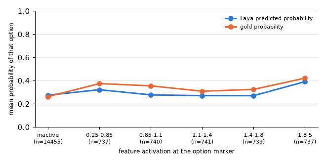

# Feature 15012

Critérios em que aparece: attribution_toward_correct

**Interpretação (preencher):** 

---

## Maiores ativações

**tr_invoice_processing_000030 / matches_order** (noul, invoice_processing) | ativação 5.773 em `pergunta` | opções ['false', 'true'] | Laya: **true** [0.48, 0.52] | gabarito: **false**

```
[CLS]noul question: The invoice reconciles with the purchase order and the recorded delivery⟦.⟧[SEP]
▸ [MASK] false: There is a discrepancy against the order or the delivery.
▸ [MASK] true: Line items, quantities and amounts reconcile.

[SEP]

{"delivery": {"condition": "accepted", "date": "2026-03-15", "received_qty": 395}, "invoice": {"currency": "USD", "id": "INV-2026-7485", "lines": [{"qty": 395, "sku": "SKU-439", "total_usd": 123820.65, "unit_usd": 313.47}], "total_usd": 123820.65, "vendor": "Orbit Logistics"}, "payment": {"days_until_due": 44, "discount_expires_in_days": null, "early_payment_discount_pct": null, "status": "scheduled", "terms": "net 60"}, "purchase_order": {"freight_terms": "freight prepaid by vendor, not separately billable", "id": "PO-8050", "lines": [{"qty": 400, "unit_usd": 313.47}], "total_usd": 125388.0}, "vendor_history": {"disputes_12m": 2, "invoices_12m": 31, "prior_invoice_ids": ["INV-2026-6077", "INV-2026-4627"]}}[SEP]
```

**tr_invoice_processing_000254 / matches_order** (noul, invoice_processing) | ativação 5.715 em `pergunta` | opções ['false', 'true'] | Laya: **true** [0.478, 0.522] | gabarito: **false**

```
[CLS]noul question: The invoice reconciles with the purchase order and the recorded delivery⟦.⟧[SEP]
▸ [MASK] false: There is a discrepancy against the order or the delivery.
▸ [MASK] true: Line items, quantities and amounts reconcile.

[SEP]

{"delivery": {"condition": "accepted", "date": "2026-03-26", "received_qty": 10}, "invoice": {"currency": "USD", "id": "INV-2026-8584", "lines": [{"qty": 10, "sku": "SKU-704", "total_usd": 6222.0, "unit_usd": 622.2}], "total_usd": 6222.0, "vendor": "Vantage Materials"}, "payment": {"days_until_due": 18, "discount_expires_in_days": null, "early_payment_discount_pct": null, "status": "scheduled", "terms": "net 45"}, "purchase_order": {"freight_terms": "freight prepaid by vendor, not separately billable", "id": "PO-1962", "lines": [{"qty": 10, "unit_usd": 444.43}], "total_usd": 4444.3}, "vendor_history": {"disputes_12m": 0, "invoices_12m": 9, "prior_invoice_ids": ["INV-2026-9224", "INV-2026-1601", "INV-2026-3670"]}}[SEP]
```

**tr_invoice_processing_000146 / matches_order** (noul, invoice_processing) | ativação 5.684 em `pergunta` | opções ['false', 'true'] | Laya: **true** [0.493, 0.507] | gabarito: **false**

```
[CLS]noul question: The invoice reconciles with the purchase order and the recorded delivery⟦.⟧[SEP]
▸ [MASK] false: There is a discrepancy against the order or the delivery.
▸ [MASK] true: Line items, quantities and amounts reconcile.

[SEP]

{"delivery": {"condition": "accepted", "date": "2026-03-17", "received_qty": 395}, "invoice": {"currency": "USD", "id": "INV-2026-6069", "lines": [{"qty": 395, "sku": "SKU-242", "total_usd": 30533.5, "unit_usd": 77.3}], "total_usd": 30533.5, "vendor": "Vantage Materials"}, "payment": {"days_until_due": 44, "discount_expires_in_days": null, "early_payment_discount_pct": null, "status": "scheduled", "terms": "net 30"}, "purchase_order": {"freight_terms": "freight prepaid by vendor, not separately billable", "id": "PO-6112", "lines": [{"qty": 400, "unit_usd": 77.3}], "total_usd": 30920.0}, "vendor_history": {"disputes_12m": 5, "invoices_12m": 23, "prior_invoice_ids": ["INV-2026-2964", "INV-2026-3490", "INV-2026-7675"]}}[SEP]
```

**tr_invoice_processing_000055 / matches_order** (noul, invoice_processing) | ativação 5.680 em `pergunta` | opções ['false', 'true'] | Laya: **true** [0.485, 0.515] | gabarito: **true**

```
[CLS]noul question: The invoice reconciles with the purchase order and the recorded delivery⟦.⟧[SEP]
▸ [MASK] false: There is a discrepancy against the order or the delivery.
▸ [MASK] true: Line items, quantities and amounts reconcile.

[SEP]

{"delivery": {"condition": "accepted", "date": "2026-03-24", "received_qty": 10}, "invoice": {"currency": "USD", "id": "INV-2026-2278", "lines": [{"qty": 10, "sku": "SKU-174", "total_usd": 2565.3, "unit_usd": 256.53}], "total_usd": 2565.3, "vendor": "Orbit Logistics"}, "payment": {"days_until_due": 44, "discount_expires_in_days": null, "early_payment_discount_pct": null, "status": "scheduled", "terms": "net 15"}, "purchase_order": {"freight_terms": "freight prepaid by vendor, not separately billable", "id": "PO-1729", "lines": [{"qty": 10, "unit_usd": 256.53}], "total_usd": 2565.3}, "vendor_history": {"disputes_12m": 2, "invoices_12m": 35, "prior_invoice_ids": ["INV-2026-2466", "INV-2026-1629", "INV-2026-2511", "INV-2026-3620"]}}[SEP]
```

**tr_invoice_processing_000209 / matches_order** (noul, invoice_processing) | ativação 5.680 em `pergunta` | opções ['false', 'true'] | Laya: **true** [0.484, 0.516] | gabarito: **false**

```
[CLS]noul question: The invoice reconciles with the purchase order and the recorded delivery⟦.⟧[SEP]
▸ [MASK] false: There is a discrepancy against the order or the delivery.
▸ [MASK] true: Line items, quantities and amounts reconcile.

[SEP]

{"delivery": {"condition": "accepted", "date": "2026-03-16", "received_qty": 80}, "invoice": {"currency": "USD", "id": "INV-2026-4623", "lines": [{"qty": 80, "sku": "SKU-665", "total_usd": 22786.4, "unit_usd": 284.83}], "total_usd": 22786.4, "vendor": "Pallas Industrial"}, "payment": {"days_until_due": -3, "discount_expires_in_days": null, "early_payment_discount_pct": null, "status": "overdue", "terms": "net 60"}, "purchase_order": {"freight_terms": "freight prepaid by vendor, not separately billable", "id": "PO-7949", "lines": [{"qty": 100, "unit_usd": 284.83}], "total_usd": 28483.0}, "vendor_history": {"disputes_12m": 0, "invoices_12m": 31, "prior_invoice_ids": ["INV-2026-3629"]}}[SEP]
```

## Ativações medianas (faixa 40-60%, mediana 1.199)

**tr_invoice_processing_000270 / disposition** (choice, invoice_processing) | ativação 1.393 em `pergunta` | opções ['approve', 'hold', 'manual_review', 'reject'] | Laya: **approve** [0.38, 0.218, 0.128, 0.274] | gabarito: **hold**

```
[CLS]⟦choice⟧ question: How should this vendor invoice be dispositioned?[SEP]
▸ [MASK] approve: Matches the order and delivery; approve for payment.
▸ [MASK] hold: Something needs confirming before payment; hold pending clarification.
▸ [MASK] manual_review: A human in finance must review the discrepancy.
▸ [MASK] reject: Should not be paid: duplicate, unauthorised or materially wrong.

[SEP]

{"delivery": {"condition": "accepted with exceptions", "date": "2026-03-27", "received_qty": 250}, "invoice": {"currency": "USD", "id": "INV-2026-6405", "lines": [{"qty": 250, "sku": "SKU-989", "total_usd": 43932.5, "unit_usd": 175.73}], "total_usd": 43932.5, "vendor": "Orbit Logistics"}, "payment": {"days_until_due": -9, "discount_expires_in_days": null, "early_payment_discount_pct": null, "status": "overdue", "terms": "net 45"}, "purchase_order": {"freight_terms": "freight prepaid by vendor, not separately billable", "id": "PO-9640", "lines": [{"qty": 250, "unit_usd": 175.73}], "total_usd": 43932.5}, "vendor_history": {"disputes_12m": 1, "invoices_12m": 34, "prior_invoice_ids": ["INV-2026-6405", "INV-2026-9686", "INV-2026-1551", "INV-2026-1949"]}}[SEP]
```

**tr_invoice_processing_000194 / duplicate** (noul, invoice_processing) | ativação 1.294 em `pergunta` | opções ['false', 'true'] | Laya: **true** [0.134, 0.866] | gabarito: **true**

```
[CLS]⟦n⟧oul question: This invoice appears to duplicate an invoice already submitted.[SEP]
▸ [MASK] false: no, the statement does not hold
▸ [MASK] true: yes, the statement holds

[SEP]

{"delivery": {"condition": "accepted", "date": "2026-03-09", "received_qty": 1000}, "invoice": {"currency": "USD", "id": "INV-2026-6341", "lines": [{"qty": 1000, "sku": "SKU-622", "total_usd": 173280.0, "unit_usd": 173.28}], "total_usd": 173280.0, "vendor": "Acme Fabrication"}, "payment": {"days_until_due": -21, "discount_expires_in_days": null, "early_payment_discount_pct": null, "status": "overdue", "terms": "net 30"}, "purchase_order": {"freight_terms": "freight prepaid by vendor, not separately billable", "id": "PO-3528", "lines": [{"qty": 1000, "unit_usd": 173.28}], "total_usd": 173280.0}, "vendor_history": {"disputes_12m": 0, "invoices_12m": 11, "prior_invoice_ids": ["INV-2026-6341"]}}[SEP]
```

**tr_customer_service_000001 / needs_human** (noul, customer_service) | ativação 1.084 em `pergunta` | opções ['false', 'true'] | Laya: **true** [0.441, 0.559] | gabarito: **false**

```
[CLS]noul question: This conversation requires a human agent rather than automated handling⟦.⟧[SEP]
▸ [MASK] false: Automation can carry this to resolution.
▸ [MASK] true: A human must take over: judgement, authority or empathy is required.

[SEP]

{"account": {"lifetime_value_usd": 1646, "prior_tickets_90d": 1, "seats": 5, "tenure_months": 26, "tier": "premium"}, "orders": [{"amount_usd": 9, "date": "2026-01-23", "id": "A-68034", "status": "settled"}, {"amount_usd": 9, "date": "2026-03-16", "id": "A-14370", "status": "settled"}, {"amount_usd": 9, "date": "2026-03-08", "id": "A-24814", "status": "refunded"}], "thread": [{"role": "customer", "text": "I can’t log in to my premium dashboard at all – I need access immediately, this is urgent."}, {"role": "agent", "text": "I understand the urgency. Are you seeing any error message when you try to sign in?"}, {"role": "customer", "text": "It just says “Invalid credentials” even though I’m sure my password is correct. My account is tied to jason.lee@example.com."}]}[SEP]
```

**tr_invoice_processing_000214 / matches_order** (noul, invoice_processing) | ativação 1.074 em `opção` | opções ['false', 'true'] | Laya: **true** [0.477, 0.523] | gabarito: **true**

```
[CLS]noul question: The invoice reconciles with the purchase order and the recorded delivery.[SEP]
▸ [MASK] false: There is a discrepancy against the order or the delivery.
▸ [MASK] true: Line items, quantities⟦ and⟧ amounts reconcile.

[SEP]

{"delivery": {"condition": "accepted", "date": "2026-03-07", "received_qty": 100}, "invoice": {"currency": "USD", "id": "INV-2026-1869", "lines": [{"qty": 100, "sku": "SKU-904", "total_usd": 19005.0, "unit_usd": 190.05}], "total_usd": 19005.0, "vendor": "Vantage Materials"}, "payment": {"days_until_due": 44, "discount_expires_in_days": 6, "early_payment_discount_pct": 2.0, "status": "scheduled", "terms": "net 15"}, "purchase_order": {"freight_terms": "freight prepaid by vendor, not separately billable", "id": "PO-8011", "lines": [{"qty": 100, "unit_usd": 190.05}], "total_usd": 19005.0}, "vendor_history": {"disputes_12m": 1, "invoices_12m": 54, "prior_invoice_ids": ["INV-2026-3002", "INV-2026-1460", "INV-2026-8867", "INV-2026-8047"]}}[SEP]
```

**tr_invoice_processing_000066 / urgency** (score, invoice_processing) | ativação 1.195 em `marcador` | opções ['0', '1', '2', '3'] | Laya: **1** [0.212, 0.55, 0.129, 0.11] | gabarito: **2**

```
[CLS]score question: How time-sensitive is processing this invoice?[SEP]
▸ ⟦[MASK]⟧ level 0: No time pressure; can wait indefinitely.
▸ [MASK] level 1: Routine; handle within the normal queue.
▸ [MASK] level 2: Elevated; should be handled within the same week.
▸ [MASK] level 3: Critical; requires action within the same day.

[SEP]

{"delivery": {"condition": "accepted", "date": "2026-03-26", "received_qty": 250}, "invoice": {"currency": "USD", "id": "INV-2026-6387", "lines": [{"qty": 250, "sku": "SKU-563", "total_usd": 57015.0, "unit_usd": 228.06}], "total_usd": 57015.0, "vendor": "Kestrel Supply"}, "payment": {"days_until_due": 11, "discount_expires_in_days": 5, "early_payment_discount_pct": 2.0, "status": "scheduled", "terms": "net 15"}, "purchase_order": {"freight_terms": "freight prepaid by vendor, not separately billable", "id": "PO-1938", "lines": [{"qty": 250, "unit_usd": 228.06}], "total_usd": 57015.0}, "vendor_history": {"disputes_12m": 5, "invoices_12m": 57, "prior_invoice_ids": ["INV-2026-2067", "INV-2026-4476", "INV-2026-9946", "INV-2026-4487"]}}[SEP]
```

## Estatísticas (conjunto de descoberta, dev e teste)

**pred / error**

| split | decisões | ativas | ativas e Laya errou | taxa | lift | q (BH) | OR (CMH) | q (CMH) |
|---|---|---|---|---|---|---|---|---|
| discovery | 5100 | 1125 | 612 | 0.544 | 0.85 | 6.56e-12 | 0.62 | 6.48e-05 |
| dev | 900 | 255 | 150 | 0.588 | 0.90 | 0.0608 | 0.51 | 0.0976 |
| test | 2000 | 447 | 244 | 0.546 | 0.86 | 4.95e-05 | 0.43 | 3.1e-05 |

**corr / error**

| split | decisões | ativas | ativas e Laya errou | taxa | lift | q (BH) | OR (CMH) | q (CMH) |
|---|---|---|---|---|---|---|---|---|
| discovery | 5100 | 1291 | 778 | 0.603 | 0.95 | 0.00578 | 1.05 | 0.887 |
| dev | 900 | 302 | 197 | 0.652 | 0.99 | 0.949 | 0.85 | 0.895 |
| test | 2000 | 543 | 340 | 0.626 | 0.98 | 0.618 | 1.40 | 0.542 |

**state / error**

| split | decisões | ativas | ativas e Laya errou | taxa | lift | q (BH) | OR (CMH) | q (CMH) |
|---|---|---|---|---|---|---|---|---|
| discovery | 5100 | 248 | 156 | 0.629 | 0.99 | 0.98 | 1.08 | 0.75 |
| dev | 900 | 47 | 37 | 0.787 | 1.20 | 0.791 | 2.47 | 0.182 |
| test | 2000 | 108 | 67 | 0.620 | 0.97 | 1 | 0.93 | 0.887 |

Confusão mais sobre-representada (pred): `matches_order|1>0` (n=110, lift 4.53, p=0). Formato `pergunta|índice previsto>índice correto`.

Confusão mais sobre-representada (corr): `duplicate|1>0` (n=216, lift 3.95, p=0). Formato `pergunta|índice previsto>índice correto`.

Confusão mais sobre-representada (state): `matches_order|1>0` (n=35, lift 6.54, p=2.64e-20). Formato `pergunta|índice previsto>índice correto`.



