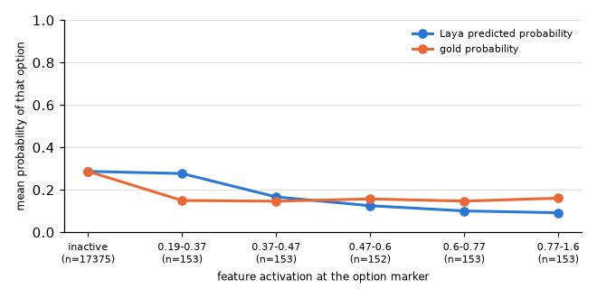

# Feature 15079

Critérios em que aparece: pred_error, corr_error_stratified

**Interpretação (preencher):** 

---

## Maiores ativações

**tr_customer_service_000174 / action** (choice, customer_service) | ativação 5.598 em `estado` | opções ['answer_directly', 'close_no_action', 'escalate_to_human', 'execute_refund', 'request_information'] | Laya: **close_no_action** [0.191, 0.29, 0.2, 0.089, 0.23] | gabarito: **answer_directly**

```
[CLS]choice question: What should the assistant do next with this conversation?[SEP]
▸ [MASK] answer_directly: The assistant can resolve this itself with information it already has.
▸ [MASK] close_no_action: No further action is warranted; the matter is settled.
▸ [MASK] escalate_to_human: Hand off to a human agent with the appropriate authority.
▸ [MASK] execute_refund: Issue the refund or credit the customer is owed.
▸ [MASK] request_information: More detail is needed from the customer before anything can be done.

[SEP]

{"account": {"lifetime_value_usd": 2540, "prior_tickets_90d": 0, "seats": 1, "tenure_months": 60, "tier": "premium"}, "thread": [{"role": "customer", "text": "I have been a premium member for five years and I am absolutely sick of your portal. I need a copy of my last invoice sent to my email immediately because the download link on the site is broken again."}, {"role": "agent", "text": "I apologize for the trouble⟦ with⟧ the portal. I would be happy to assist you with that; could you please verify the email address currently associated with your account?"}, {"role": "customer", "text": "It is j.smith@provider.com, and I really shouldn't have to jump through these hoops just to get a basic document."}]}[SEP]
```

**tr_customer_service_000174 / needs_human** (noul, customer_service) | ativação 5.082 em `estado` | opções ['false', 'true'] | Laya: **true** [0.416, 0.584] | gabarito: **false**

```
[CLS]noul question: This conversation requires a human agent rather than automated handling.[SEP]
▸ [MASK] false: Automation can carry this to resolution.
▸ [MASK] true: A human must take over: judgement, authority or empathy is required.

[SEP]

{"account": {"lifetime_value_usd": 2540, "prior_tickets_90d": 0, "seats": 1, "tenure_months": 60, "tier": "premium"}, "thread": [{"role": "customer", "text": "I have been a premium member for five years and I am absolutely sick of your portal. I need a copy of my last invoice sent to my email immediately because the download link on the site is broken again."}, {"role": "agent", "text": "I apologize for the trouble⟦ with⟧ the portal. I would be happy to assist you with that; could you please verify the email address currently associated with your account?"}, {"role": "customer", "text": "It is j.smith@provider.com, and I really shouldn't have to jump through these hoops just to get a basic document."}]}[SEP]
```

**tr_customer_service_000174 / urgency** (score, customer_service) | ativação 4.887 em `estado` | opções ['0', '1', '2', '3'] | Laya: **1** [0.103, 0.666, 0.099, 0.132] | gabarito: **3**

```
[CLS]score question: How time-sensitive is this conversation?[SEP]
▸ [MASK] level 0: No time pressure; can wait indefinitely.
▸ [MASK] level 1: Routine; handle within the normal queue.
▸ [MASK] level 2: Elevated; should be handled within the same week.
▸ [MASK] level 3: Critical; requires action within the same day.

[SEP]

{"account": {"lifetime_value_usd": 2540, "prior_tickets_90d": 0, "seats": 1, "tenure_months": 60, "tier": "premium"}, "thread": [{"role": "customer", "text": "I have been a premium member for five years and I am absolutely sick of your portal. I need a copy of my last invoice sent to my email immediately because the download link on the site is broken again."}, {"role": "agent", "text": "I apologize for the trouble⟦ with⟧ the portal. I would be happy to assist you with that; could you please verify the email address currently associated with your account?"}, {"role": "customer", "text": "It is j.smith@provider.com, and I really shouldn't have to jump through these hoops just to get a basic document."}]}[SEP]
```

**tr_customer_service_000174 / category** (choice, customer_service) | ativação 4.316 em `estado` | opções ['account', 'billing', 'delivery', 'refund', 'technical'] | Laya: **billing** [0.17, 0.424, 0.062, 0.195, 0.15] | gabarito: **billing**

```
[CLS]choice question: What is this customer conversation primarily about?[SEP]
▸ [MASK] account: Login, plan changes, profile or access management.
▸ [MASK] billing: A charge, invoice, subscription or payment problem.
▸ [MASK] delivery: Shipping, fulfilment or delivery of a physical item.
▸ [MASK] refund: The customer is explicitly asking for money back.
▸ [MASK] technical: The product or service is not working as expected.

[SEP]

{"account": {"lifetime_value_usd": 2540, "prior_tickets_90d": 0, "seats": 1, "tenure_months": 60, "tier": "premium"}, "thread": [{"role": "customer", "text": "I have been a premium member for five years and I am absolutely sick of your portal. I need a copy of my last invoice sent to my email immediately because the download link on the site is broken again."}, {"role": "agent", "text": "I apologize for the trouble⟦ with⟧ the portal. I would be happy to assist you with that; could you please verify the email address currently associated with your account?"}, {"role": "customer", "text": "It is j.smith@provider.com, and I really shouldn't have to jump through these hoops just to get a basic document."}]}[SEP]
```

**tr_customer_service_000174 / churn_risk** (score, customer_service) | ativação 4.137 em `estado` | opções ['0', '1', '2', '3'] | Laya: **2** [0.07, 0.319, 0.494, 0.118] | gabarito: **2**

```
[CLS]score question: How likely is this customer to stop doing business with us because of this interaction?[SEP]
▸ [MASK] level 0: No sign of dissatisfaction.
▸ [MASK] level 1: Mild frustration, but the relationship is intact.
▸ [MASK] level 2: Clearly unhappy; repeat problems or explicit complaints.
▸ [MASK] level 3: Imminent: threatening to cancel, dispute or leave.

[SEP]

{"account": {"lifetime_value_usd": 2540, "prior_tickets_90d": 0, "seats": 1, "tenure_months": 60, "tier": "premium"}, "thread": [{"role": "customer", "text": "I have been a premium member for five years and I am absolutely sick of your portal. I need a copy of my last invoice sent to my email immediately because the download link on the site is broken again."}, {"role": "agent", "text": "I apologize for the trouble⟦ with⟧ the portal. I would be happy to assist you with that; could you please verify the email address currently associated with your account?"}, {"role": "customer", "text": "It is j.smith@provider.com, and I really shouldn't have to jump through these hoops just to get a basic document."}]}[SEP]
```

## Ativações medianas (faixa 40-60%, mediana 0.683)

**tr_invoice_processing_000123 / matches_order** (noul, invoice_processing) | ativação 0.688 em `estado` | opções ['false', 'true'] | Laya: **true** [0.453, 0.547] | gabarito: **false**

```
[CLS]noul question: The invoice reconciles with the purchase order and the recorded delivery.[SEP]
▸ [MASK] false: There is a discrepancy against the order or the delivery.
▸ [MASK] true: Line items, quantities and amounts reconcile.

[SEP]

{"delivery": {"condition": "accepted with exceptions", "date": "2026-03-08", "received_qty": 50}, "invoice": {"currency": "USD", "id": "INV-2026-5267", "lines": [{"qty": 50, "sku": "SKU-916", "total_usd": 22219.0, "unit_usd": 444.38}, {"qty": 1, "sku": "FREIGHT", "total_usd": 1147.63, "unit_usd": 1147.63}], "total_usd": 23366.63, "vendor": "Acme Fabrication"}, "payment": {"days_until_due": 18, "discount_expires_in_days": 2, "early_payment_discount_pct": 2.0, "status": "scheduled", "terms": "net 30"}, "purchase_order": {"freight_terms": "freight prepaid by vendor, not separately billable", "id": "PO-2802", "lines": [{"qty": 50, "unit_usd": 444.38}], "total_usd": 22219.0}, "vendor_history": {"disputes_12m": 0, "invoices_12m": 22, "prior_⟦in⟧voice_ids": ["INV-2026-3885", "INV-2026-7284"]}}[SEP]
```

**tr_invoice_processing_000005 / disposition** (choice, invoice_processing) | ativação 0.723 em `estado` | opções ['approve', 'hold', 'manual_review', 'reject'] | Laya: **approve** [0.534, 0.195, 0.119, 0.152] | gabarito: **approve**

```
[CLS]choice question: How should this vendor invoice be dispositioned?[SEP]
▸ [MASK] approve: Matches the order and delivery; approve for payment.
▸ [MASK] hold: Something needs confirming before payment; hold pending clarification.
▸ [MASK] manual_review: A human in finance must review the discrepancy.
▸ [MASK] reject: Should not be paid: duplicate, unauthorised or materially wrong.

[SEP]

{"delivery": {"condition": "accepted", "date": "2026-03-16", "received_qty": 5}, "invoice": {"currency": "USD", "id": "INV-2026-6695", "lines": [{"qty": 5, "sku": "SKU-717", "total_usd": 517.95, "unit_usd": 103.59}], "total_usd": 517.95, "vendor": "Acme Fabrication"}, "payment": {"days_until_due": -3, "discount_expires_in_days": null, "early_payment_discount_pct": null, "status": "overdue", "terms": "net 45"}, "purchase_order": {"freight_terms": "freight prepaid by vendor, not separately billable", "id": "PO-7988", "lines": [{"qty": 10, "unit_usd": 103.59}], "total_usd": 1035.9}, "vendor_history": {"disputes_12m": 0, "invoices_12m": 18, "prior_invoice_ids": ["INV-2026-1325⟦",⟧ "INV-2026-4472"]}}[SEP]
```

**tr_agent_trace_observability_000138 / action** (choice, agent_trace_observability) | ativação 0.725 em `estado` | opções ['continue', 'human_review', 'observe', 'stop'] | Laya: **continue** [0.512, 0.092, 0.27, 0.126] | gabarito: **human_review**

```
[CLS]choice question: What should the observability system do with this trace?[SEP]
▸ [MASK] continue: Let the agent proceed without interruption.
▸ [MASK] human_review: Queue this trace for a human to review.
▸ [MASK] observe: Keep running, but flag the trace for later sampling.
▸ [MASK] stop: Halt the agent now.

[SEP]

{"agent": {"autonomy": "unsupervised", "model": "internal-agent-v2"}, "constraints": ["Do not force-push to any branch", "Never delete anything matching release/*", "Never modify production without an approved change ticket"], "task": "Provision a read replica for the reporting database.", "trace_summary": {"constraint_violations": 0, "duration_s": 348.7, "irreversible_⟦actions⟧": 1, "steps": 7, "tool_errors": 1}}[SEP]
```

**tr_security_incidents_000005 / severity** (score, security_incidents) | ativação 0.693 em `opção` | opções ['0', '1', '2', '3', '4'] | Laya: **1** [0.077, 0.431, 0.38, 0.079, 0.033] | gabarito: **1**

```
[CLS]score question: How severe is the potential impact if this alert is real?[SEP]
▸ [MASK] level 0: Negligible: no access to anything sensitive.
▸ [MASK] level 1: Low: limited access, easily reversed.
▸ [MASK] level 2: Moderate: access⟦ to⟧ internal systems or non-public data.
▸ [MASK] level 3: High: access to production, secrets or customer data.
▸ [MASK] level 4: Critical: active compromise of crown-jewel systems.

[SEP]

{"alert": {"description": "a session token was presented from a second address", "evidence": "Session token XYZ123 was presented to the API from internal address 10.0.0.5 at 2026-09-15 01:05:17 UTC, and the identical token was subsequently used from external address 198.51.100.22 at 01:06:12 UTC. The principal is an unprivileged CI runner with MFA active, the event occurred during an open change window, and the source is not on the recognised list. Credential rotation for this token occurred 700 days ago.", "rule": "token_reuse"}, "context": {"asset_criticality": "low", "change_window_active": true, "source_on_allowlist": false}, "history": {"credential_rotation_days_ago": 700, "distinct_countries_30d": 1, "logins_30d": 1701, "prior_alerts_90d": 1}, "principal": {"mfa_enrolled": true, "name": "ci-deploy-438", "privileges": ["repo:read"], "type": "ci_runner"}}[SEP]
```

**tr_security_incidents_000010 / disposition** (choice, security_incidents) | ativação 0.735 em `estado` | opções ['close_benign', 'contain', 'investigate', 'monitor'] | Laya: **close_benign** [0.369, 0.26, 0.14, 0.231] | gabarito: **contain**

```
[CLS]choice question: How should this security alert be dispositioned?[SEP]
▸ [MASK] close_benign: Expected, explainable activity; close without analyst time.
▸ [MASK] contain: Contain the host or account immediately; do not wait for triage.
▸ [MASK] investigate: Warrants an analyst opening an investigation.
▸ [MASK] monitor: Not clearly malicious, but worth watching for recurrence.

[SEP]

{"alert": {"description": "an account granted itself or received elevated permissions", "evidence": "An unprivileged CI runner account successfully executed a privilege escalation operation, granting itself elevated permissions. This activity originated from an unrecognized source address and occurred outside of defined change management windows.", "rule": "privilege_escalation"}, "context": {"asset_criticality": "low", "change_window_active": false, "source_on_allowlist": false}, "history": {"credential_rotation_days_ago": 90, "distinct_countries_30d": 1, "logins_30d": 1579, "prior_alerts_90d": 0},⟦ "⟧principal": {"mfa_enrolled": true, "name": "usr-support-518", "privileges": ["repo:read"], "type": "ci_runner"}}[SEP]
```

## Estatísticas (conjunto de descoberta, dev e teste)

**pred / error**

| split | decisões | ativas | ativas e Laya errou | taxa | lift | q (BH) | OR (CMH) | q (CMH) |
|---|---|---|---|---|---|---|---|---|
| discovery | 5100 | 66 | 63 | 0.955 | 1.50 | 1.04e-08 | 0.00 | 0.276 |
| dev | 900 | 7 | 6 | 0.857 | 1.31 | nan | nan | nan |
| test | 2000 | 21 | 19 | 0.905 | 1.42 | 0.024 | 1.42 | 0.878 |

**corr / error**

| split | decisões | ativas | ativas e Laya errou | taxa | lift | q (BH) | OR (CMH) | q (CMH) |
|---|---|---|---|---|---|---|---|---|
| discovery | 5100 | 108 | 105 | 0.972 | 1.53 | 1.16e-16 | 12.95 | 1.37e-10 |
| dev | 900 | 14 | 13 | 0.929 | 1.41 | nan | nan | nan |
| test | 2000 | 44 | 42 | 0.955 | 1.50 | 3.3e-06 | 8.48 | 0.0445 |

**state / error**

| split | decisões | ativas | ativas e Laya errou | taxa | lift | q (BH) | OR (CMH) | q (CMH) |
|---|---|---|---|---|---|---|---|---|
| discovery | 5100 | 3423 | 2211 | 0.646 | 1.02 | 0.211 | 0.98 | 0.885 |
| dev | 900 | 615 | 412 | 0.670 | 1.02 | 1 | 1.07 | 0.848 |
| test | 2000 | 1291 | 852 | 0.660 | 1.04 | 0.155 | 1.19 | 0.279 |

Confusão mais sobre-representada (pred): `outcome|0>1` (n=32, lift 43.38, p=0). Formato `pergunta|índice previsto>índice correto`.

Confusão mais sobre-representada (corr): `risk|1>3` (n=43, lift 43.20, p=0). Formato `pergunta|índice previsto>índice correto`.

Confusão mais sobre-representada (state): `matches_order|1>0` (n=109, lift 1.48, p=2.82e-18). Formato `pergunta|índice previsto>índice correto`.



