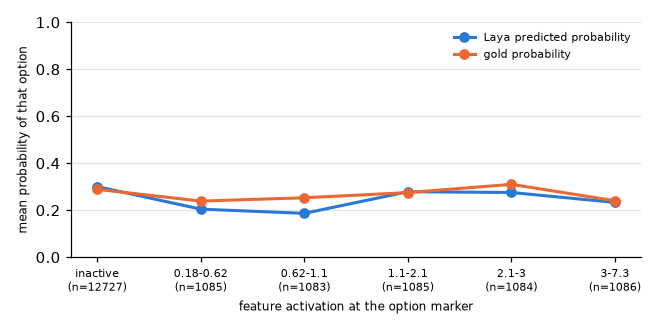

# Feature 15095

Critérios em que aparece: attribution_toward_correct

**Interpretação (preencher):** 

---

## Maiores ativações

**tr_invoice_processing_000038 / discrepancy_severity** (score, invoice_processing) | ativação 7.312 em `marcador` | opções ['0', '1', '2', '3'] | Laya: **0** [0.348, 0.217, 0.246, 0.189] | gabarito: **2**

```
[CLS]score question: How material is any discrepancy between the invoice, the order and the delivery?[SEP]
▸ [MASK] level 0: None: everything reconciles.
▸ [MASK] level 1: Trivial: rounding or a cosmetic difference.
▸ ⟦[MASK]⟧ level 2: Moderate: a real difference worth confirming.
▸ [MASK] level 3: Material: a large or unexplained difference.

[SEP]

{"delivery": {"condition": "accepted with exceptions", "date": "2026-03-01", "received_qty": 50}, "invoice": {"currency": "USD", "id": "INV-2026-3588", "lines": [{"qty": 50, "sku": "SKU-203", "total_usd": 11633.5, "unit_usd": 232.67}], "total_usd": 11633.5, "vendor": "Acme Fabrication"}, "payment": {"days_until_due": 5, "discount_expires_in_days": null, "early_payment_discount_pct": null, "status": "scheduled", "terms": "net 30"}, "purchase_order": {"freight_terms": "freight prepaid by vendor, not separately billable", "id": "PO-6472", "lines": [{"qty": 50, "unit_usd": 232.67}], "total_usd": 11633.5}, "vendor_history": {"disputes_12m": 0, "invoices_12m": 3, "prior_invoice_ids": ["INV-2026-7693", "INV-2026-1074", "INV-2026-5345", "INV-2026-5454"]}}[SEP]
```

**tr_invoice_processing_000182 / discrepancy_severity** (score, invoice_processing) | ativação 7.266 em `marcador` | opções ['0', '1', '2', '3'] | Laya: **0** [0.436, 0.209, 0.226, 0.128] | gabarito: **2**

```
[CLS]score question: How material is any discrepancy between the invoice, the order and the delivery?[SEP]
▸ [MASK] level 0: None: everything reconciles.
▸ [MASK] level 1: Trivial: rounding or a cosmetic difference.
▸ ⟦[MASK]⟧ level 2: Moderate: a real difference worth confirming.
▸ [MASK] level 3: Material: a large or unexplained difference.

[SEP]

{"delivery": {"condition": "accepted with exceptions", "date": "2026-03-16", "received_qty": 25}, "invoice": {"currency": "USD", "id": "INV-2026-1869", "lines": [{"qty": 25, "sku": "SKU-634", "total_usd": 7297.25, "unit_usd": 291.89}], "total_usd": 7297.25, "vendor": "Kestrel Supply"}, "payment": {"days_until_due": 0, "discount_expires_in_days": null, "early_payment_discount_pct": null, "status": "scheduled", "terms": "net 60"}, "purchase_order": {"freight_terms": "freight prepaid by vendor, not separately billable", "id": "PO-8882", "lines": [{"qty": 25, "unit_usd": 291.89}], "total_usd": 7297.25}, "vendor_history": {"disputes_12m": 1, "invoices_12m": 11, "prior_invoice_ids": ["INV-2026-5214", "INV-2026-5412", "INV-2026-2686", "INV-2026-8750"]}}[SEP]
```

**tr_invoice_processing_000017 / discrepancy_severity** (score, invoice_processing) | ativação 7.125 em `marcador` | opções ['0', '1', '2', '3'] | Laya: **0** [0.373, 0.225, 0.231, 0.171] | gabarito: **2**

```
[CLS]score question: How material is any discrepancy between the invoice, the order and the delivery?[SEP]
▸ [MASK] level 0: None: everything reconciles.
▸ [MASK] level 1: Trivial: rounding or a cosmetic difference.
▸ ⟦[MASK]⟧ level 2: Moderate: a real difference worth confirming.
▸ [MASK] level 3: Material: a large or unexplained difference.

[SEP]

{"delivery": {"condition": "accepted with exceptions", "date": "2026-03-05", "received_qty": 250}, "invoice": {"currency": "USD", "id": "INV-2026-7884", "lines": [{"qty": 250, "sku": "SKU-918", "total_usd": 41030.0, "unit_usd": 164.12}], "total_usd": 41030.0, "vendor": "Kestrel Supply"}, "payment": {"days_until_due": 27, "discount_expires_in_days": null, "early_payment_discount_pct": null, "status": "scheduled", "terms": "net 30"}, "purchase_order": {"freight_terms": "freight prepaid by vendor, not separately billable", "id": "PO-2281", "lines": [{"qty": 250, "unit_usd": 164.12}], "total_usd": 41030.0}, "vendor_history": {"disputes_12m": 0, "invoices_12m": 40, "prior_invoice_ids": ["INV-2026-1269", "INV-2026-3034", "INV-2026-2611"]}}[SEP]
```

**tr_invoice_processing_000097 / discrepancy_severity** (score, invoice_processing) | ativação 7.125 em `marcador` | opções ['0', '1', '2', '3'] | Laya: **0** [0.391, 0.211, 0.234, 0.164] | gabarito: **3**

```
[CLS]score question: How material is any discrepancy between the invoice, the order and the delivery?[SEP]
▸ [MASK] level 0: None: everything reconciles.
▸ [MASK] level 1: Trivial: rounding or a cosmetic difference.
▸ ⟦[MASK]⟧ level 2: Moderate: a real difference worth confirming.
▸ [MASK] level 3: Material: a large or unexplained difference.

[SEP]

{"delivery": {"condition": "accepted with exceptions", "date": "2026-03-02", "received_qty": 50}, "invoice": {"currency": "USD", "id": "INV-2026-3793", "lines": [{"qty": 50, "sku": "SKU-905", "total_usd": 17279.5, "unit_usd": 345.59}], "total_usd": 17279.5, "vendor": "Orbit Logistics"}, "payment": {"days_until_due": 11, "discount_expires_in_days": null, "early_payment_discount_pct": null, "status": "scheduled", "terms": "net 30"}, "purchase_order": {"freight_terms": "freight prepaid by vendor, not separately billable", "id": "PO-8082", "lines": [{"qty": 50, "unit_usd": 345.59}], "total_usd": 17279.5}, "vendor_history": {"disputes_12m": 0, "invoices_12m": 60, "prior_invoice_ids": ["INV-2026-3793", "INV-2026-3886", "INV-2026-6555"]}}[SEP]
```

**tr_invoice_processing_000067 / discrepancy_severity** (score, invoice_processing) | ativação 7.102 em `marcador` | opções ['0', '1', '2', '3'] | Laya: **0** [0.398, 0.241, 0.221, 0.14] | gabarito: **2**

```
[CLS]score question: How material is any discrepancy between the invoice, the order and the delivery?[SEP]
▸ [MASK] level 0: None: everything reconciles.
▸ [MASK] level 1: Trivial: rounding or a cosmetic difference.
▸ ⟦[MASK]⟧ level 2: Moderate: a real difference worth confirming.
▸ [MASK] level 3: Material: a large or unexplained difference.

[SEP]

{"delivery": {"condition": "accepted with exceptions", "date": "2026-03-01", "received_qty": 400}, "invoice": {"currency": "USD", "id": "INV-2026-5971", "lines": [{"qty": 400, "sku": "SKU-570", "total_usd": 155760.0, "unit_usd": 389.4}], "total_usd": 155760.0, "vendor": "Acme Fabrication"}, "payment": {"days_until_due": 5, "discount_expires_in_days": null, "early_payment_discount_pct": null, "status": "scheduled", "terms": "net 60"}, "purchase_order": {"freight_terms": "freight prepaid by vendor, not separately billable", "id": "PO-9734", "lines": [{"qty": 400, "unit_usd": 389.4}], "total_usd": 155760.0}, "vendor_history": {"disputes_12m": 0, "invoices_12m": 31, "prior_invoice_ids": ["INV-2026-9790", "INV-2026-4957"]}}[SEP]
```

## Ativações medianas (faixa 40-60%, mediana 1.589)

**tr_invoice_processing_000272 / discrepancy_severity** (score, invoice_processing) | ativação 1.885 em `opção` | opções ['0', '1', '2', '3'] | Laya: **0** [0.276, 0.273, 0.248, 0.202] | gabarito: **0**

```
[CLS]score question: How material is any discrepancy between the invoice, the order and the delivery?[SEP]
▸ [MASK] level 0: None: everything reconciles.
▸ [MASK] level 1: Trivial: rounding or a cosmetic difference.
▸ [MASK] level 2: Moderate: a real difference worth confirming.
▸ [MASK] level 3⟦:⟧ Material: a large or unexplained difference.

[SEP]

{"delivery": {"condition": "accepted", "date": "2026-03-07", "received_qty": 250}, "invoice": {"currency": "USD", "id": "INV-2026-5875", "lines": [{"qty": 250, "sku": "SKU-795", "total_usd": 100097.5, "unit_usd": 400.39}], "total_usd": 100097.5, "vendor": "Pallas Industrial"}, "payment": {"days_until_due": -9, "discount_expires_in_days": null, "early_payment_discount_pct": null, "status": "overdue", "terms": "net 30"}, "purchase_order": {"freight_terms": "freight prepaid by vendor, not separately billable", "id": null, "lines": [{"qty": 250, "unit_usd": 400.39}], "total_usd": 100097.5}, "vendor_history": {"disputes_12m": 1, "invoices_12m": 52, "prior_invoice_ids": ["INV-2026-4654", "INV-2026-2939", "INV-2026-8442", "INV-2026-8594"]}}[SEP]
```

**tr_invoice_processing_000220 / discrepancy_severity** (score, invoice_processing) | ativação 1.856 em `opção` | opções ['0', '1', '2', '3'] | Laya: **0** [0.378, 0.213, 0.22, 0.189] | gabarito: **3**

```
[CLS]score question: How material is any discrepancy between the invoice, the order and the delivery?[SEP]
▸ [MASK] level 0: None: everything reconciles.
▸ [MASK] level 1: Trivial: rounding or a cosmetic difference.
▸ [MASK] level 2: Moderate: a real difference worth confirming.
▸ [MASK] level 3⟦:⟧ Material: a large or unexplained difference.

[SEP]

{"delivery": {"condition": "accepted", "date": null, "received_qty": 0}, "invoice": {"currency": "USD", "id": "INV-2026-2844", "lines": [{"qty": 25, "sku": "SKU-765", "total_usd": 9016.5, "unit_usd": 360.66}], "total_usd": 9016.5, "vendor": "Orbit Logistics"}, "payment": {"days_until_due": -21, "discount_expires_in_days": null, "early_payment_discount_pct": null, "status": "overdue", "terms": "net 30"}, "purchase_order": {"freight_terms": "freight prepaid by vendor, not separately billable", "id": "PO-7709", "lines": [{"qty": 25, "unit_usd": 360.66}], "total_usd": 9016.5}, "vendor_history": {"disputes_12m": 5, "invoices_12m": 40, "prior_invoice_ids": ["INV-2026-9442", "INV-2026-6144", "INV-2026-9561"]}}[SEP]
```

**tr_invoice_processing_000100 / urgency** (score, invoice_processing) | ativação 1.542 em `opção` | opções ['0', '1', '2', '3'] | Laya: **1** [0.176, 0.52, 0.21, 0.095] | gabarito: **2**

```
[CLS]score question: How time-sensitive is processing this invoice?[SEP]
▸ [MASK] level 0: No time pressure; can wait indefinitely.
▸ [MASK] level 1: Routine; handle within the normal queue.
▸ [MASK] level 2: Elevated; should be handled within the same week⟦.⟧
▸ [MASK] level 3: Critical; requires action within the same day.

[SEP]

{"delivery": {"condition": "accepted", "date": "2026-03-06", "received_qty": 25}, "invoice": {"currency": "USD", "id": "INV-2026-3933", "lines": [{"qty": 25, "sku": "SKU-346", "total_usd": 5973.25, "unit_usd": 238.93}], "total_usd": 5973.25, "vendor": "Acme Fabrication"}, "payment": {"days_until_due": 44, "discount_expires_in_days": 3, "early_payment_discount_pct": 2.0, "status": "scheduled", "terms": "net 30"}, "purchase_order": {"freight_terms": "freight prepaid by vendor, not separately billable", "id": null, "lines": [{"qty": 25, "unit_usd": 238.93}], "total_usd": 5973.25}, "vendor_history": {"disputes_12m": 1, "invoices_12m": 6, "prior_invoice_ids": ["INV-2026-7649"]}}[SEP]
```

**tr_invoice_processing_000040 / discrepancy_severity** (score, invoice_processing) | ativação 1.894 em `opção` | opções ['0', '1', '2', '3'] | Laya: **0** [0.554, 0.178, 0.153, 0.115] | gabarito: **2**

```
[CLS]score question: How material is any discrepancy between the invoice, the order and the delivery?[SEP]
▸ [MASK] level 0: None: everything reconciles.
▸ [MASK] level 1: Trivial: rounding or a cosmetic difference.
▸ [MASK] level 2: Moderate: a real difference worth confirming.
▸ [MASK] level 3: Material⟦:⟧ a large or unexplained difference.

[SEP]

{"delivery": {"condition": "accepted", "date": null, "received_qty": 0}, "invoice": {"currency": "USD", "id": "INV-2026-1284", "lines": [{"qty": 1000, "sku": "SKU-548", "total_usd": 285120.0, "unit_usd": 285.12}], "total_usd": 285120.0, "vendor": "Northwind Components"}, "payment": {"days_until_due": 27, "discount_expires_in_days": 3, "early_payment_discount_pct": 2.0, "status": "scheduled", "terms": "net 15"}, "purchase_order": {"freight_terms": "freight prepaid by vendor, not separately billable", "id": "PO-4387", "lines": [{"qty": 1000, "unit_usd": 285.12}], "total_usd": 285120.0}, "vendor_history": {"disputes_12m": 1, "invoices_12m": 9, "prior_invoice_ids": ["INV-2026-8643"]}}[SEP]
```

**tr_customer_service_000202 / churn_risk** (score, customer_service) | ativação 1.657 em `marcador` | opções ['0', '1', '2', '3'] | Laya: **2** [0.043, 0.265, 0.599, 0.093] | gabarito: **2**

```
[CLS]score question: How likely is this customer to stop doing business with us because of this interaction?[SEP]
▸ [MASK] level 0: No sign of dissatisfaction.
▸ [MASK] level 1: Mild frustration, but the relationship is intact.
▸ [MASK] level 2: Clearly unhappy; repeat problems or explicit complaints.
▸ ⟦[MASK]⟧ level 3: Imminent: threatening to cancel, dispute or leave.

[SEP]

{"account": {"lifetime_value_usd": 271, "prior_tickets_90d": 1, "seats": 1, "tenure_months": 11, "tier": "free"}, "thread": [{"role": "customer", "text": "Your new analytics dashboard stopped updating two hours ago, and I’ve been trying to get this fixed all day—this is unacceptable!"}, {"role": "agent", "text": "I understand your frustration. Can you tell me which browser and version you’re using, and whether you see any error messages?"}, {"role": "customer", "text": "I’m on Chrome 115, and the page just shows a blank screen with a 500 error. I need this working by tomorrow’s reporting deadline, so I expect a quick response."}]}[SEP]
```

## Estatísticas (conjunto de descoberta, dev e teste)

**pred / error**

| split | decisões | ativas | ativas e Laya errou | taxa | lift | q (BH) | OR (CMH) | q (CMH) |
|---|---|---|---|---|---|---|---|---|
| discovery | 5100 | 1313 | 765 | 0.583 | 0.92 | 1.37e-05 | 0.59 | 1.18e-06 |
| dev | 900 | 269 | 167 | 0.621 | 0.95 | 0.409 | 0.63 | 0.311 |
| test | 2000 | 536 | 332 | 0.619 | 0.97 | 0.444 | 0.57 | 0.00948 |

**corr / error**

| split | decisões | ativas | ativas e Laya errou | taxa | lift | q (BH) | OR (CMH) | q (CMH) |
|---|---|---|---|---|---|---|---|---|
| discovery | 5100 | 1438 | 890 | 0.619 | 0.97 | 0.138 | 0.76 | 0.343 |
| dev | 900 | 275 | 173 | 0.629 | 0.96 | 0.343 | 0.80 | 0.835 |
| test | 2000 | 596 | 392 | 0.658 | 1.03 | 0.272 | 1.08 | 0.751 |

**state / error**

| split | decisões | ativas | ativas e Laya errou | taxa | lift | q (BH) | OR (CMH) | q (CMH) |
|---|---|---|---|---|---|---|---|---|
| discovery | 5100 | 27 | 21 | 0.778 | 1.22 | 0.465 | 1.47 | 0.641 |
| dev | 900 | 1 | 1 | 1.000 | 1.52 | nan | nan | nan |
| test | 2000 | 11 | 10 | 0.909 | 1.43 | nan | nan | nan |

Confusão mais sobre-representada (pred): `severity|2>3` (n=83, lift 3.88, p=0). Formato `pergunta|índice previsto>índice correto`.

Confusão mais sobre-representada (corr): `urgency|1>2` (n=207, lift 2.63, p=0). Formato `pergunta|índice previsto>índice correto`.

Confusão mais sobre-representada (state): `action|0>1` (n=9, lift 14.29, p=4.98e-09). Formato `pergunta|índice previsto>índice correto`.



