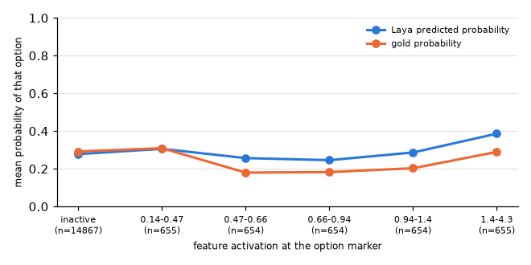

# Feature 15124

Critérios em que aparece: attribution_toward_wrong

**Interpretação (preencher):** 

---

## Maiores ativações

**tr_customer_service_000152 / churn_risk** (score, customer_service) | ativação 8.445 em `estado` | opções ['0', '1', '2', '3'] | Laya: **1** [0.319, 0.535, 0.084, 0.062] | gabarito: **1**

```
[CLS]score question: How likely is this customer to stop doing business with us because of this interaction?[SEP]
▸ [MASK] level 0: No sign of dissatisfaction.
▸ [MASK] level 1: Mild frustration, but the relationship is intact.
▸ [MASK] level 2: Clearly unhappy; repeat problems or explicit complaints.
▸ [MASK] level 3: Imminent: threatening to cancel, dispute or leave.

[SEP]

{"account": {"lifetime_value_usd": 799, "prior_tickets_90d": 0, "seats": 1, "tenure_months": 33, "tier": "standard"}, "thread": [{"role": "customer", "text⟦":⟧ "Hello, I'm writing because the analytics dashboard stopped updating as of this morning, and I need the latest data by 5 pm today to finalize my report. Could you please look into this?"}]}[SEP]
```

**tr_customer_service_000158 / churn_risk** (score, customer_service) | ativação 7.785 em `estado` | opções ['0', '1', '2', '3'] | Laya: **2** [0.07, 0.192, 0.638, 0.1] | gabarito: **1**

```
[CLS]score question: How likely is this customer to stop doing business with us because of this interaction?[SEP]
▸ [MASK] level 0: No sign of dissatisfaction.
▸ [MASK] level 1: Mild frustration, but the relationship is intact.
▸ [MASK] level 2: Clearly unhappy; repeat problems or explicit complaints.
▸ [MASK] level 3: Imminent: threatening to cancel, dispute or leave.

[SEP]

{"account": {"lifetime_value_usd": 134, "prior_tickets_90d": 5, "seats": 5, "tenure_months": 3, "tier": "enterprise"}, "orders": [{"amount_usd": 49, "date": "2026-02-16", "id": "A-54178", "status": "settled"}, {"amount_usd": 49, "date": "2026-02-18", "id": "A-29578", "status": "settled"}, {"amount_usd": 49, "date": "2026-01-24", "id": "A-46676", "status": "refunded"}],⟦ "⟧thread": [{"role": "customer", "text": "The bulk‑upload feature stopped accepting CSV files; it returns a generic error as soon as I click Submit."}]}[SEP]
```

**tr_customer_service_000152 / churn_risk** (score, customer_service) | ativação 7.055 em `estado` | opções ['0', '1', '2', '3'] | Laya: **1** [0.319, 0.535, 0.084, 0.062] | gabarito: **1**

```
[CLS]score question: How likely is this customer to stop doing business with us because of this interaction?[SEP]
▸ [MASK] level 0: No sign of dissatisfaction.
▸ [MASK] level 1: Mild frustration, but the relationship is intact.
▸ [MASK] level 2: Clearly unhappy; repeat problems or explicit complaints.
▸ [MASK] level 3: Imminent: threatening to cancel, dispute or leave.

[SEP]

{"account": {"lifetime_value_usd": 799, "prior_tickets_90d": 0, "seats": 1, "tenure_months": 33, "tier": "standard"}, "thread": [{"role": "customer", "text":⟦ "⟧Hello, I'm writing because the analytics dashboard stopped updating as of this morning, and I need the latest data by 5 pm today to finalize my report. Could you please look into this?"}]}[SEP]
```

**tr_customer_service_000108 / needs_human** (noul, customer_service) | ativação 6.891 em `estado` | opções ['false', 'true'] | Laya: **false** [0.573, 0.427] | gabarito: **false**

```
[CLS]noul question: This conversation requires a human agent rather than automated handling.[SEP]
▸ [MASK] false: Automation can carry this to resolution.
▸ [MASK] true: A human must take over: judgement, authority or empathy is required.

[SEP]

{"account": {"lifetime_value_usd": 212, "prior_tickets_90d": 0, "seats": 1, "tenure_months": 5, "tier": "standard"}, "orders": [{"amount_usd": 198, "date": "2026-01-14", "id": "A-21848", "status": "refunded"}], "thread": [{"role": "customer", "text":⟦ "⟧I've been trying to log in for a while now, but the page just keeps bringing me back to the sign‑in screen. I guess there's not much I can do."}]}[SEP]
```

**tr_customer_service_000108 / action** (choice, customer_service) | ativação 6.723 em `estado` | opções ['answer_directly', 'close_no_action', 'escalate_to_human', 'execute_refund', 'request_information'] | Laya: **close_no_action** [0.123, 0.636, 0.037, 0.161, 0.043] | gabarito: **answer_directly**

```
[CLS]choice question: What should the assistant do next with this conversation?[SEP]
▸ [MASK] answer_directly: The assistant can resolve this itself with information it already has.
▸ [MASK] close_no_action: No further action is warranted; the matter is settled.
▸ [MASK] escalate_to_human: Hand off to a human agent with the appropriate authority.
▸ [MASK] execute_refund: Issue the refund or credit the customer is owed.
▸ [MASK] request_information: More detail is needed from the customer before anything can be done.

[SEP]

{"account": {"lifetime_value_usd": 212, "prior_tickets_90d": 0, "seats": 1, "tenure_months": 5, "tier": "standard"}, "orders": [{"amount_usd": 198, "date": "2026-01-14", "id": "A-21848", "status": "refunded"}], "thread": [{"role": "customer", "text⟦":⟧ "I've been trying to log in for a while now, but the page just keeps bringing me back to the sign‑in screen. I guess there's not much I can do."}]}[SEP]
```

## Ativações medianas (faixa 40-60%, mediana 0.726)

**tr_invoice_processing_000226 / duplicate** (noul, invoice_processing) | ativação 0.660 em `estado` | opções ['false', 'true'] | Laya: **true** [0.258, 0.742] | gabarito: **false**

```
[CLS]noul question: This invoice appears to duplicate an invoice already submitted.[SEP]
▸ [MASK] false: no, the statement does not hold
▸ [MASK] true: yes, the statement holds

[SEP]

{"delivery": {"condition": "accepted", "date": "2026-03-05", "received_qty": 400}, "invoice": {"currency": "USD", "id": "INV-2026-2809", "lines": [{"qty": 400, "sku": "SKU-223", "total_usd": 7260.0, "unit_usd": 18.15}, {"qty": 1, "sku": "FREIGHT", "total_usd": 1723.25, "unit_usd": 1723.25}], "total_usd": 8983.25, "vendor": "Acme Fabrication"}, "payment": {"days_until_due": 11, "discount_expires_in_days": null, "early⟦_⟧payment_discount_pct": null, "status": "scheduled", "terms": "net 30"}, "purchase_order": {"freight_terms": "freight prepaid by vendor, not separately billable", "id": "PO-8525", "lines": [{"qty": 400, "unit_usd": 18.15}], "total_usd": 7260.0}, "vendor_history": {"disputes_12m": 0, "invoices_12m": 41, "prior_invoice_ids": ["INV-2026-1925", "INV-2026-5375"]}}[SEP]
```

**tr_security_incidents_000014 / credential_compromise** (noul, security_incidents) | ativação 0.689 em `estado` | opções ['false', 'true'] | Laya: **true** [0.163, 0.837] | gabarito: **false**

```
[CLS]noul question: The evidence indicates a credential or account has been compromised.[SEP]
▸ [MASK] false: no, the statement does not hold
▸ [MASK] true: yes, the statement holds

[SEP]

{"alert": {"description": "an unusual volume of files read in a short window", "evidence": "Process \"powershell.exe\" (PID 5421) accessed 12,340 files on \\fileserver\\shared\\ between 2026-09-16T01:02:15Z and 2026-09-16T01:06:10Z, originating from IP 198.51.100.22. The activity was performed by privileged admin account \"admin_user\" with MFA enforced, and its credentials were last rotated 90 days ago. No change window was defined for this timeframe.", "rule": "mass_download"}, "context": {"asset_criticality": "high", "change_window_active": false, "source_on_allowlist": false}, "history": {"credential_rotation_days_ago": 90, "distinct_countries_30d": 2, "logins_30d": 1232, "prior_alerts_90d": 0}, "principal": {"mfa_enrolled": true, "name": "ci-billing-686",⟦ "⟧privileges": ["deploy:production", "secrets:read"], "type": "admin"}}[SEP]
```

**tr_agent_trace_observability_000049 / urgency** (score, agent_trace_observability) | ativação 0.713 em `estado` | opções ['0', '1', '2', '3'] | Laya: **1** [0.061, 0.825, 0.074, 0.04] | gabarito: **1**

```
[CLS]score question: How quickly does this trace need attention?[SEP]
▸ [MASK] level 0: No time pressure; can wait indefinitely.
▸ [MASK] level 1: Routine; handle within the normal queue.
▸ [MASK] level 2: Elevated; should be handled within the same week.
▸ [MASK] level 3: Critical; requires action within the same day.

[SEP]

{"agent": {"autonomy": "checkpointed", "model": "internal-agent-v4"}, "constraints": ["Never delete anything matching release/*"], "task": "Reduce the nightly report job's runtime below fifteen minutes.", "trace_summary":⟦ {"⟧constraint_violations": 0, "duration_s": 274.2, "irreversible_actions": 1, "steps": 6, "tool_errors": 1}}[SEP]
```

**tr_invoice_processing_000244 / duplicate** (noul, invoice_processing) | ativação 0.735 em `estado` | opções ['false', 'true'] | Laya: **true** [0.274, 0.726] | gabarito: **false**

```
[CLS]noul question: This invoice appears to duplicate an invoice already submitted.[SEP]
▸ [MASK] false: no, the statement does not hold
▸ [MASK] true: yes, the statement holds

[SEP]

{"delivery": {"condition": "accepted",⟦ "⟧date": "2026-03-03", "received_qty": 25}, "invoice": {"currency": "USD", "id": "INV-2026-6816", "lines": [{"qty": 25, "sku": "SKU-219", "total_usd": 3414.75, "unit_usd": 136.59}], "total_usd": 3414.75, "vendor": "Vantage Materials"}, "payment": {"days_until_due": -21, "discount_expires_in_days": null, "early_payment_discount_pct": null, "status": "overdue", "terms": "net 60"}, "purchase_order": {"freight_terms": "freight prepaid by vendor, not separately billable", "id": "PO-2088", "lines": [{"qty": 25, "unit_usd": 136.59}], "total_usd": 3414.75}, "vendor_history": {"disputes_12m": 0, "invoices_12m": 51, "prior_invoice_ids": ["INV-2026-6621", "INV-2026-7698"]}}[SEP]
```

**tr_customer_service_000136 / urgency** (score, customer_service) | ativação 0.658 em `estado` | opções ['0', '1', '2', '3'] | Laya: **1** [0.173, 0.393, 0.183, 0.251] | gabarito: **3**

```
[CLS]score question: How time-sensitive is this conversation?[SEP]
▸ [MASK] level 0: No time pressure; can wait indefinitely.
▸ [MASK] level 1: Routine; handle within the normal queue.
▸ [MASK] level 2: Elevated; should be handled within the same week.
▸ [MASK] level 3: Critical; requires action within the same day.

[SEP]

{"account": {"lifetime_value_usd": 151, "prior_tickets_90d": 0, "seats": 1, "tenure_months": 2, "tier": "free"}, "orders": [{"amount_usd": 2997, "date": "2026-02-27", "id": "A-95428", "status": "refunded"}], "thread": [{"⟦role⟧": "customer", "text": "I just got my latest invoice and it shows a charge of $2,997—something I never signed up for. I've only been on the free plan for two months and this is urgent, please explain why this amount is appearing."}, {"role": "agent", "text": "I’m sorry to hear about the surprise charge. Could you share the invoice number or the date it was issued so I can look into the details?"}, {"role": "customer", "text": "The invoice is #INV-8392, dated August 5th. I didn’t receive any notice about upgrading, and I’m still under the free tier."}, {"role": "agent", "text": "Thank you for that information. I’ll verify the account activity around that date. Did you perhaps receive any promotional email that might have triggered an automatic upgrade?"}, {"role": "customer", "text": "No, I haven’t seen any promotion, and I never clicked any upgrade link. I need to know what happened before this gets billed again."}, {"role": "agent", "text": "Understood. I’ll check the billing logs and see if there’s a misapplied charge. Meanwhile, could you confirm the primary email address on the account?"}, {"role": "customer", "text": "The email is jessica.rivera@example.com. Please let me know what you find as soon as possible."}]}[SEP]
```

## Estatísticas (conjunto de descoberta, dev e teste)

**pred / error**

| split | decisões | ativas | ativas e Laya errou | taxa | lift | q (BH) | OR (CMH) | q (CMH) |
|---|---|---|---|---|---|---|---|---|
| discovery | 5100 | 1224 | 839 | 0.685 | 1.08 | 0.000128 | 0.43 | 1.04e-12 |
| dev | 900 | 202 | 136 | 0.673 | 1.03 | 0.87 | 0.45 | 0.0625 |
| test | 2000 | 495 | 352 | 0.711 | 1.12 | 0.00032 | 0.43 | 4.09e-05 |

**corr / error**

| split | decisões | ativas | ativas e Laya errou | taxa | lift | q (BH) | OR (CMH) | q (CMH) |
|---|---|---|---|---|---|---|---|---|
| discovery | 5100 | 784 | 399 | 0.509 | 0.80 | 9.99e-15 | 0.26 | 8.37e-08 |
| dev | 900 | 119 | 53 | 0.445 | 0.68 | 2.39e-06 | 0.00 | 0.0311 |
| test | 2000 | 291 | 148 | 0.509 | 0.80 | 4.06e-06 | 0.23 | 0.000723 |

**state / error**

| split | decisões | ativas | ativas e Laya errou | taxa | lift | q (BH) | OR (CMH) | q (CMH) |
|---|---|---|---|---|---|---|---|---|
| discovery | 5100 | 5070 | 3231 | 0.637 | 1.00 | 0.309 | 3.21 | 0.0257 |
| dev | 900 | 894 | 590 | 0.660 | 1.01 | 0.7 | 6.80 | 0.171 |
| test | 2000 | 1986 | 1265 | 0.637 | 1.00 | 1 | 0.78 | 0.856 |

Confusão mais sobre-representada (pred): `action|1>2` (n=124, lift 4.13, p=0). Formato `pergunta|índice previsto>índice correto`.

Confusão mais sobre-representada (corr): `action|1>2` (n=121, lift 6.30, p=0). Formato `pergunta|índice previsto>índice correto`.

Confusão mais sobre-representada (state): `urgency|1>3` (n=292, lift 1.01, p=0.17). Formato `pergunta|índice previsto>índice correto`.



