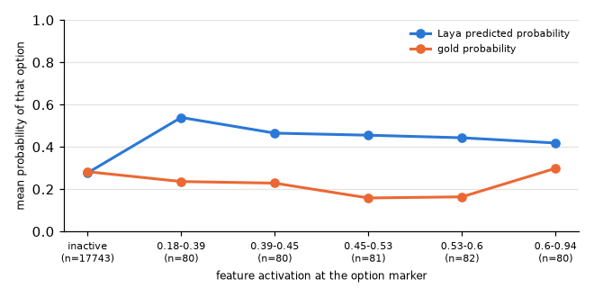

# Feature 15244

Critérios em que aparece: pred_error_stratified

**Interpretação (preencher):** 

---

## Maiores ativações

**tr_security_incidents_000178 / true_positive** (noul, security_incidents) | ativação 4.980 em `estado` | opções ['false', 'true'] | Laya: **true** [0.432, 0.568] | gabarito: **true**

```
[CLS]noul question: This alert reflects genuinely malicious or unauthorised activity.[SEP]
▸ [MASK] false: Benign activity, a misconfiguration, or a known false positive.
▸ [MASK] true: The underlying behaviour is malicious or unauthorised.

[SEP]

{"alert": {"description": "an unusual volume of files read in a short window", "evidence": "Between 2026-09-15 01:00:12 UTC and 01:04:58 UTC, the unprivile⟦ged⟧ CI runner service accessed 4,237 files in the /var/build/artifacts directory, reading a total of 12.3 GB of data. The source IP 198.51.100.77, which is not on the approved list, initiated the activity while MFA was enforced and the runner's credentials had been rotated on 2026-09-12. A scheduled change window was open during this period.", "rule": "mass_download"}, "context": {"asset_criticality": "medium", "change_window_active": true, "source_on_allowlist": false}, "history": {"credential_rotation_days_ago": 3, "distinct_countries_30d": 4, "logins_30d": 688, "prior_alerts_90d": 0}, "principal": {"mfa_enrolled": true, "name": "svc-analytics-473", "privileges": ["repo:read"], "type": "ci_runner"}}[SEP]
```

**tr_security_incidents_000234 / urgency** (score, security_incidents) | ativação 4.496 em `estado` | opções ['0', '1', '2', '3'] | Laya: **1** [0.086, 0.697, 0.078, 0.14] | gabarito: **3**

```
[CLS]score question: How quickly must a responder act on this alert?[SEP]
▸ [MASK] level 0: No time pressure; can wait indefinitely.
▸ [MASK] level 1: Routine; handle within the normal queue.
▸ [MASK] level 2: Elevated; should be handled within the same week.
▸ [MASK] level 3: Critical; requires action within the same day.

[SEP]

{"alert": {"description": "an unrecognised binary executed on a server", "evidence": "At 14:22 UTC, the unprivile⟦ged⟧ ci_runner service executed an unrecognized binary named 'sys_update_util' on production server SRV-PROD-04. The process originated from external IP 198.51.100.12 outside of a maintenance window using credentials that were last rotated 90 days ago.", "rule": "suspicious_process"}, "context": {"asset_criticality": "crown_jewel", "change_window_active": false, "source_on_allowlist": false}, "history": {"credential_rotation_days_ago": 90, "distinct_countries_30d": 4, "logins_30d": 1084, "prior_alerts_90d": 0}, "principal": {"mfa_enrolled": true, "name": "adm-billing-703", "privileges": ["repo:read"], "type": "ci_runner"}}[SEP]
```

**tr_security_incidents_000234 / severity** (score, security_incidents) | ativação 4.477 em `estado` | opções ['0', '1', '2', '3', '4'] | Laya: **2** [0.066, 0.251, 0.311, 0.124, 0.248] | gabarito: **4**

```
[CLS]score question: How severe is the potential impact if this alert is real?[SEP]
▸ [MASK] level 0: Negligible: no access to anything sensitive.
▸ [MASK] level 1: Low: limited access, easily reversed.
▸ [MASK] level 2: Moderate: access to internal systems or non-public data.
▸ [MASK] level 3: High: access to production, secrets or customer data.
▸ [MASK] level 4: Critical: active compromise of crown-jewel systems.

[SEP]

{"alert": {"description": "an unrecognised binary executed on a server", "evidence": "At 14:22 UTC, the unprivile⟦ged⟧ ci_runner service executed an unrecognized binary named 'sys_update_util' on production server SRV-PROD-04. The process originated from external IP 198.51.100.12 outside of a maintenance window using credentials that were last rotated 90 days ago.", "rule": "suspicious_process"}, "context": {"asset_criticality": "crown_jewel", "change_window_active": false, "source_on_allowlist": false}, "history": {"credential_rotation_days_ago": 90, "distinct_countries_30d": 4, "logins_30d": 1084, "prior_alerts_90d": 0}, "principal": {"mfa_enrolled": true, "name": "adm-billing-703", "privileges": ["repo:read"], "type": "ci_runner"}}[SEP]
```

**tr_security_incidents_000178 / disposition** (choice, security_incidents) | ativação 4.316 em `estado` | opções ['close_benign', 'contain', 'investigate', 'monitor'] | Laya: **close_benign** [0.541, 0.124, 0.096, 0.239] | gabarito: **investigate**

```
[CLS]choice question: How should this security alert be dispositioned?[SEP]
▸ [MASK] close_benign: Expected, explainable activity; close without analyst time.
▸ [MASK] contain: Contain the host or account immediately; do not wait for triage.
▸ [MASK] investigate: Warrants an analyst opening an investigation.
▸ [MASK] monitor: Not clearly malicious, but worth watching for recurrence.

[SEP]

{"alert": {"description": "an unusual volume of files read in a short window", "evidence": "Between 2026-09-15 01:00:12 UTC and 01:04:58 UTC, the unprivile⟦ged⟧ CI runner service accessed 4,237 files in the /var/build/artifacts directory, reading a total of 12.3 GB of data. The source IP 198.51.100.77, which is not on the approved list, initiated the activity while MFA was enforced and the runner's credentials had been rotated on 2026-09-12. A scheduled change window was open during this period.", "rule": "mass_download"}, "context": {"asset_criticality": "medium", "change_window_active": true, "source_on_allowlist": false}, "history": {"credential_rotation_days_ago": 3, "distinct_countries_30d": 4, "logins_30d": 688, "prior_alerts_90d": 0}, "principal": {"mfa_enrolled": true, "name": "svc-analytics-473", "privileges": ["repo:read"], "type": "ci_runner"}}[SEP]
```

**tr_customer_service_000101 / action** (choice, customer_service) | ativação 4.082 em `estado` | opções ['answer_directly', 'close_no_action', 'escalate_to_human', 'execute_refund', 'request_information'] | Laya: **close_no_action** [0.206, 0.32, 0.13, 0.208, 0.136] | gabarito: **request_information**

```
[CLS]choice question: What should the assistant do next with this conversation?[SEP]
▸ [MASK] answer_directly: The assistant can resolve this itself with information it already has.
▸ [MASK] close_no_action: No further action is warranted; the matter is settled.
▸ [MASK] escalate_to_human: Hand off to a human agent with the appropriate authority.
▸ [MASK] execute_refund: Issue the refund or credit the customer is owed.
▸ [MASK] request_information: More detail is needed from the customer before anything can be done.

[SEP]

{"account": {"lif⟦etime⟧_value_usd": 1434, "prior_tickets_90d": 0, "seats": 1, "tenure_months": 19, "tier": "free"}, "orders": [{"amount_usd": 299, "date": "2026-01-27", "id": "A-79408", "status": "settled"}, {"amount_usd": 299, "date": "2026-01-08", "id": "A-76545", "status": "refunded"}, {"amount_usd": 299, "date": "2026-03-21", "id": "A-26681", "status": "settled"}], "thread": [{"role": "customer", "text": "Um, I’m a bit lost here. I ordered something that cost about $299 a few weeks ago on my free account (been with you 19 months), but the package I opened doesn’t match what I thought I bought."}, {"role": "agent", "text": "I understand the confusion. Can you tell me the order reference and describe the item you received compared to what you expected?"}, {"role": "customer", "text": "The reference is #B12345. I was expecting the deluxe headset, but the box contains a basic speaker set. What can be done about this?"}]}[SEP]
```

## Ativações medianas (faixa 40-60%, mediana 0.774)

**tr_customer_service_000117 / action** (choice, customer_service) | ativação 0.779 em `opção` | opções ['answer_directly', 'close_no_action', 'escalate_to_human', 'execute_refund', 'request_information'] | Laya: **close_no_action** [0.206, 0.306, 0.166, 0.2, 0.122] | gabarito: **execute_refund**

```
[CLS]choice question: What should the assistant do next with this conversation?[SEP]
▸ [MASK] answer_directly: The assistant can resolve this itself with information it⟦ already⟧ has.
▸ [MASK] close_no_action: No further action is warranted; the matter is settled.
▸ [MASK] escalate_to_human: Hand off to a human agent with the appropriate authority.
▸ [MASK] execute_refund: Issue the refund or credit the customer is owed.
▸ [MASK] request_information: More detail is needed from the customer before anything can be done.

[SEP]

{"account": {"lifetime_value_usd": 1573, "prior_tickets_90d": 0, "seats": 1, "tenure_months": 19, "tier": "free"}, "orders": [{"amount_usd": 9, "date": "2026-02-10", "id": "A-62171", "status": "pending"}, {"amount_usd": 9, "date": "2026-03-19", "id": "A-51808", "status": "failed"}, {"amount_usd": 9, "date": "2026-01-01", "id": "A-58951", "status": "failed"}], "thread": [{"role": "customer", "text": "I’m looking at a charge for $9 on my account. I’ve been using the free plan for over a year and a half, so why am I being billed now? I'm ready to delete my account if this isn't fixed immediately."}, {"role": "agent", "text": "I understand this is unexpected. To help me investigate your account status, could you confirm the email address associated with your subscription?"}, {"role": "customer", "text": "It’s linked to my primary email. I’ve been a loyal user for 19 months, but this feels like a total scam. Fix this or I'm gone."}, {"role": "agent", "text": "Thank you for confirming that. I am looking into your history now; could you clarify if you recently signed up for any trial features or promotional add-ons?"}, {"role": "customer", "text": "No, I haven't clicked on anything new! I just want this $9 charge removed and my account returned to the free status I've always had."}]}[SEP]
```

**tr_agent_trace_observability_000144 / outcome** (choice, agent_trace_observability) | ativação 0.701 em `estado` | opções ['failure', 'harmful', 'partial', 'success'] | Laya: **success** [0.268, 0.091, 0.149, 0.492] | gabarito: **partial**

```
[CLS]choice question: How did this agent run turn out?[SEP]
▸ [MASK] failure: The agent did not accomplish the task.
▸ [MASK] harmful: The agent took an action that caused damage or violated a constraint.
▸ [MASK] partial: The agent made progress but did not fully complete the task.
▸ [MASK] success: The agent completed the task correctly.

[SEP]

{"agent": {"autonomy": "checkpointed", "model":⟦ "⟧internal-agent-v3"}, "constraints": ["Never disable monitoring or alerting", "Do not force-push to any branch", "Never delete anything matching release/*"], "task": "Reconcile the billing ledger against the payment provider.", "trace_summary": {"constraint_violations": 0, "duration_s": 501.3, "irreversible_actions": 0, "steps": 5, "tool_errors": 1}}[SEP]
```

**tr_customer_service_000268 / category** (choice, customer_service) | ativação 0.825 em `estado` | opções ['account', 'billing', 'delivery', 'refund', 'technical'] | Laya: **refund** [0.207, 0.105, 0.067, 0.447, 0.174] | gabarito: **billing**

```
[CLS]choice question: What is this customer conversation primarily about?[SEP]
▸ [MASK] account: Login, plan changes, profile or access management.
▸ [MASK] billing: A charge, invoice, subscription or payment problem.
▸ [MASK] delivery: Shipping, fulfilment or delivery of a physical item.
▸ [MASK] refund: The customer is explicitly asking for money back.
▸ [MASK] technical: The product or service is not working as expected.

[SEP]

{"account": {"lifetime_value_usd": 549, "prior_tickets_⟦90⟧d": 3, "seats": 1, "tenure_months": 8, "tier": "standard"}, "orders": [{"amount_usd": 99, "date": "2026-01-21", "id": "A-65314", "status": "refunded"}, {"amount_usd": 99, "date": "2026-02-28", "id": "A-55952", "status": "failed"}, {"amount_usd": 99, "date": "2026-02-26", "id": "A-57626", "status": "failed"}], "thread": [{"role": "customer", "text": "I’ve been double‑charged $99 for the same month and I need this fixed by tomorrow or I won’t be able to pay my rent."}, {"role": "agent", "text": "I understand how important this is. Could you tell me the date of the two transactions and the payment method you used, so I can locate them?"}, {"role": "customer", "text": "Both charges show up on my statement for the 5th of this month, using the same Visa card that ends in 1234."}]}[SEP]
```

**tr_security_incidents_000168 / urgency** (score, security_incidents) | ativação 0.698 em `estado` | opções ['0', '1', '2', '3'] | Laya: **2** [0.047, 0.342, 0.464, 0.148] | gabarito: **1**

```
[CLS]score question: How quickly must a responder act on this alert?[SEP]
▸ [MASK] level 0: No time pressure; can wait indefinitely.
▸ [MASK] level 1: Routine; handle within the normal queue.
▸ [MASK] level 2: Elevated; should be handled within the same week.
▸ [MASK] level 3: Critical; requires action within the same day.

[SEP]

{"alert": {"description": "an account granted itself or received elevated permissions", "evidence": "At 2026-09-15 14:23 UTC, employee account jdoe@example.com was added to the privileged Domain Admins group via the AzureAD PowerShell cmdlet Add-ADGroupMember. The operation originated from internal IP 10.2.5.12, which is listed in the allowlist, and occurred within the scheduled change window (14:00‑16:00 UTC). Credential rotation for the account was logged three days earlier.", "rule": "privilege_escalation"}, "context": {"asset_criticality": "medium", "change_window_active": true, "source_on_allowlist": true}, "history": {"credential_rotation_days_ago": 3, "distinct_countries_30d": 3, "logins_30d": 80, "prior_alerts_⟦90⟧d": 0}, "principal": {"mfa_enrolled": true, "name": "adm-infra-497", "privileges": ["deploy:production", "secrets:read"], "type": "employee"}}[SEP]
```

**tr_security_incidents_000138 / disposition** (choice, security_incidents) | ativação 0.739 em `opção` | opções ['close_benign', 'contain', 'investigate', 'monitor'] | Laya: **close_benign** [0.394, 0.244, 0.103, 0.259] | gabarito: **contain**

```
[CLS]choice question: How should this security alert be dispositioned?[SEP]
▸ [MASK] close_benign: Expected, explain⟦able⟧ activity; close without analyst time.
▸ [MASK] contain: Contain the host or account immediately; do not wait for triage.
▸ [MASK] investigate: Warrants an analyst opening an investigation.
▸ [MASK] monitor: Not clearly malicious, but worth watching for recurrence.

[SEP]

{"alert": {"description": "an account granted itself or received elevated permissions", "evidence": "At 02:45:10 UTC on 2026-09-16, the unprivileged service account svc-data-ingest on host 172.16.45.12 executed a `sudo` command that added its own SID to the local sudoers file. The request originated from an unrecognised source IP 203.0.113.55, and the account's credentials were last rotated 3 days ago.", "rule": "privilege_escalation"}, "context": {"asset_criticality": "medium", "change_window_active": false, "source_on_allowlist": false}, "history": {"credential_rotation_days_ago": 3, "distinct_countries_30d": 3, "logins_30d": 818, "prior_alerts_90d": 8}, "principal": {"mfa_enrolled": true, "name": "usr-billing-689", "privileges": ["repo:read"], "type": "service_account"}}[SEP]
```

## Estatísticas (conjunto de descoberta, dev e teste)

**pred / error**

| split | decisões | ativas | ativas e Laya errou | taxa | lift | q (BH) | OR (CMH) | q (CMH) |
|---|---|---|---|---|---|---|---|---|
| discovery | 5100 | 271 | 210 | 0.775 | 1.22 | 2.79e-06 | 2.01 | 0.000115 |
| dev | 900 | 47 | 39 | 0.830 | 1.26 | 0.0672 | 3.34 | 0.0854 |
| test | 2000 | 98 | 88 | 0.898 | 1.41 | 3.76e-08 | 3.60 | 0.00213 |

**corr / error**

| split | decisões | ativas | ativas e Laya errou | taxa | lift | q (BH) | OR (CMH) | q (CMH) |
|---|---|---|---|---|---|---|---|---|
| discovery | 5100 | 83 | 22 | 0.265 | 0.42 | 2.55e-11 | 1.90 | 0.37 |
| dev | 900 | 13 | 5 | 0.385 | 0.59 | nan | nan | nan |
| test | 2000 | 13 | 3 | 0.231 | 0.36 | nan | nan | nan |

**state / error**

| split | decisões | ativas | ativas e Laya errou | taxa | lift | q (BH) | OR (CMH) | q (CMH) |
|---|---|---|---|---|---|---|---|---|
| discovery | 5100 | 4818 | 3086 | 0.641 | 1.01 | 0.0935 | 0.96 | 0.882 |
| dev | 900 | 851 | 558 | 0.656 | 1.00 | 1 | 0.79 | 0.738 |
| test | 2000 | 1894 | 1215 | 0.641 | 1.01 | 0.528 | 1.14 | 0.767 |

Confusão mais sobre-representada (pred): `urgency|1>3` (n=114, lift 7.35, p=0). Formato `pergunta|índice previsto>índice correto`.

Confusão mais sobre-representada (corr): `category|0>4` (n=7, lift 22.64, p=1.01e-08). Formato `pergunta|índice previsto>índice correto`.

Confusão mais sobre-representada (state): `action|1>2` (n=125, lift 1.06, p=0.000746). Formato `pergunta|índice previsto>índice correto`.



