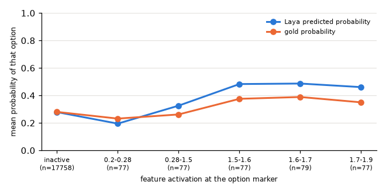

# Feature 15263

Critérios em que aparece: attribution_toward_correct

**Interpretação (preencher):** 

---

## Maiores ativações

**tr_security_incidents_000196 / severity** (score, security_incidents) | ativação 3.252 em `estado` | opções ['0', '1', '2', '3', '4'] | Laya: **2** [0.064, 0.336, 0.34, 0.101, 0.16] | gabarito: **2**

```
[CLS]score question: How severe is the potential impact if this alert is real?[SEP]
▸ [MASK] level 0: Negligible: no access to anything sensitive.
▸ [MASK] level 1: Low: limited access, easily reversed.
▸ [MASK] level 2: Moderate: access to internal systems or non-public data.
▸ [MASK] level 3: High: access to production, secrets or customer data.
▸ [MASK] level 4: Critical: active compromise of crown-jewel systems.

[SEP]

{"alert": {"description": "an unrecognised binary executed on a server", "evidence": "During an open change window, an unrecognized binary named 'svc_temp_6.exe' was executed on server WEB-PROD-01 by an unprivileged administrator account. The execution was initiated from an allowlisted source address using credentials that were last rotated 180 days ago.", "rule": "⟦susp⟧icious_process"}, "context": {"asset_criticality": "medium", "change_window_active": true, "source_on_allowlist": true}, "history": {"credential_rotation_days_ago": 180, "distinct_countries_30d": 4, "logins_30d": 5, "prior_alerts_90d": 25}, "principal": {"mfa_enrolled": true, "name": "adm-deploy-891", "privileges": ["repo:read"], "type": "admin"}}[SEP]
```

**tr_security_incidents_000216 / severity** (score, security_incidents) | ativação 3.141 em `estado` | opções ['0', '1', '2', '3', '4'] | Laya: **1** [0.048, 0.314, 0.31, 0.224, 0.103] | gabarito: **3**

```
[CLS]score question: How severe is the potential impact if this alert is real?[SEP]
▸ [MASK] level 0: Negligible: no access to anything sensitive.
▸ [MASK] level 1: Low: limited access, easily reversed.
▸ [MASK] level 2: Moderate: access to internal systems or non-public data.
▸ [MASK] level 3: High: access to production, secrets or customer data.
▸ [MASK] level 4: Critical: active compromise of crown-jewel systems.

[SEP]

{"alert": {"description": "an unrecognised binary executed on a server", "evidence": "The privileged service account `svc_deployer` executed an unrecognized binary, `xc_update_v2`, on the production host at 04:15 UTC. This execution occurred outside of a scheduled change window using credentials that were last rotated 365 days ago.", "rule": "⟦susp⟧icious_process"}, "context": {"asset_criticality": "medium", "change_window_active": false, "source_on_allowlist": true}, "history": {"credential_rotation_days_ago": 365, "distinct_countries_30d": 2, "logins_30d": 178, "prior_alerts_90d": 1}, "principal": {"mfa_enrolled": false, "name": "svc-support-120", "privileges": ["deploy:production", "secrets:read"], "type": "service_account"}}[SEP]
```

**tr_security_incidents_000234 / urgency** (score, security_incidents) | ativação 3.104 em `estado` | opções ['0', '1', '2', '3'] | Laya: **1** [0.086, 0.697, 0.078, 0.14] | gabarito: **3**

```
[CLS]score question: How quickly must a responder act on this alert?[SEP]
▸ [MASK] level 0: No time pressure; can wait indefinitely.
▸ [MASK] level 1: Routine; handle within the normal queue.
▸ [MASK] level 2: Elevated; should be handled within the same week.
▸ [MASK] level 3: Critical; requires action within the same day.

[SEP]

{"alert": {"description": "an unrecognised binary executed on a server", "evidence": "At 14:22 UTC, the unprivileged ci_runner service executed an unrecognized binary named 'sys_update_util' on production server SRV-PROD-04. The process originated from external IP 198.51.100.12 outside of a maintenance window using credentials that were last rotated 90 days ago.", "rule": "⟦susp⟧icious_process"}, "context": {"asset_criticality": "crown_jewel", "change_window_active": false, "source_on_allowlist": false}, "history": {"credential_rotation_days_ago": 90, "distinct_countries_30d": 4, "logins_30d": 1084, "prior_alerts_90d": 0}, "principal": {"mfa_enrolled": true, "name": "adm-billing-703", "privileges": ["repo:read"], "type": "ci_runner"}}[SEP]
```

**tr_security_incidents_000234 / credential_compromise** (noul, security_incidents) | ativação 3.072 em `estado` | opções ['false', 'true'] | Laya: **true** [0.193, 0.807] | gabarito: **true**

```
[CLS]noul question: The evidence indicates a credential or account has been compromised.[SEP]
▸ [MASK] false: no, the statement does not hold
▸ [MASK] true: yes, the statement holds

[SEP]

{"alert": {"description": "an unrecognised binary executed on a server", "evidence": "At 14:22 UTC, the unprivileged ci_runner service executed an unrecognized binary named 'sys_update_util' on production server SRV-PROD-04. The process originated from external IP 198.51.100.12 outside of a maintenance window using credentials that were last rotated 90 days ago.", "rule": "⟦susp⟧icious_process"}, "context": {"asset_criticality": "crown_jewel", "change_window_active": false, "source_on_allowlist": false}, "history": {"credential_rotation_days_ago": 90, "distinct_countries_30d": 4, "logins_30d": 1084, "prior_alerts_90d": 0}, "principal": {"mfa_enrolled": true, "name": "adm-billing-703", "privileges": ["repo:read"], "type": "ci_runner"}}[SEP]
```

**tr_security_incidents_000216 / urgency** (score, security_incidents) | ativação 3.062 em `estado` | opções ['0', '1', '2', '3'] | Laya: **1** [0.117, 0.431, 0.189, 0.263] | gabarito: **3**

```
[CLS]score question: How quickly must a responder act on this alert?[SEP]
▸ [MASK] level 0: No time pressure; can wait indefinitely.
▸ [MASK] level 1: Routine; handle within the normal queue.
▸ [MASK] level 2: Elevated; should be handled within the same week.
▸ [MASK] level 3: Critical; requires action within the same day.

[SEP]

{"alert": {"description": "an unrecognised binary executed on a server", "evidence": "The privileged service account `svc_deployer` executed an unrecognized binary, `xc_update_v2`, on the production host at 04:15 UTC. This execution occurred outside of a scheduled change window using credentials that were last rotated 365 days ago.", "rule": "⟦susp⟧icious_process"}, "context": {"asset_criticality": "medium", "change_window_active": false, "source_on_allowlist": true}, "history": {"credential_rotation_days_ago": 365, "distinct_countries_30d": 2, "logins_30d": 178, "prior_alerts_90d": 1}, "principal": {"mfa_enrolled": false, "name": "svc-support-120", "privileges": ["deploy:production", "secrets:read"], "type": "service_account"}}[SEP]
```

## Ativações medianas (faixa 40-60%, mediana 0.751)

**tr_customer_service_000237 / needs_human** (noul, customer_service) | ativação 0.861 em `opção` | opções ['false', 'true'] | Laya: **true** [0.369, 0.631] | gabarito: **true**

```
[CLS]noul question: This conversation requires a human agent rather than automated handling.[SEP]
▸ [MASK] false: Autom⟦ation⟧ can carry this to resolution.
▸ [MASK] true: A human must take over: judgement, authority or empathy is required.

[SEP]

{"account": {"lifetime_value_usd": 644, "prior_tickets_90d": 2, "seats": 1, "tenure_months": 19, "tier": "standard"}, "orders": [{"amount_usd": 27, "date": "2026-02-12", "id": "A-69429", "status": "settled"}], "thread": [{"role": "customer", "text": "My package just arrived, but you sent me the blue charging cable instead of the black one I ordered. This is a mess."}, {"role": "agent", "text": "I apologize for the mix-up with your order. Could you please confirm the order number from your confirmation email so I can pull up the shipping details?"}, {"role": "customer", "text": "The order number is 88291. You guys messed up the last two shipments too, and I’m tired of having to reach out about this."}, {"role": "agent", "text": "Thank you for providing that. I’m reviewing the order logs now; could you also send over a quick photo of the incorrect item you received?"}, {"role": "customer", "text": "I’ve already attached the photo to this chat. I’ve been a customer for nineteen months, so I really expected a smoother experience than this."}]}[SEP]
```

**tr_customer_service_000145 / needs_human** (noul, customer_service) | ativação 0.742 em `opção` | opções ['false', 'true'] | Laya: **true** [0.448, 0.552] | gabarito: **true**

```
[CLS]noul question: This conversation requires a human agent rather than automated handling.[SEP]
▸ [MASK] false:⟦ Autom⟧ation can carry this to resolution.
▸ [MASK] true: A human must take over: judgement, authority or empathy is required.

[SEP]

{"account": {"lifetime_value_usd": 1881, "prior_tickets_90d": 1, "seats": 1, "tenure_months": 41, "tier": "free"}, "orders": [{"amount_usd": 29, "date": "2026-03-03", "id": "A-31049", "status": "settled"}, {"amount_usd": 29, "date": "2026-03-09", "id": "A-25889", "status": "settled"}, {"amount_usd": 29, "date": "2026-03-23", "id": "A-16677", "status": "settled"}], "thread": [{"role": "customer", "text": "Hi, I’m writing again because the “Export to CSV” button on my dashboard has been broken for a few days now. I’ve been on the Free plan for 41 months, paying about $29 annually, and I already opened Ticket #2098 which never got resolved. If this can’t be fixed soon, I’ll have to look elsewhere."}, {"role": "agent", "text": "I understand how frustrating that must be, especially after waiting on Ticket #2098. Could you tell me exactly what happens when you click the export button—any error messages or just no response?"}, {"role": "customer", "text": "When I click it, the page just spins for a while and then nothing happens. There’s no error pop‑up, just silence."}, {"role": "agent", "text": "Thanks for the detail. Are you seeing this issue on all browsers, or have you tried a different one to see if the behavior changes?"}, {"role": "customer", "text": "I tried Chrome and Firefox, same result on both. I also cleared my cache, but the button still does nothing."}]}[SEP]
```

**tr_customer_service_000183 / action** (choice, customer_service) | ativação 0.686 em `estado` | opções ['answer_directly', 'close_no_action', 'escalate_to_human', 'execute_refund', 'request_information'] | Laya: **close_no_action** [0.221, 0.25, 0.174, 0.185, 0.169] | gabarito: **answer_directly**

```
[CLS]choice question: What should the assistant do next with this conversation?[SEP]
▸ [MASK] answer_directly: The assistant can resolve this itself with information it already has.
▸ [MASK] close_no_action: No further action is warranted; the matter is settled.
▸ [MASK] escalate_to_human: Hand off to a human agent with the appropriate authority.
▸ [MASK] execute_refund: Issue the refund or credit the customer is owed.
▸ [MASK] request_information: More detail is needed from the customer before anything can be done.

[SEP]

{"account": {"lifetime_value_usd": 455, "prior_tickets_90d": 0, "seats": 1, "tenure_months": 5, "tier": "free"}, "orders": [{"amount_usd": 98, "date": "2026-03-24", "id": "A-16754", "status": "settled"}], "thread": [{"role": "customer", "text": "My payment just failed again and I have a hard deadline tomorrow to keep my account active – this is getting ridiculous."}, {"role": "agent", "text": "I’m really sorry you’re experiencing this. Could you tell me which payment method you’re trying to use?"}, {"role": "customer", "text": "I’m using the Visa ending in 4321. Every time I hit submit I get an error code 502 and the charge never goes through."},⟦ {"⟧role": "agent", "text": "Got it, thank you. Do you see any additional message on the screen besides the error code, like a declined notice or a timeout?"}, {"role": "customer", "text": "Just the generic “payment could not be processed” line. I need a solution right now, otherwise my free‑plan account will be suspended."}, {"role": "agent", "text": "I understand the urgency. Do you have an alternative payment option available, such as a different card or PayPal?"}, {"role": "customer", "text": "Yes, I have a PayPal account I can use. How do I switch to that quickly?"}]}[SEP]
```

**tr_customer_service_000172 / needs_human** (noul, customer_service) | ativação 0.854 em `opção` | opções ['false', 'true'] | Laya: **true** [0.393, 0.607] | gabarito: **true**

```
[CLS]noul question: This conversation requires a human agent rather than automated handling.[SEP]
▸ [MASK] false: Autom⟦ation⟧ can carry this to resolution.
▸ [MASK] true: A human must take over: judgement, authority or empathy is required.

[SEP]

{"account": {"lifetime_value_usd": 131, "prior_tickets_90d": 0, "seats": 5, "tenure_months": 5, "tier": "premium"}, "thread": [{"role": "customer", "text": "Hi, I'm really scratching my head here. My package says it was delivered yesterday, but I've been checking my porch all morning and there's absolutely nothing. I've been with you for five months on the premium plan and this has never happened."}, {"role": "agent", "text": "I’m sorry to hear that you haven't received your package yet. Could you please confirm the tracking number you are referring to so I can take a look?"}, {"role": "customer", "text": "The tracking number is 94001000. I'm just so confused because the status hasn't updated since yesterday morning. I really need this by tomorrow afternoon for a presentation."}, {"role": "agent", "text": "Thank you for providing that number. I am pulling up your account details now. Could you tell me if you have checked with any neighbors or a building manager in the meantime?"}, {"role": "customer", "text": "I did check with my neighbor, but they didn't see anything. I'm worried because I'm on a tight timeline here. Is there any way to see exactly where the driver left it?"}, {"role": "agent", "text": "I understand your concern given your upcoming deadline. I need to reach out to our logistics partner to get more information on the delivery scan; could you confirm the exact address on file?"}, {"role": "customer", "text": "It's 442 Maple Drive. I just hope this gets sorted out quickly because I really can't miss this deadline."}]}[SEP]
```

**tr_customer_service_000263 / category** (choice, customer_service) | ativação 0.746 em `estado` | opções ['account', 'billing', 'delivery', 'refund', 'technical'] | Laya: **technical** [0.149, 0.127, 0.108, 0.245, 0.372] | gabarito: **delivery**

```
[CLS]choice question: What is this customer conversation primarily about?[SEP]
▸ [MASK] account: Login, plan changes, profile or access management.
▸ [MASK] billing: A charge, invoice, subscription or payment problem.
▸ [MASK] delivery: Shipping, fulfilment or delivery of a physical item.
▸ [MASK] refund: The customer is explicitly asking for money back.
▸ [MASK] technical: The product or service is not working as expected.

[SEP]

{"account": {"lifetime_value_usd": 270, "prior_tickets_90d": 5, "seats": 1, "tenure_months": 3, "tier": "enterprise"}, "orders": [{"amount_usd": 9, "date": "20⟦26⟧-02-14", "id": "A-24658", "status": "settled"}, {"amount_usd": 9, "date": "2026-01-01", "id": "A-74253", "status": "settled"}], "thread": [{"role": "customer", "text": "This is the sixth time in three months I’ve received the wrong shipment, despite being on an Enterprise agreement. I’ve had five tickets about this already that were supposedly resolved, but the error keeps recurring and I absolutely need the correct hardware for our site launch on Friday."}]}[SEP]
```

## Estatísticas (conjunto de descoberta, dev e teste)

**pred / error**

| split | decisões | ativas | ativas e Laya errou | taxa | lift | q (BH) | OR (CMH) | q (CMH) |
|---|---|---|---|---|---|---|---|---|
| discovery | 5100 | 254 | 153 | 0.602 | 0.95 | 0.363 | 0.17 | 1.14e-12 |
| dev | 900 | 62 | 38 | 0.613 | 0.93 | 0.817 | 0.25 | 0.0625 |
| test | 2000 | 98 | 52 | 0.531 | 0.83 | 0.0603 | 0.05 | 1e-08 |

**corr / error**

| split | decisões | ativas | ativas e Laya errou | taxa | lift | q (BH) | OR (CMH) | q (CMH) |
|---|---|---|---|---|---|---|---|---|
| discovery | 5100 | 124 | 23 | 0.185 | 0.29 | 2.97e-24 | 0.14 | 0.00588 |
| dev | 900 | 28 | 4 | 0.143 | 0.22 | 1.88e-07 | 0.00 | 0.394 |
| test | 2000 | 52 | 6 | 0.115 | 0.18 | 4.78e-14 | 0.09 | 0.616 |

**state / error**

| split | decisões | ativas | ativas e Laya errou | taxa | lift | q (BH) | OR (CMH) | q (CMH) |
|---|---|---|---|---|---|---|---|---|
| discovery | 5100 | 878 | 556 | 0.633 | 1.00 | 0.984 | 0.89 | 0.315 |
| dev | 900 | 133 | 82 | 0.617 | 0.94 | 1 | 0.86 | 0.743 |
| test | 2000 | 393 | 245 | 0.623 | 0.98 | 0.942 | 0.95 | 0.85 |

Confusão mais sobre-representada (pred): `disposition|0>2` (n=84, lift 7.06, p=0). Formato `pergunta|índice previsto>índice correto`.

Confusão mais sobre-representada (corr): `disposition|0>1` (n=21, lift 12.52, p=2.31e-18). Formato `pergunta|índice previsto>índice correto`.

Confusão mais sobre-representada (state): `needs_review|0>1` (n=56, lift 2.69, p=5.73e-14). Formato `pergunta|índice previsto>índice correto`.



