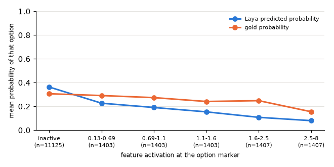

# Feature 15421

Critérios em que aparece: corr_error_stratified, attribution_toward_correct

**Interpretação (preencher):** 

---

## Maiores ativações

**tr_customer_service_000107 / category** (choice, customer_service) | ativação 8.031 em `marcador` | opções ['account', 'billing', 'delivery', 'refund', 'technical'] | Laya: **refund** [0.143, 0.112, 0.186, 0.485, 0.074] | gabarito: **delivery**

```
[CLS]choice question: What is this customer conversation primarily about?[SEP]
▸ [MASK] account: Login, plan changes, profile or access management.
▸ [MASK] billing: A charge, invoice, subscription or payment problem.
▸ [MASK] delivery: Shipping, fulfilment or delivery of a physical item.
▸ [MASK] refund: The customer is explicitly asking for money back.
▸ ⟦[MASK]⟧ technical: The product or service is not working as expected.

[SEP]

{"account": {"lifetime_value_usd": 224, "prior_tickets_90d": 0, "seats": 1, "tenure_months": 8, "tier": "premium"}, "thread": [{"role": "customer", "text": "I received the item yesterday and it was damaged. After eight months on the premium plan, this is the last thing I need!"}]}[SEP]
```

**tr_customer_service_000105 / category** (choice, customer_service) | ativação 7.543 em `marcador` | opções ['account', 'billing', 'delivery', 'refund', 'technical'] | Laya: **account** [0.588, 0.038, 0.027, 0.119, 0.228] | gabarito: **account**

```
[CLS]choice question: What is this customer conversation primarily about?[SEP]
▸ [MASK] account: Login, plan changes, profile or access management.
▸ [MASK] billing: A charge, invoice, subscription or payment problem.
▸ ⟦[MASK]⟧ delivery: Shipping, fulfilment or delivery of a physical item.
▸ [MASK] refund: The customer is explicitly asking for money back.
▸ [MASK] technical: The product or service is not working as expected.

[SEP]

{"account": {"lifetime_value_usd": 521, "prior_tickets_90d": 1, "seats": 1, "tenure_months": 33, "tier": "standard"}, "thread": [{"role": "customer", "text": "I've been waiting over two years on this standard plan, and now I can’t log in at all! This is unacceptable after the last ticket you left hanging."}]}[SEP]
```

**tr_customer_service_000275 / category** (choice, customer_service) | ativação 7.316 em `marcador` | opções ['account', 'billing', 'delivery', 'refund', 'technical'] | Laya: **account** [0.364, 0.141, 0.028, 0.329, 0.139] | gabarito: **account**

```
[CLS]choice question: What is this customer conversation primarily about?[SEP]
▸ [MASK] account: Login, plan changes, profile or access management.
▸ [MASK] billing: A charge, invoice, subscription or payment problem.
▸ ⟦[MASK]⟧ delivery: Shipping, fulfilment or delivery of a physical item.
▸ [MASK] refund: The customer is explicitly asking for money back.
▸ [MASK] technical: The product or service is not working as expected.

[SEP]

{"account": {"lifetime_value_usd": 51, "prior_tickets_90d": 3, "seats": 1, "tenure_months": 1, "tier": "standard"}, "orders": [{"amount_usd": 149, "date": "2026-01-08", "id": "A-29936", "status": "failed"}], "thread": [{"role": "customer", "text": "I need the standard account canceled by Friday at 5 p.m. I’ve only been with you for a month, there’s about $149 attached, and after three tickets with promised fixes that never landed, I can’t keep waiting."}]}[SEP]
```

**tr_customer_service_000250 / category** (choice, customer_service) | ativação 7.316 em `marcador` | opções ['account', 'billing', 'delivery', 'refund', 'technical'] | Laya: **billing** [0.006, 0.969, 0.006, 0.012, 0.007] | gabarito: **billing**

```
[CLS]choice question: What is this customer conversation primarily about?[SEP]
▸ [MASK] account: Login, plan changes, profile or access management.
▸ [MASK] billing: A charge, invoice, subscription or payment problem.
▸ [MASK] delivery: Shipping, fulfilment or delivery of a physical item.
▸ [MASK] refund: The customer is explicitly asking for money back.
▸ ⟦[MASK]⟧ technical: The product or service is not working as expected.

[SEP]

{"account": {"lifetime_value_usd": 145, "prior_tickets_90d": 0, "seats": 1, "tenure_months": 2, "tier": "standard"}, "thread": [{"role": "customer", "text": "Could you please send me a copy of my latest invoice? Thank you!"}]}[SEP]
```

**tr_customer_service_000185 / category** (choice, customer_service) | ativação 7.016 em `marcador` | opções ['account', 'billing', 'delivery', 'refund', 'technical'] | Laya: **account** [0.5, 0.057, 0.035, 0.29, 0.119] | gabarito: **technical**

```
[CLS]choice question: What is this customer conversation primarily about?[SEP]
▸ [MASK] account: Login, plan changes, profile or access management.
▸ [MASK] billing: A charge, invoice, subscription or payment problem.
▸ ⟦[MASK]⟧ delivery: Shipping, fulfilment or delivery of a physical item.
▸ [MASK] refund: The customer is explicitly asking for money back.
▸ [MASK] technical: The product or service is not working as expected.

[SEP]

{"account": {"lifetime_value_usd": 30, "prior_tickets_90d": 5, "seats": 1, "tenure_months": 1, "tier": "free"}, "thread": [{"role": "customer", "text": "I’ve tried three times to export my data and every attempt just times out—this free account is supposed to let me take my info anywhere!"}]}[SEP]
```

## Ativações medianas (faixa 40-60%, mediana 0.848)

**tr_security_incidents_000166 / severity** (score, security_incidents) | ativação 0.863 em `estado` | opções ['0', '1', '2', '3', '4'] | Laya: **1** [0.049, 0.303, 0.292, 0.193, 0.164] | gabarito: **3**

```
[CLS]score question: How severe is the potential impact if this alert is real?[SEP]
▸ [MASK] level 0: Negligible: no access to anything sensitive.
▸ [MASK] level 1: Low: limited access, easily reversed.
▸ [MASK] level 2: Moderate: access to internal systems or non-public data.
▸ [MASK] level 3: High: access to production, secrets or customer data.
▸ [MASK] level 4: Critical: active compromise of crown-jewel systems.

[SEP]

{"alert": {"description": "a long-unused account became active", "evidence": "On 2026-09-14 18:47 UTC the privileged CI runner service account svc-ci-runner-01 performed a git fetch on gitlab.internal, marking the first activity for this account since its creation on 2025-02-01. The operation came from the allow‑listed address 10.2.5.12. The account is MFA‑protected and its credentials have not been changed for 412 days.", "rule": "⟦d⟧ormant_account_use"}, "context": {"asset_criticality": "medium", "change_window_active": false, "source_on_allowlist": true}, "history": {"credential_rotation_days_ago": 412, "distinct_countries_30d": 2, "logins_30d": 751, "prior_alerts_90d": 0}, "principal": {"mfa_enrolled": true, "name": "svc-deploy-785", "privileges": ["deploy:production", "secrets:read"], "type": "ci_runner"}}[SEP]
```

**tr_security_incidents_000200 / severity** (score, security_incidents) | ativação 0.929 em `estado` | opções ['0', '1', '2', '3', '4'] | Laya: **1** [0.047, 0.399, 0.366, 0.156, 0.032] | gabarito: **2**

```
[CLS]score question: How severe is the potential impact if this alert is real?[SEP]
▸ [MASK] level 0: Negligible: no access to anything sensitive.
▸ [MASK] level 1: Low: limited access, easily reversed.
▸ [MASK] level 2: Moderate: access to internal systems or non-public data.
▸ [MASK] level 3: High: access to production, secrets or customer data.
▸ [MASK] level 4: Critical: active compromise of crown-jewel systems.

[SEP]

{"alert": {"description": "many failed authentications followed by a success", "evidence": "Service account 'svc_account_2' recorded 48 failed authentication attempts followed by a successful login at 22:10 UTC from an unrecognized network origin. The account operates without MFA and has not undergone credential rotation in the past 90 days.", "rule": "brute_force"}, "context": {"asset_criticality": "medium", "change_window_active": false⟦,⟧ "source_on_allowlist": false}, "history": {"credential_rotation_days_ago": 90, "distinct_countries_30d": 3, "logins_30d": 938, "prior_alerts_90d": 3}, "principal": {"mfa_enrolled": false, "name": "svc-deploy-730", "privileges": ["repo:read"], "type": "service_account"}}[SEP]
```

**tr_security_incidents_000272 / urgency** (score, security_incidents) | ativação 0.755 em `opção` | opções ['0', '1', '2', '3'] | Laya: **1** [0.094, 0.402, 0.338, 0.166] | gabarito: **3**

```
[CLS]score question: How quickly must a responder act on this alert?[SEP]
▸ [MASK] level 0: No time pressure; can wait indefinitely.
▸ [MASK] level 1: Routine; handle within the normal queue.
▸ [MASK] level 2: Elevated; should be handled⟦ within⟧ the same week.
▸ [MASK] level 3: Critical; requires action within the same day.

[SEP]

{"alert": {"description": "an account granted itself or received elevated permissions", "evidence": "The CI runner named gitlab-runner-12 added its own token to the local Administrators group on host build-agent-07 at 2026-09-15 23:58:12 UTC, using the net.exe command. This privilege change occurred while a change window was active, and the runner’s credentials had not been rotated for 700 days.", "rule": "privilege_escalation"}, "context": {"asset_criticality": "medium", "change_window_active": true, "source_on_allowlist": false}, "history": {"credential_rotation_days_ago": 700, "distinct_countries_30d": 2, "logins_30d": 501, "prior_alerts_90d": 0}, "principal": {"mfa_enrolled": true, "name": "svc-support-708", "privileges": ["repo:read"], "type": "ci_runner"}}[SEP]
```

**tr_security_incidents_000208 / credential_compromise** (noul, security_incidents) | ativação 0.793 em `estado` | opções ['false', 'true'] | Laya: **true** [0.129, 0.871] | gabarito: **true**

```
[CLS]noul question: The evidence indicates a credential or account has been compromised.[SEP]
▸ [MASK] false: no, the statement does not hold
▸ [MASK] true: yes, the statement holds

[SEP]

{"alert": {"description": "a large transfer to an external destination", "evidence": "At 04:03 UTC on 2026-09-15, a service account named svc_backup transferred 4.8 GB of data to external IP 198.51.100.77 over port 443 using the process rsync.exe. The transfer completed in 7 minutes and originated from an unrecognised host in the DMZ. The event took place during an open change window.", "rule": "data_egress"}, "context": {"asset_criticality": "low", "change_window_active": true, "source_on_allowlist": false}, "history": {"credential_rotation_days_ago": 30, "distinct_countries_30d": 3,⟦ "⟧logins_30d": 873, "prior_alerts_90d": 3}, "principal": {"mfa_enrolled": false, "name": "ci-support-613", "privileges": ["deploy:production", "secrets:read"], "type": "service_account"}}[SEP]
```

**tr_invoice_processing_000145 / disposition** (choice, invoice_processing) | ativação 0.972 em `opção` | opções ['approve', 'hold', 'manual_review', 'reject'] | Laya: **approve** [0.396, 0.196, 0.148, 0.26] | gabarito: **hold**

```
[CLS]choice question: How should this vendor invoice be dispositioned?[SEP]
▸ [MASK] approve: Matches the order and delivery; approve for payment.
▸ [MASK] hold: Something needs confirming before payment; hold pending clarification.
▸ [MASK] manual_review⟦:⟧ A human in finance must review the discrepancy.
▸ [MASK] reject: Should not be paid: duplicate, unauthorised or materially wrong.

[SEP]

{"delivery": {"condition": "accepted", "date": null, "received_qty": 0}, "invoice": {"currency": "USD", "id": "INV-2026-2395", "lines": [{"qty": 10, "sku": "SKU-397", "total_usd": 242.8, "unit_usd": 24.28}], "total_usd": 242.8, "vendor": "Orbit Logistics"}, "payment": {"days_until_due": 44, "discount_expires_in_days": null, "early_payment_discount_pct": null, "status": "scheduled", "terms": "net 30"}, "purchase_order": {"freight_terms": "freight prepaid by vendor, not separately billable", "id": "PO-5010", "lines": [{"qty": 10, "unit_usd": 24.28}], "total_usd": 242.8}, "vendor_history": {"disputes_12m": 0, "invoices_12m": 30, "prior_invoice_ids": ["INV-2026-4693", "INV-2026-7769"]}}[SEP]
```

## Estatísticas (conjunto de descoberta, dev e teste)

**pred / error**

| split | decisões | ativas | ativas e Laya errou | taxa | lift | q (BH) | OR (CMH) | q (CMH) |
|---|---|---|---|---|---|---|---|---|
| discovery | 5100 | 184 | 110 | 0.598 | 0.94 | 0.393 | 1.44 | 0.144 |
| dev | 900 | 31 | 19 | 0.613 | 0.93 | 0.922 | 0.96 | 0.954 |
| test | 2000 | 82 | 47 | 0.573 | 0.90 | 0.355 | 1.04 | 0.958 |

**corr / error**

| split | decisões | ativas | ativas e Laya errou | taxa | lift | q (BH) | OR (CMH) | q (CMH) |
|---|---|---|---|---|---|---|---|---|
| discovery | 5100 | 1715 | 1641 | 0.957 | 1.50 | 2.02e-301 | 11.20 | 5.69e-54 |
| dev | 900 | 289 | 277 | 0.958 | 1.46 | 9.22e-45 | 11.00 | 2.1e-07 |
| test | 2000 | 694 | 659 | 0.950 | 1.49 | 1.62e-115 | 8.39 | 2.21e-20 |

**state / error**

| split | decisões | ativas | ativas e Laya errou | taxa | lift | q (BH) | OR (CMH) | q (CMH) |
|---|---|---|---|---|---|---|---|---|
| discovery | 5100 | 4887 | 3135 | 0.641 | 1.01 | 0.00947 | 1.13 | 0.64 |
| dev | 900 | 872 | 572 | 0.656 | 1.00 | 1 | 0.84 | 0.854 |
| test | 2000 | 1932 | 1234 | 0.639 | 1.00 | 0.892 | 0.86 | 0.802 |

Confusão mais sobre-representada (pred): `true_positive|0>1` (n=35, lift 8.59, p=2.21e-24). Formato `pergunta|índice previsto>índice correto`.

Confusão mais sobre-representada (corr): `action|0>1` (n=119, lift 2.97, p=0). Formato `pergunta|índice previsto>índice correto`.

Confusão mais sobre-representada (state): `disposition|0>2` (n=239, lift 1.04, p=2.9e-05). Formato `pergunta|índice previsto>índice correto`.



