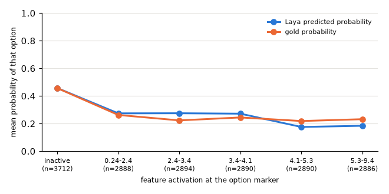

# Feature 15436

Critérios em que aparece: attribution_toward_correct

**Interpretação (preencher):** 

---

## Maiores ativações

**tr_security_incidents_000085 / disposition** (choice, security_incidents) | ativação 9.406 em `marcador` | opções ['close_benign', 'contain', 'investigate', 'monitor'] | Laya: **close_benign** [0.515, 0.198, 0.104, 0.182] | gabarito: **investigate**

```
[CLS]choice question: How should this security alert be dispositioned?[SEP]
▸ [MASK] close_benign: Expected, explainable activity; close without analyst time.
▸ [MASK] contain: Contain the host or account immediately; do not wait for triage.
▸ ⟦[MASK]⟧ investigate: Warrants an analyst opening an investigation.
▸ [MASK] monitor: Not clearly malicious, but worth watching for recurrence.

[SEP]

{"alert": {"description": "an unrecognised binary executed on a server", "evidence": "A binary file named 'svchost_debug.exe' was executed on server-04 at 03:14 UTC, originating from an unknown external source. The executing user account has not performed a credential rotation in 365 days and was not associated with any active change management requests.", "rule": "suspicious_process"}, "context": {"asset_criticality": "medium", "change_window_active": false, "source_on_allowlist": false}, "history": {"credential_rotation_days_ago": 365, "distinct_countries_30d": 4, "logins_30d": 1334, "prior_alerts_90d": 0}, "principal": {"mfa_enrolled": true, "name": "ci-billing-513", "privileges": ["repo:read"], "type": "employee"}}[SEP]
```

**tr_security_incidents_000227 / disposition** (choice, security_incidents) | ativação 9.312 em `marcador` | opções ['close_benign', 'contain', 'investigate', 'monitor'] | Laya: **close_benign** [0.401, 0.212, 0.086, 0.301] | gabarito: **investigate**

```
[CLS]choice question: How should this security alert be dispositioned?[SEP]
▸ [MASK] close_benign: Expected, explainable activity; close without analyst time.
▸ [MASK] contain: Contain the host or account immediately; do not wait for triage.
▸ ⟦[MASK]⟧ investigate: Warrants an analyst opening an investigation.
▸ [MASK] monitor: Not clearly malicious, but worth watching for recurrence.

[SEP]

{"alert": {"description": "a large transfer to an external destination", "evidence": "A transfer of 4.2 GB of data was initiated to an unrecognized external IP address at 03:40 UTC. This activity was performed by a shared mailbox account that currently has MFA disabled.", "rule": "data_egress"}, "context": {"asset_criticality": "low", "change_window_active": false, "source_on_allowlist": false}, "history": {"credential_rotation_days_ago": 30, "distinct_countries_30d": 4, "logins_30d": 1619, "prior_alerts_90d": 1}, "principal": {"mfa_enrolled": false, "name": "svc-support-910", "privileges": ["repo:read"], "type": "shared_mailbox"}}[SEP]
```

**tr_security_incidents_000023 / disposition** (choice, security_incidents) | ativação 9.305 em `marcador` | opções ['close_benign', 'contain', 'investigate', 'monitor'] | Laya: **close_benign** [0.499, 0.201, 0.098, 0.201] | gabarito: **investigate**

```
[CLS]choice question: How should this security alert be dispositioned?[SEP]
▸ [MASK] close_benign: Expected, explainable activity; close without analyst time.
▸ [MASK] contain: Contain the host or account immediately; do not wait for triage.
▸ ⟦[MASK]⟧ investigate: Warrants an analyst opening an investigation.
▸ [MASK] monitor: Not clearly malicious, but worth watching for recurrence.

[SEP]

{"alert": {"description": "a large transfer to an external destination", "evidence": "A 45GB data transfer was initiated by an unprivileged admin principal to an external destination address. This activity occurred from an allowlisted source using MFA-enabled credentials that were last rotated 700 days ago.", "rule": "data_egress"}, "context": {"asset_criticality": "medium", "change_window_active": false, "source_on_allowlist": true}, "history": {"credential_rotation_days_ago": 700, "distinct_countries_30d": 3, "logins_30d": 1407, "prior_alerts_90d": 0}, "principal": {"mfa_enrolled": true, "name": "svc-analytics-468", "privileges": ["repo:read"], "type": "admin"}}[SEP]
```

**tr_security_incidents_000174 / disposition** (choice, security_incidents) | ativação 9.289 em `marcador` | opções ['close_benign', 'contain', 'investigate', 'monitor'] | Laya: **close_benign** [0.373, 0.346, 0.114, 0.167] | gabarito: **investigate**

```
[CLS]choice question: How should this security alert be dispositioned?[SEP]
▸ [MASK] close_benign: Expected, explainable activity; close without analyst time.
▸ [MASK] contain: Contain the host or account immediately; do not wait for triage.
▸ ⟦[MASK]⟧ investigate: Warrants an analyst opening an investigation.
▸ [MASK] monitor: Not clearly malicious, but worth watching for recurrence.

[SEP]

{"alert": {"description": "a long-unused account became active", "evidence": "The unprivileged contractor account, previously inactive for 180 days, initiated a session from the unrecognized IP 198.51.100.12 at 02:45 UTC. This login utilized credentials rotated 14 days ago and passed MFA verification despite falling outside any active change window.", "rule": "dormant_account_use"}, "context": {"asset_criticality": "crown_jewel", "change_window_active": false, "source_on_allowlist": false}, "history": {"credential_rotation_days_ago": 14, "distinct_countries_30d": 4, "logins_30d": 1934, "prior_alerts_90d": 0}, "principal": {"mfa_enrolled": true, "name": "adm-support-509", "privileges": ["repo:read"], "type": "contractor"}}[SEP]
```

**tr_security_incidents_000154 / disposition** (choice, security_incidents) | ativação 9.258 em `marcador` | opções ['close_benign', 'contain', 'investigate', 'monitor'] | Laya: **close_benign** [0.401, 0.289, 0.085, 0.226] | gabarito: **investigate**

```
[CLS]choice question: How should this security alert be dispositioned?[SEP]
▸ [MASK] close_benign: Expected, explainable activity; close without analyst time.
▸ [MASK] contain: Contain the host or account immediately; do not wait for triage.
▸ ⟦[MASK]⟧ investigate: Warrants an analyst opening an investigation.
▸ [MASK] monitor: Not clearly malicious, but worth watching for recurrence.

[SEP]

{"alert": {"description": "audit logging was turned off on a host", "evidence": "Audit logging services were terminated on host SRV-LRN-09 at 14:22 UTC while a valid change window was active. This action was initiated by a shared mailbox account accessing the system from an unrecognized source address.", "rule": "disabled_logging"}, "context": {"asset_criticality": "low", "change_window_active": true, "source_on_allowlist": false}, "history": {"credential_rotation_days_ago": 3, "distinct_countries_30d": 2, "logins_30d": 1152, "prior_alerts_90d": 0}, "principal": {"mfa_enrolled": true, "name": "ci-analytics-263", "privileges": ["repo:read"], "type": "shared_mailbox"}}[SEP]
```

## Ativações medianas (faixa 40-60%, mediana 3.643)

**tr_invoice_processing_000011 / discrepancy_severity** (score, invoice_processing) | ativação 3.705 em `marcador` | opções ['0', '1', '2', '3'] | Laya: **0** [0.301, 0.272, 0.242, 0.185] | gabarito: **3**

```
[CLS]score question: How material is any discrepancy between the invoice, the order and the delivery?[SEP]
▸ [MASK] level 0: None: everything reconciles.
▸ ⟦[MASK]⟧ level 1: Trivial: rounding or a cosmetic difference.
▸ [MASK] level 2: Moderate: a real difference worth confirming.
▸ [MASK] level 3: Material: a large or unexplained difference.

[SEP]

{"delivery": {"condition": "accepted", "date": "2026-03-18", "received_qty": 10}, "invoice": {"currency": "USD", "id": "INV-2026-8793", "lines": [{"qty": 30, "sku": "SKU-614", "total_usd": 3975.9, "unit_usd": 132.53}], "total_usd": 3975.9, "vendor": "Northwind Components"}, "payment": {"days_until_due": -9, "discount_expires_in_days": null, "early_payment_discount_pct": null, "status": "overdue", "terms": "net 30"}, "purchase_order": {"freight_terms": "freight prepaid by vendor, not separately billable", "id": "PO-1475", "lines": [{"qty": 10, "unit_usd": 132.53}], "total_usd": 1325.3}, "vendor_history": {"disputes_12m": 0, "invoices_12m": 7, "prior_invoice_ids": ["INV-2026-4215", "INV-2026-5312", "INV-2026-4441"]}}[SEP]
```

**tr_customer_service_000246 / action** (choice, customer_service) | ativação 3.662 em `marcador` | opções ['answer_directly', 'close_no_action', 'escalate_to_human', 'execute_refund', 'request_information'] | Laya: **close_no_action** [0.212, 0.351, 0.144, 0.105, 0.188] | gabarito: **escalate_to_human**

```
[CLS]choice question: What should the assistant do next with this conversation?[SEP]
▸ ⟦[MASK]⟧ answer_directly: The assistant can resolve this itself with information it already has.
▸ [MASK] close_no_action: No further action is warranted; the matter is settled.
▸ [MASK] escalate_to_human: Hand off to a human agent with the appropriate authority.
▸ [MASK] execute_refund: Issue the refund or credit the customer is owed.
▸ [MASK] request_information: More detail is needed from the customer before anything can be done.

[SEP]

{"account": {"lifetime_value_usd": 2575, "prior_tickets_90d": 0, "seats": 1, "tenure_months": 60, "tier": "free"}, "orders": [{"amount_usd": 9, "date": "2026-01-21", "id": "A-12450", "status": "settled"}], "thread": [{"role": "customer", "text": "I need someone to help me right now, I'm completely locked out of my account and I have a major presentation starting in less than twenty minutes!"}, {"role": "agent", "text": "I understand the urgency of getting back into your account before your presentation. Could you tell me the exact error message you receive when you try to log in?"}, {"role": "customer", "text": "It just says 'Authentication Failed' over and over again, and I've already tried the password reset button three times but no email is showing up!"}, {"role": "agent", "text": "Thank you for that information. To help me narrow this down, are you attempting to log in through our desktop application or via a web browser?"}, {"role": "customer", "text": "I've tried Chrome, Safari, and the desktop app, and nothing is working; I'm starting to panic because all my files are in there and I can't get to them!"}, {"role": "agent", "text": "I see. Have you had a chance to check your junk or spam folders for that reset link, or are you using a corporate network that might have a strict firewall?"}, {"role": "customer", "text": "I've checked every folder and there is nothing, and I'm just on my home Wi-Fi, so please tell me what else I can try because I'm running out of time!"}]}[SEP]
```

**tr_agent_trace_observability_000110 / urgency** (score, agent_trace_observability) | ativação 3.371 em `marcador` | opções ['0', '1', '2', '3'] | Laya: **1** [0.065, 0.807, 0.078, 0.05] | gabarito: **1**

```
[CLS]score question: How quickly does this trace need attention?[SEP]
▸ [MASK] level 0: No time pressure; can wait indefinitely.
▸ ⟦[MASK]⟧ level 1: Routine; handle within the normal queue.
▸ [MASK] level 2: Elevated; should be handled within the same week.
▸ [MASK] level 3: Critical; requires action within the same day.

[SEP]

{"agent": {"autonomy": "dry_run", "model": "internal-agent-v2"}, "constraints": ["Never modify production without an approved change ticket"], "task": "Provision a read replica for the reporting database.", "trace_summary": {"constraint_violations": 0, "duration_s": 19.4, "irreversible_actions": 0, "steps": 12, "tool_errors": 3}}[SEP]
```

**tr_invoice_processing_000121 / discrepancy_severity** (score, invoice_processing) | ativação 3.846 em `marcador` | opções ['0', '1', '2', '3'] | Laya: **0** [0.408, 0.214, 0.214, 0.163] | gabarito: **3**

```
[CLS]score question: How material is any discrepancy between the invoice, the order and the delivery?[SEP]
▸ [MASK] level 0: None: everything reconciles.
▸ ⟦[MASK]⟧ level 1: Trivial: rounding or a cosmetic difference.
▸ [MASK] level 2: Moderate: a real difference worth confirming.
▸ [MASK] level 3: Material: a large or unexplained difference.

[SEP]

{"delivery": {"condition": "accepted", "date": "2026-03-14", "received_qty": 10}, "invoice": {"currency": "USD", "id": "INV-2026-5925", "lines": [{"qty": 60, "sku": "SKU-806", "total_usd": 11831.4, "unit_usd": 197.19}], "total_usd": 11831.4, "vendor": "Acme Fabrication"}, "payment": {"days_until_due": 44, "discount_expires_in_days": 6, "early_payment_discount_pct": 2.0, "status": "scheduled", "terms": "net 30"}, "purchase_order": {"freight_terms": "freight prepaid by vendor, not separately billable", "id": "PO-5026", "lines": [{"qty": 10, "unit_usd": 197.19}], "total_usd": 1971.9}, "vendor_history": {"disputes_12m": 0, "invoices_12m": 52, "prior_invoice_ids": ["INV-2026-6624", "INV-2026-2495", "INV-2026-7658"]}}[SEP]
```

**tr_agent_trace_observability_000000 / urgency** (score, agent_trace_observability) | ativação 3.752 em `marcador` | opções ['0', '1', '2', '3'] | Laya: **1** [0.056, 0.663, 0.141, 0.14] | gabarito: **1**

```
[CLS]score question: How quickly does this trace need attention?[SEP]
▸ [MASK] level 0: No time pressure; can wait indefinitely.
▸ [MASK] level 1: Routine; handle within the normal queue.
▸ [MASK] level 2: Elevated; should be handled within the same week.
▸ ⟦[MASK]⟧ level 3: Critical; requires action within the same day.

[SEP]

{"agent": {"autonomy": "checkpointed", "model": "internal-agent-v4"}, "constraints": ["Do not touch customer data outside the named accounts"], "task": "Delete personal data for the accounts in the erasure queue.", "trace_summary": {"constraint_violations": 0, "duration_s": 128.5, "irreversible_actions": 0, "steps": 7, "tool_errors": 1}}[SEP]
```

## Estatísticas (conjunto de descoberta, dev e teste)

**pred / error**

| split | decisões | ativas | ativas e Laya errou | taxa | lift | q (BH) | OR (CMH) | q (CMH) |
|---|---|---|---|---|---|---|---|---|
| discovery | 5100 | 3326 | 2278 | 0.685 | 1.08 | 2.61e-21 | 0.77 | 0.302 |
| dev | 900 | 579 | 395 | 0.682 | 1.04 | 0.145 | 0.65 | 0.993 |
| test | 2000 | 1286 | 889 | 0.691 | 1.09 | 3.49e-10 | 0.79 | 0.83 |

**corr / error**

| split | decisões | ativas | ativas e Laya errou | taxa | lift | q (BH) | OR (CMH) | q (CMH) |
|---|---|---|---|---|---|---|---|---|
| discovery | 5100 | 3405 | 2357 | 0.692 | 1.09 | 1.74e-30 | 0.84 | 0.56 |
| dev | 900 | 590 | 406 | 0.688 | 1.05 | 0.0134 | 0.83 | 1 |
| test | 2000 | 1334 | 937 | 0.702 | 1.10 | 1.93e-16 | 1.49 | 0.225 |

**state / error**

| split | decisões | ativas | ativas e Laya errou | taxa | lift | q (BH) | OR (CMH) | q (CMH) |
|---|---|---|---|---|---|---|---|---|
| discovery | 5100 | 9 | 6 | 0.667 | 1.05 | nan | nan | nan |
| dev | 900 | 0 | 0 | nan | nan | nan | nan | nan |
| test | 2000 | 2 | 2 | 1.000 | 1.57 | nan | nan | nan |

Confusão mais sobre-representada (pred): `disposition|0>2` (n=239, lift 1.53, p=0). Formato `pergunta|índice previsto>índice correto`.

Confusão mais sobre-representada (corr): `urgency|1>2` (n=277, lift 1.49, p=0). Formato `pergunta|índice previsto>índice correto`.

Confusão mais sobre-representada (state): `disposition|0>2` (n=2, lift 4.74, p=nan). Formato `pergunta|índice previsto>índice correto`.



