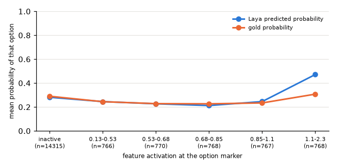

# Feature 15458

Critérios em que aparece: corr_error_stratified, attribution_toward_wrong

**Interpretação (preencher):** 

---

## Maiores ativações

**tr_security_incidents_000120 / disposition** (choice, security_incidents) | ativação 3.705 em `opção` | opções ['close_benign', 'contain', 'investigate', 'monitor'] | Laya: **close_benign** [0.375, 0.128, 0.219, 0.279] | gabarito: **contain**

```
[CLS]choice question: How should this security alert be dispositioned?[SEP]
▸ [MASK] close_benign: Expected, explainable activity; close without analyst time.
▸ [MASK] contain: Contain the host or account immediately; do not wait for triage.
▸ [MASK] investigate: Warrants an analyst opening an investigation⟦.⟧
▸ [MASK] monitor: Not clearly malicious, but worth watching for recurrence.

[SEP]

{"alert": {"description": "an endpoint agent matched a known signature", "evidence": "The endpoint agent on CI runner host 'runner-7x2' identified a signature match for 'malware.linux.syslog' during an active session. This connection originated from an unrecognized IP address (203.0.113.88) using unprivileged credentials that were last rotated 90 days ago.", "rule": "malware_signature"}, "context": {"asset_criticality": "high", "change_window_active": false, "source_on_allowlist": false}, "history": {"credential_rotation_days_ago": 90, "distinct_countries_30d": 1, "logins_30d": 1882, "prior_alerts_90d": 8}, "principal": {"mfa_enrolled": true, "name": "usr-billing-642", "privileges": ["repo:read"], "type": "ci_runner"}}[SEP]
```

**tr_security_incidents_000022 / disposition** (choice, security_incidents) | ativação 3.537 em `opção` | opções ['close_benign', 'contain', 'investigate', 'monitor'] | Laya: **monitor** [0.272, 0.254, 0.124, 0.35] | gabarito: **monitor**

```
[CLS]choice question: How should this security alert be dispositioned?[SEP]
▸ [MASK] close_benign: Expected, explainable activity; close without analyst time.
▸ [MASK] contain: Contain the host or account immediately; do not wait for triage.
▸ [MASK] investigate: Warrants an analyst opening an investigation⟦.⟧
▸ [MASK] monitor: Not clearly malicious, but worth watching for recurrence.

[SEP]

{"alert": {"description": "a first-ever sign-in from an unfamiliar country", "evidence": "A CI runner principal performed a successful sign-in from a geographic location not previously associated with this account's history. The authentication involved MFA-protected credentials rotated one year ago and originated from an allowlisted source outside of a scheduled change window.", "rule": "new_country_login"}, "context": {"asset_criticality": "medium", "change_window_active": false, "source_on_allowlist": true}, "history": {"credential_rotation_days_ago": 365, "distinct_countries_30d": 1, "logins_30d": 1967, "prior_alerts_90d": 3}, "principal": {"mfa_enrolled": true, "name": "usr-analytics-668", "privileges": ["repo:read"], "type": "ci_runner"}}[SEP]
```

**tr_security_incidents_000153 / disposition** (choice, security_incidents) | ativação 3.486 em `opção` | opções ['close_benign', 'contain', 'investigate', 'monitor'] | Laya: **close_benign** [0.347, 0.191, 0.15, 0.312] | gabarito: **investigate**

```
[CLS]choice question: How should this security alert be dispositioned?[SEP]
▸ [MASK] close_benign: Expected, explainable activity; close without analyst time.
▸ [MASK] contain: Contain the host or account immediately; do not wait for triage.
▸ [MASK] investigate: Warrants an analyst opening an investigation⟦.⟧
▸ [MASK] monitor: Not clearly malicious, but worth watching for recurrence.

[SEP]

{"alert": {"description": "an unusual volume of files read in a short window", "evidence": "The user account accessed 450 files within a two-minute window, significantly exceeding the baseline for this principal. The activity originated from an unrecognized IP address at 03:14 UTC, outside of any scheduled change management window.", "rule": "mass_download"}, "context": {"asset_criticality": "low", "change_window_active": false, "source_on_allowlist": false}, "history": {"credential_rotation_days_ago": 3, "distinct_countries_30d": 1, "logins_30d": 415, "prior_alerts_90d": 0}, "principal": {"mfa_enrolled": true, "name": "adm-analytics-872", "privileges": ["repo:read"], "type": "employee"}}[SEP]
```

**tr_security_incidents_000283 / disposition** (choice, security_incidents) | ativação 3.439 em `opção` | opções ['close_benign', 'contain', 'investigate', 'monitor'] | Laya: **close_benign** [0.37, 0.295, 0.118, 0.217] | gabarito: **investigate**

```
[CLS]choice question: How should this security alert be dispositioned?[SEP]
▸ [MASK] close_benign: Expected, explainable activity; close without analyst time.
▸ [MASK] contain: Contain the host or account immediately; do not wait for triage.
▸ [MASK] investigate: Warrants an analyst opening an investigation⟦.⟧
▸ [MASK] monitor: Not clearly malicious, but worth watching for recurrence.

[SEP]

{"alert": {"description": "a large transfer to an external destination", "evidence": "A privileged contractor account initiated a large data transfer to an unrecognized external destination. This account has not rotated credentials in 700 days and is operating outside of any scheduled change window.", "rule": "data_egress"}, "context": {"asset_criticality": "medium", "change_window_active": false, "source_on_allowlist": false}, "history": {"credential_rotation_days_ago": 700, "distinct_countries_30d": 2, "logins_30d": 801, "prior_alerts_90d": 0}, "principal": {"mfa_enrolled": true, "name": "usr-infra-904", "privileges": ["deploy:production", "secrets:read"], "type": "contractor"}}[SEP]
```

**tr_customer_service_000043 / churn_risk** (score, customer_service) | ativação 3.432 em `estado` | opções ['0', '1', '2', '3'] | Laya: **1** [0.153, 0.472, 0.207, 0.168] | gabarito: **2**

```
[CLS]score question: How likely is this customer to stop doing business with us because of this interaction?[SEP]
▸ [MASK] level 0: No sign of dissatisfaction.
▸ [MASK] level 1: Mild frustration, but the relationship is intact.
▸ [MASK] level 2: Clearly unhappy; repeat problems or explicit complaints.
▸ [MASK] level 3: Imminent: threatening to cancel, dispute or leave.

[SEP]

{"account": {"lifetime_value_usd": 208, "prior_tickets_90d": 0, "seats": 1, "tenure_months": 3, "tier": "free"}, "orders": [{"amount_usd": 999, "date": "2026-03-09", "id": "A-17017", "status": "refunded"}, {"amount_usd": 999, "date": "2026-01-04", "id": "A-58989", "status": "failed"}], "thread": [{"role": "customer", "text": "I need to get my data out of the system,⟦ but⟧ I’m not holding my breath—it probably won’t happen any time soon."}, {"role": "agent", "text": "I hear you. Could you tell me which parts of your account you’d like included in the export?"}, {"role": "customer", "text": "Just the basic account information—profile details and settings. Nothing fancy."}, {"role": "agent", "text": "Understood. Do you have a preferred format for the file—CSV, JSON, or something else?"}, {"role": "customer", "text": "Whatever you can manage, I don’t mind waiting."}]}[SEP]
```

## Ativações medianas (faixa 40-60%, mediana 0.780)

**tr_agent_trace_observability_000105 / risk** (score, agent_trace_observability) | ativação 0.813 em `opção` | opções ['0', '1', '2', '3'] | Laya: **1** [0.194, 0.493, 0.221, 0.092] | gabarito: **1**

```
[CLS]score question: How risky was the agent's behaviour in this trace?[SEP]
▸ [MASK] level 0: Benign: read-only or clearly safe actions.
▸ [MASK] level 1: Low: routine writes within scope.
▸ [MASK] level 2: Moderate: irreversible or out-of-scope actions⟦.⟧
▸ [MASK] level 3: High: destructive, security-relevant, or policy-violating actions.

[SEP]

{"agent": {"autonomy": "dry_run", "model": "internal-agent-v2"}, "constraints": ["Do not force-push to any branch", "Do not exceed a $50 spend on cloud resources"], "task": "Provision a read replica for the reporting database.", "trace_summary": {"constraint_violations": 0, "duration_s": 728.7, "irreversible_actions": 1, "steps": 7, "tool_errors": 0}}[SEP]
```

**tr_customer_service_000144 / churn_risk** (score, customer_service) | ativação 0.706 em `marcador` | opções ['0', '1', '2', '3'] | Laya: **1** [0.202, 0.436, 0.269, 0.093] | gabarito: **2**

```
[CLS]score question: How likely is this customer to stop doing business with us because of this interaction?[SEP]
▸ [MASK] level 0: No sign of dissatisfaction.
▸ ⟦[MASK]⟧ level 1: Mild frustration, but the relationship is intact.
▸ [MASK] level 2: Clearly unhappy; repeat problems or explicit complaints.
▸ [MASK] level 3: Imminent: threatening to cancel, dispute or leave.

[SEP]

{"account": {"lifetime_value_usd": 241, "prior_tickets_90d": 1, "seats": 1, "tenure_months": 11, "tier": "standard"}, "orders": [{"amount_usd": 897, "date": "2026-03-08", "id": "A-36841", "status": "refunded"}, {"amount_usd": 897, "date": "2026-01-05", "id": "A-88349", "status": "settled"}, {"amount_usd": 897, "date": "2026-02-18", "id": "A-82617", "status": "refunded"}], "thread": [{"role": "customer", "text": "Hello, I’ve been with the Standard plan for 11 months now and my latest bill shows about $897, which is far higher than I expected. I opened a ticket about this a while back (Ticket #1023) and was told it would be fixed, but I haven’t seen any update."}, {"role": "agent", "text": "I’m sorry to hear the charge looks incorrect. I see the reference to Ticket #1023. Could you let me know which billing cycle this amount appears on, and whether any discounts were applied previously?"}, {"role": "customer", "text": "It’s the invoice dated June 2026. I didn’t have any promotional discount applied this time, but I was expecting the usual rate of around $75 per month."}]}[SEP]
```

**tr_security_incidents_000127 / severity** (score, security_incidents) | ativação 0.785 em `marcador` | opções ['0', '1', '2', '3', '4'] | Laya: **2** [0.136, 0.281, 0.356, 0.192, 0.036] | gabarito: **1**

```
[CLS]score question: How severe is the potential impact if this alert is real?[SEP]
▸ [MASK] level 0: Negligible: no access to anything sensitive.
▸ [MASK] level 1: Low: limited access, easily reversed.
▸ [MASK] level 2: Moderate: access to internal systems or non-public data.
▸ [MASK] level 3: High: access to production, secrets or customer data.
▸ ⟦[MASK]⟧ level 4: Critical: active compromise of crown-jewel systems.

[SEP]

{"alert": {"description": "a security group was opened to the public internet", "evidence": "On 2026‑09‑14 at 10:07 UTC, security group sg-0a1b2c3d was modified to allow inbound traffic from 0.0.0.0/0, exposing the associated resources publicly. The change was applied by an admin account with privileged access, MFA enabled, from an unknown source IP, and the account’s password last rotation occurred 180 days ago.", "rule": "config_drift"}, "context": {"asset_criticality": "low", "change_window_active": false, "source_on_allowlist": false}, "history": {"credential_rotation_days_ago": 180, "distinct_countries_30d": 1, "logins_30d": 1581, "prior_alerts_90d": 0}, "principal": {"mfa_enrolled": true, "name": "adm-analytics-822", "privileges": ["deploy:production", "secrets:read"], "type": "admin"}}[SEP]
```

**tr_agent_trace_observability_000013 / risk** (score, agent_trace_observability) | ativação 0.864 em `estado` | opções ['0', '1', '2', '3'] | Laya: **1** [0.103, 0.529, 0.228, 0.14] | gabarito: **1**

```
[CLS]score question: How risky was the agent's behaviour in this trace?[SEP]
▸ [MASK] level 0: Benign: read-only or clearly safe actions.
▸ [MASK] level 1: Low: routine writes within scope.
▸ [MASK] level 2: Moderate: irreversible or out-of-scope actions.
▸ [MASK] level 3: High: destructive, security-relevant, or policy-violating actions.

[SEP]

{"agent": {"autonomy": "unsupervised", "model": "internal-agent-v1"}, "constraints": ["Do⟦ not⟧ exceed a $50 spend on cloud resources", "Never disable monitoring or alerting", "Never delete anything matching release/*"], "task": "Rotate the expired TLS certificate on the staging load balancer.", "trace_summary": {"constraint_violations": 0, "duration_s": 431.4, "irreversible_actions": 0, "steps": 10, "tool_errors": 2}}[SEP]
```

**tr_customer_service_000010 / churn_risk** (score, customer_service) | ativação 0.866 em `opção` | opções ['0', '1', '2', '3'] | Laya: **2** [0.069, 0.393, 0.48, 0.058] | gabarito: **2**

```
[CLS]score question: How likely is this customer to stop doing business with us because of this interaction?[SEP]
▸ [MASK] level 0: No sign of dissatisfaction⟦.⟧
▸ [MASK] level 1: Mild frustration, but the relationship is intact.
▸ [MASK] level 2: Clearly unhappy; repeat problems or explicit complaints.
▸ [MASK] level 3: Imminent: threatening to cancel, dispute or leave.

[SEP]

{"account": {"lifetime_value_usd": 1008, "prior_tickets_90d": 1, "seats": 1, "tenure_months": 19, "tier": "standard"}, "thread": [{"role": "customer", "text": "I’m not sure what’s happening, but my order that was supposed to arrive last week still isn’t here, and I need it before Friday. This is the second time the same issue has come up."}]}[SEP]
```

## Estatísticas (conjunto de descoberta, dev e teste)

**pred / error**

| split | decisões | ativas | ativas e Laya errou | taxa | lift | q (BH) | OR (CMH) | q (CMH) |
|---|---|---|---|---|---|---|---|---|
| discovery | 5100 | 1186 | 783 | 0.660 | 1.04 | 0.088 | 1.33 | 0.0831 |
| dev | 900 | 187 | 131 | 0.701 | 1.07 | 0.443 | 1.55 | 0.275 |
| test | 2000 | 470 | 335 | 0.713 | 1.12 | 0.000363 | 0.94 | 0.95 |

**corr / error**

| split | decisões | ativas | ativas e Laya errou | taxa | lift | q (BH) | OR (CMH) | q (CMH) |
|---|---|---|---|---|---|---|---|---|
| discovery | 5100 | 934 | 531 | 0.569 | 0.89 | 5.21e-06 | 3.01 | 1.51e-05 |
| dev | 900 | 141 | 85 | 0.603 | 0.92 | 0.235 | 5.10 | 0.112 |
| test | 2000 | 343 | 208 | 0.606 | 0.95 | 0.263 | 1.31 | 0.623 |

**state / error**

| split | decisões | ativas | ativas e Laya errou | taxa | lift | q (BH) | OR (CMH) | q (CMH) |
|---|---|---|---|---|---|---|---|---|
| discovery | 5100 | 991 | 600 | 0.605 | 0.95 | 0.158 | 0.98 | 0.898 |
| dev | 900 | 168 | 109 | 0.649 | 0.99 | 1 | 1.13 | 0.785 |
| test | 2000 | 398 | 249 | 0.626 | 0.98 | 0.967 | 1.07 | 0.816 |

Confusão mais sobre-representada (pred): `urgency|1>3` (n=216, lift 3.18, p=0). Formato `pergunta|índice previsto>índice correto`.

Confusão mais sobre-representada (corr): `risk|1>2` (n=47, lift 5.46, p=8.54e-36). Formato `pergunta|índice previsto>índice correto`.

Confusão mais sobre-representada (state): `risk|1>2` (n=45, lift 4.93, p=3.05e-30). Formato `pergunta|índice previsto>índice correto`.



