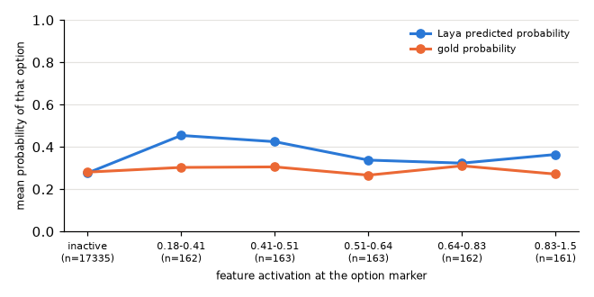

# Feature 15464

Critérios em que aparece: pred_error_stratified

**Interpretação (preencher):** 

---

## Maiores ativações

**tr_security_incidents_000275 / credential_compromise** (noul, security_incidents) | ativação 3.539 em `estado` | opções ['false', 'true'] | Laya: **true** [0.058, 0.942] | gabarito: **false**

```
[CLS]noul question: The evidence indicates a credential or account has been compromised.[SEP]
▸ [MASK] false: no, the statement does not hold
▸ [MASK] true: yes, the statement holds

[SEP]

{"alert": {"description": "two successful logins from distant locations too close together", "evidence": "The shared mailbox account 'alerts@corp.com' logged in successfully from IP 10.2.3.4 (internal network) at 2026-09-14 22:45:00 UTC⟦ and⟧ again from IP 10.2.3.5 (internal network) at 2026-09-14 22:50:12 UTC, locations on the allowlist. Both logins were MFA‑authenticated and occurred outside any scheduled change window. Credential rotation for this account was last performed 412 days ago.", "rule": "impossible_travel"}, "context": {"asset_criticality": "low", "change_window_active": false, "source_on_allowlist": true}, "history": {"credential_rotation_days_ago": 412, "distinct_countries_30d": 2, "logins_30d": 943, "prior_alerts_90d": 0}, "principal": {"mfa_enrolled": true, "name": "svc-billing-223", "privileges": ["deploy:production", "secrets:read"], "type": "shared_mailbox"}}[SEP]
```

**tr_security_incidents_000275 / disposition** (choice, security_incidents) | ativação 3.291 em `estado` | opções ['close_benign', 'contain', 'investigate', 'monitor'] | Laya: **close_benign** [0.507, 0.195, 0.099, 0.199] | gabarito: **close_benign**

```
[CLS]choice question: How should this security alert be dispositioned?[SEP]
▸ [MASK] close_benign: Expected, explainable activity; close without analyst time.
▸ [MASK] contain: Contain the host or account immediately; do not wait for triage.
▸ [MASK] investigate: Warrants an analyst opening an investigation.
▸ [MASK] monitor: Not clearly malicious, but worth watching for recurrence.

[SEP]

{"alert": {"description": "two successful logins from distant locations too close together", "evidence": "The shared mailbox account 'alerts@corp.com' logged in successfully from IP 10.2.3.4 (internal network) at 2026-09-14 22:45:00 UTC⟦ and⟧ again from IP 10.2.3.5 (internal network) at 2026-09-14 22:50:12 UTC, locations on the allowlist. Both logins were MFA‑authenticated and occurred outside any scheduled change window. Credential rotation for this account was last performed 412 days ago.", "rule": "impossible_travel"}, "context": {"asset_criticality": "low", "change_window_active": false, "source_on_allowlist": true}, "history": {"credential_rotation_days_ago": 412, "distinct_countries_30d": 2, "logins_30d": 943, "prior_alerts_90d": 0}, "principal": {"mfa_enrolled": true, "name": "svc-billing-223", "privileges": ["deploy:production", "secrets:read"], "type": "shared_mailbox"}}[SEP]
```

**tr_security_incidents_000275 / severity** (score, security_incidents) | ativação 3.230 em `estado` | opções ['0', '1', '2', '3', '4'] | Laya: **2** [0.04, 0.253, 0.39, 0.258, 0.058] | gabarito: **3**

```
[CLS]score question: How severe is the potential impact if this alert is real?[SEP]
▸ [MASK] level 0: Negligible: no access to anything sensitive.
▸ [MASK] level 1: Low: limited access, easily reversed.
▸ [MASK] level 2: Moderate: access to internal systems or non-public data.
▸ [MASK] level 3: High: access to production, secrets or customer data.
▸ [MASK] level 4: Critical: active compromise of crown-jewel systems.

[SEP]

{"alert": {"description": "two successful logins from distant locations too close together", "evidence": "The shared mailbox account 'alerts@corp.com' logged in successfully from IP 10.2.3.4 (internal network) at 2026-09-14 22:45:00 UTC⟦ and⟧ again from IP 10.2.3.5 (internal network) at 2026-09-14 22:50:12 UTC, locations on the allowlist. Both logins were MFA‑authenticated and occurred outside any scheduled change window. Credential rotation for this account was last performed 412 days ago.", "rule": "impossible_travel"}, "context": {"asset_criticality": "low", "change_window_active": false, "source_on_allowlist": true}, "history": {"credential_rotation_days_ago": 412, "distinct_countries_30d": 2, "logins_30d": 943, "prior_alerts_90d": 0}, "principal": {"mfa_enrolled": true, "name": "svc-billing-223", "privileges": ["deploy:production", "secrets:read"], "type": "shared_mailbox"}}[SEP]
```

**tr_security_incidents_000275 / urgency** (score, security_incidents) | ativação 3.025 em `estado` | opções ['0', '1', '2', '3'] | Laya: **1** [0.113, 0.738, 0.085, 0.064] | gabarito: **1**

```
[CLS]score question: How quickly must a responder act on this alert?[SEP]
▸ [MASK] level 0: No time pressure; can wait indefinitely.
▸ [MASK] level 1: Routine; handle within the normal queue.
▸ [MASK] level 2: Elevated; should be handled within the same week.
▸ [MASK] level 3: Critical; requires action within the same day.

[SEP]

{"alert": {"description": "two successful logins from distant locations too close together", "evidence": "The shared mailbox account 'alerts@corp.com' logged in successfully from IP 10.2.3.4 (internal network) at 2026-09-14 22:45:00 UTC⟦ and⟧ again from IP 10.2.3.5 (internal network) at 2026-09-14 22:50:12 UTC, locations on the allowlist. Both logins were MFA‑authenticated and occurred outside any scheduled change window. Credential rotation for this account was last performed 412 days ago.", "rule": "impossible_travel"}, "context": {"asset_criticality": "low", "change_window_active": false, "source_on_allowlist": true}, "history": {"credential_rotation_days_ago": 412, "distinct_countries_30d": 2, "logins_30d": 943, "prior_alerts_90d": 0}, "principal": {"mfa_enrolled": true, "name": "svc-billing-223", "privileges": ["deploy:production", "secrets:read"], "type": "shared_mailbox"}}[SEP]
```

**tr_security_incidents_000275 / true_positive** (noul, security_incidents) | ativação 3.023 em `estado` | opções ['false', 'true'] | Laya: **false** [0.536, 0.464] | gabarito: **false**

```
[CLS]noul question: This alert reflects genuinely malicious or unauthorised activity.[SEP]
▸ [MASK] false: Benign activity, a misconfiguration, or a known false positive.
▸ [MASK] true: The underlying behaviour is malicious or unauthorised.

[SEP]

{"alert": {"description": "two successful logins from distant locations too close together", "evidence": "The shared mailbox account 'alerts@corp.com' logged in successfully from IP 10.2.3.4 (internal network) at 2026-09-14 22:45:00 UTC⟦ and⟧ again from IP 10.2.3.5 (internal network) at 2026-09-14 22:50:12 UTC, locations on the allowlist. Both logins were MFA‑authenticated and occurred outside any scheduled change window. Credential rotation for this account was last performed 412 days ago.", "rule": "impossible_travel"}, "context": {"asset_criticality": "low", "change_window_active": false, "source_on_allowlist": true}, "history": {"credential_rotation_days_ago": 412, "distinct_countries_30d": 2, "logins_30d": 943, "prior_alerts_90d": 0}, "principal": {"mfa_enrolled": true, "name": "svc-billing-223", "privileges": ["deploy:production", "secrets:read"], "type": "shared_mailbox"}}[SEP]
```

## Ativações medianas (faixa 40-60%, mediana 0.693)

**tr_customer_service_000205 / churn_risk** (score, customer_service) | ativação 0.771 em `opção` | opções ['0', '1', '2', '3'] | Laya: **2** [0.207, 0.318, 0.398, 0.078] | gabarito: **2**

```
[CLS]score question: How likely is this customer to stop doing business with us because of this interaction?[SEP]
▸ [MASK] level 0: No sign of dissatisfaction.
▸ [MASK] level 1: Mild frustration, but the relationship is intact⟦.⟧
▸ [MASK] level 2: Clearly unhappy; repeat problems or explicit complaints.
▸ [MASK] level 3: Imminent: threatening to cancel, dispute or leave.

[SEP]

{"account": {"lifetime_value_usd": 264, "prior_tickets_90d": 5, "seats": 1, "tenure_months": 3, "tier": "free"}, "orders": [{"amount_usd": 897, "date": "2026-02-17", "id": "A-64161", "status": "refunded"}, {"amount_usd": 897, "date": "2026-02-28", "id": "A-55118", "status": "settled"}], "thread": [{"role": "customer", "text": "I'm looking for the invoice for the $897 charge again. It isn't in my inbox or the dashboard, which seems to happen every time there is a billing cycle."}, {"role": "agent", "text": "I understand you're looking for a missing invoice. To ensure I'm looking at the right record, could you confirm the date the transaction appeared on your statement?"}, {"role": "customer", "text": "It was processed on the 12th. This is the fifth time I've had to reach out for the same basic document, and I just don't know why the automated system won't send it to me."}, {"role": "agent", "text": "I see the history of your previous inquiries regarding this. When you check your billing tab, does the invoice show as 'Paid' or is the entry missing entirely from the list?"}, {"role": "customer", "text": "The entry is there and says paid, but when I click the link to download the PDF, it just opens a blank page and nothing happens."}]}[SEP]
```

**tr_security_incidents_000069 / severity** (score, security_incidents) | ativação 0.775 em `opção` | opções ['0', '1', '2', '3', '4'] | Laya: **2** [0.03, 0.355, 0.415, 0.146, 0.055] | gabarito: **3**

```
[CLS]score question: How severe is the potential impact if this alert is real?[SEP]
▸ [MASK] level 0: Negligible: no access to anything sensitive.
▸ [MASK] level 1: Low: limited access, easily reversed⟦.⟧
▸ [MASK] level 2: Moderate: access to internal systems or non-public data.
▸ [MASK] level 3: High: access to production, secrets or customer data.
▸ [MASK] level 4: Critical: active compromise of crown-jewel systems.

[SEP]

{"alert": {"description": "a session token was presented from a second address", "evidence": "A session token issued to a shared_mailbox principal was presented from a secondary, unrecognized IP address while no change window was active. The account is currently configured with MFA, though the credentials have not been rotated in 365 days.", "rule": "token_reuse"}, "context": {"asset_criticality": "crown_jewel", "change_window_active": false, "source_on_allowlist": false}, "history": {"credential_rotation_days_ago": 365, "distinct_countries_30d": 4, "logins_30d": 1871, "prior_alerts_90d": 0}, "principal": {"mfa_enrolled": true, "name": "ci-infra-665", "privileges": ["repo:read"], "type": "shared_mailbox"}}[SEP]
```

**tr_customer_service_000033 / action** (choice, customer_service) | ativação 0.656 em `estado` | opções ['answer_directly', 'close_no_action', 'escalate_to_human', 'execute_refund', 'request_information'] | Laya: **close_no_action** [0.167, 0.375, 0.208, 0.067, 0.183] | gabarito: **escalate_to_human**

```
[CLS]choice question: What should the assistant do next with this conversation?[SEP]
▸ [MASK] answer_directly: The assistant can resolve this itself with information it already has.
▸ [MASK] close_no_action: No further action is warranted; the matter is settled.
▸ [MASK] escalate_to_human: Hand off to a human agent with the appropriate authority.
▸ [MASK] execute_refund: Issue the refund or credit the customer is owed.
▸ [MASK] request_information: More detail is needed from the customer before anything can be done.

[SEP]

{"account": {"lifetime_value_usd": 972, "prior_tickets_90d": 3, "seats": 1, "tenure_months": 49, "tier": "free"}, "orders": [{"amount_usd": 999, "date": "2026-03-06", "id": "A-72271", "status": "settled"}, {"amount_usd": 999, "date": "2026-02-16", "id": "A-14198", "status": "settled"}, {"amount_usd": 999, "date": "2026-01-05", "id": "A-90678", "status": "settled"}], "thread": [{"role": "customer", "text": "I've been trying to downgrade to the free plan for three days now and the website just keeps looping me back to the dashboard. This is incredibly annoying given I've been a loyal user for over four years."}, {"role": "agent", "text": "I'm sorry for the frustration the downgrade process is causing. Could you tell me if you are seeing any specific error codes or pop-up messages when the page refreshes?"⟦},⟧ {"role": "customer", "text": "There are no codes, it just fails silently. I've spent almost a thousand dollars with you guys over 49 months, and after having three previous tickets only 'partially' addressed, I really expected a simple plan change to actually work."}, {"role": "agent", "text": "I appreciate your long-term history with us. To help me investigate the account block, would you mind specifying which features from those three previous tickets are still causing you issues on your current plan?"}, {"role": "customer", "text": "The seat management and the data exports never worked right, which is why I'm trying to scale back. I'm just tired of paying for a service that feels broken every time I try to adjust my settings."}]}[SEP]
```

**tr_security_incidents_000123 / credential_compromise** (noul, security_incidents) | ativação 0.651 em `estado` | opções ['false', 'true'] | Laya: **true** [0.474, 0.526] | gabarito: **true**

```
[CLS]noul question: The evidence indicates a credential or account has been compromised.[SEP]
▸ [MASK] false: no, the statement does not hold
▸ [MASK] true: yes, the statement holds

[SEP]

{"alert": {"description": "two successful logins from distant locations too close together",⟦ "⟧evidence": "Successful authentications for the unprivileged service account 'svc_data_sync' were recorded from IP 192.168.4.12 in New York at 08:00 UTC and IP 10.0.5.88 in London at 08:14 UTC. These logins originated from unrecognized network sources using credentials that were last rotated 412 days ago.", "rule": "impossible_travel"}, "context": {"asset_criticality": "crown_jewel", "change_window_active": false, "source_on_allowlist": false}, "history": {"credential_rotation_days_ago": 412, "distinct_countries_30d": 3, "logins_30d": 1458, "prior_alerts_90d": 0}, "principal": {"mfa_enrolled": false, "name": "usr-deploy-577", "privileges": ["repo:read"], "type": "service_account"}}[SEP]
```

**tr_security_incidents_000232 / severity** (score, security_incidents) | ativação 0.707 em `estado` | opções ['0', '1', '2', '3', '4'] | Laya: **2** [0.087, 0.257, 0.34, 0.272, 0.044] | gabarito: **3**

```
[CLS]score question: How severe is the potential impact if this alert is real?[SEP]
▸ [MASK] level 0: Negligible: no access to anything sensitive.
▸ [MASK] level 1: Low: limited access, easily reversed.
▸ [MASK] level 2: Moderate: access to internal systems or non-public data.
▸ [MASK] level 3: High: access to production, secrets or customer data.
▸ [MASK] level 4: Critical: active compromise of crown-jewel systems.

[SEP]

{"alert": {"description": "a first-ever sign-in from an unfamiliar country", "evidence": "At 2026-09-15 14:02:57 UTC, privileged admin \"admin01@example.com\" logged into the Azure portal from IP 198.51.100.77, geolocated to Nairobi, Kenya, a country with no prior successful logins for this account. The session passed MFA⟦,⟧ the source IP is not present in the organization’s allowlist, and the login occurred during an active change window (2026-09-15 13:00–15:00 UTC); the admin’s credentials were last rotated on 2025-03-18 (180 days prior).", "rule": "new_country_login"}, "context": {"asset_criticality": "medium", "change_window_active": true, "source_on_allowlist": false}, "history": {"credential_rotation_days_ago": 180, "distinct_countries_30d": 2, "logins_30d": 1427, "prior_alerts_90d": 3}, "principal": {"mfa_enrolled": true, "name": "ci-deploy-221", "privileges": ["deploy:production", "secrets:read"], "type": "admin"}}[SEP]
```

## Estatísticas (conjunto de descoberta, dev e teste)

**pred / error**

| split | decisões | ativas | ativas e Laya errou | taxa | lift | q (BH) | OR (CMH) | q (CMH) |
|---|---|---|---|---|---|---|---|---|
| discovery | 5100 | 469 | 329 | 0.701 | 1.10 | 0.00478 | 1.68 | 0.000155 |
| dev | 900 | 78 | 48 | 0.615 | 0.94 | 0.78 | 0.82 | 0.737 |
| test | 2000 | 186 | 136 | 0.731 | 1.15 | 0.012 | 1.43 | 0.266 |

**corr / error**

| split | decisões | ativas | ativas e Laya errou | taxa | lift | q (BH) | OR (CMH) | q (CMH) |
|---|---|---|---|---|---|---|---|---|
| discovery | 5100 | 249 | 109 | 0.438 | 0.69 | 2.69e-10 | 1.39 | 0.293 |
| dev | 900 | 46 | 16 | 0.348 | 0.53 | 6.51e-05 | 0.98 | 0.977 |
| test | 2000 | 90 | 40 | 0.444 | 0.70 | 0.000402 | 1.03 | 0.965 |

**state / error**

| split | decisões | ativas | ativas e Laya errou | taxa | lift | q (BH) | OR (CMH) | q (CMH) |
|---|---|---|---|---|---|---|---|---|
| discovery | 5100 | 1967 | 1218 | 0.619 | 0.97 | 0.223 | 1.06 | 0.567 |
| dev | 900 | 326 | 207 | 0.635 | 0.97 | 1 | 1.11 | 0.789 |
| test | 2000 | 758 | 464 | 0.612 | 0.96 | 0.482 | 1.03 | 0.889 |

Confusão mais sobre-representada (pred): `urgency|1>3` (n=113, lift 4.21, p=0). Formato `pergunta|índice previsto>índice correto`.

Confusão mais sobre-representada (corr): `churn_risk|1>2` (n=32, lift 11.92, p=1.05e-28). Formato `pergunta|índice previsto>índice correto`.

Confusão mais sobre-representada (state): `credential_compromise|1>0` (n=77, lift 2.27, p=1.05e-21). Formato `pergunta|índice previsto>índice correto`.



