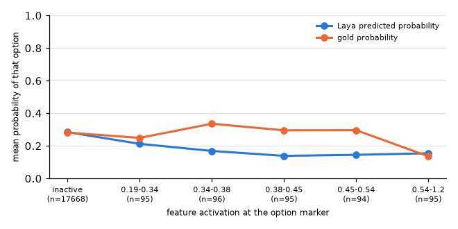

# Feature 15510

Critérios em que aparece: pred_error

**Interpretação (preencher):** 

---

## Maiores ativações

**tr_customer_service_000244 / urgency** (score, customer_service) | ativação 3.934 em `estado` | opções ['0', '1', '2', '3'] | Laya: **1** [0.053, 0.617, 0.175, 0.155] | gabarito: **2**

```
[CLS]score question: How time-sensitive is this conversation?[SEP]
▸ [MASK] level 0: No time pressure; can wait indefinitely.
▸ [MASK] level 1: Routine; handle within the normal queue.
▸ [MASK] level 2: Elevated; should be handled within the same week.
▸ [MASK] level 3: Critical; requires action within the same day.

[SEP]

{"account": {"lifetime_value_usd": 91, "prior_tickets_90d": 0, "seats": 1, "tenure_months": 1, "tier": "standard"}, "thread": [{"role": "customer", "text": "Hi there! I just opened my package and noticed that I received the standard kit instead of the deluxe version I had ordered. I⟦ hate⟧ to be a pain, but I'm actually on a very tight schedule and need the specific components from the deluxe kit for a project deadline on Tuesday. Could you help me figure out how to get the right items sent out?"}]}[SEP]
```

**tr_customer_service_000244 / action** (choice, customer_service) | ativação 3.207 em `estado` | opções ['answer_directly', 'close_no_action', 'escalate_to_human', 'execute_refund', 'request_information'] | Laya: **close_no_action** [0.194, 0.413, 0.085, 0.173, 0.135] | gabarito: **request_information**

```
[CLS]choice question: What should the assistant do next with this conversation?[SEP]
▸ [MASK] answer_directly: The assistant can resolve this itself with information it already has.
▸ [MASK] close_no_action: No further action is warranted; the matter is settled.
▸ [MASK] escalate_to_human: Hand off to a human agent with the appropriate authority.
▸ [MASK] execute_refund: Issue the refund or credit the customer is owed.
▸ [MASK] request_information: More detail is needed from the customer before anything can be done.

[SEP]

{"account": {"lifetime_value_usd": 91, "prior_tickets_90d": 0, "seats": 1, "tenure_months": 1, "tier": "standard"}, "thread": [{"role": "customer", "text": "Hi there! I just opened my package and noticed that I received the standard kit instead of the deluxe version I had ordered. I⟦ hate⟧ to be a pain, but I'm actually on a very tight schedule and need the specific components from the deluxe kit for a project deadline on Tuesday. Could you help me figure out how to get the right items sent out?"}]}[SEP]
```

**tr_customer_service_000032 / action** (choice, customer_service) | ativação 2.684 em `estado` | opções ['answer_directly', 'close_no_action', 'escalate_to_human', 'execute_refund', 'request_information'] | Laya: **execute_refund** [0.143, 0.231, 0.244, 0.312, 0.07] | gabarito: **escalate_to_human**

```
[CLS]choice question: What should the assistant do next with this conversation?[SEP]
▸ [MASK] answer_directly: The assistant can resolve this itself with information it already has.
▸ [MASK] close_no_action: No further action is warranted; the matter is settled.
▸ [MASK] escalate_to_human: Hand off to a human agent with the appropriate authority.
▸ [MASK] execute_refund: Issue the refund or credit the customer is owed.
▸ [MASK] request_information: More detail is needed from the customer before anything can be done.

[SEP]

{"account": {"lifetime_value_usd": 380, "prior_tickets_90d": 1, "seats": 1, "tenure_months": 5, "tier": "standard"}, "orders": [{"amount_usd": 598, "date": "2026-02-19", "id": "A-24938", "status": "pending"}, {"amount_usd": 598, "date": "2026-03-04", "id": "A-58038", "status": "refunded"}, {"amount_usd": 598, "date": "2026-03-13", "id": "A-45299", "status": "settled"}], "thread": [{"role": "customer", "text": "I am beyond finished with this service. I've poured nearly six hundred dollars into this account over the last five months and my previous ticket is still sitting there completely ignored. Just cancel my entire account immediately."}, {"role": "agent", "text": "I understand you're looking to close your account today. To⟦ ensure⟧ I have the right context, could you please clarify if the lack of response on your previous ticket is the primary reason for your decision to leave the standard plan?"}, {"role": "customer", "text": "It's the fact that I'm paying for a premium tier and getting treated like I don't exist while you keep my $598. I'm not here to talk it out or wait for a fix that isn't coming—I want the cancellation processed now."}]}[SEP]
```

**tr_customer_service_000244 / category** (choice, customer_service) | ativação 2.631 em `estado` | opções ['account', 'billing', 'delivery', 'refund', 'technical'] | Laya: **delivery** [0.063, 0.069, 0.537, 0.259, 0.073] | gabarito: **delivery**

```
[CLS]choice question: What is this customer conversation primarily about?[SEP]
▸ [MASK] account: Login, plan changes, profile or access management.
▸ [MASK] billing: A charge, invoice, subscription or payment problem.
▸ [MASK] delivery: Shipping, fulfilment or delivery of a physical item.
▸ [MASK] refund: The customer is explicitly asking for money back.
▸ [MASK] technical: The product or service is not working as expected.

[SEP]

{"account": {"lifetime_value_usd": 91, "prior_tickets_90d": 0, "seats": 1, "tenure_months": 1, "tier": "standard"}, "thread": [{"role": "customer", "text": "Hi there! I just opened my package and noticed that I received the standard kit instead of the deluxe version I had ordered. I⟦ hate⟧ to be a pain, but I'm actually on a very tight schedule and need the specific components from the deluxe kit for a project deadline on Tuesday. Could you help me figure out how to get the right items sent out?"}]}[SEP]
```

**tr_customer_service_000028 / action** (choice, customer_service) | ativação 2.406 em `estado` | opções ['answer_directly', 'close_no_action', 'escalate_to_human', 'execute_refund', 'request_information'] | Laya: **close_no_action** [0.192, 0.449, 0.067, 0.114, 0.178] | gabarito: **escalate_to_human**

```
[CLS]choice question: What should the assistant do next with this conversation?[SEP]
▸ [MASK] answer_directly: The assistant can resolve this itself with information it already has.
▸ [MASK] close_no_action: No further action is warranted; the matter is settled.
▸ [MASK] escalate_to_human: Hand off to a human agent with the appropriate authority.
▸ [MASK] execute_refund: Issue the refund or credit the customer is owed.
▸ [MASK] request_information: More detail is needed from the customer before anything can be done.

[SEP]

{"account": {"lifetime_value_usd": 53, "prior_tickets_90d": 1, "seats": 1, "tenure_months": 2, "tier": "free"}, "orders": [{"amount_usd": 297, "date": "2026-02-24", "id": "A-62944", "status": "settled"}], "thread": [{"role": "customer", "text": "Hello! I'm writing because I'm a bit confused about my recent statement. I've been on the free plan for about two months now, but I noticed a charge for $297 labeled as seat management. I had a similar issue resolved previously, but it seems to have cropped up again."}, {"role": "agent", "text": "Thank you for reaching out to us. I would be more than happy to look into these seat management charges for you. To get started, could you please confirm the email address associated with your account?"}, {"role": "customer", "text": "Of course, it's linked to my primary email. I'm just concerned because I haven't⟦ intentionally⟧ added any new users, and I'd like to understand why the system is triggering this billing amount for a free account."}, {"role": "agent", "text": "I appreciate you providing that. To help me narrow down the cause, could you tell me if you've recently modified any sharing permissions or added any guest contributors to your projects?"}, {"role": "customer", "text": "I did share a read-only link with a colleague last week, but I didn't think that counted as a paid seat. I'd appreciate it if you could check if that action was what caused the $297 charge to appear."}]}[SEP]
```

## Ativações medianas (faixa 40-60%, mediana 0.611)

**tr_security_incidents_000107 / credential_compromise** (noul, security_incidents) | ativação 0.547 em `estado` | opções ['false', 'true'] | Laya: **true** [0.201, 0.799] | gabarito: **true**

```
[CLS]noul question: The evidence indicates a credential or account has been compromised.[SEP]
▸ [MASK] false: no, the statement does not hold
▸ [MASK] true: yes, the statement holds

[SEP]

{"alert": {"description": "an endpoint agent matched a known signature", "evidence": "The privileged service account 'svc-prod-sync' triggered a malware signature match on host SRV-DB-01 at 22:10 UTC. This detection occurred outside of any active change window while MFA was disabled for the principal. The source address is currently on the allowlist, and the account credentials were last rotated 14 days ago.", "rule": "malware_signature"}, "context": {"asset_criticality": "medium", "change_window_active": false, "source_on_allowlist": true}, "history": {"credential_rotation_days_ago": 14, "distinct_countries_30d": 1, "logins_30d": 778, "prior_alerts_90d": 0}, "principal": {"mfa⟦_⟧enrolled": false, "name": "usr-billing-280", "privileges": ["deploy:production", "secrets:read"], "type": "service_account"}}[SEP]
```

**tr_customer_service_000245 / urgency** (score, customer_service) | ativação 0.581 em `estado` | opções ['0', '1', '2', '3'] | Laya: **1** [0.125, 0.783, 0.06, 0.032] | gabarito: **2**

```
[CLS]score question: How time-sensitive is this conversation?[SEP]
▸ [MASK] level 0: No time pressure; can wait indefinitely.
▸ [MASK] level 1: Routine; handle within the normal queue.
▸ [MASK] level 2: Elevated; should be handled within the same week.
▸ [MASK] level 3: Critical; requires action within the same day.

[SEP]

{"account": {"lifetime_value_usd": 1250,⟦ "⟧prior_tickets_90d": 0, "seats": 1, "tenure_months": 14, "tier": "enterprise"}, "thread": [{"role": "customer", "text": "I'm a bit lost—I've been trying to log into our enterprise portal for the last twenty minutes but it keeps saying my credentials aren't recognized. I haven't changed anything since yesterday, and I'm not seeing any emails about account updates even though I've used this login for over a year. Is there something special I need to do to get back in?"}]}[SEP]
```

**tr_invoice_processing_000105 / disposition** (choice, invoice_processing) | ativação 0.612 em `estado` | opções ['approve', 'hold', 'manual_review', 'reject'] | Laya: **approve** [0.481, 0.196, 0.118, 0.205] | gabarito: **reject**

```
[CLS]choice question: How should this vendor invoice be dispositioned?[SEP]
▸ [MASK] approve: Matches the order and delivery; approve for payment.
▸ [MASK] hold: Something needs confirming before payment; hold pending clarification.
▸ [MASK] manual_review: A human in finance must review the discrepancy.
▸ [MASK] reject: Should not be paid: duplicate, unauthorised or materially wrong.

[SEP]

{"delivery": {"condition": "accepted", "date": "2026-03-10", "received_qty": 250}, "invoice": {"currency": "USD", "id": "INV-2026-2481", "lines": [{"q⟦ty⟧": 250, "sku": "SKU-290", "total_usd": 68527.5, "unit_usd": 274.11}], "total_usd": 68527.5, "vendor": "Northwind Components"}, "payment": {"days_until_due": 11, "discount_expires_in_days": null, "early_payment_discount_pct": null, "status": "scheduled", "terms": "net 15"}, "purchase_order": {"freight_terms": "freight prepaid by vendor, not separately billable", "id": "PO-9344", "lines": [{"qty": 250, "unit_usd": 274.11}], "total_usd": 68527.5}, "vendor_history": {"disputes_12m": 5, "invoices_12m": 22, "prior_invoice_ids": ["INV-2026-2481"]}}[SEP]
```

**tr_security_incidents_000106 / credential_compromise** (noul, security_incidents) | ativação 0.588 em `estado` | opções ['false', 'true'] | Laya: **false** [0.794, 0.206] | gabarito: **false**

```
[CLS]noul question: The evidence indicates a credential or account has been compromised.[SEP]
▸ [MASK] false: no, the statement does not hold
▸ [MASK] true: yes, the statement holds

[SEP]

{"alert": {"description": "a long-unused account became active", "evidence": "At 14:22 UTC, the contractor account 'c-smith' successfully authenticated from an allowlisted source despite being inactive for 120 days. Multi-factor authentication was verified during the session, which took place during a scheduled change window. The account's credentials were last rotated 30 days prior to this access.", "rule": "dormant_account_use"}, "context": {"asset_criticality": "low", "change_window_active": true, "source_on_allowlist": true}, "history": {"credential_rotation_days_ago": 30, "distinct_countries_30d": 1, "logins_30d": 1999, "⟦prior⟧_alerts_90d": 0}, "principal": {"mfa_enrolled": true, "name": "svc-infra-357", "privileges": ["repo:read"], "type": "contractor"}}[SEP]
```

**tr_invoice_processing_000278 / urgency** (score, invoice_processing) | ativação 0.615 em `estado` | opções ['0', '1', '2', '3'] | Laya: **1** [0.21, 0.53, 0.159, 0.1] | gabarito: **2**

```
[CLS]score question: How time-sensitive is processing this invoice?[SEP]
▸ [MASK] level 0: No time pressure; can wait indefinitely.
▸ [MASK] level 1: Routine; handle within the normal queue.
▸ [MASK] level 2: Elevated; should be handled within the same week.
▸ [MASK] level 3: Critical; requires action within the same day.

[SEP]

{"delivery": {"condition": "accepted", "date": "2026-03-20", "received_qty": 25}, "invoice": {"currency": "USD", "id": "INV-2026-7761", "lines": [{"q⟦ty⟧": 25, "sku": "SKU-466", "total_usd": 8533.0, "unit_usd": 341.32}], "total_usd": 8533.0, "vendor": "Vantage Materials"}, "payment": {"days_until_due": 5, "discount_expires_in_days": null, "early_payment_discount_pct": null, "status": "scheduled", "terms": "net 45"}, "purchase_order": {"freight_terms": "freight prepaid by vendor, not separately billable", "id": "PO-3755", "lines": [{"qty": 25, "unit_usd": 341.32}], "total_usd": 8533.0}, "vendor_history": {"disputes_12m": 5, "invoices_12m": 51, "prior_invoice_ids": ["INV-2026-2143", "INV-2026-9910"]}}[SEP]
```

## Estatísticas (conjunto de descoberta, dev e teste)

**pred / error**

| split | decisões | ativas | ativas e Laya errou | taxa | lift | q (BH) | OR (CMH) | q (CMH) |
|---|---|---|---|---|---|---|---|---|
| discovery | 5100 | 28 | 27 | 0.964 | 1.52 | 0.000296 | 12.17 | 0.418 |
| dev | 900 | 6 | 6 | 1.000 | 1.52 | nan | nan | nan |
| test | 2000 | 11 | 10 | 0.909 | 1.43 | nan | nan | nan |

**corr / error**

| split | decisões | ativas | ativas e Laya errou | taxa | lift | q (BH) | OR (CMH) | q (CMH) |
|---|---|---|---|---|---|---|---|---|
| discovery | 5100 | 130 | 129 | 0.992 | 1.56 | 1.06e-23 | 7.32 | 0.143 |
| dev | 900 | 29 | 29 | 1.000 | 1.52 | 2.44e-05 | nan | nan |
| test | 2000 | 41 | 40 | 0.976 | 1.53 | 1e-06 | 4.94 | 0.599 |

**state / error**

| split | decisões | ativas | ativas e Laya errou | taxa | lift | q (BH) | OR (CMH) | q (CMH) |
|---|---|---|---|---|---|---|---|---|
| discovery | 5100 | 1266 | 816 | 0.645 | 1.01 | 0.775 | 1.05 | 0.653 |
| dev | 900 | 243 | 162 | 0.667 | 1.02 | 1 | 1.09 | 0.838 |
| test | 2000 | 494 | 334 | 0.676 | 1.06 | 0.387 | 1.21 | 0.298 |

Confusão mais sobre-representada (pred): `outcome|0>2` (n=7, lift 28.98, p=2.24e-09). Formato `pergunta|índice previsto>índice correto`.

Confusão mais sobre-representada (corr): `outcome|3>2` (n=39, lift 20.13, p=4.9e-44). Formato `pergunta|índice previsto>índice correto`.

Confusão mais sobre-representada (state): `matches_order|1>0` (n=49, lift 1.79, p=4.06e-06). Formato `pergunta|índice previsto>índice correto`.



