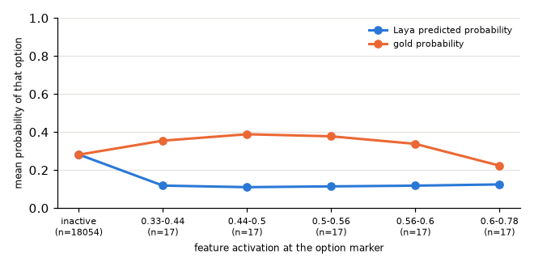

# Feature 15643

Critérios em que aparece: corr_error

**Interpretação (preencher):** 

---

## Maiores ativações

**tr_customer_service_000172 / needs_human** (noul, customer_service) | ativação 1.691 em `estado` | opções ['false', 'true'] | Laya: **true** [0.393, 0.607] | gabarito: **true**

```
[CLS]noul question: This conversation requires a human agent rather than automated handling.[SEP]
▸ [MASK] false: Automation can carry this to resolution.
▸ [MASK] true: A human must take over: judgement, authority or empathy is required.

[SEP]

{"account": {"lifetime_value_usd": 131, "prior_tickets_90d": 0, "seats": 5, "tenure_months": 5, "tier": "premium"}, "thread": [{"role": "customer", "text": "Hi, I'm really scratching my head here. My package says it was delivered yesterday, but I've been checking my porch all morning and there's absolutely nothing. I've been with you for five months on the premium plan and this has never happened."}, {"role⟦":⟧ "agent", "text": "I’m sorry to hear that you haven't received your package yet. Could you please confirm the tracking number you are referring to so I can take a look?"}, {"role": "customer", "text": "The tracking number is 94001000. I'm just so confused because the status hasn't updated since yesterday morning. I really need this by tomorrow afternoon for a presentation."}, {"role": "agent", "text": "Thank you for providing that number. I am pulling up your account details now. Could you tell me if you have checked with any neighbors or a building manager in the meantime?"}, {"role": "customer", "text": "I did check with my neighbor, but they didn't see anything. I'm worried because I'm on a tight timeline here. Is there any way to see exactly where the driver left it?"}, {"role": "agent", "text": "I understand your concern given your upcoming deadline. I need to reach out to our logistics partner to get more information on the delivery scan; could you confirm the exact address on file?"}, {"role": "customer", "text": "It's 442 Maple Drive. I just hope this gets sorted out quickly because I really can't miss this deadline."}]}[SEP]
```

**tr_customer_service_000232 / urgency** (score, customer_service) | ativação 1.606 em `estado` | opções ['0', '1', '2', '3'] | Laya: **3** [0.103, 0.33, 0.218, 0.35] | gabarito: **3**

```
[CLS]score question: How time-sensitive is this conversation?[SEP]
▸ [MASK] level 0: No time pressure; can wait indefinitely.
▸ [MASK] level 1: Routine; handle within the normal queue.
▸ [MASK] level 2: Elevated; should be handled within the same week.
▸ [MASK] level 3: Critical; requires action within the same day.

[SEP]

{"account": {"lifetime_value_usd": 186, "prior_tickets_90d": 0, "seats": 5, "tenure_months": 3, "tier": "premium"}, "orders": [{"amount_usd": 2997, "date": "2026-01-02", "id": "A-95746", "status": "refunded"}, {"amount_usd": 2997, "date": "2026-03-02", "id": "A-16068", "status": "settled"}], "thread": [{"role": "customer", "text": "I'm looking at my dashboard and everything is grayed out, it says I'm on a trial but I've been a Premium member for three months? I don't understand why it would change now, especially since I have a massive project deadline tomorrow and I need my tools."}, {"role⟦":⟧ "agent", "text": "I can certainly look into your subscription status for you. To get started, could you please confirm the email address associated with your $2997 annual Premium plan?"}, {"role": "customer", "text": "It's the same email I'm using for this chat, but I'm just so confused because my bank shows the payment went through months ago. Why would the system suddenly think I'm not a customer anymore?"}, {"role": "agent", "text": "Thank you for that information. I am reviewing your account history now. Have you recently made any changes to your team settings or tried to link a secondary account to this workspace?"}, {"role": "customer", "text": "I haven't touched the settings at all, I just logged in to finish my work and saw the 'downgraded' notification at the top. I'm really worried because I have to submit this work by 8 AM tomorrow and I can't even export my files right now."}, {"role": "agent", "text": "I appreciate you clarifying that. To help me narrow this down, could you tell me if you are seeing any specific error codes when you try to click on the export button?"}, {"role": "customer", "text": "There aren't any codes, it just opens a pop-up telling me to 'Upgrade to Premium' to use that feature, which makes no sense at all since I'm already paying. Can someone please figure out why the system isn't recognizing my plan before I lose my window to finish this?"}]}[SEP]
```

**tr_customer_service_000172 / churn_risk** (score, customer_service) | ativação 1.591 em `estado` | opções ['0', '1', '2', '3'] | Laya: **2** [0.088, 0.286, 0.446, 0.179] | gabarito: **2**

```
[CLS]score question: How likely is this customer to stop doing business with us because of this interaction?[SEP]
▸ [MASK] level 0: No sign of dissatisfaction.
▸ [MASK] level 1: Mild frustration, but the relationship is intact.
▸ [MASK] level 2: Clearly unhappy; repeat problems or explicit complaints.
▸ [MASK] level 3: Imminent: threatening to cancel, dispute or leave.

[SEP]

{"account": {"lifetime_value_usd": 131, "prior_tickets_90d": 0, "seats": 5, "tenure_months": 5, "tier": "premium"}, "thread": [{"role": "customer", "text": "Hi, I'm really scratching my head here. My package says it was delivered yesterday, but I've been checking my porch all morning and there's absolutely nothing. I've been with you for five months on the premium plan and this has never happened."}, {"role⟦":⟧ "agent", "text": "I’m sorry to hear that you haven't received your package yet. Could you please confirm the tracking number you are referring to so I can take a look?"}, {"role": "customer", "text": "The tracking number is 94001000. I'm just so confused because the status hasn't updated since yesterday morning. I really need this by tomorrow afternoon for a presentation."}, {"role": "agent", "text": "Thank you for providing that number. I am pulling up your account details now. Could you tell me if you have checked with any neighbors or a building manager in the meantime?"}, {"role": "customer", "text": "I did check with my neighbor, but they didn't see anything. I'm worried because I'm on a tight timeline here. Is there any way to see exactly where the driver left it?"}, {"role": "agent", "text": "I understand your concern given your upcoming deadline. I need to reach out to our logistics partner to get more information on the delivery scan; could you confirm the exact address on file?"}, {"role": "customer", "text": "It's 442 Maple Drive. I just hope this gets sorted out quickly because I really can't miss this deadline."}]}[SEP]
```

**tr_customer_service_000172 / churn_risk** (score, customer_service) | ativação 1.561 em `estado` | opções ['0', '1', '2', '3'] | Laya: **2** [0.088, 0.286, 0.446, 0.179] | gabarito: **2**

```
[CLS]score question: How likely is this customer to stop doing business with us because of this interaction?[SEP]
▸ [MASK] level 0: No sign of dissatisfaction.
▸ [MASK] level 1: Mild frustration, but the relationship is intact.
▸ [MASK] level 2: Clearly unhappy; repeat problems or explicit complaints.
▸ [MASK] level 3: Imminent: threatening to cancel, dispute or leave.

[SEP]

{"account": {"lifetime_value_usd": 131, "prior_tickets_90d": 0, "seats": 5, "tenure_months": 5, "tier": "premium"}, "thread": [{"role": "customer", "text": "Hi, I'm really scratching my head here. My package says it was delivered yesterday, but I've been checking my porch all morning and there's absolutely nothing. I've been with you for five months on the premium plan and this has never happened."}, {"role": "agent", "text": "I’m sorry to hear that you haven't received your package yet. Could you please confirm the tracking number you are referring to so I can take a look?"}, {"role": "customer", "text": "The tracking number is 94001000. I'm just so confused because the status hasn't updated since yesterday morning. I really need this by tomorrow afternoon for a presentation."}, {"role": "agent", "text": "Thank you for providing that number. I am pulling up your account details now. Could you tell me if you have checked with any neighbors or a building manager in the meantime?"}, {"role": "customer", "text": "I did check with my neighbor, but they didn't see anything. I'm worried because I'm on a tight timeline here. Is there any way to see exactly where the driver left it?"}, {"role": "agent", "text": "I understand your concern given your upcoming deadline. I need to reach out to our logistics partner to get more information on the delivery scan; could you confirm the exact address on file?"}, {"role⟦":⟧ "customer", "text": "It's 442 Maple Drive. I just hope this gets sorted out quickly because I really can't miss this deadline."}]}[SEP]
```

**tr_customer_service_000172 / urgency** (score, customer_service) | ativação 1.535 em `estado` | opções ['0', '1', '2', '3'] | Laya: **1** [0.086, 0.381, 0.196, 0.337] | gabarito: **3**

```
[CLS]score question: How time-sensitive is this conversation?[SEP]
▸ [MASK] level 0: No time pressure; can wait indefinitely.
▸ [MASK] level 1: Routine; handle within the normal queue.
▸ [MASK] level 2: Elevated; should be handled within the same week.
▸ [MASK] level 3: Critical; requires action within the same day.

[SEP]

{"account": {"lifetime_value_usd": 131, "prior_tickets_90d": 0, "seats": 5, "tenure_months": 5, "tier": "premium"}, "thread": [{"role": "customer", "text": "Hi, I'm really scratching my head here. My package says it was delivered yesterday, but I've been checking my porch all morning and there's absolutely nothing. I've been with you for five months on the premium plan and this has never happened."}, {"role": "agent", "text": "I’m sorry to hear that you haven't received your package yet. Could you please confirm the tracking number you are referring to so I can take a look?"}, {"role": "customer", "text": "The tracking number is 94001000. I'm just so confused because the status hasn't updated since yesterday morning. I really need this by tomorrow afternoon for a presentation."}, {"role": "agent", "text": "Thank you for providing that number. I am pulling up your account details now. Could you tell me if you have checked with any neighbors or a building manager in the meantime?"}, {"role": "customer", "text": "I did check with my neighbor, but they didn't see anything. I'm worried because I'm on a tight timeline here. Is there any way to see exactly where the driver left it?"}, {"role": "agent", "text": "I understand your concern given your upcoming deadline. I need to reach out to our logistics partner to get more information on the delivery scan; could you confirm the exact address on file?"}, {"role⟦":⟧ "customer", "text": "It's 442 Maple Drive. I just hope this gets sorted out quickly because I really can't miss this deadline."}]}[SEP]
```

## Ativações medianas (faixa 40-60%, mediana 0.608)

**tr_security_incidents_000264 / true_positive** (noul, security_incidents) | ativação 0.658 em `estado` | opções ['false', 'true'] | Laya: **true** [0.437, 0.563] | gabarito: **false**

```
[CLS]noul question: This alert reflects genuinely malicious or unauthorised activity.[SEP]
▸ [MASK] false: Benign activity, a misconfiguration, or a known false positive.
▸ [MASK] true: The underlying behaviour is malicious or unauthorised.

[SEP]

{"alert": {"description": "a first-ever sign-in from an unfamiliar country", "evidence": "At 22:14 UTC, the unprivileged principal 'ci_runner' authenticated from an IP address in a country not previously associated with this account. The login occurred without multi-factor authentication using credentials rotated 14 days ago, and no change window was active at the time.", "rule": "new_country_login"}, "context": {"asset_criticality": "low", "change_window_active": false, "source_on_allowlist": false}, "history": {"credential_rotation_days_ago": 14,⟦ "⟧distinct_countries_30d": 3, "logins_30d": 458, "prior_alerts_90d": 0}, "principal": {"mfa_enrolled": false, "name": "svc-billing-637", "privileges": ["repo:read"], "type": "ci_runner"}}[SEP]
```

**tr_security_incidents_000133 / disposition** (choice, security_incidents) | ativação 0.675 em `estado` | opções ['close_benign', 'contain', 'investigate', 'monitor'] | Laya: **contain** [0.301, 0.369, 0.094, 0.236] | gabarito: **investigate**

```
[CLS]choice question: How should this security alert be dispositioned?[SEP]
▸ [MASK] close_benign: Expected, explainable activity; close without analyst time.
▸ [MASK] contain: Contain the host or account immediately; do not wait for triage.
▸ [MASK] investigate: Warrants an analyst opening an investigation.
▸ [MASK] monitor: Not clearly malicious, but worth watching for recurrence.

[SEP]

{"alert": {"description": "audit logging was turned off on a host", "evidence": "Audit logging was disabled on host build-runner-07 at 2026-09-15 11:47 UTC, as evidenced by the removal of the journald.conf entry that enables persistent storage. The action originated from CI runner account ci-runner-42, which lacks elevated privileges but has MFA active, and occurred outside any scheduled change window. The initiating source (10.2.0.15) matches an allow‑listed IP range, and the runner's credentials were refreshed three days ago.", "rule": "disabled_logging"}, "context": {"asset_criticality": "crown_jewel", "change_window_active": false, "source_on_allowlist": true}, "history": {"credential_rotation_days_ago": 3,⟦ "⟧distinct_countries_30d": 3, "logins_30d": 902, "prior_alerts_90d": 3}, "principal": {"mfa_enrolled": true, "name": "adm-support-681", "privileges": ["repo:read"], "type": "ci_runner"}}[SEP]
```

**tr_security_incidents_000236 / true_positive** (noul, security_incidents) | ativação 0.605 em `estado` | opções ['false', 'true'] | Laya: **false** [0.598, 0.402] | gabarito: **false**

```
[CLS]noul question: This alert reflects genuinely malicious or unauthorised activity.[SEP]
▸ [MASK] false: Benign activity, a misconfiguration, or a known false positive.
▸ [MASK] true: The underlying behaviour is malicious or unauthorised.

[SEP]

{"alert": {"description": "a long-unused account became active", "evidence": "The privileged admin_01 account, which had shown no activity for 120 consecutive days, successfully authenticated from allowlisted IP 10.0.4.55 at 02:00 AM. This session was established with MFA enabled and used credentials rotated 30 days ago, though no change tickets were active at the time.",⟦ "⟧rule": "dormant_account_use"}, "context": {"asset_criticality": "medium", "change_window_active": false, "source_on_allowlist": true}, "history": {"credential_rotation_days_ago": 30, "distinct_countries_30d": 3, "logins_30d": 15, "prior_alerts_90d": 0}, "principal": {"mfa_enrolled": true, "name": "ci-infra-266", "privileges": ["deploy:production", "secrets:read"], "type": "admin"}}[SEP]
```

**tr_customer_service_000172 / needs_human** (noul, customer_service) | ativação 0.653 em `estado` | opções ['false', 'true'] | Laya: **true** [0.393, 0.607] | gabarito: **true**

```
[CLS]noul question: This conversation requires a human agent rather than automated handling.[SEP]
▸ [MASK] false: Automation can carry this to resolution.
▸ [MASK] true: A human must take over: judgement, authority or empathy is required.

[SEP]

{"account": {"lifetime_value_usd": 131, "prior_tickets_90d": 0, "seats": 5, "tenure_months": 5, "tier": "premium"}, "thread": [{"role": "customer", "text": "Hi, I'm really scratching my head here. My package says it was delivered yesterday, but I've been checking my porch all morning and there's absolutely nothing. I've been with you for five months on the premium plan and this has never happened."}, {"role": "agent", "text": "I’m sorry to hear that you haven't received your package yet. Could you please confirm the tracking number you are referring to so I can take a look?"}, {"role": "customer", "text": "The tracking number is 94001000. I'm just so confused because the status hasn't updated since yesterday morning. I really need this by tomorrow afternoon for a presentation."}, {"role": "agent", "text": "Thank you for providing that number. I am pulling up your account details now. Could you tell me if you have checked with any neighbors or a building manager in the meantime?"}, {"role": "customer", "text": "I did check with my neighbor, but they didn't see anything. I'm worried because I'm on a tight timeline here. Is there any way to see exactly where the driver left it?"},⟦ {"⟧role": "agent", "text": "I understand your concern given your upcoming deadline. I need to reach out to our logistics partner to get more information on the delivery scan; could you confirm the exact address on file?"}, {"role": "customer", "text": "It's 442 Maple Drive. I just hope this gets sorted out quickly because I really can't miss this deadline."}]}[SEP]
```

**tr_customer_service_000221 / category** (choice, customer_service) | ativação 0.638 em `estado` | opções ['account', 'billing', 'delivery', 'refund', 'technical'] | Laya: **technical** [0.245, 0.126, 0.091, 0.249, 0.289] | gabarito: **delivery**

```
[CLS]choice question: What is this customer conversation primarily about?[SEP]
▸ [MASK] account: Login, plan changes, profile or access management.
▸ [MASK] billing: A charge, invoice, subscription or payment problem.
▸ [MASK] delivery: Shipping, fulfilment or delivery of a physical item.
▸ [MASK] refund: The customer is explicitly asking for money back.
▸ [MASK] technical: The product or service is not working as expected.

[SEP]

{"account": {"lifetime_value_usd": 1327, "prior_tickets_90d": 0, "seats": 1, "tenure_months": 14, "tier": "standard"}, "orders": [{"amount_usd": 149, "date": "2026-02-16", "id": "A-75209", "status": "pending"}, {"amount_usd": 149, "date": "2026-02-14", "id": "A-62252", "status": "settled"}], "thread": [{"role": "customer", "text": "My order arrived this afternoon, but the contents are incorrect. I received a blue thermal carafe instead of the stainless steel model I ordered."⟦},⟧ {"role": "agent", "text": "I apologize for the mix-up with your shipment. I’d like to look into this for you; could you please share your order number and the SKU listed on the box you received?"}, {"role": "customer", "text": "The order number is #88492-AX. The box says SKU-992-B, but my invoice clearly lists SKU-992-S."}, {"role": "agent", "text": "Thank you for verifying those details. Are you able to upload a photo of the item you received so I can confirm the discrepancy for our records?"}, {"role": "customer", "text": "I've attached the photo to this message. Please let me know what the next steps are once you have verified it."}]}[SEP]
```

## Estatísticas (conjunto de descoberta, dev e teste)

**pred / error**

| split | decisões | ativas | ativas e Laya errou | taxa | lift | q (BH) | OR (CMH) | q (CMH) |
|---|---|---|---|---|---|---|---|---|
| discovery | 5100 | 0 | 0 | nan | nan | nan | nan | nan |
| dev | 900 | 0 | 0 | nan | nan | nan | nan | nan |
| test | 2000 | 1 | 0 | 0.000 | 0.00 | nan | nan | nan |

**corr / error**

| split | decisões | ativas | ativas e Laya errou | taxa | lift | q (BH) | OR (CMH) | q (CMH) |
|---|---|---|---|---|---|---|---|---|
| discovery | 5100 | 36 | 36 | 1.000 | 1.57 | 3.25e-07 | inf | 0.604 |
| dev | 900 | 2 | 2 | 1.000 | 1.52 | nan | nan | nan |
| test | 2000 | 9 | 8 | 0.889 | 1.40 | nan | nan | nan |

**state / error**

| split | decisões | ativas | ativas e Laya errou | taxa | lift | q (BH) | OR (CMH) | q (CMH) |
|---|---|---|---|---|---|---|---|---|
| discovery | 5100 | 477 | 309 | 0.648 | 1.02 | 0.856 | 1.29 | 0.062 |
| dev | 900 | 80 | 52 | 0.650 | 0.99 | 1 | 1.09 | 0.89 |
| test | 2000 | 187 | 125 | 0.668 | 1.05 | 0.843 | 1.29 | 0.37 |

Confusão mais sobre-representada (corr): `action|1>2` (n=30, lift 34.00, p=2.1e-44). Formato `pergunta|índice previsto>índice correto`.

Confusão mais sobre-representada (state): `true_positive|0>1` (n=28, lift 2.65, p=9.47e-07). Formato `pergunta|índice previsto>índice correto`.



