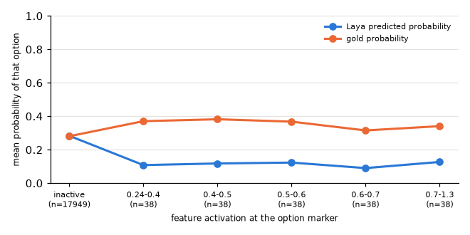

# Feature 15828

Critérios em que aparece: corr_error

**Interpretação (preencher):** 

---

## Maiores ativações

**tr_customer_service_000115 / needs_human** (noul, customer_service) | ativação 3.816 em `estado` | opções ['false', 'true'] | Laya: **true** [0.48, 0.52] | gabarito: **true**

```
[CLS]noul question: This conversation requires a human agent rather than automated handling.[SEP]
▸ [MASK] false: Automation can carry this to resolution.
▸ [MASK] true: A human must take over: judgement, authority or empathy is required.

[SEP]

{"account": {"lifetime_value_usd": 173, "prior_tickets_90d": 3, "seats": 5, "tenure_months": 11, "tier": "enterprise"}, "orders": [{"amount_usd": 98, "date": "2026-01-16", "id": "A-50500", "status": "settled"}, {"amount_usd": 98, "date": "2026-01-22", "id": "A-56044", "status": "settled"}, {"amount_usd": 98, "date": "2026-02-10", "id": "A-31954", "status": "refunded"}], "thread": [{"role": "customer", "text": "I am beyond frustrated that our enterprise API is down for the third time this quarter after I was told it was 'partially' fixed last week. We pay nearly $100 a month for a service that is currently blocking a massive deployment we have scheduled for noon today, and I need a⟦ real⟧ status update right now!"}]}[SEP]
```

**tr_customer_service_000115 / category** (choice, customer_service) | ativação 3.506 em `estado` | opções ['account', 'billing', 'delivery', 'refund', 'technical'] | Laya: **technical** [0.073, 0.074, 0.012, 0.396, 0.444] | gabarito: **technical**

```
[CLS]choice question: What is this customer conversation primarily about?[SEP]
▸ [MASK] account: Login, plan changes, profile or access management.
▸ [MASK] billing: A charge, invoice, subscription or payment problem.
▸ [MASK] delivery: Shipping, fulfilment or delivery of a physical item.
▸ [MASK] refund: The customer is explicitly asking for money back.
▸ [MASK] technical: The product or service is not working as expected.

[SEP]

{"account": {"lifetime_value_usd": 173, "prior_tickets_90d": 3, "seats": 5, "tenure_months": 11, "tier": "enterprise"}, "orders": [{"amount_usd": 98, "date": "2026-01-16", "id": "A-50500", "status": "settled"}, {"amount_usd": 98, "date": "2026-01-22", "id": "A-56044", "status": "settled"}, {"amount_usd": 98, "date": "2026-02-10", "id": "A-31954", "status": "refunded"}], "thread": [{"role": "customer", "text": "I am beyond frustrated that our enterprise API is down for the third time this quarter after I was told it was 'partially' fixed last week. We pay nearly $100 a month for a service that is currently blocking a massive deployment we have scheduled for noon today, and I need a⟦ real⟧ status update right now!"}]}[SEP]
```

**tr_customer_service_000099 / churn_risk** (score, customer_service) | ativação 3.363 em `estado` | opções ['0', '1', '2', '3'] | Laya: **3** [0.09, 0.287, 0.24, 0.383] | gabarito: **2**

```
[CLS]score question: How likely is this customer to stop doing business with us because of this interaction?[SEP]
▸ [MASK] level 0: No sign of dissatisfaction.
▸ [MASK] level 1: Mild frustration, but the relationship is intact.
▸ [MASK] level 2: Clearly unhappy; repeat problems or explicit complaints.
▸ [MASK] level 3: Imminent: threatening to cancel, dispute or leave.

[SEP]

{"account": {"lifetime_value_usd": 210, "prior_tickets_90d": 0, "seats": 1, "tenure_months": 5, "tier": "standard"}, "thread": [{"role": "customer", "text": "I need to downgrade my account immediately. My budget is finalized at the end of the day today, so this needs to be handled right now."}, {"role": "agent", "text": "I understand that you have a time-sensitive deadline. To ensure I'm looking at the correct account, could you please verify the full name on the billing profile?"}, {"role": "customer", "text": "The name is Marcus Thorne. Please, I really don't have time to go back and forth on this today."}, {"role": "agent", "text": "Thank you, Marcus. I have your account pulled up. Could you please clarify if you are looking to move to the base tier or if you'd like to remove specific add-ons?"}, {"role": "customer", "text": "I just want the⟦ base⟧ tier, and I need this confirmed before the business day closes. Can you tell me if that's going to happen?"}]}[SEP]
```

**tr_customer_service_000115 / churn_risk** (score, customer_service) | ativação 3.330 em `estado` | opções ['0', '1', '2', '3'] | Laya: **2** [0.048, 0.223, 0.641, 0.088] | gabarito: **2**

```
[CLS]score question: How likely is this customer to stop doing business with us because of this interaction?[SEP]
▸ [MASK] level 0: No sign of dissatisfaction.
▸ [MASK] level 1: Mild frustration, but the relationship is intact.
▸ [MASK] level 2: Clearly unhappy; repeat problems or explicit complaints.
▸ [MASK] level 3: Imminent: threatening to cancel, dispute or leave.

[SEP]

{"account": {"lifetime_value_usd": 173, "prior_tickets_90d": 3, "seats": 5, "tenure_months": 11, "tier": "enterprise"}, "orders": [{"amount_usd": 98, "date": "2026-01-16", "id": "A-50500", "status": "settled"}, {"amount_usd": 98, "date": "2026-01-22", "id": "A-56044", "status": "settled"}, {"amount_usd": 98, "date": "2026-02-10", "id": "A-31954", "status": "refunded"}], "thread": [{"role": "customer", "text": "I am beyond frustrated that our enterprise API is down for the third time this quarter after I was told it was 'partially' fixed last week. We pay nearly $100 a month for a service that is currently blocking a massive deployment we have scheduled for noon today, and I need a⟦ real⟧ status update right now!"}]}[SEP]
```

**tr_customer_service_000198 / urgency** (score, customer_service) | ativação 3.289 em `estado` | opções ['0', '1', '2', '3'] | Laya: **1** [0.022, 0.922, 0.038, 0.018] | gabarito: **1**

```
[CLS]score question: How time-sensitive is this conversation?[SEP]
▸ [MASK] level 0: No time pressure; can wait indefinitely.
▸ [MASK] level 1: Routine; handle within the normal queue.
▸ [MASK] level 2: Elevated; should be handled within the same week.
▸ [MASK] level 3: Critical; requires action within the same day.

[SEP]

{"account": {"lifetime_value_usd": 495, "prior_tickets_90d": 0, "seats": 1, "tenure_months": 8, "tier": "standard"}, "thread": [{"role": "customer", "text": "My payment failed again for the standard plan. I suppose it’s just my luck, but I’m not really surprised at this point⟦ given⟧ how things have been going."}]}[SEP]
```

## Ativações medianas (faixa 40-60%, mediana 0.659)

**tr_customer_service_000197 / category** (choice, customer_service) | ativação 0.602 em `pergunta` | opções ['account', 'billing', 'delivery', 'refund', 'technical'] | Laya: **delivery** [0.003, 0.003, 0.983, 0.004, 0.007] | gabarito: **delivery**

```
[CLS]choice question:⟦ What⟧ is this customer conversation primarily about?[SEP]
▸ [MASK] account: Login, plan changes, profile or access management.
▸ [MASK] billing: A charge, invoice, subscription or payment problem.
▸ [MASK] delivery: Shipping, fulfilment or delivery of a physical item.
▸ [MASK] refund: The customer is explicitly asking for money back.
▸ [MASK] technical: The product or service is not working as expected.

[SEP]

{"account": {"lifetime_value_usd": 1409, "prior_tickets_90d": 2, "seats": 1, "tenure_months": 49, "tier": "free"}, "thread": [{"role": "customer", "text": "I’ve been with you for over four years now, but I’m really lost as to why my delivery hasn't arrived yet. I've reached out twice before and was told it was on the way, but nothing ever shows up. It’s making it very hard to justify staying if this keeps happening."}]}[SEP]
```

**tr_security_incidents_000250 / disposition** (choice, security_incidents) | ativação 0.693 em `estado` | opções ['close_benign', 'contain', 'investigate', 'monitor'] | Laya: **close_benign** [0.547, 0.166, 0.084, 0.202] | gabarito: **investigate**

```
[CLS]choice question: How should this security alert be dispositioned?[SEP]
▸ [MASK] close_benign: Expected, explainable activity; close without analyst time.
▸ [MASK] contain: Contain the host or account immediately; do not wait for triage.
▸ [MASK] investigate: Warrants an analyst opening an investigation.
▸ [MASK] monitor: Not clearly malicious, but worth watching for recurrence.

[SEP]

{"alert": {"description": "two successful logins from distant locations too close together", "evidence": "A contractor account logged in from New York at 08:00 UTC and subsequently from London at 08:45 UTC. The user credentials associated with this unprivileged account were last rotated one year ago, though both access events originated from allowlisted IP addresses.", "rule": "impossible_travel"}, "context": {"asset_criticality": "crown_jewel", "change_window_active": false, "source_on_allowlist": true}, "history": {"credential_rotation_days_ago": 365, "distinct_countries_30d": 3, "logins_30d": 698, "prior_alerts_90d": 0}, "principal":⟦ {"⟧mfa_enrolled": true, "name": "svc-analytics-492", "privileges": ["repo:read"], "type": "contractor"}}[SEP]
```

**tr_customer_service_000083 / urgency** (score, customer_service) | ativação 0.668 em `estado` | opções ['0', '1', '2', '3'] | Laya: **1** [0.055, 0.629, 0.17, 0.147] | gabarito: **2**

```
[CLS]score question: How time-sensitive is this conversation?[SEP]
▸ [MASK] level 0: No time pressure; can wait indefinitely.
▸ [MASK] level 1: Routine; handle within the normal queue.
▸ [MASK] level 2: Elevated; should be handled within the same week.
▸ [MASK] level 3: Critical; requires action within the same day.

[SEP]

{"account": {"lifetime_value_usd": 275, "prior_tickets_90d": 2,⟦ "⟧seats": 1, "tenure_months": 5, "tier": "standard"}, "thread": [{"role": "customer", "text": "I’m confused – I ordered the blue wireless mouse but received a black wired one, and I need the correct item by Friday for my project."}]}[SEP]
```

**tr_customer_service_000257 / churn_risk** (score, customer_service) | ativação 0.714 em `estado` | opções ['0', '1', '2', '3'] | Laya: **2** [0.14, 0.234, 0.456, 0.171] | gabarito: **2**

```
[CLS]score question: How likely is this customer to stop doing business with us because of this interaction?[SEP]
▸ [MASK] level 0: No sign of dissatisfaction.
▸ [MASK] level 1: Mild frustration, but the relationship is intact.
▸ [MASK] level 2: Clearly unhappy; repeat problems or explicit complaints.
▸ [MASK] level 3: Imminent: threatening to cancel, dispute or leave.

[SEP]

{"account":⟦ {"⟧lifetime_value_usd": 131, "prior_tickets_90d": 1, "seats": 1, "tenure_months": 5, "tier": "standard"}, "orders": [{"amount_usd": 447, "date": "2026-03-22", "id": "A-40460", "status": "settled"}, {"amount_usd": 447, "date": "2026-02-25", "id": "A-64478", "status": "failed"}], "thread": [{"role": "customer", "text": "What the hell? I ordered the deluxe headset for $447 and you sent me a basic mouse instead. This is unacceptable."}, {"role": "agent", "text": "I’m sorry you received the wrong item. Can you tell me the order number so I can look into the mix‑up?"}, {"role": "customer", "text": "Order #B5544LM. I need the correct headset sent to me immediately."}]}[SEP]
```

**tr_customer_service_000296 / category** (choice, customer_service) | ativação 0.609 em `estado` | opções ['account', 'billing', 'delivery', 'refund', 'technical'] | Laya: **technical** [0.266, 0.086, 0.068, 0.243, 0.337] | gabarito: **account**

```
[CLS]choice question: What is this customer conversation primarily about?[SEP]
▸ [MASK] account: Login, plan changes, profile or access management.
▸ [MASK] billing: A charge, invoice, subscription or payment problem.
▸ [MASK] delivery: Shipping, fulfilment or delivery of a physical item.
▸ [MASK] refund: The customer is explicitly asking for money back.
▸ [MASK] technical: The product or service is not working as expected.

[SEP]

{"account": {"lifetime_value_usd": 154, "prior_tickets_90d": 0, "seats": 1, "tenure_⟦months⟧": 2, "tier": "free"}, "thread": [{"role": "customer", "text": "We have a launch in two hours and need to reassign seats on our free plan—add three new users and remove two that left. This has to happen now."}, {"role": "agent", "text": "I understand the timing is tight. Could you give me the email addresses of the users you’d like to add and the ones you want removed?"}, {"role": "customer", "text": "Add: alice@example.com, bob@example.com, carol@example.com. Remove: dave@example.com and eve@example.com. I need the changes reflected instantly."}, {"role": "agent", "text": "Thanks for the list. I’ll process those seat changes right away. Would you like a confirmation email once the updates are applied?"}, {"role": "customer", "text": "Yes, send the confirmation now and make sure the seats are active before our launch; we can’t afford any delay."}]}[SEP]
```

## Estatísticas (conjunto de descoberta, dev e teste)

**pred / error**

| split | decisões | ativas | ativas e Laya errou | taxa | lift | q (BH) | OR (CMH) | q (CMH) |
|---|---|---|---|---|---|---|---|---|
| discovery | 5100 | 0 | 0 | nan | nan | nan | nan | nan |
| dev | 900 | 0 | 0 | nan | nan | nan | nan | nan |
| test | 2000 | 1 | 0 | 0.000 | 0.00 | nan | nan | nan |

**corr / error**

| split | decisões | ativas | ativas e Laya errou | taxa | lift | q (BH) | OR (CMH) | q (CMH) |
|---|---|---|---|---|---|---|---|---|
| discovery | 5100 | 79 | 79 | 1.000 | 1.57 | 1.64e-15 | inf | 0.0237 |
| dev | 900 | 14 | 14 | 1.000 | 1.52 | nan | nan | nan |
| test | 2000 | 39 | 38 | 0.974 | 1.53 | 2.29e-06 | 4.17 | 0.405 |

**state / error**

| split | decisões | ativas | ativas e Laya errou | taxa | lift | q (BH) | OR (CMH) | q (CMH) |
|---|---|---|---|---|---|---|---|---|
| discovery | 5100 | 2770 | 1771 | 0.639 | 1.00 | 0.869 | 1.03 | 0.811 |
| dev | 900 | 522 | 354 | 0.678 | 1.03 | 0.904 | 1.32 | 0.31 |
| test | 2000 | 1033 | 678 | 0.656 | 1.03 | 0.463 | 1.10 | 0.605 |

Confusão mais sobre-representada (corr): `urgency|1>3` (n=75, lift 16.58, p=0). Formato `pergunta|índice previsto>índice correto`.

Confusão mais sobre-representada (state): `duplicate|1>0` (n=194, lift 1.65, p=8.49e-31). Formato `pergunta|índice previsto>índice correto`.



