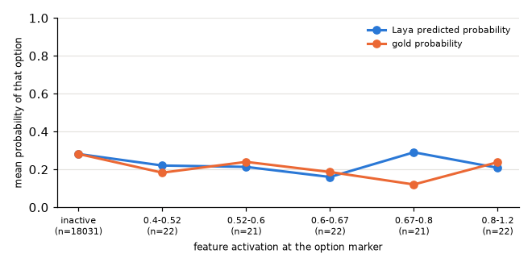

# Feature 16174

Critérios em que aparece: pred_error, corr_error

**Interpretação (preencher):** 

---

## Maiores ativações

**tr_customer_service_000217 / urgency** (score, customer_service) | ativação 4.723 em `estado` | opções ['0', '1', '2', '3'] | Laya: **1** [0.09, 0.82, 0.061, 0.029] | gabarito: **2**

```
[CLS]score question: How time-sensitive is this conversation?[SEP]
▸ [MASK] level 0: No time pressure; can wait indefinitely.
▸ [MASK] level 1: Routine; handle within the normal queue.
▸ [MASK] level 2: Elevated; should be handled within the same week.
▸ [MASK] level 3: Critical; requires action within the same day.

[SEP]

{"account": {"lifetime_value_usd": 835, "prior_tickets_90d": 0, "seats": 1, "tenure_months": 33, "tier": "free"}, "thread": [{"role": "customer", "text": "I've been using this account for nearly three years without an issue, but now I'm locked out and the reset emails just aren't arriving. I suppose this is just how it goes sometimes; I'm not sure⟦ what⟧ else to try."}]}[SEP]
```

**tr_customer_service_000217 / churn_risk** (score, customer_service) | ativação 4.504 em `estado` | opções ['0', '1', '2', '3'] | Laya: **1** [0.135, 0.53, 0.217, 0.118] | gabarito: **1**

```
[CLS]score question: How likely is this customer to stop doing business with us because of this interaction?[SEP]
▸ [MASK] level 0: No sign of dissatisfaction.
▸ [MASK] level 1: Mild frustration, but the relationship is intact.
▸ [MASK] level 2: Clearly unhappy; repeat problems or explicit complaints.
▸ [MASK] level 3: Imminent: threatening to cancel, dispute or leave.

[SEP]

{"account": {"lifetime_value_usd": 835, "prior_tickets_90d": 0, "seats": 1, "tenure_months": 33, "tier": "free"}, "thread": [{"role": "customer", "text": "I've been using this account for nearly three years without an issue, but now I'm locked out and the reset emails just aren't arriving. I suppose this is just how it goes sometimes; I'm not sure⟦ what⟧ else to try."}]}[SEP]
```

**tr_customer_service_000217 / action** (choice, customer_service) | ativação 4.324 em `estado` | opções ['answer_directly', 'close_no_action', 'escalate_to_human', 'execute_refund', 'request_information'] | Laya: **close_no_action** [0.089, 0.72, 0.064, 0.052, 0.075] | gabarito: **request_information**

```
[CLS]choice question: What should the assistant do next with this conversation?[SEP]
▸ [MASK] answer_directly: The assistant can resolve this itself with information it already has.
▸ [MASK] close_no_action: No further action is warranted; the matter is settled.
▸ [MASK] escalate_to_human: Hand off to a human agent with the appropriate authority.
▸ [MASK] execute_refund: Issue the refund or credit the customer is owed.
▸ [MASK] request_information: More detail is needed from the customer before anything can be done.

[SEP]

{"account": {"lifetime_value_usd": 835, "prior_tickets_90d": 0, "seats": 1, "tenure_months": 33, "tier": "free"}, "thread": [{"role": "customer", "text": "I've been using this account for nearly three years without an issue, but now I'm locked out and the reset emails just aren't arriving. I suppose this is just how it goes sometimes; I'm not sure⟦ what⟧ else to try."}]}[SEP]
```

**tr_customer_service_000217 / category** (choice, customer_service) | ativação 4.305 em `estado` | opções ['account', 'billing', 'delivery', 'refund', 'technical'] | Laya: **refund** [0.266, 0.15, 0.042, 0.384, 0.158] | gabarito: **account**

```
[CLS]choice question: What is this customer conversation primarily about?[SEP]
▸ [MASK] account: Login, plan changes, profile or access management.
▸ [MASK] billing: A charge, invoice, subscription or payment problem.
▸ [MASK] delivery: Shipping, fulfilment or delivery of a physical item.
▸ [MASK] refund: The customer is explicitly asking for money back.
▸ [MASK] technical: The product or service is not working as expected.

[SEP]

{"account": {"lifetime_value_usd": 835, "prior_tickets_90d": 0, "seats": 1, "tenure_months": 33, "tier": "free"}, "thread": [{"role": "customer", "text": "I've been using this account for nearly three years without an issue, but now I'm locked out and the reset emails just aren't arriving. I suppose this is just how it goes sometimes; I'm not sure⟦ what⟧ else to try."}]}[SEP]
```

**tr_customer_service_000217 / needs_human** (noul, customer_service) | ativação 4.035 em `estado` | opções ['false', 'true'] | Laya: **false** [0.619, 0.38] | gabarito: **false**

```
[CLS]noul question: This conversation requires a human agent rather than automated handling.[SEP]
▸ [MASK] false: Automation can carry this to resolution.
▸ [MASK] true: A human must take over: judgement, authority or empathy is required.

[SEP]

{"account": {"lifetime_value_usd": 835, "prior_tickets_90d": 0, "seats": 1, "tenure_months": 33, "tier": "free"}, "thread": [{"role": "customer", "text": "I've been using this account for nearly three years without an issue, but now I'm locked out and the reset emails just aren't arriving. I suppose this is just how it goes sometimes; I'm not sure⟦ what⟧ else to try."}]}[SEP]
```

## Ativações medianas (faixa 40-60%, mediana 1.016)

**tr_customer_service_000161 / action** (choice, customer_service) | ativação 0.950 em `opção` | opções ['answer_directly', 'close_no_action', 'escalate_to_human', 'execute_refund', 'request_information'] | Laya: **close_no_action** [0.236, 0.444, 0.149, 0.07, 0.102] | gabarito: **escalate_to_human**

```
[CLS]choice question: What should the assistant do next with this conversation?[SEP]
▸ [MASK] answer_directly: The assistant can resolve this itself with information it already has⟦.⟧
▸ [MASK] close_no_action: No further action is warranted; the matter is settled.
▸ [MASK] escalate_to_human: Hand off to a human agent with the appropriate authority.
▸ [MASK] execute_refund: Issue the refund or credit the customer is owed.
▸ [MASK] request_information: More detail is needed from the customer before anything can be done.

[SEP]

{"account": {"lifetime_value_usd": 2849, "prior_tickets_90d": 0, "seats": 40, "tenure_months": 72, "tier": "enterprise"}, "thread": [{"role": "customer", "text": "I’m a bit lost on how to downgrade my enterprise account; everything I try just loops back to the same page."}, {"role": "agent", "text": "Sorry for the confusion—could you tell me which part of the portal is giving you trouble?"}, {"role": "customer", "text": "When I click “Change Plan” nothing happens, and I need the downgrade done before Friday, so I’m not sure what to do next."}]}[SEP]
```

**tr_customer_service_000161 / churn_risk** (score, customer_service) | ativação 1.084 em `estado` | opções ['0', '1', '2', '3'] | Laya: **1** [0.13, 0.651, 0.113, 0.106] | gabarito: **2**

```
[CLS]score question: How likely is this customer to stop doing business with us because of this interaction?[SEP]
▸ [MASK] level 0: No sign of dissatisfaction.
▸ [MASK] level 1: Mild frustration, but the relationship is intact.
▸ [MASK] level 2: Clearly unhappy; repeat problems or explicit complaints.
▸ [MASK] level 3: Imminent: threatening to cancel, dispute or leave.

[SEP]

{"account": {"lifetime_value_usd": 2849, "prior_tickets_90d": 0, "seats": 40, "tenure_months": 72, "tier": "enterprise"}, "thread": [{"role": "customer", "text": "I’m a bit lost on how to downgrade my enterprise account; everything I try just loops back to the same page."}, {"role": "agent", "text": "Sorry for the confusion—could you tell me which part of the portal is giving you trouble?"}, {"role": "customer", "text": "When I click “Change Plan⟦”⟧ nothing happens, and I need the downgrade done before Friday, so I’m not sure what to do next."}]}[SEP]
```

**tr_customer_service_000246 / category** (choice, customer_service) | ativação 1.146 em `estado` | opções ['account', 'billing', 'delivery', 'refund', 'technical'] | Laya: **account** [0.379, 0.162, 0.032, 0.21, 0.217] | gabarito: **account**

```
[CLS]choice question: What is this customer conversation primarily about?[SEP]
▸ [MASK] account: Login, plan changes, profile or access management.
▸ [MASK] billing: A charge, invoice, subscription or payment problem.
▸ [MASK] delivery: Shipping, fulfilment or delivery of a physical item.
▸ [MASK] refund: The customer is explicitly asking for money back.
▸ [MASK] technical: The product or service is not working as expected.

[SEP]

{"account": {"lifetime_value_usd": 2575, "prior_tickets_90d": 0, "seats": 1, "tenure_months": 60, "tier": "free"}, "orders": [{"amount_usd": 9, "date": "2026-01-21", "id": "A-12450", "status": "settled"}], "thread": [{"role": "customer", "text": "I need someone to help me right now, I'm completely locked out of my account and I have a major presentation starting in less than twenty minutes!"}, {"role": "agent", "text": "I understand the urgency of getting back into your account before your presentation. Could you tell me the exact error message you receive when you try to log in?"}, {"role": "customer", "text": "It just says 'Authentication Failed' over and over again, and I've already tried the password reset button three times but no email is showing up!"}, {"role": "agent", "text": "Thank you for that information. To help me narrow this down, are you attempting to log in through our desktop application or via a web browser?"}, {"role": "customer", "text": "I've tried Chrome, Safari, and the desktop app, and nothing is working; I'm starting to panic because all my files are in there and I can't get to them!"}, {"role": "agent", "text": "I see. Have you had a⟦ chance⟧ to check your junk or spam folders for that reset link, or are you using a corporate network that might have a strict firewall?"}, {"role": "customer", "text": "I've checked every folder and there is nothing, and I'm just on my home Wi-Fi, so please tell me what else I can try because I'm running out of time!"}]}[SEP]
```

**tr_customer_service_000017 / action** (choice, customer_service) | ativação 1.015 em `estado` | opções ['answer_directly', 'close_no_action', 'escalate_to_human', 'execute_refund', 'request_information'] | Laya: **close_no_action** [0.171, 0.346, 0.161, 0.125, 0.197] | gabarito: **escalate_to_human**

```
[CLS]choice question: What should the assistant do next with this conversation?[SEP]
▸ [MASK] answer_directly: The assistant can resolve this itself with information it already has.
▸ [MASK] close_no_action: No further action is warranted; the matter is settled.
▸ [MASK] escalate_to_human: Hand off to a human agent with the appropriate authority.
▸ [MASK] execute_refund: Issue the refund or credit the customer is owed.
▸ [MASK] request_information: More detail is needed from the customer before anything can be done.

[SEP]

{"account": {"lifetime_value_usd": 228, "prior_tickets_90d": 3, "seats": 1, "tenure_months": 11, "tier": "premium"}, "orders": [{"amount_usd": 29, "date": "2026-03-25", "id": "A-17351", "status": "settled"}, {"amount_usd": 29, "date": "2026-02-18", "id": "A-55118", "status": "settled"}], "thread": [{"role": "customer", "text": "My payment for the $29 subscription failed this morning. I have a presentation tomorrow morning at 9:00 AM that requires this access, so I need this cleared up immediately."}, {"role": "agent", "text": "I see the status of your account. Before we look into the billing error⟦,⟧ could you confirm if the payment method on file has expired or if you have recently updated your banking information?"}, {"role": "customer", "text": "The card is current and active. I have had three previous tickets regarding billing glitches that were supposedly addressed, yet here I am again with the same issue."}, {"role": "agent", "text": "I acknowledge your frustration regarding the previous tickets. To investigate this specific failure, could you provide the transaction reference ID shown in your payment history?"}, {"role": "customer", "text": "I am looking at my bank portal now, but I don't see a reference ID generated for this attempt. How are we going to fix this before my deadline tomorrow?"}]}[SEP]
```

**tr_customer_service_000224 / category** (choice, customer_service) | ativação 1.147 em `estado` | opções ['account', 'billing', 'delivery', 'refund', 'technical'] | Laya: **technical** [0.188, 0.152, 0.067, 0.226, 0.368] | gabarito: **technical**

```
[CLS]choice question: What is this customer conversation primarily about?[SEP]
▸ [MASK] account: Login, plan changes, profile or access management.
▸ [MASK] billing: A charge, invoice, subscription or payment problem.
▸ [MASK] delivery: Shipping, fulfilment or delivery of a physical item.
▸ [MASK] refund: The customer is explicitly asking for money back.
▸ [MASK] technical: The product or service is not working as expected.

[SEP]

{"account": {"lifetime_value_usd": 3096, "prior_tickets_90d": 1, "seats": 1, "tenure_months": 60, "tier": "standard"}, "thread": [{"role": "customer", "text": "I’ve been on the standard plan for five years, but the bulk export feature has stopped working since the last update."}, {"role": "agent", "text": "I am sorry to hear you're experiencing trouble with the export tool. Could you please confirm if you're receiving a specific error code when you attempt the download?"}, {"role": "customer", "text": "There isn't an error code; the progress bar just freezes at 20% and stays there until the page times out."}, {"role": "agent", "text": "Thank you for that clarification. Have you attempted clearing your browser cache⟦ or⟧ trying a different browser to see if the export completes?"}, {"role": "customer", "text": "I tried both of those after our last ticket, but the result was the same."}]}[SEP]
```

## Estatísticas (conjunto de descoberta, dev e teste)

**pred / error**

| split | decisões | ativas | ativas e Laya errou | taxa | lift | q (BH) | OR (CMH) | q (CMH) |
|---|---|---|---|---|---|---|---|---|
| discovery | 5100 | 32 | 32 | 1.000 | 1.57 | 4.02e-06 | inf | 0.87 |
| dev | 900 | 8 | 7 | 0.875 | 1.33 | nan | nan | nan |
| test | 2000 | 10 | 10 | 1.000 | 1.57 | nan | nan | nan |

**corr / error**

| split | decisões | ativas | ativas e Laya errou | taxa | lift | q (BH) | OR (CMH) | q (CMH) |
|---|---|---|---|---|---|---|---|---|
| discovery | 5100 | 24 | 24 | 1.000 | 1.57 | 6.33e-05 | inf | 0.799 |
| dev | 900 | 5 | 4 | 0.800 | 1.22 | nan | nan | nan |
| test | 2000 | 8 | 8 | 1.000 | 1.57 | nan | nan | nan |

**state / error**

| split | decisões | ativas | ativas e Laya errou | taxa | lift | q (BH) | OR (CMH) | q (CMH) |
|---|---|---|---|---|---|---|---|---|
| discovery | 5100 | 438 | 260 | 0.594 | 0.93 | 0.254 | 0.94 | 0.741 |
| dev | 900 | 82 | 54 | 0.659 | 1.00 | 1 | 1.13 | 0.844 |
| test | 2000 | 149 | 94 | 0.631 | 0.99 | 1 | 1.04 | 0.93 |

Confusão mais sobre-representada (pred): `action|1>2` (n=19, lift 24.23, p=1.64e-23). Formato `pergunta|índice previsto>índice correto`.

Confusão mais sobre-representada (corr): `action|1>2` (n=22, lift 37.40, p=1.43e-34). Formato `pergunta|índice previsto>índice correto`.

Confusão mais sobre-representada (state): `action|1>2` (n=45, lift 4.19, p=4.68e-18). Formato `pergunta|índice previsto>índice correto`.



