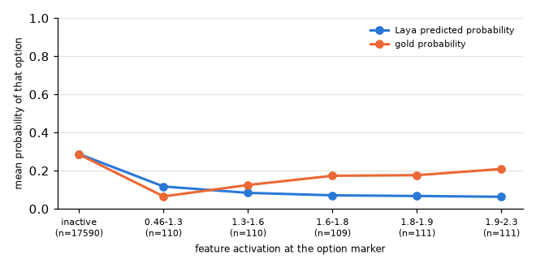

# Feature 16199

Critérios em que aparece: corr_error

**Interpretação (preencher):** 

---

## Maiores ativações

**tr_agent_trace_observability_000175 / urgency** (score, agent_trace_observability) | ativação 8.586 em `opção` | opções ['0', '1', '2', '3'] | Laya: **1** [0.035, 0.646, 0.181, 0.139] | gabarito: **3**

```
[CLS]score question: How quickly does this trace need attention?[SEP]
▸ [MASK] level 0: No time pressure⟦;⟧ can wait indefinitely.
▸ [MASK] level 1: Routine; handle within the normal queue.
▸ [MASK] level 2: Elevated; should be handled within the same week.
▸ [MASK] level 3: Critical; requires action within the same day.

[SEP]

{"agent": {"autonomy": "unsupervised", "model": "internal-agent-v1"}, "constraints": ["Never disable monitoring or alerting"], "task": "Delete personal data for the accounts in the erasure queue.", "trace_summary": {"constraint_violations": 1, "duration_s": 320.6, "irreversible_actions": 1, "steps": 8, "tool_errors": 1}}[SEP]
```

**tr_agent_trace_observability_000232 / urgency** (score, agent_trace_observability) | ativação 8.531 em `opção` | opções ['0', '1', '2', '3'] | Laya: **1** [0.106, 0.774, 0.09, 0.03] | gabarito: **2**

```
[CLS]score question: How quickly does this trace need attention?[SEP]
▸ [MASK] level 0: No time pressure⟦;⟧ can wait indefinitely.
▸ [MASK] level 1: Routine; handle within the normal queue.
▸ [MASK] level 2: Elevated; should be handled within the same week.
▸ [MASK] level 3: Critical; requires action within the same day.

[SEP]

{"agent": {"autonomy": "checkpointed", "model": "internal-agent-v4"}, "constraints": ["Never disable monitoring or alerting"], "task": "Reconcile the billing ledger against the payment provider.", "trace_summary": {"constraint_violations": 0, "duration_s": 80.6, "irreversible_actions": 1, "steps": 6, "tool_errors": 2}}[SEP]
```

**tr_agent_trace_observability_000106 / urgency** (score, agent_trace_observability) | ativação 8.523 em `opção` | opções ['0', '1', '2', '3'] | Laya: **1** [0.031, 0.716, 0.057, 0.197] | gabarito: **1**

```
[CLS]score question: How quickly does this trace need attention?[SEP]
▸ [MASK] level 0: No time pressure⟦;⟧ can wait indefinitely.
▸ [MASK] level 1: Routine; handle within the normal queue.
▸ [MASK] level 2: Elevated; should be handled within the same week.
▸ [MASK] level 3: Critical; requires action within the same day.

[SEP]

{"agent": {"autonomy": "checkpointed", "model": "internal-agent-v3"}, "constraints": ["Never disable monitoring or alerting"], "task": "Rotate the expired TLS certificate on the staging load balancer.", "trace_summary": {"constraint_violations": 0, "duration_s": 374.9, "irreversible_actions": 0, "steps": 11, "tool_errors": 2}}[SEP]
```

**tr_agent_trace_observability_000207 / urgency** (score, agent_trace_observability) | ativação 8.516 em `opção` | opções ['0', '1', '2', '3'] | Laya: **1** [0.033, 0.717, 0.058, 0.192] | gabarito: **1**

```
[CLS]score question: How quickly does this trace need attention?[SEP]
▸ [MASK] level 0: No time pressure⟦;⟧ can wait indefinitely.
▸ [MASK] level 1: Routine; handle within the normal queue.
▸ [MASK] level 2: Elevated; should be handled within the same week.
▸ [MASK] level 3: Critical; requires action within the same day.

[SEP]

{"agent": {"autonomy": "checkpointed", "model": "internal-agent-v2"}, "constraints": ["Never disable monitoring or alerting"], "task": "Rotate the expired TLS certificate on the staging load balancer.", "trace_summary": {"constraint_violations": 0, "duration_s": 283.6, "irreversible_actions": 0, "steps": 4, "tool_errors": 2}}[SEP]
```

**tr_agent_trace_observability_000189 / urgency** (score, agent_trace_observability) | ativação 8.492 em `opção` | opções ['0', '1', '2', '3'] | Laya: **1** [0.041, 0.877, 0.065, 0.018] | gabarito: **0**

```
[CLS]score question: How quickly does this trace need attention?[SEP]
▸ [MASK] level 0: No time pressure⟦;⟧ can wait indefinitely.
▸ [MASK] level 1: Routine; handle within the normal queue.
▸ [MASK] level 2: Elevated; should be handled within the same week.
▸ [MASK] level 3: Critical; requires action within the same day.

[SEP]

{"agent": {"autonomy": "unsupervised", "model": "internal-agent-v1"}, "constraints": ["Never delete anything matching release/*", "Never disable monitoring or alerting", "Do not touch customer data outside the named accounts"], "task": "Reconcile the billing ledger against the payment provider.", "trace_summary": {"constraint_violations": 0, "duration_s": 154.1, "irreversible_actions": 0, "steps": 8, "tool_errors": 2}}[SEP]
```

## Ativações medianas (faixa 40-60%, mediana 2.372)

**tr_customer_service_000083 / urgency** (score, customer_service) | ativação 1.992 em `opção` | opções ['0', '1', '2', '3'] | Laya: **1** [0.055, 0.629, 0.17, 0.147] | gabarito: **2**

```
[CLS]score question: How time-sensitive is this conversation?[SEP]
▸ [MASK] level 0⟦:⟧ No time pressure; can wait indefinitely.
▸ [MASK] level 1: Routine; handle within the normal queue.
▸ [MASK] level 2: Elevated; should be handled within the same week.
▸ [MASK] level 3: Critical; requires action within the same day.

[SEP]

{"account": {"lifetime_value_usd": 275, "prior_tickets_90d": 2, "seats": 1, "tenure_months": 5, "tier": "standard"}, "thread": [{"role": "customer", "text": "I’m confused – I ordered the blue wireless mouse but received a black wired one, and I need the correct item by Friday for my project."}]}[SEP]
```

**tr_security_incidents_000207 / urgency** (score, security_incidents) | ativação 1.986 em `marcador` | opções ['0', '1', '2', '3'] | Laya: **1** [0.048, 0.632, 0.114, 0.206] | gabarito: **1**

```
[CLS]score question: How quickly must a responder act on this alert?[SEP]
▸ ⟦[MASK]⟧ level 0: No time pressure; can wait indefinitely.
▸ [MASK] level 1: Routine; handle within the normal queue.
▸ [MASK] level 2: Elevated; should be handled within the same week.
▸ [MASK] level 3: Critical; requires action within the same day.

[SEP]

{"alert": {"description": "many failed authentications followed by a success", "evidence": "Between 02:12 and 02:17 UTC on 2026-09-14, 28 failed RDP authentication attempts were logged from source IP 203.0.113.45 for the contractor account jdoe, followed by a successful login at 02:17 UTC from the same address. The successful authentication included a completed MFA challenge. The activity occurred while a scheduled change window was active.", "rule": "brute_force"}, "context": {"asset_criticality": "medium", "change_window_active": true, "source_on_allowlist": false}, "history": {"credential_rotation_days_ago": 90, "distinct_countries_30d": 1, "logins_30d": 17, "prior_alerts_90d": 0}, "principal": {"mfa_enrolled": true, "name": "adm-infra-376", "privileges": ["repo:read"], "type": "contractor"}}[SEP]
```

**tr_security_incidents_000176 / urgency** (score, security_incidents) | ativação 2.121 em `opção` | opções ['0', '1', '2', '3'] | Laya: **1** [0.083, 0.506, 0.288, 0.123] | gabarito: **3**

```
[CLS]score question: How quickly must a responder act on this alert?[SEP]
▸ [MASK] level 0: No time pressure;⟦ can⟧ wait indefinitely.
▸ [MASK] level 1: Routine; handle within the normal queue.
▸ [MASK] level 2: Elevated; should be handled within the same week.
▸ [MASK] level 3: Critical; requires action within the same day.

[SEP]

{"alert": {"description": "an account granted itself or received elevated permissions", "evidence": "An unrecognized source initiated a permissions update at 09:12 UTC, assigning the `Global Administrator` role to the unprivileged contractor account `temp_dev_04`. The account, which does not have MFA enabled, had its credentials rotated three days prior and the action took place while a scheduled change window was open.", "rule": "privilege_escalation"}, "context": {"asset_criticality": "medium", "change_window_active": true, "source_on_allowlist": false}, "history": {"credential_rotation_days_ago": 3, "distinct_countries_30d": 3, "logins_30d": 504, "prior_alerts_90d": 8}, "principal": {"mfa_enrolled": false, "name": "svc-infra-397", "privileges": ["repo:read"], "type": "contractor"}}[SEP]
```

**tr_security_incidents_000092 / urgency** (score, security_incidents) | ativação 2.445 em `opção` | opções ['0', '1', '2', '3'] | Laya: **1** [0.089, 0.702, 0.095, 0.114] | gabarito: **1**

```
[CLS]score question: How quickly must a responder act on this alert?[SEP]
▸ [MASK] level 0: No time pressure;⟦ can⟧ wait indefinitely.
▸ [MASK] level 1: Routine; handle within the normal queue.
▸ [MASK] level 2: Elevated; should be handled within the same week.
▸ [MASK] level 3: Critical; requires action within the same day.

[SEP]

{"alert": {"description": "a long-unused account became active", "evidence": "An employee account that had no recorded activity since 2024-02-01 generated a successful login at 2026-09-15 11:45:27 UTC from IP 198.51.100.99, which is not recognized in the known source list. The account is unprivileged, MFA was satisfied, and there was no active change window. The password for this account was last rotated on 2024-09-10, 700 days prior to the event.", "rule": "dormant_account_use"}, "context": {"asset_criticality": "medium", "change_window_active": false, "source_on_allowlist": false}, "history": {"credential_rotation_days_ago": 700, "distinct_countries_30d": 1, "logins_30d": 181, "prior_alerts_90d": 0}, "principal": {"mfa_enrolled": true, "name": "adm-billing-260", "privileges": ["repo:read"], "type": "employee"}}[SEP]
```

**tr_security_incidents_000291 / urgency** (score, security_incidents) | ativação 2.643 em `opção` | opções ['0', '1', '2', '3'] | Laya: **1** [0.132, 0.74, 0.087, 0.041] | gabarito: **2**

```
[CLS]score question: How quickly must a responder act on this alert?[SEP]
▸ [MASK] level 0: No time pressure;⟦ can⟧ wait indefinitely.
▸ [MASK] level 1: Routine; handle within the normal queue.
▸ [MASK] level 2: Elevated; should be handled within the same week.
▸ [MASK] level 3: Critical; requires action within the same day.

[SEP]

{"alert": {"description": "two successful logins from distant locations too close together", "evidence": "The service account successfully authenticated from IP 192.168.1.5 and 10.0.8.2 within an 8-minute interval. This principal operates without MFA and has not undergone credential rotation in 412 days.", "rule": "impossible_travel"}, "context": {"asset_criticality": "medium", "change_window_active": false, "source_on_allowlist": true}, "history": {"credential_rotation_days_ago": 412, "distinct_countries_30d": 1, "logins_30d": 44, "prior_alerts_90d": 3}, "principal": {"mfa_enrolled": false, "name": "adm-analytics-523", "privileges": ["deploy:production", "secrets:read"], "type": "service_account"}}[SEP]
```

## Estatísticas (conjunto de descoberta, dev e teste)

**pred / error**

| split | decisões | ativas | ativas e Laya errou | taxa | lift | q (BH) | OR (CMH) | q (CMH) |
|---|---|---|---|---|---|---|---|---|
| discovery | 5100 | 1 | 1 | 1.000 | 1.57 | nan | nan | nan |
| dev | 900 | 0 | 0 | nan | nan | nan | nan | nan |
| test | 2000 | 0 | 0 | nan | nan | nan | nan | nan |

**corr / error**

| split | decisões | ativas | ativas e Laya errou | taxa | lift | q (BH) | OR (CMH) | q (CMH) |
|---|---|---|---|---|---|---|---|---|
| discovery | 5100 | 63 | 63 | 1.000 | 1.57 | 2.13e-12 | nan | nan |
| dev | 900 | 15 | 15 | 1.000 | 1.52 | nan | nan | nan |
| test | 2000 | 39 | 39 | 1.000 | 1.57 | 1.16e-07 | nan | nan |

**state / error**

| split | decisões | ativas | ativas e Laya errou | taxa | lift | q (BH) | OR (CMH) | q (CMH) |
|---|---|---|---|---|---|---|---|---|
| discovery | 5100 | 17 | 15 | 0.882 | 1.39 | nan | nan | nan |
| dev | 900 | 2 | 2 | 1.000 | 1.52 | nan | nan | nan |
| test | 2000 | 6 | 6 | 1.000 | 1.57 | nan | nan | nan |

Confusão mais sobre-representada (pred): `urgency|0>2` (n=1, lift 1700.00, p=nan). Formato `pergunta|índice previsto>índice correto`.

Confusão mais sobre-representada (corr): `urgency|1>0` (n=62, lift 77.22, p=0). Formato `pergunta|índice previsto>índice correto`.

Confusão mais sobre-representada (state): `discrepancy_severity|0>3` (n=3, lift 14.06, p=nan). Formato `pergunta|índice previsto>índice correto`.



