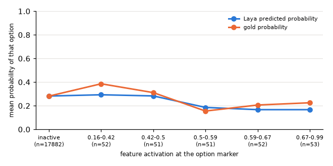

# Feature 16220

Critérios em que aparece: corr_error_stratified

**Interpretação (preencher):** 

---

## Maiores ativações

**tr_customer_service_000273 / action** (choice, customer_service) | ativação 4.520 em `estado` | opções ['answer_directly', 'close_no_action', 'escalate_to_human', 'execute_refund', 'request_information'] | Laya: **close_no_action** [0.163, 0.425, 0.111, 0.19, 0.111] | gabarito: **escalate_to_human**

```
[CLS]choice question: What should the assistant do next with this conversation?[SEP]
▸ [MASK] answer_directly: The assistant can resolve this itself with information it already has.
▸ [MASK] close_no_action: No further action is warranted; the matter is settled.
▸ [MASK] escalate_to_human: Hand off to a human agent with the appropriate authority.
▸ [MASK] execute_refund: Issue the refund or credit the customer is owed.
▸ [MASK] request_information: More detail is needed from the customer before anything can be done.

[SEP]

{"account": {"lifetime_value_usd": 278, "prior_tickets_90d": 2, "seats": 1, "tenure_months": 8, "tier": "free"}, "orders": [{"amount_usd": 598, "date": "2026-02-17", "id": "A-18443", "status": "pending"}, {"amount_usd": 598, "date": "2026-02-01", "id": "A-75942", "status": "refunded"}], "thread": [{"role": "customer", "text": "I’d like to cancel the account. I’ve been on the free plan for about eight months, and there’⟦s⟧ roughly $598 tied up. There are two older tickets that haven’t been resolved."}, {"role": "agent", "text": "I’m sorry to hear that. Could you confirm the account email so I can look at the open items?"}, {"role": "customer", "text": "It’s the email on the billing page. I’m not in a hurry, but I need the cancellation request to stay open until those tickets are handled."}]}[SEP]
```

**tr_customer_service_000273 / category** (choice, customer_service) | ativação 4.207 em `estado` | opções ['account', 'billing', 'delivery', 'refund', 'technical'] | Laya: **refund** [0.154, 0.183, 0.036, 0.43, 0.196] | gabarito: **account**

```
[CLS]choice question: What is this customer conversation primarily about?[SEP]
▸ [MASK] account: Login, plan changes, profile or access management.
▸ [MASK] billing: A charge, invoice, subscription or payment problem.
▸ [MASK] delivery: Shipping, fulfilment or delivery of a physical item.
▸ [MASK] refund: The customer is explicitly asking for money back.
▸ [MASK] technical: The product or service is not working as expected.

[SEP]

{"account": {"lifetime_value_usd": 278, "prior_tickets_90d": 2, "seats": 1, "tenure_months": 8, "tier": "free"}, "orders": [{"amount_usd": 598, "date": "2026-02-17", "id": "A-18443", "status": "pending"}, {"amount_usd": 598, "date": "2026-02-01", "id": "A-75942", "status": "refunded"}], "thread": [{"role": "customer", "text": "I’d like to cancel the account. I’ve been on the free plan for about eight months, and there’⟦s⟧ roughly $598 tied up. There are two older tickets that haven’t been resolved."}, {"role": "agent", "text": "I’m sorry to hear that. Could you confirm the account email so I can look at the open items?"}, {"role": "customer", "text": "It’s the email on the billing page. I’m not in a hurry, but I need the cancellation request to stay open until those tickets are handled."}]}[SEP]
```

**tr_customer_service_000244 / urgency** (score, customer_service) | ativação 4.203 em `estado` | opções ['0', '1', '2', '3'] | Laya: **1** [0.053, 0.617, 0.175, 0.155] | gabarito: **2**

```
[CLS]score question: How time-sensitive is this conversation?[SEP]
▸ [MASK] level 0: No time pressure; can wait indefinitely.
▸ [MASK] level 1: Routine; handle within the normal queue.
▸ [MASK] level 2: Elevated; should be handled within the same week.
▸ [MASK] level 3: Critical; requires action within the same day.

[SEP]

{"account": {"lifetime_value_usd": 91, "prior_tickets_90d": 0, "seats": 1, "tenure_months": 1, "tier": "standard"}, "thread": [{"role": "customer", "text": "Hi there! I just opened my package and noticed that I received the standard kit instead of the deluxe version I had ordered. I hate⟦ to⟧ be a pain, but I'm actually on a very tight schedule and need the specific components from the deluxe kit for a project deadline on Tuesday. Could you help me figure out how to get the right items sent out?"}]}[SEP]
```

**tr_customer_service_000244 / needs_human** (noul, customer_service) | ativação 4.145 em `estado` | opções ['false', 'true'] | Laya: **true** [0.48, 0.52] | gabarito: **true**

```
[CLS]noul question: This conversation requires a human agent rather than automated handling.[SEP]
▸ [MASK] false: Automation can carry this to resolution.
▸ [MASK] true: A human must take over: judgement, authority or empathy is required.

[SEP]

{"account": {"lifetime_value_usd": 91, "prior_tickets_90d": 0, "seats": 1, "tenure_months": 1, "tier": "standard"}, "thread": [{"role": "customer", "text": "Hi there! I just opened my package and noticed that I received the standard kit instead of the deluxe version I had ordered. I hate⟦ to⟧ be a pain, but I'm actually on a very tight schedule and need the specific components from the deluxe kit for a project deadline on Tuesday. Could you help me figure out how to get the right items sent out?"}]}[SEP]
```

**tr_customer_service_000273 / churn_risk** (score, customer_service) | ativação 3.924 em `estado` | opções ['0', '1', '2', '3'] | Laya: **3** [0.091, 0.258, 0.232, 0.419] | gabarito: **3**

```
[CLS]score question: How likely is this customer to stop doing business with us because of this interaction?[SEP]
▸ [MASK] level 0: No sign of dissatisfaction.
▸ [MASK] level 1: Mild frustration, but the relationship is intact.
▸ [MASK] level 2: Clearly unhappy; repeat problems or explicit complaints.
▸ [MASK] level 3: Imminent: threatening to cancel, dispute or leave.

[SEP]

{"account": {"lifetime_value_usd": 278, "prior_tickets_90d": 2, "seats": 1, "tenure_months": 8, "tier": "free"}, "orders": [{"amount_usd": 598, "date": "2026-02-17", "id": "A-18443", "status": "pending"}, {"amount_usd": 598, "date": "2026-02-01", "id": "A-75942", "status": "refunded"}], "thread": [{"role": "customer", "text": "I’d like to cancel the account. I’ve been on the free plan for about eight months, and there’⟦s⟧ roughly $598 tied up. There are two older tickets that haven’t been resolved."}, {"role": "agent", "text": "I’m sorry to hear that. Could you confirm the account email so I can look at the open items?"}, {"role": "customer", "text": "It’s the email on the billing page. I’m not in a hurry, but I need the cancellation request to stay open until those tickets are handled."}]}[SEP]
```

## Ativações medianas (faixa 40-60%, mediana 0.776)

**tr_customer_service_000021 / action** (choice, customer_service) | ativação 0.722 em `opção` | opções ['answer_directly', 'close_no_action', 'escalate_to_human', 'execute_refund', 'request_information'] | Laya: **close_no_action** [0.184, 0.313, 0.184, 0.14, 0.18] | gabarito: **escalate_to_human**

```
[CLS]choice question: What should the assistant do next with this conversation?[SEP]
▸ [MASK] answer_directly: The assistant can resolve this itself with information it already has.
▸ [MASK] close_no_action: No further action is warranted; the matter is settled.
▸ [MASK] escalate_to_human: Hand off⟦ to⟧ a human agent with the appropriate authority.
▸ [MASK] execute_refund: Issue the refund or credit the customer is owed.
▸ [MASK] request_information: More detail is needed from the customer before anything can be done.

[SEP]

{"account": {"lifetime_value_usd": 2339, "prior_tickets_90d": 0, "seats": 1, "tenure_months": 33, "tier": "free"}, "orders": [{"amount_usd": 999, "date": "2026-02-27", "id": "A-76350", "status": "pending"}], "thread": [{"role": "customer", "text": "I was charged $999 this month even though I’m on the free plan. Can you explain why this happened?"}, {"role": "agent", "text": "I see the charge you’re referring to. Could you share the invoice number or the date it appeared on your statement?"}, {"role": "customer", "text": "The invoice is #INV-20230914 and it shows up on my credit card as a $999 charge. I thought I was only on the free tier."}, {"role": "agent", "text": "Thank you for that information. I’ll pull up the billing records. Could you confirm the email address linked to your account?"}, {"role": "customer", "text": "The account email is user@example.com. Please let me know why this charge was applied."}]}[SEP]
```

**tr_invoice_processing_000276 / matches_order** (noul, invoice_processing) | ativação 0.706 em `estado` | opções ['false', 'true'] | Laya: **true** [0.486, 0.514] | gabarito: **true**

```
[CLS]noul question: The invoice reconciles with the purchase order and the recorded delivery.[SEP]
▸ [MASK] false: There is a discrepancy against the order or the delivery.
▸ [MASK] true: Line items, quantities and amounts reconcile.

[SEP]

{"delivery": {"condition": "accepted", "date": "2026-03-02", "received_qty": 25}, "invoice": {"currency": "USD", "id": "INV-2026-4114", "lines": [{"qty": 25, "sku": "SKU-776", "total_usd": 6578.75, "unit_usd": 263.15}], "total_usd": 6578.75, "vendor": "Acme Fabric⟦ation⟧"}, "payment": {"days_until_due": 0, "discount_expires_in_days": null, "early_payment_discount_pct": null, "status": "scheduled", "terms": "net 15"}, "purchase_order": {"freight_terms": "freight prepaid by vendor, not separately billable", "id": null, "lines": [{"qty": 25, "unit_usd": 263.15}], "total_usd": 6578.75}, "vendor_history": {"disputes_12m": 0, "invoices_12m": 8, "prior_invoice_ids": ["INV-2026-5447", "INV-2026-7281", "INV-2026-3201"]}}[SEP]
```

**tr_customer_service_000274 / action** (choice, customer_service) | ativação 0.727 em `estado` | opções ['answer_directly', 'close_no_action', 'escalate_to_human', 'execute_refund', 'request_information'] | Laya: **close_no_action** [0.177, 0.426, 0.169, 0.098, 0.131] | gabarito: **answer_directly**

```
[CLS]choice question: What should the assistant do next with this conversation?[SEP]
▸ [MASK] answer_directly: The assistant can resolve this itself with information it already has.
▸ [MASK] close_no_action: No further action is warranted; the matter is settled.
▸ [MASK] escalate_to_human: Hand off to a human agent with the appropriate authority.
▸ [MASK] execute_refund: Issue the refund or credit the customer is owed.
▸ [MASK] request_information: More detail is needed from the customer before anything can be done.

[SEP]

{"account": {"lifetime_value_usd": 2198, "prior_tickets_90d": 0, "seats": 1, "tenure_months": 72, "tier": "free"}, "thread": [{"role": "customer", "text": "I need to export the data from my account⟦.⟧ I’ve been on the free plan for seventy-two months, and I can’t keep hoping the export button works."}, {"role": "agent", "text": "I’m sorry that’s been so difficult. Can you tell me what you see when you open the export option?"}, {"role": "customer", "text": "Nothing. It looks the same as it has for days. I haven’t submitted a ticket before, so there’s no earlier trail."}, {"role": "agent", "text": "Thank you. Are you trying to export all records, or a specific collection?"}, {"role": "customer", "text": "All of it, if I can. I’m not asking for much, just a way out that doesn’t require more waiting."}]}[SEP]
```

**tr_customer_service_000185 / category** (choice, customer_service) | ativação 0.792 em `opção` | opções ['account', 'billing', 'delivery', 'refund', 'technical'] | Laya: **account** [0.5, 0.057, 0.035, 0.29, 0.119] | gabarito: **technical**

```
[CLS]choice question: What is this customer conversation primarily about?[SEP]
▸ [MASK] account: Login, plan changes, profile or access management.
▸ [MASK] billing: A charge, invoice, subscription or payment problem.
▸ [MASK] delivery: Shipping, fulfilment or delivery of a physical item.
▸ [MASK] refund: The customer is explicitly asking for money back.
▸ [MASK] technical: The product or service⟦ is⟧ not working as expected.

[SEP]

{"account": {"lifetime_value_usd": 30, "prior_tickets_90d": 5, "seats": 1, "tenure_months": 1, "tier": "free"}, "thread": [{"role": "customer", "text": "I’ve tried three times to export my data and every attempt just times out—this free account is supposed to let me take my info anywhere!"}]}[SEP]
```

**tr_security_incidents_000280 / credential_compromise** (noul, security_incidents) | ativação 0.844 em `estado` | opções ['false', 'true'] | Laya: **true** [0.089, 0.911] | gabarito: **false**

```
[CLS]noul question: The evidence indicates a credential or account has been compromised.[SEP]
▸ [MASK] false: no, the statement does not hold
▸ [MASK] true: yes, the statement holds

[SEP]

{"alert": {"description": "a session token was presented from a second address", "evidence": "Session token \"f9d2a1c3\" associated with shared_mailbox@example.com was first used from IP 198.51.100.22 at 2026-09-16 02:11 UTC and then presented again from IP 198.51.100.55 at 2026-09-16 02:13 UTC. Both source IPs are on the allowlist; the token holder's credentials were last rotated 412 days⟦ ago⟧ and no change window was active.", "rule": "token_reuse"}, "context": {"asset_criticality": "low", "change_window_active": false, "source_on_allowlist": true}, "history": {"credential_rotation_days_ago": 412, "distinct_countries_30d": 4, "logins_30d": 1529, "prior_alerts_90d": 3}, "principal": {"mfa_enrolled": true, "name": "ci-analytics-679", "privileges": ["repo:read"], "type": "shared_mailbox"}}[SEP]
```

## Estatísticas (conjunto de descoberta, dev e teste)

**pred / error**

| split | decisões | ativas | ativas e Laya errou | taxa | lift | q (BH) | OR (CMH) | q (CMH) |
|---|---|---|---|---|---|---|---|---|
| discovery | 5100 | 17 | 11 | 0.647 | 1.02 | nan | nan | nan |
| dev | 900 | 0 | 0 | nan | nan | nan | nan | nan |
| test | 2000 | 5 | 4 | 0.800 | 1.26 | nan | nan | nan |

**corr / error**

| split | decisões | ativas | ativas e Laya errou | taxa | lift | q (BH) | OR (CMH) | q (CMH) |
|---|---|---|---|---|---|---|---|---|
| discovery | 5100 | 62 | 56 | 0.903 | 1.42 | 5.79e-06 | 23.23 | 4.88e-05 |
| dev | 900 | 16 | 16 | 1.000 | 1.52 | nan | nan | nan |
| test | 2000 | 22 | 21 | 0.955 | 1.50 | 0.00207 | inf | 0.0445 |

**state / error**

| split | decisões | ativas | ativas e Laya errou | taxa | lift | q (BH) | OR (CMH) | q (CMH) |
|---|---|---|---|---|---|---|---|---|
| discovery | 5100 | 2464 | 1532 | 0.622 | 0.98 | 0.199 | 0.90 | 0.226 |
| dev | 900 | 460 | 288 | 0.626 | 0.95 | 0.755 | 0.71 | 0.178 |
| test | 2000 | 1032 | 631 | 0.611 | 0.96 | 0.262 | 0.85 | 0.296 |

Confusão mais sobre-representada (pred): `risk|1>2` (n=2, lift 12.77, p=nan). Formato `pergunta|índice previsto>índice correto`.

Confusão mais sobre-representada (corr): `category|0>4` (n=11, lift 47.62, p=2.37e-17). Formato `pergunta|índice previsto>índice correto`.

Confusão mais sobre-representada (state): `category|0>4` (n=19, lift 2.07, p=9.59e-07). Formato `pergunta|índice previsto>índice correto`.



