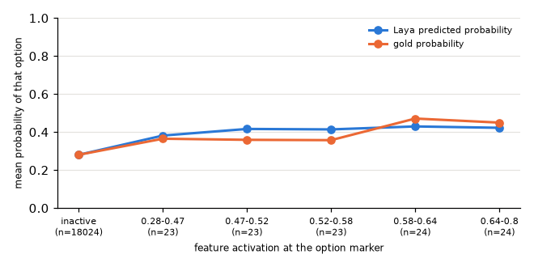

# Feature 16287

Critérios em que aparece: corr_error

**Interpretação (preencher):** 

---

## Maiores ativações

**tr_invoice_processing_000153 / discrepancy_severity** (score, invoice_processing) | ativação 11.609 em `pergunta` | opções ['0', '1', '2', '3'] | Laya: **0** [0.399, 0.204, 0.214, 0.182] | gabarito: **3**

```
[CLS]score question: How material is any discrepancy between the invoice, the order and⟦ the⟧ delivery?[SEP]
▸ [MASK] level 0: None: everything reconciles.
▸ [MASK] level 1: Trivial: rounding or a cosmetic difference.
▸ [MASK] level 2: Moderate: a real difference worth confirming.
▸ [MASK] level 3: Material: a large or unexplained difference.

[SEP]

{"delivery": {"condition": "accepted with exceptions", "date": null, "received_qty": 0}, "invoice": {"currency": "USD", "id": "INV-2026-9865", "lines": [{"qty": 1000, "sku": "SKU-844", "total_usd": 237850.0, "unit_usd": 237.85}], "total_usd": 237850.0, "vendor": "Kestrel Supply"}, "payment": {"days_until_due": 18, "discount_expires_in_days": 4, "early_payment_discount_pct": 2.0, "status": "scheduled", "terms": "net 15"}, "purchase_order": {"freight_terms": "freight prepaid by vendor, not separately billable", "id": "PO-9394", "lines": [{"qty": 1000, "unit_usd": 237.85}], "total_usd": 237850.0}, "vendor_history": {"disputes_12m": 1, "invoices_12m": 13, "prior_invoice_ids": ["INV-2026-5658", "INV-2026-4550", "INV-2026-8891"]}}[SEP]
```

**tr_invoice_processing_000172 / discrepancy_severity** (score, invoice_processing) | ativação 11.602 em `pergunta` | opções ['0', '1', '2', '3'] | Laya: **0** [0.311, 0.274, 0.232, 0.183] | gabarito: **0**

```
[CLS]score question: How material is any discrepancy between the invoice, the order and⟦ the⟧ delivery?[SEP]
▸ [MASK] level 0: None: everything reconciles.
▸ [MASK] level 1: Trivial: rounding or a cosmetic difference.
▸ [MASK] level 2: Moderate: a real difference worth confirming.
▸ [MASK] level 3: Material: a large or unexplained difference.

[SEP]

{"delivery": {"condition": "accepted", "date": "2026-03-23", "received_qty": 250}, "invoice": {"currency": "USD", "id": "INV-2026-5713", "lines": [{"qty": 250, "sku": "SKU-100", "total_usd": 57532.5, "unit_usd": 230.13}], "total_usd": 57532.5, "vendor": "Orbit Logistics"}, "payment": {"days_until_due": 2, "discount_expires_in_days": 4, "early_payment_discount_pct": 2.0, "status": "scheduled", "terms": "net 30"}, "purchase_order": {"freight_terms": "freight prepaid by vendor, not separately billable", "id": "PO-3277", "lines": [{"qty": 250, "unit_usd": 230.13}], "total_usd": 57532.5}, "vendor_history": {"disputes_12m": 1, "invoices_12m": 60, "prior_invoice_ids": ["INV-2026-5713"]}}[SEP]
```

**tr_invoice_processing_000134 / discrepancy_severity** (score, invoice_processing) | ativação 11.500 em `pergunta` | opções ['0', '1', '2', '3'] | Laya: **0** [0.325, 0.258, 0.205, 0.212] | gabarito: **0**

```
[CLS]score question: How material is any discrepancy between the invoice, the order and⟦ the⟧ delivery?[SEP]
▸ [MASK] level 0: None: everything reconciles.
▸ [MASK] level 1: Trivial: rounding or a cosmetic difference.
▸ [MASK] level 2: Moderate: a real difference worth confirming.
▸ [MASK] level 3: Material: a large or unexplained difference.

[SEP]

{"delivery": {"condition": "accepted", "date": "2026-03-15", "received_qty": 10}, "invoice": {"currency": "USD", "id": "INV-2026-2470", "lines": [{"qty": 10, "sku": "SKU-529", "total_usd": 1797.7, "unit_usd": 179.77}], "total_usd": 1797.7, "vendor": "Pallas Industrial"}, "payment": {"days_until_due": 2, "discount_expires_in_days": 3, "early_payment_discount_pct": 2.0, "status": "scheduled", "terms": "net 30"}, "purchase_order": {"freight_terms": "freight prepaid by vendor, not separately billable", "id": null, "lines": [{"qty": 10, "unit_usd": 179.77}], "total_usd": 1797.7}, "vendor_history": {"disputes_12m": 0, "invoices_12m": 43, "prior_invoice_ids": ["INV-2026-2034"]}}[SEP]
```

**tr_invoice_processing_000268 / discrepancy_severity** (score, invoice_processing) | ativação 11.344 em `pergunta` | opções ['0', '1', '2', '3'] | Laya: **0** [0.37, 0.257, 0.207, 0.166] | gabarito: **0**

```
[CLS]score question: How material is any discrepancy between the invoice, the order and⟦ the⟧ delivery?[SEP]
▸ [MASK] level 0: None: everything reconciles.
▸ [MASK] level 1: Trivial: rounding or a cosmetic difference.
▸ [MASK] level 2: Moderate: a real difference worth confirming.
▸ [MASK] level 3: Material: a large or unexplained difference.

[SEP]

{"delivery": {"condition": "accepted", "date": "2026-03-08", "received_qty": 5}, "invoice": {"currency": "USD", "id": "INV-2026-3492", "lines": [{"qty": 5, "sku": "SKU-605", "total_usd": 1104.6, "unit_usd": 220.92}], "total_usd": 1104.6, "vendor": "Pallas Industrial"}, "payment": {"days_until_due": 2, "discount_expires_in_days": null, "early_payment_discount_pct": null, "status": "scheduled", "terms": "net 30"}, "purchase_order": {"freight_terms": "freight prepaid by vendor, not separately billable", "id": "PO-3026", "lines": [{"qty": 25, "unit_usd": 220.92}], "total_usd": 5523.0}, "vendor_history": {"disputes_12m": 5, "invoices_12m": 1, "prior_invoice_ids": ["INV-2026-6730", "INV-2026-2551", "INV-2026-8707", "INV-2026-1458"]}}[SEP]
```

**tr_invoice_processing_000267 / discrepancy_severity** (score, invoice_processing) | ativação 11.297 em `pergunta` | opções ['0', '1', '2', '3'] | Laya: **0** [0.47, 0.221, 0.19, 0.119] | gabarito: **0**

```
[CLS]score question: How material is any discrepancy between the invoice, the order and⟦ the⟧ delivery?[SEP]
▸ [MASK] level 0: None: everything reconciles.
▸ [MASK] level 1: Trivial: rounding or a cosmetic difference.
▸ [MASK] level 2: Moderate: a real difference worth confirming.
▸ [MASK] level 3: Material: a large or unexplained difference.

[SEP]

{"delivery": {"condition": "accepted", "date": "2026-03-04", "received_qty": 250}, "invoice": {"currency": "USD", "id": "INV-2026-4915", "lines": [{"qty": 250, "sku": "SKU-624", "total_usd": 59980.0, "unit_usd": 239.92}], "total_usd": 59980.0, "vendor": "Kestrel Supply"}, "payment": {"days_until_due": 44, "discount_expires_in_days": 4, "early_payment_discount_pct": 2.0, "status": "scheduled", "terms": "net 15"}, "purchase_order": {"freight_terms": "freight prepaid by vendor, not separately billable", "id": null, "lines": [{"qty": 250, "unit_usd": 239.92}], "total_usd": 59980.0}, "vendor_history": {"disputes_12m": 0, "invoices_12m": 29, "prior_invoice_ids": ["INV-2026-6690", "INV-2026-1352", "INV-2026-1118", "INV-2026-2984"]}}[SEP]
```

## Ativações medianas (faixa 40-60%, mediana 4.770)

**tr_invoice_processing_000261 / matches_order** (noul, invoice_processing) | ativação 4.312 em `estado` | opções ['false', 'true'] | Laya: **true** [0.478, 0.522] | gabarito: **true**

```
[CLS]noul question: The invoice reconciles with the purchase order and the recorded delivery.[SEP]
▸ [MASK] false: There is a discrepancy against the order or the delivery.
▸ [MASK] true: Line items, quantities and amounts reconcile.

[SEP]

{"delivery": {"condition": "accepted", "date": "2026-03-09", "received_qty": 400}, "invoice": {"currency": "USD", "id": "INV-2026-6026", "lines": [{"qty": 400, "sku": "SKU-802", "total_usd": 72944.0, "unit_usd": 182.36}], "total_usd": 72944.0, "vendor": "Orbit Logistics"}, "payment": {"days_until_due": -21, "discount_expires_in_days": null, "early_payment_discount_pct": null, "status": "overdue", "terms": "net 30"}, "purchase_order": {"freight_terms": "freight prepaid by vendor, not separately billable", "id": "PO-7576", "lines": [{"qty": 400, "unit_usd": 182.36}], "total_usd": 72944.0}, "vendor_history": {"disputes_12m": 0, "invoices_12m": 18⟦,⟧ "prior_invoice_ids": ["INV-2026-6063", "INV-2026-2691"]}}[SEP]
```

**tr_invoice_processing_000215 / matches_order** (noul, invoice_processing) | ativação 5.352 em `estado` | opções ['false', 'true'] | Laya: **false** [0.517, 0.483] | gabarito: **false**

```
[CLS]noul question: The invoice reconciles with the purchase order and the recorded delivery.[SEP]
▸ [MASK] false: There is a discrepancy against the order or the delivery.
▸ [MASK] true: Line items, quantities and amounts reconcile.

[SEP]

{"delivery": {"condition": "accepted", "date": "2026-03-25", "received_qty": 400}, "invoice": {"currency": "USD", "id": "INV-2026-4820", "lines": [{"qty": 405, "sku": "SKU-586", "total_usd": 6787.8, "unit_usd": 16.76}], "total_usd": 6787.8, "vendor": "Kestrel Supply"}, "payment": {"days_until_due": -21⟦,⟧ "discount_expires_in_days": null, "early_payment_discount_pct": null, "status": "overdue", "terms": "net 30"}, "purchase_order": {"freight_terms": "freight prepaid by vendor, not separately billable", "id": "PO-2440", "lines": [{"qty": 400, "unit_usd": 16.76}], "total_usd": 6704.0}, "vendor_history": {"disputes_12m": 0, "invoices_12m": 26, "prior_invoice_ids": ["INV-2026-6115"]}}[SEP]
```

**tr_security_incidents_000109 / disposition** (choice, security_incidents) | ativação 4.359 em `estado` | opções ['close_benign', 'contain', 'investigate', 'monitor'] | Laya: **close_benign** [0.458, 0.182, 0.1, 0.259] | gabarito: **investigate**

```
[CLS]choice question: How should this security alert be dispositioned?[SEP]
▸ [MASK] close_benign: Expected, explainable activity; close without analyst time.
▸ [MASK] contain: Contain the host or account immediately; do not wait for triage.
▸ [MASK] investigate: Warrants an analyst opening an investigation.
▸ [MASK] monitor: Not clearly malicious, but worth watching for recurrence.

[SEP]

{"alert": {"description": "two successful logins from distant locations too close together", "evidence": "Successful VPN logins were observed for⟦ the⟧ contractor account \"jdoe_cont\" at 2026-09-16 08:02 UTC from IP 198.51.100.22 (Chicago) and again at 08:07 UTC from IP 203.0.113.77 (Tokyo), representing a distance of over 9,000 km within a five‑minute interval. The account is unprivileged, MFA is active, credentials were rotated 14 days prior, and the source devices are not on the recognized inventory list.", "rule": "impossible_travel"}, "context": {"asset_criticality": "medium", "change_window_active": false, "source_on_allowlist": false}, "history": {"credential_rotation_days_ago": 14, "distinct_countries_30d": 2, "logins_30d": 650, "prior_alerts_90d": 0}, "principal": {"mfa_enrolled": true, "name": "adm-billing-167", "privileges": ["repo:read"], "type": "contractor"}}[SEP]
```

**tr_invoice_processing_000131 / duplicate** (noul, invoice_processing) | ativação 4.430 em `estado` | opções ['false', 'true'] | Laya: **true** [0.123, 0.877] | gabarito: **false**

```
[CLS]noul question: This invoice appears to duplicate an invoice already submitted.[SEP]
▸ [MASK] false: no, the statement does not hold
▸ [MASK] true: yes, the statement holds

[SEP]

{"delivery": {"condition": "accepted with exceptions", "date": "2026-03-27", "received_qty": 400}, "invoice": {"currency": "EUR", "id": "INV-2026-5488", "lines": [{"qty": 400, "sku": "SKU-649", "total_usd": 111464.0, "unit⟦_⟧usd": 278.66}], "total_usd": 111464.0, "vendor": "Kestrel Supply"}, "payment": {"days_until_due": -21, "discount_expires_in_days": null, "early_payment_discount_pct": null, "status": "overdue", "terms": "net 30"}, "purchase_order": {"freight_terms": "freight prepaid by vendor, not separately billable", "id": "PO-2745", "lines": [{"qty": 400, "unit_usd": 278.66}], "total_usd": 111464.0}, "vendor_history": {"disputes_12m": 5, "invoices_12m": 32, "prior_invoice_ids": ["INV-2026-1370", "INV-2026-1475", "INV-2026-5848", "INV-2026-3077"]}}[SEP]
```

**tr_customer_service_000232 / action** (choice, customer_service) | ativação 5.125 em `estado` | opções ['answer_directly', 'close_no_action', 'escalate_to_human', 'execute_refund', 'request_information'] | Laya: **close_no_action** [0.184, 0.3, 0.114, 0.228, 0.174] | gabarito: **escalate_to_human**

```
[CLS]choice question: What should the assistant do next with this conversation?[SEP]
▸ [MASK] answer_directly: The assistant can resolve this itself with information it already has.
▸ [MASK] close_no_action: No further action is warranted; the matter is settled.
▸ [MASK] escalate_to_human: Hand off to a human agent with the appropriate authority.
▸ [MASK] execute_refund: Issue the refund or credit the customer is owed.
▸ [MASK] request_information: More detail is needed from the customer before anything can be done.

[SEP]

{"account": {"lifetime_value_usd": 186, "prior_tickets_90d": 0, "seats": 5, "tenure_months": 3, "tier": "premium"}, "orders": [{"amount_usd": 2997, "date": "2026-01-02", "id": "A-95746", "status": "refunded"}, {"amount_usd": 2997, "date": "2026-03-02", "id": "A-16068", "status": "settled"}], "thread": [{"role": "customer", "text": "I'm looking at my dashboard and everything is grayed out, it says I'm on a trial but I've been a Premium member for three months? I don't understand why it would change now, especially since I have a massive project deadline tomorrow and I need my tools."}, {"role": "agent", "text": "I can certainly look into your subscription status for you. To get started, could you please confirm the email address associated with your $2997 annual Premium plan?"}, {"role": "customer", "text": "It's the same email I'm using for this chat, but I'm just so confused because my bank shows the payment went through months ago. Why would the system suddenly think I'm not a customer anymore?"}, {"role": "agent", "text": "Thank you for that information. I am reviewing your account history now. Have you recently made any changes to your team settings or tried⟦ to⟧ link a secondary account to this workspace?"}, {"role": "customer", "text": "I haven't touched the settings at all, I just logged in to finish my work and saw the 'downgraded' notification at the top. I'm really worried because I have to submit this work by 8 AM tomorrow and I can't even export my files right now."}, {"role": "agent", "text": "I appreciate you clarifying that. To help me narrow this down, could you tell me if you are seeing any specific error codes when you try to click on the export button?"}, {"role": "customer", "text": "There aren't any codes, it just opens a pop-up telling me to 'Upgrade to Premium' to use that feature, which makes no sense at all since I'm already paying. Can someone please figure out why the system isn't recognizing my plan before I lose my window to finish this?"}]}[SEP]
```

## Estatísticas (conjunto de descoberta, dev e teste)

**pred / error**

| split | decisões | ativas | ativas e Laya errou | taxa | lift | q (BH) | OR (CMH) | q (CMH) |
|---|---|---|---|---|---|---|---|---|
| discovery | 5100 | 0 | 0 | nan | nan | nan | nan | nan |
| dev | 900 | 0 | 0 | nan | nan | nan | nan | nan |
| test | 2000 | 0 | 0 | nan | nan | nan | nan | nan |

**corr / error**

| split | decisões | ativas | ativas e Laya errou | taxa | lift | q (BH) | OR (CMH) | q (CMH) |
|---|---|---|---|---|---|---|---|---|
| discovery | 5100 | 31 | 31 | 1.000 | 1.57 | 2.98e-06 | inf | 0.00428 |
| dev | 900 | 8 | 8 | 1.000 | 1.52 | nan | nan | nan |
| test | 2000 | 14 | 14 | 1.000 | 1.57 | nan | nan | nan |

**state / error**

| split | decisões | ativas | ativas e Laya errou | taxa | lift | q (BH) | OR (CMH) | q (CMH) |
|---|---|---|---|---|---|---|---|---|
| discovery | 5100 | 2906 | 1847 | 0.636 | 1.00 | 1 | 1.21 | 0.0534 |
| dev | 900 | 560 | 365 | 0.652 | 0.99 | 1 | 0.94 | 0.886 |
| test | 2000 | 1172 | 752 | 0.642 | 1.01 | 0.969 | 1.08 | 0.722 |

Confusão mais sobre-representada (corr): `needs_human|1>0` (n=28, lift 71.98, p=0). Formato `pergunta|índice previsto>índice correto`.

Confusão mais sobre-representada (state): `duplicate|1>0` (n=210, lift 1.71, p=1.96e-44). Formato `pergunta|índice previsto>índice correto`.



