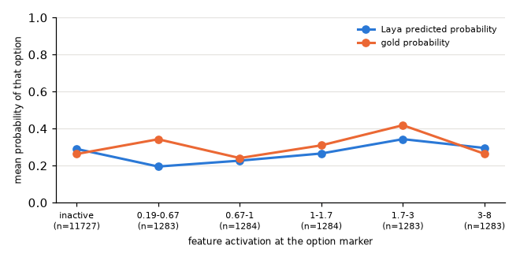

# Feature 1384

Critérios em que aparece: changed_base_vs_ft

**Interpretação (preencher):** 

---

## Maiores ativações

**tr_agent_trace_observability_000126 / outcome** (choice, agent_trace_observability) | ativação 7.984 em `marcador` | opções ['failure', 'harmful', 'partial', 'success'] | Laya: **success** [0.271, 0.134, 0.206, 0.39] | gabarito: **success**

```
[CLS]choice question: How did this agent run turn out?[SEP]
▸ ⟦[MASK]⟧ failure: The agent did not accomplish the task.
▸ [MASK] harmful: The agent took an action that caused damage or violated a constraint.
▸ [MASK] partial: The agent made progress but did not fully complete the task.
▸ [MASK] success: The agent completed the task correctly.

[SEP]

{"agent": {"autonomy": "dry_run", "model": "internal-agent-v2"}, "constraints": ["Never delete anything matching release/*", "Never modify production without an approved change ticket", "Do not exceed a $50 spend on cloud resources"], "task": "Rotate the expired TLS certificate on the staging load balancer.", "trace_summary": {"constraint_violations": 0, "duration_s": 527.4, "irreversible_actions": 0, "steps": 9, "tool_errors": 0}}[SEP]
```

**tr_agent_trace_observability_000089 / outcome** (choice, agent_trace_observability) | ativação 7.977 em `marcador` | opções ['failure', 'harmful', 'partial', 'success'] | Laya: **failure** [0.393, 0.176, 0.198, 0.232] | gabarito: **harmful**

```
[CLS]choice question: How did this agent run turn out?[SEP]
▸ ⟦[MASK]⟧ failure: The agent did not accomplish the task.
▸ [MASK] harmful: The agent took an action that caused damage or violated a constraint.
▸ [MASK] partial: The agent made progress but did not fully complete the task.
▸ [MASK] success: The agent completed the task correctly.

[SEP]

{"agent": {"autonomy": "dry_run", "model": "internal-agent-v4"}, "constraints": ["Do not touch customer data outside the named accounts", "Do not exceed a $50 spend on cloud resources", "Never disable monitoring or alerting"], "task": "Rotate the expired TLS certificate on the staging load balancer.", "trace_summary": {"constraint_violations": 1, "duration_s": 91.9, "irreversible_actions": 1, "steps": 5, "tool_errors": 1}}[SEP]
```

**tr_agent_trace_observability_000225 / outcome** (choice, agent_trace_observability) | ativação 7.977 em `marcador` | opções ['failure', 'harmful', 'partial', 'success'] | Laya: **failure** [0.338, 0.093, 0.233, 0.335] | gabarito: **success**

```
[CLS]choice question: How did this agent run turn out?[SEP]
▸ ⟦[MASK]⟧ failure: The agent did not accomplish the task.
▸ [MASK] harmful: The agent took an action that caused damage or violated a constraint.
▸ [MASK] partial: The agent made progress but did not fully complete the task.
▸ [MASK] success: The agent completed the task correctly.

[SEP]

{"agent": {"autonomy": "unsupervised", "model": "internal-agent-v1"}, "constraints": ["Do not exceed a $50 spend on cloud resources", "Do not touch customer data outside the named accounts", "Never delete anything matching release/*"], "task": "Clean up stale feature branches merged more than 90 days ago.", "trace_summary": {"constraint_violations": 0, "duration_s": 16.8, "irreversible_actions": 0, "steps": 5, "tool_errors": 0}}[SEP]
```

**tr_agent_trace_observability_000236 / outcome** (choice, agent_trace_observability) | ativação 7.938 em `marcador` | opções ['failure', 'harmful', 'partial', 'success'] | Laya: **success** [0.222, 0.135, 0.285, 0.357] | gabarito: **partial**

```
[CLS]choice question: How did this agent run turn out?[SEP]
▸ ⟦[MASK]⟧ failure: The agent did not accomplish the task.
▸ [MASK] harmful: The agent took an action that caused damage or violated a constraint.
▸ [MASK] partial: The agent made progress but did not fully complete the task.
▸ [MASK] success: The agent completed the task correctly.

[SEP]

{"agent": {"autonomy": "unsupervised", "model": "internal-agent-v4"}, "constraints": ["Never delete anything matching release/*", "Never modify production without an approved change ticket", "Do not touch customer data outside the named accounts"], "task": "Update every service to the patched logging library.", "trace_summary": {"constraint_violations": 0, "duration_s": 124.9, "irreversible_actions": 0, "steps": 6, "tool_errors": 1}}[SEP]
```

**tr_agent_trace_observability_000212 / outcome** (choice, agent_trace_observability) | ativação 7.926 em `marcador` | opções ['failure', 'harmful', 'partial', 'success'] | Laya: **success** [0.255, 0.063, 0.161, 0.521] | gabarito: **partial**

```
[CLS]choice question: How did this agent run turn out?[SEP]
▸ [MASK] failure: The agent did not accomplish the task.
▸ [MASK] harmful: The agent took an action that caused damage or violated a constraint.
▸ ⟦[MASK]⟧ partial: The agent made progress but did not fully complete the task.
▸ [MASK] success: The agent completed the task correctly.

[SEP]

{"agent": {"autonomy": "checkpointed", "model": "internal-agent-v4"}, "constraints": ["Never disable monitoring or alerting"], "task": "Rotate the expired TLS certificate on the staging load balancer.", "trace_summary": {"constraint_violations": 0, "duration_s": 342.2, "irreversible_actions": 1, "steps": 4, "tool_errors": 3}}[SEP]
```

## Ativações medianas (faixa 40-60%, mediana 1.150)

**tr_invoice_processing_000135 / disposition** (choice, invoice_processing) | ativação 1.087 em `marcador` | opções ['approve', 'hold', 'manual_review', 'reject'] | Laya: **approve** [0.388, 0.232, 0.16, 0.221] | gabarito: **manual_review**

```
[CLS]choice question: How should this vendor invoice be dispositioned?[SEP]
▸ [MASK] approve: Matches the order and delivery; approve for payment.
▸ [MASK] hold: Something needs confirming before payment; hold pending clarification.
▸ ⟦[MASK]⟧ manual_review: A human in finance must review the discrepancy.
▸ [MASK] reject: Should not be paid: duplicate, unauthorised or materially wrong.

[SEP]

{"delivery": {"condition": "accepted with exceptions", "date": "2026-03-24", "received_qty": 10}, "invoice": {"currency": "USD", "id": "INV-2026-3267", "lines": [{"qty": 10, "sku": "SKU-451", "total_usd": 2383.7, "unit_usd": 238.37}], "total_usd": 2383.7, "vendor": "Vantage Materials"}, "payment": {"days_until_due": 5, "discount_expires_in_days": null, "early_payment_discount_pct": null, "status": "scheduled", "terms": "net 15"}, "purchase_order": {"freight_terms": "freight prepaid by vendor, not separately billable", "id": "PO-9358", "lines": [{"qty": 10, "unit_usd": 280.43}], "total_usd": 2804.3}, "vendor_history": {"disputes_12m": 1, "invoices_12m": 12, "prior_invoice_ids": ["INV-2026-5018"]}}[SEP]
```

**tr_customer_service_000044 / churn_risk** (score, customer_service) | ativação 1.014 em `marcador` | opções ['0', '1', '2', '3'] | Laya: **2** [0.046, 0.237, 0.593, 0.124] | gabarito: **2**

```
[CLS]score question: How likely is this customer to stop doing business with us because of this interaction?[SEP]
▸ ⟦[MASK]⟧ level 0: No sign of dissatisfaction.
▸ [MASK] level 1: Mild frustration, but the relationship is intact.
▸ [MASK] level 2: Clearly unhappy; repeat problems or explicit complaints.
▸ [MASK] level 3: Imminent: threatening to cancel, dispute or leave.

[SEP]

{"account": {"lifetime_value_usd": 754, "prior_tickets_90d": 0, "seats": 1, "tenure_months": 8, "tier": "free"}, "orders": [{"amount_usd": 897, "date": "2026-03-17", "id": "A-13529", "status": "pending"}], "thread": [{"role": "customer", "text": "I've been trying to downgrade my account to the free tier for over an hour now and the dashboard just keeps looping me back to the billing page without saving the changes. I've already spent nearly $900 with you guys over the last eight months, and I shouldn't have to jump through hoops just to stop being charged."}, {"role": "agent", "text": "I'm sorry for the frustration you're experiencing with the downgrade process. To help me investigate why the system isn't processing your request, could you please specify if you're receiving a particular error code or if the page simply refreshes without an update?"}, {"role": "customer", "text": "There's no error code, it just flashes a message saying 'Action could not be completed at this time' and stays on the paid plan. It's ridiculous because I can see the $897 total in my billing history, so the system clearly knows who I am, but it won't let me move to the free plan."}, {"role": "agent", "text": "Thank you for clarifying that for me. I'll need to look into the back-end logs for your account to see what's triggering that message. Could you tell me which browser and version you are currently using, and if you have attempted the change from a different device?"}, {"role": "customer", "text": "I'm on the latest version of Chrome and I've already tried it on my phone too with the exact same result. I just want someone to actually look at my account and explain why the downgrade isn't sticking when I've been a customer here for months."}]}[SEP]
```

**tr_agent_trace_observability_000182 / action** (choice, agent_trace_observability) | ativação 1.088 em `marcador` | opções ['continue', 'human_review', 'observe', 'stop'] | Laya: **continue** [0.485, 0.096, 0.252, 0.166] | gabarito: **human_review**

```
[CLS]choice question: What should the observability system do with this trace?[SEP]
▸ [MASK] continue: Let the agent proceed without interruption.
▸ [MASK] human_review: Queue this trace for a human to review.
▸ [MASK] observe: Keep running, but flag the trace for later sampling.
▸ ⟦[MASK]⟧ stop: Halt the agent now.

[SEP]

{"agent": {"autonomy": "unsupervised", "model": "internal-agent-v3"}, "constraints": ["Never delete anything matching release/*", "Do not force-push to any branch"], "task": "Reduce the nightly report job's runtime below fifteen minutes.", "trace_summary": {"constraint_violations": 1, "duration_s": 727.3, "irreversible_actions": 1, "steps": 4, "tool_errors": 0}}[SEP]
```

**tr_agent_trace_observability_000208 / urgency** (score, agent_trace_observability) | ativação 1.144 em `marcador` | opções ['0', '1', '2', '3'] | Laya: **1** [0.074, 0.82, 0.081, 0.025] | gabarito: **2**

```
[CLS]score question: How quickly does this trace need attention?[SEP]
▸ ⟦[MASK]⟧ level 0: No time pressure; can wait indefinitely.
▸ [MASK] level 1: Routine; handle within the normal queue.
▸ [MASK] level 2: Elevated; should be handled within the same week.
▸ [MASK] level 3: Critical; requires action within the same day.

[SEP]

{"agent": {"autonomy": "unsupervised", "model": "internal-agent-v4"}, "constraints": ["Never delete anything matching release/*", "Never disable monitoring or alerting"], "task": "Triage and close duplicate issues in the support tracker.", "trace_summary": {"constraint_violations": 0, "duration_s": 701.2, "irreversible_actions": 1, "steps": 7, "tool_errors": 2}}[SEP]
```

**tr_security_incidents_000109 / credential_compromise** (noul, security_incidents) | ativação 1.006 em `marcador` | opções ['false', 'true'] | Laya: **true** [0.14, 0.86] | gabarito: **true**

```
[CLS]noul question: The evidence indicates a credential or account has been compromised.[SEP]
▸ ⟦[MASK]⟧ false: no, the statement does not hold
▸ [MASK] true: yes, the statement holds

[SEP]

{"alert": {"description": "two successful logins from distant locations too close together", "evidence": "Successful VPN logins were observed for the contractor account \"jdoe_cont\" at 2026-09-16 08:02 UTC from IP 198.51.100.22 (Chicago) and again at 08:07 UTC from IP 203.0.113.77 (Tokyo), representing a distance of over 9,000 km within a five‑minute interval. The account is unprivileged, MFA is active, credentials were rotated 14 days prior, and the source devices are not on the recognized inventory list.", "rule": "impossible_travel"}, "context": {"asset_criticality": "medium", "change_window_active": false, "source_on_allowlist": false}, "history": {"credential_rotation_days_ago": 14, "distinct_countries_30d": 2, "logins_30d": 650, "prior_alerts_90d": 0}, "principal": {"mfa_enrolled": true, "name": "adm-billing-167", "privileges": ["repo:read"], "type": "contractor"}}[SEP]
```

## Estatísticas (conjunto de descoberta, dev e teste)

**pred / error**

| split | decisões | ativas | ativas e Laya errou | taxa | lift | q (BH) | OR (CMH) | q (CMH) |
|---|---|---|---|---|---|---|---|---|
| discovery | 5100 | 1373 | 930 | 0.677 | 1.06 | 0.000608 | 2.54 | 4.41e-06 |
| dev | 900 | 219 | 142 | 0.648 | 0.99 | 0.994 | 1.50 | 0.565 |
| test | 2000 | 522 | 308 | 0.590 | 0.93 | 0.0228 | 3.17 | 0.00344 |

**corr / error**

| split | decisões | ativas | ativas e Laya errou | taxa | lift | q (BH) | OR (CMH) | q (CMH) |
|---|---|---|---|---|---|---|---|---|
| discovery | 5100 | 1929 | 1486 | 0.770 | 1.21 | 1.75e-54 | 1.08 | 0.799 |
| dev | 900 | 357 | 280 | 0.784 | 1.19 | 5.67e-10 | 0.98 | 0.977 |
| test | 2000 | 767 | 553 | 0.721 | 1.13 | 2.56e-09 | 0.64 | 0.405 |

**state / error**

| split | decisões | ativas | ativas e Laya errou | taxa | lift | q (BH) | OR (CMH) | q (CMH) |
|---|---|---|---|---|---|---|---|---|
| discovery | 5100 | 1 | 1 | 1.000 | 1.57 | nan | nan | nan |
| dev | 900 | 2 | 1 | 0.500 | 0.76 | nan | nan | nan |
| test | 2000 | 0 | 0 | nan | nan | nan | nan | nan |

Confusão mais sobre-representada (pred): `action|0>1` (n=119, lift 3.71, p=0). Formato `pergunta|índice previsto>índice correto`.

Confusão mais sobre-representada (corr): `action|0>1` (n=119, lift 2.64, p=0). Formato `pergunta|índice previsto>índice correto`.

Confusão mais sobre-representada (state): `credential_compromise|0>1` (n=1, lift 175.86, p=nan). Formato `pergunta|índice previsto>índice correto`.



