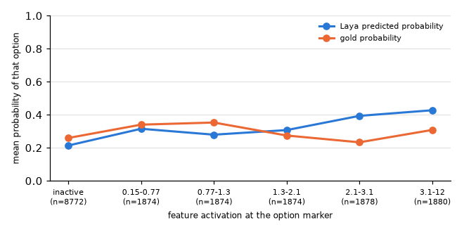

# Feature 2786

Critérios em que aparece: changed_base_vs_ft

**Interpretação (preencher):** 

---

## Maiores ativações

**tr_customer_service_000282 / category** (choice, customer_service) | ativação 11.625 em `marcador` | opções ['account', 'billing', 'delivery', 'refund', 'technical'] | Laya: **refund** [0.006, 0.015, 0.005, 0.963, 0.01] | gabarito: **refund**

```
[CLS]choice question: What is this customer conversation primarily about?[SEP]
▸ [MASK] account: Login, plan changes, profile or access management.
▸ [MASK] billing: A charge, invoice, subscription or payment problem.
▸ [MASK] delivery: Shipping, fulfilment or delivery of a physical item.
▸ ⟦[MASK]⟧ refund: The customer is explicitly asking for money back.
▸ [MASK] technical: The product or service is not working as expected.

[SEP]

{"account": {"lifetime_value_usd": 53, "prior_tickets_90d": 0, "seats": 3, "tenure_months": 1, "tier": "premium"}, "thread": [{"role": "customer", "text": "I've been waiting for my refund to hit my account for days now and there's still nothing showing up. I signed up for the Premium plan last month and it's been nothing but a headache."}, {"role": "agent", "text": "I understand how concerning it is when expected funds don't appear. Could you please confirm the date you initially requested the transaction reversal?"}, {"role": "customer", "text": "I did it last Tuesday! It's ridiculous that I'm even having to ask about this because the confirmation email said it was processed immediately."}, {"role": "agent", "text": "Thank you for that information. To help me look into the status on our end, are you able to provide the transaction ID from that confirmation email?"}, {"role": "customer", "text": "I'm looking for it now, but I shouldn't have to jump through hoops just to get my money back from a service I barely used for four weeks."}]}[SEP]
```

**tr_customer_service_000250 / category** (choice, customer_service) | ativação 11.594 em `marcador` | opções ['account', 'billing', 'delivery', 'refund', 'technical'] | Laya: **billing** [0.006, 0.969, 0.006, 0.012, 0.007] | gabarito: **billing**

```
[CLS]choice question: What is this customer conversation primarily about?[SEP]
▸ [MASK] account: Login, plan changes, profile or access management.
▸ ⟦[MASK]⟧ billing: A charge, invoice, subscription or payment problem.
▸ [MASK] delivery: Shipping, fulfilment or delivery of a physical item.
▸ [MASK] refund: The customer is explicitly asking for money back.
▸ [MASK] technical: The product or service is not working as expected.

[SEP]

{"account": {"lifetime_value_usd": 145, "prior_tickets_90d": 0, "seats": 1, "tenure_months": 2, "tier": "standard"}, "thread": [{"role": "customer", "text": "Could you please send me a copy of my latest invoice? Thank you!"}]}[SEP]
```

**tr_customer_service_000030 / category** (choice, customer_service) | ativação 11.133 em `marcador` | opções ['account', 'billing', 'delivery', 'refund', 'technical'] | Laya: **billing** [0.011, 0.931, 0.006, 0.027, 0.025] | gabarito: **billing**

```
[CLS]choice question: What is this customer conversation primarily about?[SEP]
▸ [MASK] account: Login, plan changes, profile or access management.
▸ ⟦[MASK]⟧ billing: A charge, invoice, subscription or payment problem.
▸ [MASK] delivery: Shipping, fulfilment or delivery of a physical item.
▸ [MASK] refund: The customer is explicitly asking for money back.
▸ [MASK] technical: The product or service is not working as expected.

[SEP]

{"account": {"lifetime_value_usd": 5295, "prior_tickets_90d": 1, "seats": 1, "tenure_months": 72, "tier": "premium"}, "thread": [{"role": "customer", "text": "Hello, I’ve been a loyal subscriber for six years now, but I’ve just noticed an unexpected change in my premium plan billing. I really need to get this sorted out before the end of the business day today, if possible."}, {"role": "agent", "text": "I see you’ve been with us for quite a while, and I understand you’re looking into an unexpected charge on your account. Could you please provide the billing date and the specific invoice number you are referencing?"}, {"role": "customer", "text": "Thank you for looking into this. The invoice number is #99283 and the date is from this morning. It seems higher than the usual amount for the premium tier; I just need to understand why this fluctuation occurred before my deadline arrives."}]}[SEP]
```

**tr_customer_service_000245 / category** (choice, customer_service) | ativação 10.891 em `marcador` | opções ['account', 'billing', 'delivery', 'refund', 'technical'] | Laya: **account** [0.9, 0.014, 0.008, 0.024, 0.053] | gabarito: **account**

```
[CLS]choice question: What is this customer conversation primarily about?[SEP]
▸ ⟦[MASK]⟧ account: Login, plan changes, profile or access management.
▸ [MASK] billing: A charge, invoice, subscription or payment problem.
▸ [MASK] delivery: Shipping, fulfilment or delivery of a physical item.
▸ [MASK] refund: The customer is explicitly asking for money back.
▸ [MASK] technical: The product or service is not working as expected.

[SEP]

{"account": {"lifetime_value_usd": 1250, "prior_tickets_90d": 0, "seats": 1, "tenure_months": 14, "tier": "enterprise"}, "thread": [{"role": "customer", "text": "I'm a bit lost—I've been trying to log into our enterprise portal for the last twenty minutes but it keeps saying my credentials aren't recognized. I haven't changed anything since yesterday, and I'm not seeing any emails about account updates even though I've used this login for over a year. Is there something special I need to do to get back in?"}]}[SEP]
```

**tr_customer_service_000197 / category** (choice, customer_service) | ativação 10.844 em `marcador` | opções ['account', 'billing', 'delivery', 'refund', 'technical'] | Laya: **delivery** [0.003, 0.003, 0.983, 0.004, 0.007] | gabarito: **delivery**

```
[CLS]choice question: What is this customer conversation primarily about?[SEP]
▸ [MASK] account: Login, plan changes, profile or access management.
▸ [MASK] billing: A charge, invoice, subscription or payment problem.
▸ ⟦[MASK]⟧ delivery: Shipping, fulfilment or delivery of a physical item.
▸ [MASK] refund: The customer is explicitly asking for money back.
▸ [MASK] technical: The product or service is not working as expected.

[SEP]

{"account": {"lifetime_value_usd": 1409, "prior_tickets_90d": 2, "seats": 1, "tenure_months": 49, "tier": "free"}, "thread": [{"role": "customer", "text": "I’ve been with you for over four years now, but I’m really lost as to why my delivery hasn't arrived yet. I've reached out twice before and was told it was on the way, but nothing ever shows up. It’s making it very hard to justify staying if this keeps happening."}]}[SEP]
```

## Ativações medianas (faixa 40-60%, mediana 0.983)

**tr_security_incidents_000013 / severity** (score, security_incidents) | ativação 0.890 em `estado` | opções ['0', '1', '2', '3', '4'] | Laya: **2** [0.063, 0.414, 0.43, 0.061, 0.032] | gabarito: **2**

```
[CLS]score question: How severe is the potential impact if this alert is real?[SEP]
▸ [MASK] level 0: Negligible: no access to anything sensitive.
▸ [MASK] level 1: Low: limited access, easily reversed.
▸ [MASK] level 2: Moderate: access to internal systems or non-public data.
▸ [MASK] level 3: High: access to production, secrets or customer data.
▸ [MASK] level 4: Critical: active compromise of crown-jewel systems.

[SEP]

{"alert": {"description": "audit logging was turned off on a host", "evidence⟦":⟧ "Audit logging was disabled on host WIN-DB01 (IP 10.2.5.23) at 2026-09-16T08:45:00Z by user \"jdoe_admin\". The user role is classified as unprivileged admin with MFA enabled, and the password for this account was last changed 14 days prior. No approved change window was active at the time of the event.", "rule": "disabled_logging"}, "context": {"asset_criticality": "medium", "change_window_active": false, "source_on_allowlist": false}, "history": {"credential_rotation_days_ago": 14, "distinct_countries_30d": 1, "logins_30d": 1970, "prior_alerts_90d": 0}, "principal": {"mfa_enrolled": true, "name": "ci-analytics-642", "privileges": ["repo:read"], "type": "admin"}}[SEP]
```

**tr_security_incidents_000132 / true_positive** (noul, security_incidents) | ativação 0.961 em `opção` | opções ['false', 'true'] | Laya: **false** [0.652, 0.348] | gabarito: **false**

```
[CLS]noul question: This alert reflects genuinely malicious or unauthorised activity.[SEP]
▸ [MASK]⟦ false⟧: Benign activity, a misconfiguration, or a known false positive.
▸ [MASK] true: The underlying behaviour is malicious or unauthorised.

[SEP]

{"alert": {"description": "a security group was opened to the public internet", "evidence": "At 2026-09-15 03:12 UTC, security group sg-0a1b2c3d4e was altered to include an inbound rule allowing 0.0.0.0/0 on TCP port 22. The change was performed by employee jdoe@example.com, a privileged account with MFA enabled, during an open change window. The source IP (203.0.113.45) is not on the trusted list and the account's credentials were last rotated 14 days prior.", "rule": "config_drift"}, "context": {"asset_criticality": "low", "change_window_active": true, "source_on_allowlist": false}, "history": {"credential_rotation_days_ago": 14, "distinct_countries_30d": 3, "logins_30d": 1115, "prior_alerts_90d": 0}, "principal": {"mfa_enrolled": true, "name": "usr-analytics-746", "privileges": ["deploy:production", "secrets:read"], "type": "employee"}}[SEP]
```

**tr_customer_service_000120 / churn_risk** (score, customer_service) | ativação 1.013 em `estado` | opções ['0', '1', '2', '3'] | Laya: **2** [0.12, 0.234, 0.474, 0.172] | gabarito: **2**

```
[CLS]score question: How likely is this customer to stop doing business with us because of this interaction?[SEP]
▸ [MASK] level 0: No sign of dissatisfaction.
▸ [MASK] level 1: Mild frustration, but the relationship is intact.
▸ [MASK] level 2: Clearly unhappy; repeat problems or explicit complaints.
▸ [MASK] level 3: Imminent: threatening to cancel, dispute or leave.

[SEP]

{"account": {"lifetime_value_usd": 683, "prior_tickets_90d": 2, "seats": 1, "tenure_months": 8, "tier": "premium"}, "orders": [{"amount_usd": 29, "date": "2026-03-13", "id": "A-34569", "status": "pending"}, {"amount_usd": 29, "date": "2026-02-22", "id": "A-11297", "status": "refunded"}, {"amount_usd": 29, "date": "2026-01-21", "id": "A-20004", "status": "failed"}], "thread": [{"role": "customer", "text": "I am trying to remove two seats from my Premium plan, but the dashboard still shows them as active and billable for the next cycle. I've been a customer for eight months⟦ and⟧ this is the third time I've had to report this exact issue with the $29 per seat charge."}, {"role": "agent", "text": "I can certainly look into those seat settings for you. To clarify, are these seats currently assigned to specific users, or are they currently vacant in your dashboard?"}, {"role": "customer", "text": "They are vacant. I unassigned the users last week, but the total seat count refuses to decrease when I try to update the subscription preferences."}, {"role": "agent", "text": "Thank you for that detail. When you attempt to reduce the count, are you receiving a specific error message, or does the page simply refresh without saving the changes?"}, {"role": "customer", "text": "The page just refreshes. I've already had two tickets about this in the past that were resolved temporarily, but the bug seems to have returned."}, {"role": "agent", "text": "I see the history here in your account. Could you please provide a screenshot of the billing page as it appears now so I can verify the current seat allocation against our backend records?"}, {"role": "customer", "text": "I'll attach the screenshot now. I just need to ensure I am not billed for these two extra seats again because I shouldn't be paying for capacity I'm not using."}]}[SEP]
```

**tr_security_incidents_000236 / severity** (score, security_incidents) | ativação 1.138 em `estado` | opções ['0', '1', '2', '3', '4'] | Laya: **2** [0.06, 0.282, 0.398, 0.217, 0.042] | gabarito: **3**

```
[CLS]score question: How severe is the potential impact if this alert is real?[SEP]
▸ [MASK] level 0: Negligible: no access to anything sensitive.
▸ [MASK] level 1: Low: limited access, easily reversed.
▸ [MASK] level 2: Moderate: access to internal systems or non-public data.
▸ [MASK] level 3: High: access to production, secrets or customer data.
▸ [MASK] level 4: Critical: active compromise of crown-jewel systems.

[SEP]

{"alert": {"description": "a long-unused account became active", "evidence⟦":⟧ "The privileged admin_01 account, which had shown no activity for 120 consecutive days, successfully authenticated from allowlisted IP 10.0.4.55 at 02:00 AM. This session was established with MFA enabled and used credentials rotated 30 days ago, though no change tickets were active at the time.", "rule": "dormant_account_use"}, "context": {"asset_criticality": "medium", "change_window_active": false, "source_on_allowlist": true}, "history": {"credential_rotation_days_ago": 30, "distinct_countries_30d": 3, "logins_30d": 15, "prior_alerts_90d": 0}, "principal": {"mfa_enrolled": true, "name": "ci-infra-266", "privileges": ["deploy:production", "secrets:read"], "type": "admin"}}[SEP]
```

**tr_invoice_processing_000136 / urgency** (score, invoice_processing) | ativação 1.085 em `opção` | opções ['0', '1', '2', '3'] | Laya: **1** [0.217, 0.543, 0.16, 0.08] | gabarito: **1**

```
[CLS]score question: How time-sensitive is processing this invoice?[SEP]
▸ [MASK] level 0⟦:⟧ No time pressure; can wait indefinitely.
▸ [MASK] level 1: Routine; handle within the normal queue.
▸ [MASK] level 2: Elevated; should be handled within the same week.
▸ [MASK] level 3: Critical; requires action within the same day.

[SEP]

{"delivery": {"condition": "accepted", "date": "2026-03-19", "received_qty": 50}, "invoice": {"currency": "USD", "id": "INV-2026-9170", "lines": [{"qty": 50, "sku": "SKU-755", "total_usd": 7740.5, "unit_usd": 154.81}], "total_usd": 7740.5, "vendor": "Kestrel Supply"}, "payment": {"days_until_due": 27, "discount_expires_in_days": null, "early_payment_discount_pct": null, "status": "scheduled", "terms": "net 30"}, "purchase_order": {"freight_terms": "freight prepaid by vendor, not separately billable", "id": "PO-3211", "lines": [{"qty": 50, "unit_usd": 154.81}], "total_usd": 7740.5}, "vendor_history": {"disputes_12m": 0, "invoices_12m": 47, "prior_invoice_ids": ["INV-2026-9170"]}}[SEP]
```

## Estatísticas (conjunto de descoberta, dev e teste)

**pred / error**

| split | decisões | ativas | ativas e Laya errou | taxa | lift | q (BH) | OR (CMH) | q (CMH) |
|---|---|---|---|---|---|---|---|---|
| discovery | 5100 | 4037 | 2613 | 0.647 | 1.02 | 0.00397 | 0.72 | 0.0462 |
| dev | 900 | 694 | 452 | 0.651 | 0.99 | 0.845 | 0.72 | 0.843 |
| test | 2000 | 1570 | 1024 | 0.652 | 1.02 | 0.0178 | 0.85 | 0.826 |

**corr / error**

| split | decisões | ativas | ativas e Laya errou | taxa | lift | q (BH) | OR (CMH) | q (CMH) |
|---|---|---|---|---|---|---|---|---|
| discovery | 5100 | 2791 | 1367 | 0.490 | 0.77 | 6.28e-129 | 0.22 | 2.92e-30 |
| dev | 900 | 506 | 264 | 0.522 | 0.79 | 8e-21 | 0.14 | 3.84e-06 |
| test | 2000 | 1064 | 518 | 0.487 | 0.76 | 2.88e-49 | 0.14 | 3.09e-17 |

**state / error**

| split | decisões | ativas | ativas e Laya errou | taxa | lift | q (BH) | OR (CMH) | q (CMH) |
|---|---|---|---|---|---|---|---|---|
| discovery | 5100 | 5096 | 3242 | 0.636 | 1.00 | 1 | 0.24 | 0.496 |
| dev | 900 | 900 | 591 | 0.657 | 1.00 | 1 | nan | nan |
| test | 2000 | 1998 | 1273 | 0.637 | 1.00 | 1 | 2.98 | 0.668 |

Confusão mais sobre-representada (pred): `urgency|1>3` (n=291, lift 1.26, p=1.93e-29). Formato `pergunta|índice previsto>índice correto`.

Confusão mais sobre-representada (corr): `duplicate|1>0` (n=216, lift 1.83, p=0). Formato `pergunta|índice previsto>índice correto`.

Confusão mais sobre-representada (state): `urgency|1>3` (n=292, lift 1.00, p=0.79). Formato `pergunta|índice previsto>índice correto`.



