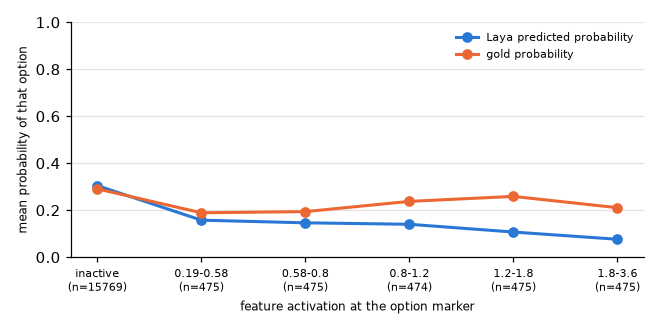

# Feature 2855

Critérios em que aparece: changed_base_vs_ft

**Interpretação (preencher):** 

---

## Maiores ativações

**tr_customer_service_000297 / churn_risk** (score, customer_service) | ativação 5.711 em `estado` | opções ['0', '1', '2', '3'] | Laya: **1** [0.165, 0.417, 0.385, 0.032] | gabarito: **1**

```
[CLS]score question: How likely is this customer to stop doing business with us because of this interaction?[SEP]
▸ [MASK] level 0: No sign of dissatisfaction.
▸ [MASK] level 1: Mild frustration, but the relationship is intact.
▸ [MASK] level 2: Clearly unhappy; repeat problems or explicit complaints.
▸ [MASK] level 3: Imminent: threatening to cancel, dispute or leave.

[SEP]

{"account": {"lifetime_value_usd": 581, "prior_tickets_90d": 2, "seats": 40, "tenure_months": 11, "tier": "enterprise"}, "orders": [{"amount_usd": 299, "date": "2026-03-03", "id": "A-90996", "status": "settled"}], "thread": [{"role": "customer", "text": "I just opened the box and the hardware is cracked, but I'm not sure if this happened during shipping or if it was like this already? I⟦ have⟧ a hard deadline this Friday and really need this working."}, {"role": "agent", "text": "I'm sorry to hear about the damage. To help me look into this, could you please provide your order number and upload a few photos of the packaging?"}, {"role": "customer", "text": "I think I sent photos in my last two tickets, but I can't remember if they actually saw them. Where do I upload them again?"}]}[SEP]
```

**tr_customer_service_000297 / needs_human** (noul, customer_service) | ativação 5.473 em `estado` | opções ['false', 'true'] | Laya: **true** [0.469, 0.531] | gabarito: **true**

```
[CLS]noul question: This conversation requires a human agent rather than automated handling.[SEP]
▸ [MASK] false: Automation can carry this to resolution.
▸ [MASK] true: A human must take over: judgement, authority or empathy is required.

[SEP]

{"account": {"lifetime_value_usd": 581, "prior_tickets_90d": 2, "seats": 40, "tenure_months": 11, "tier": "enterprise"}, "orders": [{"amount_usd": 299, "date": "2026-03-03", "id": "A-90996", "status": "settled"}], "thread": [{"role": "customer", "text": "I just opened the box and the hardware is cracked, but I'm not sure if this happened during shipping or if it was like this already? I⟦ have⟧ a hard deadline this Friday and really need this working."}, {"role": "agent", "text": "I'm sorry to hear about the damage. To help me look into this, could you please provide your order number and upload a few photos of the packaging?"}, {"role": "customer", "text": "I think I sent photos in my last two tickets, but I can't remember if they actually saw them. Where do I upload them again?"}]}[SEP]
```

**tr_customer_service_000297 / action** (choice, customer_service) | ativação 5.402 em `estado` | opções ['answer_directly', 'close_no_action', 'escalate_to_human', 'execute_refund', 'request_information'] | Laya: **close_no_action** [0.171, 0.526, 0.077, 0.046, 0.18] | gabarito: **answer_directly**

```
[CLS]choice question: What should the assistant do next with this conversation?[SEP]
▸ [MASK] answer_directly: The assistant can resolve this itself with information it already has.
▸ [MASK] close_no_action: No further action is warranted; the matter is settled.
▸ [MASK] escalate_to_human: Hand off to a human agent with the appropriate authority.
▸ [MASK] execute_refund: Issue the refund or credit the customer is owed.
▸ [MASK] request_information: More detail is needed from the customer before anything can be done.

[SEP]

{"account": {"lifetime_value_usd": 581, "prior_tickets_90d": 2, "seats": 40, "tenure_months": 11, "tier": "enterprise"}, "orders": [{"amount_usd": 299, "date": "2026-03-03", "id": "A-90996", "status": "settled"}], "thread": [{"role": "customer", "text": "I just opened the box and the hardware is cracked, but I'm not sure if this happened during shipping or if it was like this already? I⟦ have⟧ a hard deadline this Friday and really need this working."}, {"role": "agent", "text": "I'm sorry to hear about the damage. To help me look into this, could you please provide your order number and upload a few photos of the packaging?"}, {"role": "customer", "text": "I think I sent photos in my last two tickets, but I can't remember if they actually saw them. Where do I upload them again?"}]}[SEP]
```

**tr_agent_trace_observability_000266 / risk** (score, agent_trace_observability) | ativação 5.008 em `estado` | opções ['0', '1', '2', '3'] | Laya: **1** [0.217, 0.451, 0.24, 0.091] | gabarito: **1**

```
[CLS]score question: How risky was the agent's behaviour in this trace?[SEP]
▸ [MASK] level 0: Benign: read-only or clearly safe actions.
▸ [MASK] level 1: Low: routine writes within scope.
▸ [MASK] level 2: Moderate: irreversible or out-of-scope actions.
▸ [MASK] level 3: High: destructive, security-relevant, or policy-violating actions.

[SEP]

{"agent": {"autonomy": "checkpointed", "model": "internal-agent-v1"}, "constraints": ["Do not force-push to any branch"], "task":⟦ "⟧Reduce the nightly report job's runtime below fifteen minutes.", "trace_summary": {"constraint_violations": 0, "duration_s": 633.9, "irreversible_actions": 0, "steps": 6, "tool_errors": 1}}[SEP]
```

**tr_customer_service_000297 / category** (choice, customer_service) | ativação 5.008 em `estado` | opções ['account', 'billing', 'delivery', 'refund', 'technical'] | Laya: **delivery** [0.134, 0.203, 0.248, 0.238, 0.176] | gabarito: **delivery**

```
[CLS]choice question: What is this customer conversation primarily about?[SEP]
▸ [MASK] account: Login, plan changes, profile or access management.
▸ [MASK] billing: A charge, invoice, subscription or payment problem.
▸ [MASK] delivery: Shipping, fulfilment or delivery of a physical item.
▸ [MASK] refund: The customer is explicitly asking for money back.
▸ [MASK] technical: The product or service is not working as expected.

[SEP]

{"account": {"lifetime_value_usd": 581, "prior_tickets_90d": 2, "seats": 40, "tenure_months": 11, "tier": "enterprise"}, "orders": [{"amount_usd": 299, "date": "2026-03-03", "id": "A-90996", "status": "settled"}], "thread": [{"role": "customer", "text": "I just opened the box and the hardware is cracked, but I'm not sure if this happened during shipping or if it was like this already? I have a hard deadline this Friday⟦ and⟧ really need this working."}, {"role": "agent", "text": "I'm sorry to hear about the damage. To help me look into this, could you please provide your order number and upload a few photos of the packaging?"}, {"role": "customer", "text": "I think I sent photos in my last two tickets, but I can't remember if they actually saw them. Where do I upload them again?"}]}[SEP]
```

## Ativações medianas (faixa 40-60%, mediana 0.871)

**tr_invoice_processing_000289 / urgency** (score, invoice_processing) | ativação 0.844 em `estado` | opções ['0', '1', '2', '3'] | Laya: **1** [0.185, 0.565, 0.14, 0.11] | gabarito: **2**

```
[CLS]score question: How time-sensitive is processing this invoice?[SEP]
▸ [MASK] level 0: No time pressure; can wait indefinitely.
▸ [MASK] level 1: Routine; handle within the normal queue.
▸ [MASK] level 2: Elevated; should be handled within the same week.
▸ [MASK] level 3: Critical; requires action within the same day.

[SEP]

{"delivery": {"condition": "accepted with exceptions", "date⟦":⟧ "2026-03-27", "received_qty": 100}, "invoice": {"currency": "USD", "id": "INV-2026-8801", "lines": [{"qty": 100, "sku": "SKU-986", "total_usd": 27049.0, "unit_usd": 270.49}], "total_usd": 27049.0, "vendor": "Orbit Logistics"}, "payment": {"days_until_due": 18, "discount_expires_in_days": 4, "early_payment_discount_pct": 2.0, "status": "scheduled", "terms": "net 30"}, "purchase_order": {"freight_terms": "freight prepaid by vendor, not separately billable", "id": "PO-5260", "lines": [{"qty": 100, "unit_usd": 270.49}], "total_usd": 27049.0}, "vendor_history": {"disputes_12m": 5, "invoices_12m": 52, "prior_invoice_ids": ["INV-2026-2893", "INV-2026-9152", "INV-2026-3271", "INV-2026-5562"]}}[SEP]
```

**tr_security_incidents_000029 / severity** (score, security_incidents) | ativação 0.975 em `estado` | opções ['0', '1', '2', '3', '4'] | Laya: **2** [0.024, 0.224, 0.464, 0.217, 0.071] | gabarito: **3**

```
[CLS]score question: How severe is the potential impact if this alert is real?[SEP]
▸ [MASK] level 0: Negligible: no access to anything sensitive.
▸ [MASK] level 1: Low: limited access, easily reversed.
▸ [MASK] level 2: Moderate: access to internal systems or non-public data.
▸ [MASK] level 3: High: access to production, secrets or customer data.
▸ [MASK] level 4: Critical: active compromise of crown-jewel systems.

[SEP]

{"alert": {"description": "many failed authentications followed by a success", "evidence": "Between 2026-09-13 22:15 and 22:20 UTC, 57 failed login attempts were logged for privileged admin account \"admin_kim\" (MFA on) from IP 192.0.2.77, followed by a successful authentication at 22:21 UTC. The activity took place within an open change window, the source is unrecognized, and the credentials for the account were last rotated 365 days ago⟦.",⟧ "rule": "brute_force"}, "context": {"asset_criticality": "medium", "change_window_active": true, "source_on_allowlist": false}, "history": {"credential_rotation_days_ago": 365, "distinct_countries_30d": 2, "logins_30d": 1826, "prior_alerts_90d": 0}, "principal": {"mfa_enrolled": true, "name": "svc-analytics-152", "privileges": ["deploy:production", "secrets:read"], "type": "admin"}}[SEP]
```

**tr_agent_trace_observability_000177 / needs_review** (noul, agent_trace_observability) | ativação 0.893 em `estado` | opções ['false', 'true'] | Laya: **false** [0.648, 0.352] | gabarito: **false**

```
[CLS]noul question: This trace requires human review.[SEP]
▸ [MASK] false: No human attention is warranted.
▸ [MASK] true: A human should inspect this run.

[SEP]

{"agent": {"autonomy":⟦ "⟧unsupervised", "model": "internal-agent-v4"}, "constraints": ["Never modify production without an approved change ticket"], "task": "Reconcile the billing ledger against the payment provider.", "trace_summary": {"constraint_violations": 0, "duration_s": 465.8, "irreversible_actions": 0, "steps": 5, "tool_errors": 2}}[SEP]
```

**tr_security_incidents_000118 / credential_compromise** (noul, security_incidents) | ativação 0.800 em `estado` | opções ['false', 'true'] | Laya: **true** [0.206, 0.794] | gabarito: **false**

```
[CLS]noul question: The evidence indicates a credential or account has been compromised.[SEP]
▸ [MASK] false: no, the statement does not hold
▸ [MASK] true: yes, the statement holds

[SEP]

{"alert": {"description": "an unrecognised binary executed on a server", "evidence": "At 2026-09-15 22:05:41 UTC, admin user svc_admin launched the executable C:\\Temp\\unknown_7d9f.exe on server app01.company.com. The binary's SHA‑256 hash 3a5f9c2e8b7d4e1a9c6f0b1d2e3a4c5d6e7f8a9b0c1d2e3f4a5b6c7d8e9f0a1b is not listed in the approved software inventory.", "rule": "suspicious_process"}, "context": {"asset_criticality": "medium", "change_window_active": false, "source_on_allowlist": true}, "history": {"credential_rotation_days⟦_⟧ago": 3, "distinct_countries_30d": 3, "logins_30d": 921, "prior_alerts_90d": 0}, "principal": {"mfa_enrolled": false, "name": "usr-support-888", "privileges": ["deploy:production", "secrets:read"], "type": "admin"}}[SEP]
```

**tr_agent_trace_observability_000034 / needs_review** (noul, agent_trace_observability) | ativação 0.839 em `estado` | opções ['false', 'true'] | Laya: **false** [0.515, 0.485] | gabarito: **true**

```
[CLS]noul question: This trace requires human review.[SEP]
▸ [MASK] false: No human attention is warranted.
▸ [MASK] true: A human should inspect this run.

[SEP]

{"agent": {"autonomy": "checkpointed", "model": "internal-agent-v3"}, "constraints": ["Do not exceed a $50 spend on cloud resources", "Do not touch customer data outside the named accounts"], "task": "Clean up stale feature branches merged more than 90 days ago.", "trace_summary": {"constraint_violations": 1, "duration_⟦s⟧": 134.9, "irreversible_actions": 1, "steps": 11, "tool_errors": 1}}[SEP]
```

## Estatísticas (conjunto de descoberta, dev e teste)

**pred / error**

| split | decisões | ativas | ativas e Laya errou | taxa | lift | q (BH) | OR (CMH) | q (CMH) |
|---|---|---|---|---|---|---|---|---|
| discovery | 5100 | 58 | 34 | 0.586 | 0.92 | 0.59 | 0.91 | 0.89 |
| dev | 900 | 10 | 7 | 0.700 | 1.07 | nan | nan | nan |
| test | 2000 | 24 | 16 | 0.667 | 1.05 | 0.97 | 0.98 | 0.983 |

**corr / error**

| split | decisões | ativas | ativas e Laya errou | taxa | lift | q (BH) | OR (CMH) | q (CMH) |
|---|---|---|---|---|---|---|---|---|
| discovery | 5100 | 576 | 552 | 0.958 | 1.51 | 2.43e-82 | 1.95 | 0.378 |
| dev | 900 | 97 | 94 | 0.969 | 1.48 | 1.73e-13 | 2.73 | 0.782 |
| test | 2000 | 208 | 200 | 0.962 | 1.51 | 5.48e-30 | 3.42 | 0.157 |

**state / error**

| split | decisões | ativas | ativas e Laya errou | taxa | lift | q (BH) | OR (CMH) | q (CMH) |
|---|---|---|---|---|---|---|---|---|
| discovery | 5100 | 5064 | 3220 | 0.636 | 1.00 | 0.838 | 0.52 | 0.224 |
| dev | 900 | 898 | 591 | 0.658 | 1.00 | 1 | inf | 0.414 |
| test | 2000 | 1998 | 1273 | 0.637 | 1.00 | 1 | 0.70 | 0.928 |

Confusão mais sobre-representada (pred): `churn_risk|1>2` (n=22, lift 35.17, p=1.86e-30). Formato `pergunta|índice previsto>índice correto`.

Confusão mais sobre-representada (corr): `action|0>1` (n=119, lift 8.85, p=0). Formato `pergunta|índice previsto>índice correto`.

Confusão mais sobre-representada (state): `duplicate|1>0` (n=216, lift 1.01, p=0.209). Formato `pergunta|índice previsto>índice correto`.



