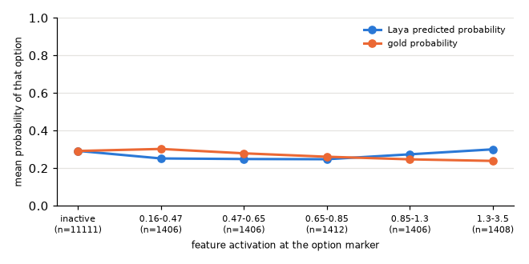

# Feature 4741

Critérios em que aparece: changed_base_vs_ft

**Interpretação (preencher):** 

---

## Maiores ativações

**tr_customer_service_000154 / category** (choice, customer_service) | ativação 4.445 em `estado` | opções ['account', 'billing', 'delivery', 'refund', 'technical'] | Laya: **refund** [0.179, 0.122, 0.04, 0.442, 0.217] | gabarito: **technical**

```
[CLS]choice question: What is this customer conversation primarily about?[SEP]
▸ [MASK] account: Login, plan changes, profile or access management.
▸ [MASK] billing: A charge, invoice, subscription or payment problem.
▸ [MASK] delivery: Shipping, fulfilment or delivery of a physical item.
▸ [MASK] refund: The customer is explicitly asking for money back.
▸ [MASK] technical: The product or service is not working as expected.

[SEP]

{"account": {"lifetime_value_usd": 1803, "prior_tickets_90d": 0, "seats": 1, "tenure_months": 19, "tier": "free"}, "orders": [{"amount_usd": 198, "date": "2026-02-24", "id": "A-56491", "status": "refunded"}, {"amount_usd": 198, "date": "2026-02-25", "id": "A-17184", "status": "settled"}], "thread": [{"role": "customer", "text": "My attempt to upload a PDF to the project folder keeps timing out after a few seconds."}, {"role": "agent", "text": "Understood. Are you seeing any error messages, or does the process simply stop?"}, {"role": "customer", "text": "It just stops; the spinner spins forever, no error text appears."}, {"role": "agent", "text": "Thanks for clarifying. Have you tried clearing your browser cache⟦ or⟧ using a different browser?"}, {"role": "customer", "text": "I tried Chrome incognito and it behaved the same way."}]}[SEP]
```

**tr_customer_service_000154 / action** (choice, customer_service) | ativação 4.375 em `estado` | opções ['answer_directly', 'close_no_action', 'escalate_to_human', 'execute_refund', 'request_information'] | Laya: **close_no_action** [0.272, 0.312, 0.1, 0.162, 0.153] | gabarito: **request_information**

```
[CLS]choice question: What should the assistant do next with this conversation?[SEP]
▸ [MASK] answer_directly: The assistant can resolve this itself with information it already has.
▸ [MASK] close_no_action: No further action is warranted; the matter is settled.
▸ [MASK] escalate_to_human: Hand off to a human agent with the appropriate authority.
▸ [MASK] execute_refund: Issue the refund or credit the customer is owed.
▸ [MASK] request_information: More detail is needed from the customer before anything can be done.

[SEP]

{"account": {"lifetime_value_usd": 1803, "prior_tickets_90d": 0, "seats": 1, "tenure_months": 19, "tier": "free"}, "orders": [{"amount_usd": 198, "date": "2026-02-24", "id": "A-56491", "status": "refunded"}, {"amount_usd": 198, "date": "2026-02-25", "id": "A-17184", "status": "settled"}], "thread": [{"role": "customer", "text": "My attempt to upload a PDF to the project folder keeps timing out after a few seconds."}, {"role": "agent", "text": "Understood. Are you seeing any error messages, or does the process simply stop?"}, {"role": "customer", "text": "It just stops; the spinner spins forever, no error text appears."}, {"role": "agent", "text": "Thanks for clarifying. Have you tried clearing your browser cache⟦ or⟧ using a different browser?"}, {"role": "customer", "text": "I tried Chrome incognito and it behaved the same way."}]}[SEP]
```

**tr_customer_service_000154 / urgency** (score, customer_service) | ativação 4.293 em `estado` | opções ['0', '1', '2', '3'] | Laya: **1** [0.15, 0.609, 0.094, 0.147] | gabarito: **1**

```
[CLS]score question: How time-sensitive is this conversation?[SEP]
▸ [MASK] level 0: No time pressure; can wait indefinitely.
▸ [MASK] level 1: Routine; handle within the normal queue.
▸ [MASK] level 2: Elevated; should be handled within the same week.
▸ [MASK] level 3: Critical; requires action within the same day.

[SEP]

{"account": {"lifetime_value_usd": 1803, "prior_tickets_90d": 0, "seats": 1, "tenure_months": 19, "tier": "free"}, "orders": [{"amount_usd": 198, "date": "2026-02-24", "id": "A-56491", "status": "refunded"}, {"amount_usd": 198, "date": "2026-02-25", "id": "A-17184", "status": "settled"}], "thread": [{"role": "customer", "text": "My attempt to upload a PDF to the project folder keeps timing out after a few seconds."}, {"role": "agent", "text": "Understood. Are you seeing any error messages, or does the process simply stop?"}, {"role": "customer", "text": "It just stops; the spinner spins forever, no error text appears."}, {"role": "agent", "text": "Thanks for clarifying. Have you tried clearing your browser cache⟦ or⟧ using a different browser?"}, {"role": "customer", "text": "I tried Chrome incognito and it behaved the same way."}]}[SEP]
```

**tr_customer_service_000044 / category** (choice, customer_service) | ativação 4.137 em `estado` | opções ['account', 'billing', 'delivery', 'refund', 'technical'] | Laya: **refund** [0.177, 0.27, 0.026, 0.351, 0.176] | gabarito: **account**

```
[CLS]choice question: What is this customer conversation primarily about?[SEP]
▸ [MASK] account: Login, plan changes, profile or access management.
▸ [MASK] billing: A charge, invoice, subscription or payment problem.
▸ [MASK] delivery: Shipping, fulfilment or delivery of a physical item.
▸ [MASK] refund: The customer is explicitly asking for money back.
▸ [MASK] technical: The product or service is not working as expected.

[SEP]

{"account": {"lifetime_value_usd": 754, "prior_tickets_90d": 0, "seats": 1, "tenure_months": 8, "tier": "free"}, "orders": [{"amount_usd": 897, "date": "2026-03-17", "id": "A-13529", "status": "pending"}], "thread": [{"role": "customer", "text": "I've been trying to downgrade my account to the free tier for over an hour now and the dashboard just keeps looping me back to the billing page without saving the changes. I've already spent nearly $900 with you guys over the last eight months, and I shouldn't have to jump through hoops just to stop being charged."}, {"role": "agent", "text": "I'm sorry for the frustration you're experiencing with the downgrade process. To help me investigate why the system isn't processing your request, could you please specify if you're receiving a particular error code or if the page simply refreshes without an update?"}, {"role": "customer", "text": "There's no error code, it just flashes a message saying 'Action could not be completed at this time' and stays on the paid plan. It's ridiculous because I can see the $897 total in my billing history, so the system clearly knows who I am, but it won't let me move to the free plan."}, {"role": "agent", "text": "Thank you for clarifying that for me. I'll need to look into the back-end logs for your account to see what's triggering that message⟦.⟧ Could you tell me which browser and version you are currently using, and if you have attempted the change from a different device?"}, {"role": "customer", "text": "I'm on the latest version of Chrome and I've already tried it on my phone too with the exact same result. I just want someone to actually look at my account and explain why the downgrade isn't sticking when I've been a customer here for months."}]}[SEP]
```

**tr_customer_service_000044 / needs_human** (noul, customer_service) | ativação 4.090 em `estado` | opções ['false', 'true'] | Laya: **true** [0.454, 0.546] | gabarito: **true**

```
[CLS]noul question: This conversation requires a human agent rather than automated handling.[SEP]
▸ [MASK] false: Automation can carry this to resolution.
▸ [MASK] true: A human must take over: judgement, authority or empathy is required.

[SEP]

{"account": {"lifetime_value_usd": 754, "prior_tickets_90d": 0, "seats": 1, "tenure_months": 8, "tier": "free"}, "orders": [{"amount_usd": 897, "date": "2026-03-17", "id": "A-13529", "status": "pending"}], "thread": [{"role": "customer", "text": "I've been trying to downgrade my account to the free tier for over an hour now and the dashboard just keeps looping me back to the billing page without saving the changes. I've already spent nearly $900 with you guys over the last eight months, and I shouldn't have to jump through hoops just to stop being charged."}, {"role": "agent", "text": "I'm sorry for the frustration you're experiencing with the downgrade process. To help me investigate why the system isn't processing your request, could you please specify if you're receiving a particular error code or if the page simply refreshes without an update?"}, {"role": "customer", "text": "There's no error code, it just flashes a message saying 'Action could not be completed at this time' and stays on the paid plan. It's ridiculous because I can see the $897 total in my billing history, so the system clearly knows who I am, but it won't let me move to the free plan."}, {"role": "agent", "text": "Thank you for clarifying that for me. I'll need to look into the back-end logs for your account to see what's triggering that message⟦.⟧ Could you tell me which browser and version you are currently using, and if you have attempted the change from a different device?"}, {"role": "customer", "text": "I'm on the latest version of Chrome and I've already tried it on my phone too with the exact same result. I just want someone to actually look at my account and explain why the downgrade isn't sticking when I've been a customer here for months."}]}[SEP]
```

## Ativações medianas (faixa 40-60%, mediana 0.717)

**tr_security_incidents_000088 / urgency** (score, security_incidents) | ativação 0.696 em `marcador` | opções ['0', '1', '2', '3'] | Laya: **1** [0.03, 0.848, 0.047, 0.075] | gabarito: **3**

```
[CLS]score question: How quickly must a responder act on this alert?[SEP]
▸ [MASK] level 0: No time pressure; can wait indefinitely.
▸ [MASK] level 1: Routine; handle within the normal queue.
▸ ⟦[MASK]⟧ level 2: Elevated; should be handled within the same week.
▸ [MASK] level 3: Critical; requires action within the same day.

[SEP]

{"alert": {"description": "audit logging was turned off on a host", "evidence": "Audit logging was disabled on host host-12.internal at 2026-09-14T18:47:19Z, as indicated by the stop of the auditd process. The change was initiated by admin user \"admin_jane\" (unprivileged) from an unrecognized source IP 198.51.100.22.", "rule": "disabled_logging"}, "context": {"asset_criticality": "crown_jewel", "change_window_active": false, "source_on_allowlist": false}, "history": {"credential_rotation_days_ago": 90, "distinct_countries_30d": 3, "logins_30d": 381, "prior_alerts_90d": 1}, "principal": {"mfa_enrolled": true, "name": "adm-infra-272", "privileges": ["repo:read"], "type": "admin"}}[SEP]
```

**tr_security_incidents_000279 / true_positive** (noul, security_incidents) | ativação 0.806 em `opção` | opções ['false', 'true'] | Laya: **false** [0.744, 0.256] | gabarito: **true**

```
[CLS]noul question: This alert reflects genuinely malicious or unauthorised activity.[SEP]
▸ [MASK] false: Benign activity, a misconfiguration, or a known false positive.
▸ [MASK] true: The underlying behaviour is malicious⟦ or⟧ unauthorised.

[SEP]

{"alert": {"description": "a security group was opened to the public internet", "evidence": "At 2026-09-15 14:23 UTC an inbound rule allowing 0.0.0.0/0 on TCP port 22 was added to security group SG-7F9C3A by employee@example.com from source IP 203.0.113.45. The change occurred while the designated change window was open and the employee's credentials were last rotated 700 days prior.", "rule": "config_drift"}, "context": {"asset_criticality": "low", "change_window_active": true, "source_on_allowlist": false}, "history": {"credential_rotation_days_ago": 700, "distinct_countries_30d": 1, "logins_30d": 712, "prior_alerts_90d": 1}, "principal": {"mfa_enrolled": true, "name": "adm-support-918", "privileges": ["repo:read"], "type": "employee"}}[SEP]
```

**tr_invoice_processing_000054 / discrepancy_severity** (score, invoice_processing) | ativação 0.645 em `estado` | opções ['0', '1', '2', '3'] | Laya: **0** [0.289, 0.238, 0.275, 0.198] | gabarito: **0**

```
[CLS]score question: How material is any discrepancy between the invoice, the order and the delivery?[SEP]
▸ [MASK] level 0: None: everything reconciles.
▸ [MASK] level 1: Trivial: rounding or a cosmetic difference.
▸ [MASK] level 2: Moderate: a real difference worth confirming.
▸ [MASK] level 3: Material: a large or unexplained difference.

[SEP]

{"delivery": {"condition": "accepted", "date": "2026-03-02", "received_qty": 25}, "invoice": {"currency": "USD", "id": "INV-2026-1648", "lines": [{"qty": 25, "sku": "SKU-523", "total_usd": 11106.5, "unit_usd": 444.26}], "total_usd": 11106.5, "vendor": "Vantage Materials"}, "payment": {"days_until_due": -9, "discount_expires_in_days": null, "early_payment_discount_pct": null, "status": "overdue", "terms": "net 45"}, "purchase_order": {"freight_terms": "freight prepaid by vendor, not separately billable", "id": "PO-1489", "lines": [{"qty": 25, "unit_usd": 444.26}], "total_usd": 11106.5}, "vendor_history": {"disputes_12m": 2,⟦ "⟧invoices_12m": 15, "prior_invoice_ids": ["INV-2026-1648", "INV-2026-6843", "INV-2026-9856"]}}[SEP]
```

**tr_security_incidents_000244 / urgency** (score, security_incidents) | ativação 0.690 em `marcador` | opções ['0', '1', '2', '3'] | Laya: **1** [0.043, 0.711, 0.11, 0.136] | gabarito: **1**

```
[CLS]score question: How quickly must a responder act on this alert?[SEP]
▸ [MASK] level 0: No time pressure; can wait indefinitely.
▸ ⟦[MASK]⟧ level 1: Routine; handle within the normal queue.
▸ [MASK] level 2: Elevated; should be handled within the same week.
▸ [MASK] level 3: Critical; requires action within the same day.

[SEP]

{"alert": {"description": "a session token was presented from a second address", "evidence": "The authentication system recorded a reuse of session token \"f1e2d3c4b5a6\" at 2026-09-16 08:41:12 UTC from IP 198.51.100.22 after the token had previously been used from IP 198.51.100.7; both source IPs are on the allowlist. The token was presented by the admin user \"admin_user@contoso.com\" (MFA enabled, unprivileged) and the account's credentials were last rotated 14 days prior.", "rule": "token_reuse"}, "context": {"asset_criticality": "crown_jewel", "change_window_active": false, "source_on_allowlist": true}, "history": {"credential_rotation_days_ago": 14, "distinct_countries_30d": 3, "logins_30d": 1356, "prior_alerts_90d": 0}, "principal": {"mfa_enrolled": true, "name": "adm-billing-855", "privileges": ["repo:read"], "type": "admin"}}[SEP]
```

**tr_invoice_processing_000279 / disposition** (choice, invoice_processing) | ativação 0.641 em `opção` | opções ['approve', 'hold', 'manual_review', 'reject'] | Laya: **approve** [0.47, 0.206, 0.125, 0.2] | gabarito: **manual_review**

```
[CLS]choice question: How should this vendor invoice be dispositioned?[SEP]
▸ [MASK] approve: Matches the order and delivery; approve for payment.
▸ [MASK] hold⟦:⟧ Something needs confirming before payment; hold pending clarification.
▸ [MASK] manual_review: A human in finance must review the discrepancy.
▸ [MASK] reject: Should not be paid: duplicate, unauthorised or materially wrong.

[SEP]

{"delivery": {"condition": "accepted", "date": "2026-03-09", "received_qty": 250}, "invoice": {"currency": "USD", "id": "INV-2026-8442", "lines": [{"qty": 250, "sku": "SKU-335", "total_usd": 60245.0, "unit_usd": 240.98}], "total_usd": 60245.0, "vendor": "Acme Fabrication"}, "payment": {"days_until_due": 5, "discount_expires_in_days": 1, "early_payment_discount_pct": 2.0, "status": "scheduled", "terms": "net 30"}, "purchase_order": {"freight_terms": "freight prepaid by vendor, not separately billable", "id": "PO-8153", "lines": [{"qty": 250, "unit_usd": 215.16}], "total_usd": 53790.0}, "vendor_history": {"disputes_12m": 1, "invoices_12m": 36, "prior_invoice_ids": ["INV-2026-1204"]}}[SEP]
```

## Estatísticas (conjunto de descoberta, dev e teste)

**pred / error**

| split | decisões | ativas | ativas e Laya errou | taxa | lift | q (BH) | OR (CMH) | q (CMH) |
|---|---|---|---|---|---|---|---|---|
| discovery | 5100 | 1850 | 1208 | 0.653 | 1.03 | 0.103 | 0.84 | 0.124 |
| dev | 900 | 327 | 213 | 0.651 | 0.99 | 0.996 | 0.78 | 0.656 |
| test | 2000 | 699 | 478 | 0.684 | 1.07 | 0.00413 | 0.95 | 0.919 |

**corr / error**

| split | decisões | ativas | ativas e Laya errou | taxa | lift | q (BH) | OR (CMH) | q (CMH) |
|---|---|---|---|---|---|---|---|---|
| discovery | 5100 | 1802 | 1160 | 0.644 | 1.01 | 0.469 | 0.59 | 0.000383 |
| dev | 900 | 345 | 231 | 0.670 | 1.02 | 0.637 | 0.50 | 0.213 |
| test | 2000 | 678 | 457 | 0.674 | 1.06 | 0.0216 | 0.57 | 0.054 |

**state / error**

| split | decisões | ativas | ativas e Laya errou | taxa | lift | q (BH) | OR (CMH) | q (CMH) |
|---|---|---|---|---|---|---|---|---|
| discovery | 5100 | 3834 | 2441 | 0.637 | 1.00 | 1 | 1.15 | 0.251 |
| dev | 900 | 700 | 454 | 0.649 | 0.99 | 1 | 0.87 | 0.759 |
| test | 2000 | 1490 | 958 | 0.643 | 1.01 | 0.831 | 1.14 | 0.578 |

Confusão mais sobre-representada (pred): `urgency|1>2` (n=205, lift 2.03, p=1.12e-38). Formato `pergunta|índice previsto>índice correto`.

Confusão mais sobre-representada (corr): `duplicate|1>0` (n=173, lift 2.27, p=3.84e-43). Formato `pergunta|índice previsto>índice correto`.

Confusão mais sobre-representada (state): `disposition|0>2` (n=238, lift 1.32, p=3.05e-29). Formato `pergunta|índice previsto>índice correto`.



