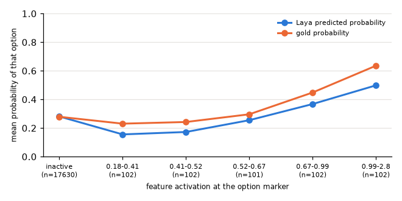

# Feature 4972

Critérios em que aparece: changed_base_vs_ft

**Interpretação (preencher):** 

---

## Maiores ativações

**tr_customer_service_000183 / category** (choice, customer_service) | ativação 6.031 em `estado` | opções ['account', 'billing', 'delivery', 'refund', 'technical'] | Laya: **account** [0.362, 0.139, 0.075, 0.232, 0.192] | gabarito: **billing**

```
[CLS]choice question: What is this customer conversation primarily about?[SEP]
▸ [MASK] account: Login, plan changes, profile or access management.
▸ [MASK] billing: A charge, invoice, subscription or payment problem.
▸ [MASK] delivery: Shipping, fulfilment or delivery of a physical item.
▸ [MASK] refund: The customer is explicitly asking for money back.
▸ [MASK] technical: The product or service is not working as expected.

[SEP]

{"account": {"lifetime_value_usd": 455, "prior_tickets_90d": 0, "seats": 1, "tenure_months": 5, "tier": "free"}, "orders": [{"amount_usd": 98, "date": "2026-03-24", "id": "A-16754", "status": "settled"}], "thread": [{"role": "customer", "text": "My payment just failed again and I have a hard deadline tomorrow to keep my account active – this is getting ridiculous."}, {"role": "agent", "text": "I’m really sorry you’re experiencing this. Could you tell me which payment method you’re trying to use?"}, {"role": "customer", "text": "I’m using the Visa ending in 4321. Every time I hit submit I get an error code 502 and the charge never goes through."}, {"role": "agent", "text": "Got it, thank you. Do you see any additional message on the screen besides the error code, like a declined notice or a timeout?"}, {"role": "customer", "text": "Just the generic “payment could not be processed” line. I need a solution right now, otherwise my free‑plan account will be suspended."}, {"role": "agent", "text": "I understand the urgency. Do you have an alternative payment option available, such as a different card⟦ or⟧ PayPal?"}, {"role": "customer", "text": "Yes, I have a PayPal account I can use. How do I switch to that quickly?"}]}[SEP]
```

**tr_customer_service_000183 / action** (choice, customer_service) | ativação 5.891 em `estado` | opções ['answer_directly', 'close_no_action', 'escalate_to_human', 'execute_refund', 'request_information'] | Laya: **close_no_action** [0.221, 0.25, 0.174, 0.185, 0.169] | gabarito: **answer_directly**

```
[CLS]choice question: What should the assistant do next with this conversation?[SEP]
▸ [MASK] answer_directly: The assistant can resolve this itself with information it already has.
▸ [MASK] close_no_action: No further action is warranted; the matter is settled.
▸ [MASK] escalate_to_human: Hand off to a human agent with the appropriate authority.
▸ [MASK] execute_refund: Issue the refund or credit the customer is owed.
▸ [MASK] request_information: More detail is needed from the customer before anything can be done.

[SEP]

{"account": {"lifetime_value_usd": 455, "prior_tickets_90d": 0, "seats": 1, "tenure_months": 5, "tier": "free"}, "orders": [{"amount_usd": 98, "date": "2026-03-24", "id": "A-16754", "status": "settled"}], "thread": [{"role": "customer", "text": "My payment just failed again and I have a hard deadline tomorrow to keep my account active – this is getting ridiculous."}, {"role": "agent", "text": "I’m really sorry you’re experiencing this. Could you tell me which payment method you’re trying to use?"}, {"role": "customer", "text": "I’m using the Visa ending in 4321. Every time I hit submit I get an error code 502 and the charge never goes through."}, {"role": "agent", "text": "Got it, thank you. Do you see any additional message on the screen besides the error code, like a declined notice or a timeout?"}, {"role": "customer", "text": "Just the generic “payment could not be processed” line. I need a solution right now, otherwise my free‑plan account will be suspended."}, {"role": "agent", "text": "I understand the urgency. Do you have an alternative payment option available, such as a different card⟦ or⟧ PayPal?"}, {"role": "customer", "text": "Yes, I have a PayPal account I can use. How do I switch to that quickly?"}]}[SEP]
```

**tr_customer_service_000183 / churn_risk** (score, customer_service) | ativação 5.656 em `estado` | opções ['0', '1', '2', '3'] | Laya: **1** [0.264, 0.358, 0.181, 0.198] | gabarito: **2**

```
[CLS]score question: How likely is this customer to stop doing business with us because of this interaction?[SEP]
▸ [MASK] level 0: No sign of dissatisfaction.
▸ [MASK] level 1: Mild frustration, but the relationship is intact.
▸ [MASK] level 2: Clearly unhappy; repeat problems or explicit complaints.
▸ [MASK] level 3: Imminent: threatening to cancel, dispute or leave.

[SEP]

{"account": {"lifetime_value_usd": 455, "prior_tickets_90d": 0, "seats": 1, "tenure_months": 5, "tier": "free"}, "orders": [{"amount_usd": 98, "date": "2026-03-24", "id": "A-16754", "status": "settled"}], "thread": [{"role": "customer", "text": "My payment just failed again and I have a hard deadline tomorrow to keep my account active – this is getting ridiculous."}, {"role": "agent", "text": "I’m really sorry you’re experiencing this. Could you tell me which payment method you’re trying to use?"}, {"role": "customer", "text": "I’m using the Visa ending in 4321. Every time I hit submit I get an error code 502 and the charge never goes through."}, {"role": "agent", "text": "Got it, thank you. Do you see any additional message on the screen besides the error code, like a declined notice or a timeout?"}, {"role": "customer", "text": "Just the generic “payment could not be processed” line. I need a solution right now, otherwise my free‑plan account will be suspended."}, {"role": "agent", "text": "I understand the urgency. Do you have an alternative payment option available, such as a different card⟦ or⟧ PayPal?"}, {"role": "customer", "text": "Yes, I have a PayPal account I can use. How do I switch to that quickly?"}]}[SEP]
```

**tr_customer_service_000183 / urgency** (score, customer_service) | ativação 5.348 em `estado` | opções ['0', '1', '2', '3'] | Laya: **1** [0.188, 0.42, 0.141, 0.25] | gabarito: **3**

```
[CLS]score question: How time-sensitive is this conversation?[SEP]
▸ [MASK] level 0: No time pressure; can wait indefinitely.
▸ [MASK] level 1: Routine; handle within the normal queue.
▸ [MASK] level 2: Elevated; should be handled within the same week.
▸ [MASK] level 3: Critical; requires action within the same day.

[SEP]

{"account": {"lifetime_value_usd": 455, "prior_tickets_90d": 0, "seats": 1, "tenure_months": 5, "tier": "free"}, "orders": [{"amount_usd": 98, "date": "2026-03-24", "id": "A-16754", "status": "settled"}], "thread": [{"role": "customer", "text": "My payment just failed again and I have a hard deadline tomorrow to keep my account active – this is getting ridiculous."}, {"role": "agent", "text": "I’m really sorry you’re experiencing this. Could you tell me which payment method you’re trying to use?"}, {"role": "customer", "text": "I’m using the Visa ending in 4321. Every time I hit submit I get an error code 502 and the charge never goes through."}, {"role": "agent", "text": "Got it, thank you. Do you see any additional message on the screen besides the error code, like a declined notice or a timeout?"}, {"role": "customer", "text": "Just the generic “payment could not be processed” line. I need a solution right now, otherwise my free‑plan account will be suspended."}, {"role": "agent", "text": "I understand the urgency. Do you have an alternative payment option available, such as a different card⟦ or⟧ PayPal?"}, {"role": "customer", "text": "Yes, I have a PayPal account I can use. How do I switch to that quickly?"}]}[SEP]
```

**tr_customer_service_000085 / action** (choice, customer_service) | ativação 3.926 em `estado` | opções ['answer_directly', 'close_no_action', 'escalate_to_human', 'execute_refund', 'request_information'] | Laya: **answer_directly** [0.405, 0.305, 0.087, 0.06, 0.144] | gabarito: **answer_directly**

```
[CLS]choice question: What should the assistant do next with this conversation?[SEP]
▸ [MASK] answer_directly: The assistant can resolve this itself with information it already has.
▸ [MASK] close_no_action: No further action is warranted; the matter is settled.
▸ [MASK] escalate_to_human: Hand off to a human agent with the appropriate authority.
▸ [MASK] execute_refund: Issue the refund or credit the customer is owed.
▸ [MASK] request_information: More detail is needed from the customer before anything can be done.

[SEP]

{"account": {"lifetime_value_usd": 62, "prior_tickets_90d": 3, "seats": 1, "tenure_months": 1, "tier": "standard"}, "thread": [{"role": "customer", "text": "I still haven't gotten a copy of my invoice for this month, even after three tickets. I need it by Friday for my accounting."}, {"role": "agent", "text": "I understand how inconvenient that is. Could you confirm the email address linked to your account so I can verify where the invoice was sent?"}, {"role": "customer", "text": "It's the same john.doe@example.com you have on file. Please just send the PDF; I can't wait any longer."}, {"role": "agent", "text": "Thanks for confirming. I’ll check the sending logs and resend the document. Is there any specific format you prefer,⟦ or⟧ will a standard PDF work?"}, {"role": "customer", "text": "A standard PDF is fine, but make sure it actually arrives this time—my deadline is this Friday and I can’t afford another delay."}]}[SEP]
```

## Ativações medianas (faixa 40-60%, mediana 0.701)

**tr_invoice_processing_000227 / discrepancy_severity** (score, invoice_processing) | ativação 0.739 em `pergunta` | opções ['0', '1', '2', '3'] | Laya: **0** [0.486, 0.218, 0.162, 0.134] | gabarito: **3**

```
[CLS]score question: How material is any discrepancy between the invoice, the order⟦ and⟧ the delivery?[SEP]
▸ [MASK] level 0: None: everything reconciles.
▸ [MASK] level 1: Trivial: rounding or a cosmetic difference.
▸ [MASK] level 2: Moderate: a real difference worth confirming.
▸ [MASK] level 3: Material: a large or unexplained difference.

[SEP]

{"delivery": {"condition": "accepted with exceptions", "date": "2026-03-17", "received_qty": 1000}, "invoice": {"currency": "USD", "id": "INV-2026-8669", "lines": [{"qty": 1000, "sku": "SKU-950", "total_usd": 37210.0, "unit_usd": 37.21}], "total_usd": 37210.0, "vendor": "Orbit Logistics"}, "payment": {"days_until_due": -3, "discount_expires_in_days": null, "early_payment_discount_pct": null, "status": "overdue", "terms": "net 15"}, "purchase_order": {"freight_terms": "freight prepaid by vendor, not separately billable", "id": "PO-9424", "lines": [{"qty": 1000, "unit_usd": 37.21}], "total_usd": 37210.0}, "vendor_history": {"disputes_12m": 5, "invoices_12m": 27, "prior_invoice_ids": ["INV-2026-8669"]}}[SEP]
```

**tr_invoice_processing_000097 / discrepancy_severity** (score, invoice_processing) | ativação 0.755 em `pergunta` | opções ['0', '1', '2', '3'] | Laya: **0** [0.391, 0.211, 0.234, 0.164] | gabarito: **3**

```
[CLS]score question: How material is any discrepancy between the invoice, the order⟦ and⟧ the delivery?[SEP]
▸ [MASK] level 0: None: everything reconciles.
▸ [MASK] level 1: Trivial: rounding or a cosmetic difference.
▸ [MASK] level 2: Moderate: a real difference worth confirming.
▸ [MASK] level 3: Material: a large or unexplained difference.

[SEP]

{"delivery": {"condition": "accepted with exceptions", "date": "2026-03-02", "received_qty": 50}, "invoice": {"currency": "USD", "id": "INV-2026-3793", "lines": [{"qty": 50, "sku": "SKU-905", "total_usd": 17279.5, "unit_usd": 345.59}], "total_usd": 17279.5, "vendor": "Orbit Logistics"}, "payment": {"days_until_due": 11, "discount_expires_in_days": null, "early_payment_discount_pct": null, "status": "scheduled", "terms": "net 30"}, "purchase_order": {"freight_terms": "freight prepaid by vendor, not separately billable", "id": "PO-8082", "lines": [{"qty": 50, "unit_usd": 345.59}], "total_usd": 17279.5}, "vendor_history": {"disputes_12m": 0, "invoices_12m": 60, "prior_invoice_ids": ["INV-2026-3793", "INV-2026-3886", "INV-2026-6555"]}}[SEP]
```

**tr_security_incidents_000177 / true_positive** (noul, security_incidents) | ativação 0.736 em `estado` | opções ['false', 'true'] | Laya: **false** [0.625, 0.375] | gabarito: **false**

```
[CLS]noul question: This alert reflects genuinely malicious or unauthorised activity.[SEP]
▸ [MASK] false: Benign activity, a misconfiguration, or a known false positive.
▸ [MASK] true: The underlying behaviour is malicious or unauthorised.

[SEP]

{"alert": {"description": "a first-ever sign-in from an unfamiliar country", "evidence": "At 2026-09-15 02:13:47 UTC, employee user jdoe performed a sign‑in from IP 203.0.113.45 located in Brazil, a country not seen in prior login history for this account. The authentication succeeded with MFA, and the account's password was last rotated on 2026-09-01. No change window was active at the time of the event.", "rule": "new_country_login"}, "context": {"asset_criticality": "medium", "change_window_active": false, "source_on_allowlist": false}, "history": {"credential_rotation_days_ago": 14, "distinct_countries_30d": 3, "logins_30d": 1743, "prior_alerts_90d": 0}, "principal": {"mfa_enrolled": true, "name": "adm-analytics-183", "privileges": ["repo:read⟦"],⟧ "type": "employee"}}[SEP]
```

**tr_customer_service_000061 / category** (choice, customer_service) | ativação 0.732 em `estado` | opções ['account', 'billing', 'delivery', 'refund', 'technical'] | Laya: **technical** [0.23, 0.187, 0.041, 0.202, 0.339] | gabarito: **account**

```
[CLS]choice question: What is this customer conversation primarily about?[SEP]
▸ [MASK] account: Login, plan changes, profile or access management.
▸ [MASK] billing: A charge, invoice, subscription or payment problem.
▸ [MASK] delivery: Shipping, fulfilment or delivery of a physical item.
▸ [MASK] refund: The customer is explicitly asking for money back.
▸ [MASK] technical: The product or service is not working as expected.

[SEP]

{"account": {"lifetime_value_usd": 1585, "prior_tickets_90d": 2⟦,⟧ "seats": 1, "tenure_months": 41, "tier": "premium"}, "thread": [{"role": "customer", "text": "I'm trying to adjust my seat count again, but the dashboard is just giving me the same greyed-out error as last time."}, {"role": "agent", "text": "I apologize for the frustration; could you confirm if you are seeing this error on the billing page or the team management tab?"}, {"role": "customer", "text": "It's on the team management tab. Honestly, I'm used to this by now."}, {"role": "agent", "text": "Thank you for clarifying. Are you currently logged in as the primary account administrator when accessing that specific tab?"}, {"role": "customer", "text": "Yes, I am the admin. Nothing ever seems to change with these permissions."}, {"role": "agent", "text": "I appreciate your patience while we look into this. Could you please send me a screenshot of the specific error message you see?"}, {"role": "customer", "text": "I'll try to get that over later, but I don't really expect it to make a difference."}]}[SEP]
```

**tr_security_incidents_000040 / disposition** (choice, security_incidents) | ativação 0.661 em `estado` | opções ['close_benign', 'contain', 'investigate', 'monitor'] | Laya: **close_benign** [0.341, 0.28, 0.145, 0.234] | gabarito: **investigate**

```
[CLS]choice question: How should this security alert be dispositioned?[SEP]
▸ [MASK] close_benign: Expected, explainable activity; close without analyst time.
▸ [MASK] contain: Contain the host or account immediately; do not wait for triage.
▸ [MASK] investigate: Warrants an analyst opening an investigation.
▸ [MASK] monitor: Not clearly malicious, but worth watching for recurrence.

[SEP]

{"alert": {"description": "an account granted itself or received elevated permissions", "evidence": "Security logs on 2026-09-16 08:45:12 UTC show employee user jdoe being added to the local Administrators group on workstation LAPTOP-23. The account originally held unprivileged rights, MFA is enabled, and its credentials were refreshed 30 days earlier. The change originated from an allowlisted source.", "rule": "privilege_escalation"}, "context": {"asset_criticality": "medium", "change_window_active": false, "source_on_allowlist": true}, "history": {"credential_rotation_days_ago": 30, "distinct_countries_30d": 4, "logins_30d": 659, "prior_alerts_90d": 0}, "principal": {"mfa_enrolled": true, "name": "usr-deploy-272",⟦ "⟧privileges": ["repo:read"], "type": "employee"}}[SEP]
```

## Estatísticas (conjunto de descoberta, dev e teste)

**pred / error**

| split | decisões | ativas | ativas e Laya errou | taxa | lift | q (BH) | OR (CMH) | q (CMH) |
|---|---|---|---|---|---|---|---|---|
| discovery | 5100 | 148 | 64 | 0.432 | 0.68 | 2.13e-06 | 0.17 | 9.61e-07 |
| dev | 900 | 24 | 9 | 0.375 | 0.57 | 0.0605 | 0.19 | 0.196 |
| test | 2000 | 47 | 22 | 0.468 | 0.73 | 0.0452 | 0.67 | 0.83 |

**corr / error**

| split | decisões | ativas | ativas e Laya errou | taxa | lift | q (BH) | OR (CMH) | q (CMH) |
|---|---|---|---|---|---|---|---|---|
| discovery | 5100 | 212 | 128 | 0.604 | 0.95 | 0.388 | 0.12 | 2.7e-11 |
| dev | 900 | 35 | 20 | 0.571 | 0.87 | 0.427 | 0.05 | 0.0151 |
| test | 2000 | 76 | 51 | 0.671 | 1.05 | 0.66 | 0.15 | 0.000909 |

**state / error**

| split | decisões | ativas | ativas e Laya errou | taxa | lift | q (BH) | OR (CMH) | q (CMH) |
|---|---|---|---|---|---|---|---|---|
| discovery | 5100 | 1691 | 1032 | 0.610 | 0.96 | 0.0695 | 0.78 | 0.0022 |
| dev | 900 | 290 | 189 | 0.652 | 0.99 | 1 | 0.89 | 0.744 |
| test | 2000 | 610 | 374 | 0.613 | 0.96 | 0.613 | 0.79 | 0.14 |

Confusão mais sobre-representada (pred): `risk|3>2` (n=7, lift 34.46, p=1.51e-11). Formato `pergunta|índice previsto>índice correto`.

Confusão mais sobre-representada (corr): `severity|2>3` (n=69, lift 20.00, p=0). Formato `pergunta|índice previsto>índice correto`.

Confusão mais sobre-representada (state): `disposition|0>1` (n=47, lift 2.05, p=2.43e-09). Formato `pergunta|índice previsto>índice correto`.



