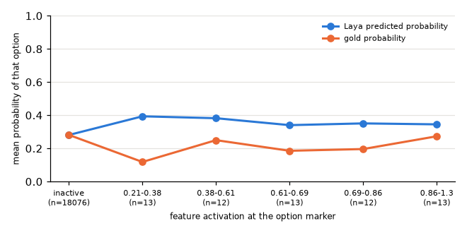

# Feature 5525

Critérios em que aparece: changed_base_vs_ft

**Interpretação (preencher):** 

---

## Maiores ativações

**tr_customer_service_000250 / category** (choice, customer_service) | ativação 9.094 em `opção` | opções ['account', 'billing', 'delivery', 'refund', 'technical'] | Laya: **billing** [0.006, 0.969, 0.006, 0.012, 0.007] | gabarito: **billing**

```
[CLS]choice question: What is this customer conversation primarily about?[SEP]
▸ [MASK] account: Login, plan changes, profile or access management.
▸ [MASK] billing: A charge,⟦ invoice⟧, subscription or payment problem.
▸ [MASK] delivery: Shipping, fulfilment or delivery of a physical item.
▸ [MASK] refund: The customer is explicitly asking for money back.
▸ [MASK] technical: The product or service is not working as expected.

[SEP]

{"account": {"lifetime_value_usd": 145, "prior_tickets_90d": 0, "seats": 1, "tenure_months": 2, "tier": "standard"}, "thread": [{"role": "customer", "text": "Could you please send me a copy of my latest invoice? Thank you!"}]}[SEP]
```

**tr_customer_service_000095 / churn_risk** (score, customer_service) | ativação 8.203 em `opção` | opções ['0', '1', '2', '3'] | Laya: **2** [0.018, 0.209, 0.56, 0.213] | gabarito: **2**

```
[CLS]score question: How likely is this customer to stop doing business with us because of this interaction?[SEP]
▸ [MASK] level 0: No sign of dissatisfaction.
▸ [MASK] level 1: Mild⟦ frustration⟧, but the relationship is intact.
▸ [MASK] level 2: Clearly unhappy; repeat problems or explicit complaints.
▸ [MASK] level 3: Imminent: threatening to cancel, dispute or leave.

[SEP]

{"account": {"lifetime_value_usd": 2044, "prior_tickets_90d": 1, "seats": 12, "tenure_months": 60, "tier": "premium"}, "thread": [{"role": "customer", "text": "I am beyond frustrated. I’ve been a loyal premium customer for five years, and the item I just received is already damaged. This is unacceptable, especially since my previous ticket about the shipping quality is still just sitting there ignored."}, {"role": "agent", "text": "I truly apologize for the frustration caused by the state of your delivery. To better assist you, could you please provide a few photos of the damage so I can document the issue?"}, {"role": "customer", "text": "I shouldn't have to jump through hoops to prove this arrived broken when your company has a history of these failures. My time is being wasted."}]}[SEP]
```

**tr_customer_service_000073 / churn_risk** (score, customer_service) | ativação 7.809 em `opção` | opções ['0', '1', '2', '3'] | Laya: **2** [0.054, 0.264, 0.512, 0.169] | gabarito: **3**

```
[CLS]score question: How likely is this customer to stop doing business with us because of this interaction?[SEP]
▸ [MASK] level 0: No sign of⟦ diss⟧atisfaction.
▸ [MASK] level 1: Mild frustration, but the relationship is intact.
▸ [MASK] level 2: Clearly unhappy; repeat problems or explicit complaints.
▸ [MASK] level 3: Imminent: threatening to cancel, dispute or leave.

[SEP]

{"account": {"lifetime_value_usd": 54, "prior_tickets_90d": 1, "seats": 1, "tenure_months": 1, "tier": "premium"}, "orders": [{"amount_usd": 29, "date": "2026-01-23", "id": "A-91950", "status": "failed"}], "thread": [{"role": "customer", "text": "I am absolutely livid that my payment failed again after I was told this was fixed last week, this is ridiculous!"}, {"role": "agent", "text": "I'm very sorry for the ongoing trouble with your premium subscription payment; I see your previous ticket regarding this same issue."}, {"role": "customer", "text": "Seeing it doesn't help me! I've only been a member for a month and you've already messed up the $29 charge twice now."}, {"role": "agent", "text": "I understand how frustrating that is. To help me investigate, are you receiving a specific error message from your bank or within our portal?"}, {"role": "customer", "text": "It just says 'transaction failed' with no explanation, which is exactly what happened the first time I complained."}, {"role": "agent", "text": "Thank you for that detail. I'm going to pull up the logs from our payment processor to see if there's a more descriptive rejection code on the backend."}, {"role": "customer", "text": "You do that, but if this isn't sorted out once and for all, I'm canceling this plan and moving to a competitor who actually wants my money."}]}[SEP]
```

**tr_customer_service_000093 / churn_risk** (score, customer_service) | ativação 7.785 em `opção` | opções ['0', '1', '2', '3'] | Laya: **2** [0.012, 0.097, 0.777, 0.114] | gabarito: **3**

```
[CLS]score question: How likely is this customer to stop doing business with us because of this interaction?[SEP]
▸ [MASK] level 0: No sign of dissatisfaction.
▸ [MASK] level 1: Mild⟦ frustration⟧, but the relationship is intact.
▸ [MASK] level 2: Clearly unhappy; repeat problems or explicit complaints.
▸ [MASK] level 3: Imminent: threatening to cancel, dispute or leave.

[SEP]

{"account": {"lifetime_value_usd": 2245, "prior_tickets_90d": 1, "seats": 1, "tenure_months": 26, "tier": "premium"}, "thread": [{"role": "customer", "text": "After 26 months of being a premium member, I’m sick of these quality issues. I dropped my device once and the casing shattered instantly. This is the same recurring garbage I complained about last time, and if this isn't handled properly, I'm taking my business elsewhere for good."}]}[SEP]
```

**tr_customer_service_000006 / churn_risk** (score, customer_service) | ativação 7.395 em `opção` | opções ['0', '1', '2', '3'] | Laya: **2** [0.063, 0.403, 0.474, 0.06] | gabarito: **1**

```
[CLS]score question: How likely is this customer to stop doing business with us because of this interaction?[SEP]
▸ [MASK] level 0: No sign of⟦ diss⟧atisfaction.
▸ [MASK] level 1: Mild frustration, but the relationship is intact.
▸ [MASK] level 2: Clearly unhappy; repeat problems or explicit complaints.
▸ [MASK] level 3: Imminent: threatening to cancel, dispute or leave.

[SEP]

{"account": {"lifetime_value_usd": 1556, "prior_tickets_90d": 0, "seats": 1, "tenure_months": 49, "tier": "standard"}, "orders": [{"amount_usd": 49, "date": "2026-01-27", "id": "A-87881", "status": "pending"}, {"amount_usd": 49, "date": "2026-01-07", "id": "A-73934", "status": "settled"}, {"amount_usd": 49, "date": "2026-03-13", "id": "A-93118", "status": "pending"}], "thread": [{"role": "customer", "text": "I've been a member for years and suddenly everything is taking forever to load, but I haven't changed my internet or anything, so I'm not sure what's going on."}, {"role": "agent", "text": "That sounds frustrating. To help me narrow this down, is the slowness happening across the whole site or just when you try to save your work?"}, {"role": "customer", "text": "It's everywhere, even the main dashboard is crawling, and I just don't know why it's behaving this way all of a sudden."}]}[SEP]
```

## Ativações medianas (faixa 40-60%, mediana 1.106)

**tr_invoice_processing_000005 / urgency** (score, invoice_processing) | ativação 1.003 em `pergunta` | opções ['0', '1', '2', '3'] | Laya: **1** [0.165, 0.615, 0.144, 0.076] | gabarito: **2**

```
[CLS]score question:⟦ How⟧ time-sensitive is processing this invoice?[SEP]
▸ [MASK] level 0: No time pressure; can wait indefinitely.
▸ [MASK] level 1: Routine; handle within the normal queue.
▸ [MASK] level 2: Elevated; should be handled within the same week.
▸ [MASK] level 3: Critical; requires action within the same day.

[SEP]

{"delivery": {"condition": "accepted", "date": "2026-03-16", "received_qty": 5}, "invoice": {"currency": "USD", "id": "INV-2026-6695", "lines": [{"qty": 5, "sku": "SKU-717", "total_usd": 517.95, "unit_usd": 103.59}], "total_usd": 517.95, "vendor": "Acme Fabrication"}, "payment": {"days_until_due": -3, "discount_expires_in_days": null, "early_payment_discount_pct": null, "status": "overdue", "terms": "net 45"}, "purchase_order": {"freight_terms": "freight prepaid by vendor, not separately billable", "id": "PO-7988", "lines": [{"qty": 10, "unit_usd": 103.59}], "total_usd": 1035.9}, "vendor_history": {"disputes_12m": 0, "invoices_12m": 18, "prior_invoice_ids": ["INV-2026-1325", "INV-2026-4472"]}}[SEP]
```

**tr_security_incidents_000175 / true_positive** (noul, security_incidents) | ativação 1.257 em `pergunta` | opções ['false', 'true'] | Laya: **true** [0.477, 0.523] | gabarito: **true**

```
[CLS]noul question: This alert⟦ reflects⟧ genuinely malicious or unauthorised activity.[SEP]
▸ [MASK] false: Benign activity, a misconfiguration, or a known false positive.
▸ [MASK] true: The underlying behaviour is malicious or unauthorised.

[SEP]

{"alert": {"description": "many failed authentications followed by a success", "evidence": "System logs show 42 failed authentication attempts against the privileged service account `svc-datasync` from source 45.33.22.11 followed by a single successful login at 11:30 PM. This activity bypassed MFA and used credentials last rotated 14 days ago while no scheduled maintenance window was in effect.", "rule": "brute_force"}, "context": {"asset_criticality": "low", "change_window_active": false, "source_on_allowlist": false}, "history": {"credential_rotation_days_ago": 14, "distinct_countries_30d": 1, "logins_30d": 1391, "prior_alerts_90d": 0}, "principal": {"mfa_enrolled": false, "name": "ci-support-332", "privileges": ["deploy:production", "secrets:read"], "type": "service_account"}}[SEP]
```

**tr_invoice_processing_000066 / matches_order** (noul, invoice_processing) | ativação 1.209 em `estado` | opções ['false', 'true'] | Laya: **true** [0.467, 0.533] | gabarito: **true**

```
[CLS]noul question: The invoice reconciles with the purchase order and the recorded delivery.[SEP]
▸ [MASK] false: There is a discrepancy against the order or the delivery.
▸ [MASK] true: Line items, quantities and amounts reconcile.

[SEP]

{"delivery": {"condition": "accepted", "date": "⟦20⟧26-03-26", "received_qty": 250}, "invoice": {"currency": "USD", "id": "INV-2026-6387", "lines": [{"qty": 250, "sku": "SKU-563", "total_usd": 57015.0, "unit_usd": 228.06}], "total_usd": 57015.0, "vendor": "Kestrel Supply"}, "payment": {"days_until_due": 11, "discount_expires_in_days": 5, "early_payment_discount_pct": 2.0, "status": "scheduled", "terms": "net 15"}, "purchase_order": {"freight_terms": "freight prepaid by vendor, not separately billable", "id": "PO-1938", "lines": [{"qty": 250, "unit_usd": 228.06}], "total_usd": 57015.0}, "vendor_history": {"disputes_12m": 5, "invoices_12m": 57, "prior_invoice_ids": ["INV-2026-2067", "INV-2026-4476", "INV-2026-9946", "INV-2026-4487"]}}[SEP]
```

**tr_security_incidents_000000 / credential_compromise** (noul, security_incidents) | ativação 1.223 em `estado` | opções ['false', 'true'] | Laya: **true** [0.283, 0.717] | gabarito: **true**

```
[CLS]noul question: The evidence indicates a credential or account has been compromised.[SEP]
▸ [MASK] false: no, the statement does not hold
▸ [MASK] true: yes, the statement holds

[SEP]

{"alert": {"description": "a long-un⟦used⟧ account became active", "evidence": "The unprivileged service account `svc_task_alpha` initiated a session from IP `198.51.100.24` following 180 days of zero activity. Authentication was successful without MFA using credentials that were last rotated six months ago.", "rule": "dormant_account_use"}, "context": {"asset_criticality": "low", "change_window_active": false, "source_on_allowlist": false}, "history": {"credential_rotation_days_ago": 180, "distinct_countries_30d": 4, "logins_30d": 287, "prior_alerts_90d": 8}, "principal": {"mfa_enrolled": false, "name": "usr-support-752", "privileges": ["repo:read"], "type": "service_account"}}[SEP]
```

**tr_agent_trace_observability_000132 / outcome** (choice, agent_trace_observability) | ativação 1.008 em `opção` | opções ['failure', 'harmful', 'partial', 'success'] | Laya: **success** [0.318, 0.152, 0.17, 0.359] | gabarito: **partial**

```
[CLS]choice question: How did this agent run turn out?[SEP]
▸ [MASK] failure: The⟦ agent⟧ did not accomplish the task.
▸ [MASK] harmful: The agent took an action that caused damage or violated a constraint.
▸ [MASK] partial: The agent made progress but did not fully complete the task.
▸ [MASK] success: The agent completed the task correctly.

[SEP]

{"agent": {"autonomy": "unsupervised", "model": "internal-agent-v4"}, "constraints": ["Never delete anything matching release/*"], "task": "Delete personal data for the accounts in the erasure queue.", "trace_summary": {"constraint_violations": 0, "duration_s": 708.0, "irreversible_actions": 0, "steps": 11, "tool_errors": 3}}[SEP]
```

## Estatísticas (conjunto de descoberta, dev e teste)

**pred / error**

| split | decisões | ativas | ativas e Laya errou | taxa | lift | q (BH) | OR (CMH) | q (CMH) |
|---|---|---|---|---|---|---|---|---|
| discovery | 5100 | 32 | 26 | 0.812 | 1.28 | 0.0821 | 1.52 | 0.66 |
| dev | 900 | 4 | 2 | 0.500 | 0.76 | nan | nan | nan |
| test | 2000 | 9 | 6 | 0.667 | 1.05 | nan | nan | nan |

**corr / error**

| split | decisões | ativas | ativas e Laya errou | taxa | lift | q (BH) | OR (CMH) | q (CMH) |
|---|---|---|---|---|---|---|---|---|
| discovery | 5100 | 12 | 6 | 0.500 | 0.79 | nan | nan | nan |
| dev | 900 | 3 | 1 | 0.333 | 0.51 | nan | nan | nan |
| test | 2000 | 4 | 1 | 0.250 | 0.39 | nan | nan | nan |

**state / error**

| split | decisões | ativas | ativas e Laya errou | taxa | lift | q (BH) | OR (CMH) | q (CMH) |
|---|---|---|---|---|---|---|---|---|
| discovery | 5100 | 5070 | 3229 | 0.637 | 1.00 | 0.63 | 1.88 | 0.306 |
| dev | 900 | 897 | 588 | 0.656 | 1.00 | 1 | 0.00 | 0.45 |
| test | 2000 | 1989 | 1269 | 0.638 | 1.00 | 0.809 | 1.77 | 0.61 |

Confusão mais sobre-representada (pred): `disposition|0>2` (n=10, lift 6.67, p=1.1e-06). Formato `pergunta|índice previsto>índice correto`.

Confusão mais sobre-representada (corr): `action|1>0` (n=3, lift 31.10, p=nan). Formato `pergunta|índice previsto>índice correto`.

Confusão mais sobre-representada (state): `urgency|1>3` (n=292, lift 1.01, p=0.17). Formato `pergunta|índice previsto>índice correto`.



