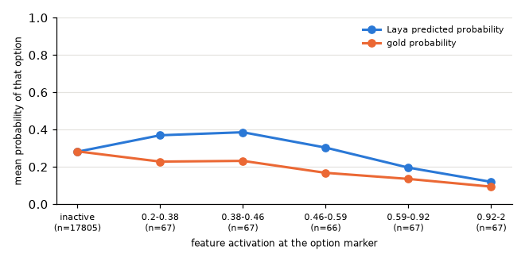

# Feature 5727

Critérios em que aparece: changed_base_vs_ft

**Interpretação (preencher):** 

---

## Maiores ativações

**tr_customer_service_000099 / urgency** (score, customer_service) | ativação 5.867 em `estado` | opções ['0', '1', '2', '3'] | Laya: **1** [0.106, 0.456, 0.167, 0.272] | gabarito: **3**

```
[CLS]score question: How time-sensitive is this conversation?[SEP]
▸ [MASK] level 0: No time pressure; can wait indefinitely.
▸ [MASK] level 1: Routine; handle within the normal queue.
▸ [MASK] level 2: Elevated; should be handled within the same week.
▸ [MASK] level 3: Critical; requires action within the same day.

[SEP]

{"account": {"lifetime_value_usd": 210, "prior_tickets_90d": 0, "seats": 1, "tenure_months": 5, "tier": "standard"}, "thread": [{"role": "customer", "text": "I need to downgrade my account immediately. My budget is finalized at the end of the day today, so this needs to be handled right now."}, {"role": "agent", "text": "I understand that you have a time-sensitive deadline. To ensure I'm looking at the correct account, could you please verify the full name on the billing profile?"}, {"role": "customer", "text": "The name is Marcus Thorne. Please, I really don't have time to go back and forth on this today."}, {"role": "agent", "text": "Thank you, Marcus. I have your account pulled up. Could you please clarify⟦ if⟧ you are looking to move to the base tier or if you'd like to remove specific add-ons?"}, {"role": "customer", "text": "I just want the base tier, and I need this confirmed before the business day closes. Can you tell me if that's going to happen?"}]}[SEP]
```

**tr_customer_service_000071 / category** (choice, customer_service) | ativação 5.664 em `estado` | opções ['account', 'billing', 'delivery', 'refund', 'technical'] | Laya: **refund** [0.192, 0.279, 0.021, 0.435, 0.074] | gabarito: **account**

```
[CLS]choice question: What is this customer conversation primarily about?[SEP]
▸ [MASK] account: Login, plan changes, profile or access management.
▸ [MASK] billing: A charge, invoice, subscription or payment problem.
▸ [MASK] delivery: Shipping, fulfilment or delivery of a physical item.
▸ [MASK] refund: The customer is explicitly asking for money back.
▸ [MASK] technical: The product or service is not working as expected.

[SEP]

{"account": {"lifetime_value_usd": 34, "prior_tickets_90d": 0, "seats": 5, "tenure_months": 1, "tier": "premium"}, "orders": [{"amount_usd": 49, "date": "2026-03-16", "id": "A-22387", "status": "refunded"}], "thread": [{"role": "customer", "text": "I want to cancel the account. We're on the premium plan, about $49 a month, and we've only been using it for a month."}, {"role": "agent", "text": "I can help with that. Could you let me know whether you want to cancel at the end of the current billing period or immediately, if immediate cancellation is an option?"}, {"role": "customer", "text": "I'd prefer it to stop at the end of the current period. I don't want to continue into another month."}, {"role": "agent", "text": "Understood. Could you also confirm whether you want to keep any data until the current period ends, or have you already completed your migration?"}, {"role": "customer", "text": "We still need read-only access until the period ends. After that, the account can be closed."}, {"role": "agent", "text": "I understand. For the record, is this a standard account cancellation,⟦ or⟧ do you need a specific invoice or final access request included in the cancellation note?"}, {"role": "customer", "text": "Standard cancellation. If a final invoice is generated, please make sure it reflects the current period only."}]}[SEP]
```

**tr_customer_service_000099 / category** (choice, customer_service) | ativação 5.586 em `estado` | opções ['account', 'billing', 'delivery', 'refund', 'technical'] | Laya: **account** [0.36, 0.233, 0.048, 0.263, 0.096] | gabarito: **account**

```
[CLS]choice question: What is this customer conversation primarily about?[SEP]
▸ [MASK] account: Login, plan changes, profile or access management.
▸ [MASK] billing: A charge, invoice, subscription or payment problem.
▸ [MASK] delivery: Shipping, fulfilment or delivery of a physical item.
▸ [MASK] refund: The customer is explicitly asking for money back.
▸ [MASK] technical: The product or service is not working as expected.

[SEP]

{"account": {"lifetime_value_usd": 210, "prior_tickets_90d": 0, "seats": 1, "tenure_months": 5, "tier": "standard"}, "thread": [{"role": "customer", "text": "I need to downgrade my account immediately. My budget is finalized at the end of the day today, so this needs to be handled right now."}, {"role": "agent", "text": "I understand that you have a time-sensitive deadline. To ensure I'm looking at the correct account, could you please verify the full name on the billing profile?"}, {"role": "customer", "text": "The name is Marcus Thorne. Please, I really don't have time to go back and forth on this today."}, {"role": "agent", "text": "Thank you, Marcus. I have your account pulled up. Could you please clarify⟦ if⟧ you are looking to move to the base tier or if you'd like to remove specific add-ons?"}, {"role": "customer", "text": "I just want the base tier, and I need this confirmed before the business day closes. Can you tell me if that's going to happen?"}]}[SEP]
```

**tr_customer_service_000071 / action** (choice, customer_service) | ativação 5.512 em `estado` | opções ['answer_directly', 'close_no_action', 'escalate_to_human', 'execute_refund', 'request_information'] | Laya: **close_no_action** [0.213, 0.271, 0.126, 0.211, 0.179] | gabarito: **answer_directly**

```
[CLS]choice question: What should the assistant do next with this conversation?[SEP]
▸ [MASK] answer_directly: The assistant can resolve this itself with information it already has.
▸ [MASK] close_no_action: No further action is warranted; the matter is settled.
▸ [MASK] escalate_to_human: Hand off to a human agent with the appropriate authority.
▸ [MASK] execute_refund: Issue the refund or credit the customer is owed.
▸ [MASK] request_information: More detail is needed from the customer before anything can be done.

[SEP]

{"account": {"lifetime_value_usd": 34, "prior_tickets_90d": 0, "seats": 5, "tenure_months": 1, "tier": "premium"}, "orders": [{"amount_usd": 49, "date": "2026-03-16", "id": "A-22387", "status": "refunded"}], "thread": [{"role": "customer", "text": "I want to cancel the account. We're on the premium plan, about $49 a month, and we've only been using it for a month."}, {"role": "agent", "text": "I can help with that. Could you let me know whether you want to cancel at the end of the current billing period or immediately, if immediate cancellation is an option?"}, {"role": "customer", "text": "I'd prefer it to stop at the end of the current period. I don't want to continue into another month."}, {"role": "agent", "text": "Understood. Could you also confirm whether you want to keep any data until the current period ends, or have you already completed your migration?"}, {"role": "customer", "text": "We still need read-only access until the period ends. After that, the account can be closed."}, {"role": "agent", "text": "I understand. For the record, is this a standard account cancellation,⟦ or⟧ do you need a specific invoice or final access request included in the cancellation note?"}, {"role": "customer", "text": "Standard cancellation. If a final invoice is generated, please make sure it reflects the current period only."}]}[SEP]
```

**tr_customer_service_000218 / needs_human** (noul, customer_service) | ativação 5.445 em `estado` | opções ['false', 'true'] | Laya: **true** [0.363, 0.637] | gabarito: **true**

```
[CLS]noul question: This conversation requires a human agent rather than automated handling.[SEP]
▸ [MASK] false: Automation can carry this to resolution.
▸ [MASK] true: A human must take over: judgement, authority or empathy is required.

[SEP]

{"account": {"lifetime_value_usd": 1493, "prior_tickets_90d": 0, "seats": 1, "tenure_months": 26, "tier": "enterprise"}, "orders": [{"amount_usd": 87, "date": "2026-02-14", "id": "A-33952", "status": "settled"}, {"amount_usd": 87, "date": "2026-02-17", "id": "A-46877", "status": "pending"}], "thread": [{"role": "customer", "text": "I just looked at my statement and you've charged me twice for the same subscription! This is completely unacceptable for an enterprise account."}, {"role": "agent", "text": "I understand your concern regarding the duplicate billing. To help me investigate, could you clarify if both charges show the same transaction ID⟦ or⟧ different ones?"}, {"role": "customer", "text": "They are both for $87 and they hit my account on the same day. Fix this immediately, I don't have time to play detective for your billing errors."}, {"role": "agent", "text": "I see the two entries for $87 you're referring to. Are there any other unexpected line items on your recent invoice that I should be aware of?"}, {"role": "customer", "text": "No, just these two. It's ridiculous that a company of your size can't manage basic accounting. I want my money back now."}, {"role": "agent", "text": "I am currently reviewing the ledger for the past 26 months of your service. Could you confirm the date the charges first appeared on your bank statement?"}, {"role": "customer", "text": "It was the 14th. Just look at the records, it's clear as day that I've been overcharged and I shouldn't have to keep explaining this to you."}]}[SEP]
```

## Ativações medianas (faixa 40-60%, mediana 0.940)

**tr_invoice_processing_000144 / matches_order** (noul, invoice_processing) | ativação 1.011 em `estado` | opções ['false', 'true'] | Laya: **true** [0.481, 0.519] | gabarito: **true**

```
[CLS]noul question: The invoice reconciles with the purchase order and the recorded delivery.[SEP]
▸ [MASK] false: There is a discrepancy against the order or the delivery.
▸ [MASK] true: Line items, quantities and amounts reconcile.

[SEP]

{"delivery": {"condition": "accepted", "date": "2026-03-03", "received_qty": 250}, "invoice": {"currency": "USD", "id": "INV-2026-4721", "lines": [{"qty": 250, "sku": "SKU-840", "total_usd": 80237.5, "unit_usd": 320.95}], "total_usd": 80237.5, "vendor": "Pallas Industrial"}, "payment": {"days_⟦until⟧_due": -9, "discount_expires_in_days": null, "early_payment_discount_pct": null, "status": "overdue", "terms": "net 60"}, "purchase_order": {"freight_terms": "freight prepaid by vendor, not separately billable", "id": null, "lines": [{"qty": 250, "unit_usd": 320.95}], "total_usd": 80237.5}, "vendor_history": {"disputes_12m": 1, "invoices_12m": 56, "prior_invoice_ids": ["INV-2026-5685", "INV-2026-2769"]}}[SEP]
```

**tr_customer_service_000232 / churn_risk** (score, customer_service) | ativação 0.940 em `estado` | opções ['0', '1', '2', '3'] | Laya: **2** [0.143, 0.248, 0.469, 0.139] | gabarito: **2**

```
[CLS]score question: How likely is this customer to stop doing business with us because of this interaction?[SEP]
▸ [MASK] level 0: No sign of dissatisfaction.
▸ [MASK] level 1: Mild frustration, but the relationship is intact.
▸ [MASK] level 2: Clearly unhappy; repeat problems or explicit complaints.
▸ [MASK] level 3: Imminent: threatening to cancel, dispute or leave.

[SEP]

{"account": {"lifetime_value_usd": 186, "prior_tickets_90d": 0, "seats": 5, "tenure_months": 3, "tier":⟦ "⟧premium"}, "orders": [{"amount_usd": 2997, "date": "2026-01-02", "id": "A-95746", "status": "refunded"}, {"amount_usd": 2997, "date": "2026-03-02", "id": "A-16068", "status": "settled"}], "thread": [{"role": "customer", "text": "I'm looking at my dashboard and everything is grayed out, it says I'm on a trial but I've been a Premium member for three months? I don't understand why it would change now, especially since I have a massive project deadline tomorrow and I need my tools."}, {"role": "agent", "text": "I can certainly look into your subscription status for you. To get started, could you please confirm the email address associated with your $2997 annual Premium plan?"}, {"role": "customer", "text": "It's the same email I'm using for this chat, but I'm just so confused because my bank shows the payment went through months ago. Why would the system suddenly think I'm not a customer anymore?"}, {"role": "agent", "text": "Thank you for that information. I am reviewing your account history now. Have you recently made any changes to your team settings or tried to link a secondary account to this workspace?"}, {"role": "customer", "text": "I haven't touched the settings at all, I just logged in to finish my work and saw the 'downgraded' notification at the top. I'm really worried because I have to submit this work by 8 AM tomorrow and I can't even export my files right now."}, {"role": "agent", "text": "I appreciate you clarifying that. To help me narrow this down, could you tell me if you are seeing any specific error codes when you try to click on the export button?"}, {"role": "customer", "text": "There aren't any codes, it just opens a pop-up telling me to 'Upgrade to Premium' to use that feature, which makes no sense at all since I'm already paying. Can someone please figure out why the system isn't recognizing my plan before I lose my window to finish this?"}]}[SEP]
```

**tr_customer_service_000240 / urgency** (score, customer_service) | ativação 0.982 em `estado` | opções ['0', '1', '2', '3'] | Laya: **1** [0.131, 0.544, 0.101, 0.224] | gabarito: **1**

```
[CLS]score question: How time-sensitive is this conversation?[SEP]
▸ [MASK] level 0: No time pressure; can wait indefinitely.
▸ [MASK] level 1: Routine; handle within the normal queue.
▸ [MASK] level 2: Elevated; should be handled within the same week.
▸ [MASK] level 3: Critical; requires action within the same day.

[SEP]

{"account": {"lifetime_value_usd": 363, "prior_tickets_90d": 0, "seats": 1, "tenure_months": 5, "tier": "standard"}, "thread": [{"role": "customer", "text": "I’d like to move my account from the Premium tier to the Standard tier, effective as of the 15th of next month."}, {"role": "agent", "text": "I understand you want to downgrade to Standard on that date. Could you confirm the email associated with the account so we can pull up the details?"}, {"role": "customer", "text": "The email is jane.doe@example.com, and I’ve been on the Premium plan for the past five months."}, {"role": "agent", "text": "Got it, Jane. Just to be clear, are there any additional services or add‑ons you’d like to keep after the downgrade?"}, {"role": "customer", "text": "No, I only need the core features that come with Standard. I also need to make sure my billing reflects the change by the deadline."}, {"role": "agent", "text": "Understood. To proceed, could you let me know⟦ if⟧ there are any outstanding invoices or credit balances we should account for before the switch?"}, {"role": "customer", "text": "There are no pending invoices; the last payment was processed last week. Please confirm the downgrade will be in place by the 15th."}]}[SEP]
```

**tr_agent_trace_observability_000299 / needs_review** (noul, agent_trace_observability) | ativação 0.875 em `opção` | opções ['false', 'true'] | Laya: **false** [0.612, 0.388] | gabarito: **false**

```
[CLS]noul question: This trace requires human review.[SEP]
▸ [MASK]⟦ false⟧: No human attention is warranted.
▸ [MASK] true: A human should inspect this run.

[SEP]

{"agent": {"autonomy": "unsupervised", "model": "internal-agent-v1"}, "constraints": ["Do not force-push to any branch"], "task": "Backfill missing analytics events for the last seven days.", "trace_summary": {"constraint_violations": 0, "duration_s": 717.5, "irreversible_actions": 1, "steps": 10, "tool_errors": 0}}[SEP]
```

**tr_customer_service_000048 / category** (choice, customer_service) | ativação 1.040 em `estado` | opções ['account', 'billing', 'delivery', 'refund', 'technical'] | Laya: **account** [0.357, 0.09, 0.032, 0.269, 0.252] | gabarito: **account**

```
[CLS]choice question: What is this customer conversation primarily about?[SEP]
▸ [MASK] account: Login, plan changes, profile or access management.
▸ [MASK] billing: A charge, invoice, subscription or payment problem.
▸ [MASK] delivery: Shipping, fulfilment or delivery of a physical item.
▸ [MASK] refund: The customer is explicitly asking for money back.
▸ [MASK] technical: The product or service is not working as expected.

[SEP]

{"account": {"lifetime_value_usd": 881, "prior_tickets_90d": 0, "seats": 1, "tenure_months": 14, "⟦tier⟧": "free"}, "thread": [{"role": "customer", "text": "I’ve been with you for 14 months on the free plan, but I need to move to a lower tier immediately. I have a firm deadline at 5 PM today to get this sorted, please help."}, {"role": "agent", "text": "I see you're looking to modify your plan subscription. To better assist you with your request, could you clarify which specific features you are looking to scale back?"}, {"role": "customer", "text": "There isn't time for a deep dive. I just need the downgrade processed before my deadline expires this afternoon."}]}[SEP]
```

## Estatísticas (conjunto de descoberta, dev e teste)

**pred / error**

| split | decisões | ativas | ativas e Laya errou | taxa | lift | q (BH) | OR (CMH) | q (CMH) |
|---|---|---|---|---|---|---|---|---|
| discovery | 5100 | 104 | 86 | 0.827 | 1.30 | 8.85e-05 | 1.19 | 0.737 |
| dev | 900 | 23 | 17 | 0.739 | 1.13 | 0.821 | 0.92 | 0.954 |
| test | 2000 | 35 | 28 | 0.800 | 1.26 | 0.097 | 1.37 | 0.824 |

**corr / error**

| split | decisões | ativas | ativas e Laya errou | taxa | lift | q (BH) | OR (CMH) | q (CMH) |
|---|---|---|---|---|---|---|---|---|
| discovery | 5100 | 39 | 21 | 0.538 | 0.85 | 0.307 | 0.45 | 0.295 |
| dev | 900 | 11 | 5 | 0.455 | 0.69 | nan | nan | nan |
| test | 2000 | 13 | 6 | 0.462 | 0.72 | nan | nan | nan |

**state / error**

| split | decisões | ativas | ativas e Laya errou | taxa | lift | q (BH) | OR (CMH) | q (CMH) |
|---|---|---|---|---|---|---|---|---|
| discovery | 5100 | 799 | 490 | 0.613 | 0.96 | 0.429 | 1.04 | 0.781 |
| dev | 900 | 149 | 96 | 0.644 | 0.98 | 1 | 1.02 | 0.98 |
| test | 2000 | 338 | 204 | 0.604 | 0.95 | 0.653 | 0.90 | 0.671 |

Confusão mais sobre-representada (pred): `outcome|0>2` (n=20, lift 22.29, p=2.74e-23). Formato `pergunta|índice previsto>índice correto`.

Confusão mais sobre-representada (corr): `urgency|1>3` (n=13, lift 5.82, p=1.15e-07). Formato `pergunta|índice previsto>índice correto`.

Confusão mais sobre-representada (state): `action|1>0` (n=21, lift 3.27, p=1.14e-07). Formato `pergunta|índice previsto>índice correto`.



