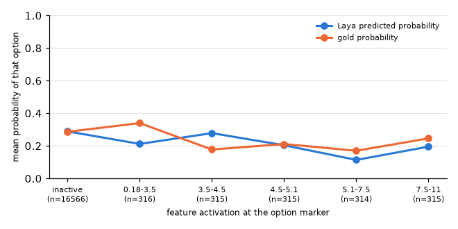

# Feature 6216

Critérios em que aparece: changed_base_vs_ft

**Interpretação (preencher):** 

---

## Maiores ativações

**tr_customer_service_000051 / category** (choice, customer_service) | ativação 10.914 em `marcador` | opções ['account', 'billing', 'delivery', 'refund', 'technical'] | Laya: **billing** [0.024, 0.827, 0.009, 0.054, 0.086] | gabarito: **billing**

```
[CLS]choice question: What is this customer conversation primarily about?[SEP]
▸ [MASK] account: Login, plan changes, profile or access management.
▸ [MASK] billing: A charge, invoice, subscription or payment problem.
▸ [MASK] delivery: Shipping, fulfilment or delivery of a physical item.
▸ [MASK] refund: The customer is explicitly asking for money back.
▸ ⟦[MASK]⟧ technical: The product or service is not working as expected.

[SEP]

{"account": {"lifetime_value_usd": 2213, "prior_tickets_90d": 1, "seats": 1, "tenure_months": 60, "tier": "standard"}, "thread": [{"role": "customer", "text": "My bill is higher than expected again. This is the second time I've had to bring this up, and I'm honestly fed up. If this isn't fixed before my 2 PM deadline, I am canceling my account for good."}, {"role": "agent", "text": "I understand your frustration regarding the recurring billing concerns. Would you be able to provide the invoice number in question so I can review the charges?"}, {"role": "customer", "text": "It’s the most recent one. Can you please check your system instead of making me jump through these hoops while my deadline approaches?"}]}[SEP]
```

**tr_customer_service_000157 / category** (choice, customer_service) | ativação 10.789 em `marcador` | opções ['account', 'billing', 'delivery', 'refund', 'technical'] | Laya: **account** [0.816, 0.019, 0.011, 0.072, 0.082] | gabarito: **account**

```
[CLS]choice question: What is this customer conversation primarily about?[SEP]
▸ [MASK] account: Login, plan changes, profile or access management.
▸ [MASK] billing: A charge, invoice, subscription or payment problem.
▸ [MASK] delivery: Shipping, fulfilment or delivery of a physical item.
▸ [MASK] refund: The customer is explicitly asking for money back.
▸ ⟦[MASK]⟧ technical: The product or service is not working as expected.

[SEP]

{"account": {"lifetime_value_usd": 3086, "prior_tickets_90d": 3, "seats": 1, "tenure_months": 49, "tier": "standard"}, "thread": [{"role": "customer", "text": "I need to get into my account right now – the login page just keeps looping back to the password screen and I can’t access anything."}, {"role": "agent", "text": "I understand the urgency. Could you share the exact error message you’re seeing, or let me know if you’ve tried resetting the password?"}, {"role": "customer", "text": "The message says “authentication failed” after I enter my credentials, and I’ve already tried the password reset twice with no luck."}]}[SEP]
```

**tr_customer_service_000275 / category** (choice, customer_service) | ativação 10.719 em `marcador` | opções ['account', 'billing', 'delivery', 'refund', 'technical'] | Laya: **account** [0.364, 0.141, 0.028, 0.329, 0.139] | gabarito: **account**

```
[CLS]choice question: What is this customer conversation primarily about?[SEP]
▸ [MASK] account: Login, plan changes, profile or access management.
▸ [MASK] billing: A charge, invoice, subscription or payment problem.
▸ [MASK] delivery: Shipping, fulfilment or delivery of a physical item.
▸ [MASK] refund: The customer is explicitly asking for money back.
▸ ⟦[MASK]⟧ technical: The product or service is not working as expected.

[SEP]

{"account": {"lifetime_value_usd": 51, "prior_tickets_90d": 3, "seats": 1, "tenure_months": 1, "tier": "standard"}, "orders": [{"amount_usd": 149, "date": "2026-01-08", "id": "A-29936", "status": "failed"}], "thread": [{"role": "customer", "text": "I need the standard account canceled by Friday at 5 p.m. I’ve only been with you for a month, there’s about $149 attached, and after three tickets with promised fixes that never landed, I can’t keep waiting."}]}[SEP]
```

**tr_customer_service_000091 / category** (choice, customer_service) | ativação 10.688 em `marcador` | opções ['account', 'billing', 'delivery', 'refund', 'technical'] | Laya: **refund** [0.042, 0.033, 0.022, 0.863, 0.039] | gabarito: **refund**

```
[CLS]choice question: What is this customer conversation primarily about?[SEP]
▸ [MASK] account: Login, plan changes, profile or access management.
▸ [MASK] billing: A charge, invoice, subscription or payment problem.
▸ [MASK] delivery: Shipping, fulfilment or delivery of a physical item.
▸ [MASK] refund: The customer is explicitly asking for money back.
▸ ⟦[MASK]⟧ technical: The product or service is not working as expected.

[SEP]

{"account": {"lifetime_value_usd": 59, "prior_tickets_90d": 0, "seats": 1, "tenure_months": 2, "tier": "standard"}, "thread": [{"role": "customer", "text": "I’m checking in about the refund I was promised last week – the deadline for the credit to hit my account is tomorrow, and I haven’t seen anything yet."}, {"role": "agent", "text": "I understand your concern. Could you provide the refund reference number that was emailed to you?"}, {"role": "customer", "text": "The reference is REF‑20230910‑01. I need to know when the money will actually be posted."}]}[SEP]
```

**tr_customer_service_000119 / category** (choice, customer_service) | ativação 10.602 em `marcador` | opções ['account', 'billing', 'delivery', 'refund', 'technical'] | Laya: **refund** [0.082, 0.072, 0.144, 0.559, 0.143] | gabarito: **delivery**

```
[CLS]choice question: What is this customer conversation primarily about?[SEP]
▸ [MASK] account: Login, plan changes, profile or access management.
▸ [MASK] billing: A charge, invoice, subscription or payment problem.
▸ [MASK] delivery: Shipping, fulfilment or delivery of a physical item.
▸ [MASK] refund: The customer is explicitly asking for money back.
▸ ⟦[MASK]⟧ technical: The product or service is not working as expected.

[SEP]

{"account": {"lifetime_value_usd": 613, "prior_tickets_90d": 1, "seats": 1, "tenure_months": 11, "tier": "standard"}, "orders": [{"amount_usd": 299, "date": "2026-01-13", "id": "A-16098", "status": "failed"}], "thread": [{"role": "customer", "text": "I just received my delivery and it's completely wrong. I paid $299 for the standard plan upgrade equipment, but what arrived in the box is the basic version. I’m seriously considering canceling my subscription over this."}, {"role": "agent", "text": "I am very sorry to hear that the incorrect item was delivered. Could you please provide your order number and a photo of the item you received so I can review this?"}, {"role": "customer", "text": "I’ve attached the photo to this ticket. This is the second time I've had issues like this, and frankly, my patience is wearing thin."}]}[SEP]
```

## Ativações medianas (faixa 40-60%, mediana 4.340)

**tr_customer_service_000265 / category** (choice, customer_service) | ativação 4.699 em `opção` | opções ['account', 'billing', 'delivery', 'refund', 'technical'] | Laya: **account** [0.259, 0.112, 0.155, 0.225, 0.249] | gabarito: **delivery**

```
[CLS]choice question: What is this customer conversation primarily about?[SEP]
▸ [MASK] account: Login, plan changes, profile or access management.
▸ [MASK] billing: A charge, invoice, subscription or payment problem⟦.⟧
▸ [MASK] delivery: Shipping, fulfilment or delivery of a physical item.
▸ [MASK] refund: The customer is explicitly asking for money back.
▸ [MASK] technical: The product or service is not working as expected.

[SEP]

{"account": {"lifetime_value_usd": 379, "prior_tickets_90d": 3, "seats": 5, "tenure_months": 11, "tier": "premium"}, "orders": [{"amount_usd": 999, "date": "2026-02-26", "id": "A-44178", "status": "settled"}, {"amount_usd": 999, "date": "2026-02-11", "id": "A-78032", "status": "settled"}, {"amount_usd": 999, "date": "2026-03-13", "id": "A-48014", "status": "pending"}], "thread": [{"role": "customer", "text": "My premium subscription delivery arrived today, but I received the wrong item. It’s the $999 package, but it’s completely different from what I ordered."}, {"role": "agent", "text": "I see you have been with us for nearly a year, and I appreciate you bringing this discrepancy to our attention. To assist you further, could you please provide the order number and describe the item you actually received?"}, {"role": "customer", "text": "The order number is #88291. I was expecting the professional hardware kit, but the box I opened contained a set of basic cabling accessories instead."}, {"role": "agent", "text": "Thank you for providing those details. I am reviewing the shipping manifest for that specific order number now; would you be able to upload a photo of the packing slip that was included in the box?"}, {"role": "customer", "text": "I’ve attached the photo of the slip to this chat. I just need to know how we’re going to handle this mix-up."}]}[SEP]
```

**tr_customer_service_000094 / category** (choice, customer_service) | ativação 4.430 em `marcador` | opções ['account', 'billing', 'delivery', 'refund', 'technical'] | Laya: **billing** [0.077, 0.459, 0.035, 0.204, 0.224] | gabarito: **billing**

```
[CLS]choice question: What is this customer conversation primarily about?[SEP]
▸ [MASK] account: Login, plan changes, profile or access management.
▸ [MASK] billing: A charge, invoice, subscription or payment problem.
▸ [MASK] delivery: Shipping, fulfilment or delivery of a physical item.
▸ ⟦[MASK]⟧ refund: The customer is explicitly asking for money back.
▸ [MASK] technical: The product or service is not working as expected.

[SEP]

{"account": {"lifetime_value_usd": 979, "prior_tickets_90d": 1, "seats": 1, "tenure_months": 11, "tier": "premium"}, "thread": [{"role": "customer", "text": "I’m looking at my billing statement and I don't understand why the premium plan charges are still hitting my card when I thought I processed a downgrade last week. Can you explain what’s going on?"}, {"role": "agent", "text": "I understand your concern regarding the recent charges. To help me investigate this for you, could you provide the reference number or date from the request you submitted?"}, {"role": "customer", "text": "I don't have a reference number, but it was just a few days ago. Why is this so difficult to track down when I've been with you for 11 months?"}, {"role": "agent", "text": "Thank you for that information. I see you have an open ticket regarding your account status; could you clarify if you received a confirmation email after attempting the downgrade?"}, {"role": "customer", "text": "I might have deleted it, but the site said it was done. It feels like I'm running in circles here with no real answers."}]}[SEP]
```

**tr_customer_service_000030 / category** (choice, customer_service) | ativação 4.711 em `marcador` | opções ['account', 'billing', 'delivery', 'refund', 'technical'] | Laya: **billing** [0.011, 0.931, 0.006, 0.027, 0.025] | gabarito: **billing**

```
[CLS]choice question: What is this customer conversation primarily about?[SEP]
▸ [MASK] account: Login, plan changes, profile or access management.
▸ ⟦[MASK]⟧ billing: A charge, invoice, subscription or payment problem.
▸ [MASK] delivery: Shipping, fulfilment or delivery of a physical item.
▸ [MASK] refund: The customer is explicitly asking for money back.
▸ [MASK] technical: The product or service is not working as expected.

[SEP]

{"account": {"lifetime_value_usd": 5295, "prior_tickets_90d": 1, "seats": 1, "tenure_months": 72, "tier": "premium"}, "thread": [{"role": "customer", "text": "Hello, I’ve been a loyal subscriber for six years now, but I’ve just noticed an unexpected change in my premium plan billing. I really need to get this sorted out before the end of the business day today, if possible."}, {"role": "agent", "text": "I see you’ve been with us for quite a while, and I understand you’re looking into an unexpected charge on your account. Could you please provide the billing date and the specific invoice number you are referencing?"}, {"role": "customer", "text": "Thank you for looking into this. The invoice number is #99283 and the date is from this morning. It seems higher than the usual amount for the premium tier; I just need to understand why this fluctuation occurred before my deadline arrives."}]}[SEP]
```

**tr_customer_service_000114 / category** (choice, customer_service) | ativação 4.516 em `marcador` | opções ['account', 'billing', 'delivery', 'refund', 'technical'] | Laya: **technical** [0.09, 0.299, 0.045, 0.212, 0.354] | gabarito: **technical**

```
[CLS]choice question: What is this customer conversation primarily about?[SEP]
▸ [MASK] account: Login, plan changes, profile or access management.
▸ [MASK] billing: A charge, invoice, subscription or payment problem.
▸ [MASK] delivery: Shipping, fulfilment or delivery of a physical item.
▸ ⟦[MASK]⟧ refund: The customer is explicitly asking for money back.
▸ [MASK] technical: The product or service is not working as expected.

[SEP]

{"account": {"lifetime_value_usd": 483, "prior_tickets_90d": 2, "seats": 1, "tenure_months": 11, "tier": "standard"}, "orders": [{"amount_usd": 18, "date": "2026-02-08", "id": "A-56150", "status": "settled"}, {"amount_usd": 18, "date": "2026-03-21", "id": "A-45857", "status": "settled"}], "thread": [{"role": "customer", "text": "The PDF export tool is failing to generate files again. I've been on the standard plan for 11 months now and this is the third time this specific feature has stopped working for me."}, {"role": "agent", "text": "I see that you've encountered issues with the PDF export previously. To help me triage this, could you let me know if you are seeing a specific error code when the generation fails?"}, {"role": "customer", "text": "There isn't an error code; the loading bar just hangs at 15% and then the browser times out. I'm paying about $18 a month for this and it's frustrating that a feature that was previously fixed has broken again."}, {"role": "agent", "text": "That sounds like a persistent hang in the rendering process. Does this happen with all of your documents, or is it only occurring with files that contain large images?"}, {"role": "customer", "text": "It's happening even with simple text-only documents. This is exactly what happened the last two times I reported this, so it seems like the old bug has returned."}]}[SEP]
```

**tr_customer_service_000084 / category** (choice, customer_service) | ativação 4.195 em `marcador` | opções ['account', 'billing', 'delivery', 'refund', 'technical'] | Laya: **refund** [0.126, 0.058, 0.054, 0.647, 0.115] | gabarito: **refund**

```
[CLS]choice question: What is this customer conversation primarily about?[SEP]
▸ ⟦[MASK]⟧ account: Login, plan changes, profile or access management.
▸ [MASK] billing: A charge, invoice, subscription or payment problem.
▸ [MASK] delivery: Shipping, fulfilment or delivery of a physical item.
▸ [MASK] refund: The customer is explicitly asking for money back.
▸ [MASK] technical: The product or service is not working as expected.

[SEP]

{"account": {"lifetime_value_usd": 228, "prior_tickets_90d": 1, "seats": 12, "tenure_months": 5, "tier": "premium"}, "orders": [{"amount_usd": 49, "date": "2026-02-23", "id": "A-33356", "status": "settled"}, {"amount_usd": 49, "date": "2026-03-08", "id": "A-82014", "status": "pending"}, {"amount_usd": 49, "date": "2026-02-05", "id": "A-73657", "status": "settled"}], "thread": [{"role": "customer", "text": "I've been waiting for my refund for the $49 I was charged on my premium plan, and this is the second time you've said it'll be processed and nothing happened. I'm fed up and I'm ready to cancel my subscription if this isn't sorted right now."}, {"role": "agent", "text": "I’m sorry you’ve had to deal with this again. Could you please share the ticket number you received previously so I can pull up the details and see where the hold‑up is?"}, {"role": "customer", "text": "The ticket was #123456, and I need that money back today—otherwise I'm pulling my account and moving to a competitor."}]}[SEP]
```

## Estatísticas (conjunto de descoberta, dev e teste)

**pred / error**

| split | decisões | ativas | ativas e Laya errou | taxa | lift | q (BH) | OR (CMH) | q (CMH) |
|---|---|---|---|---|---|---|---|---|
| discovery | 5100 | 283 | 147 | 0.519 | 0.82 | 0.000139 | 0.54 | 0.523 |
| dev | 900 | 44 | 21 | 0.477 | 0.73 | 0.0907 | 0.84 | 0.894 |
| test | 2000 | 109 | 57 | 0.523 | 0.82 | 0.0305 | 0.59 | 0.826 |

**corr / error**

| split | decisões | ativas | ativas e Laya errou | taxa | lift | q (BH) | OR (CMH) | q (CMH) |
|---|---|---|---|---|---|---|---|---|
| discovery | 5100 | 381 | 245 | 0.643 | 1.01 | 0.84 | 0.80 | 0.799 |
| dev | 900 | 53 | 30 | 0.566 | 0.86 | 0.267 | inf | 0.685 |
| test | 2000 | 137 | 85 | 0.620 | 0.97 | 0.781 | 1.48 | 0.825 |

**state / error**

| split | decisões | ativas | ativas e Laya errou | taxa | lift | q (BH) | OR (CMH) | q (CMH) |
|---|---|---|---|---|---|---|---|---|
| discovery | 5100 | 42 | 28 | 0.667 | 1.05 | 0.958 | 1.74 | 0.267 |
| dev | 900 | 15 | 10 | 0.667 | 1.02 | nan | nan | nan |
| test | 2000 | 24 | 19 | 0.792 | 1.24 | 0.626 | 2.55 | 0.217 |

Confusão mais sobre-representada (pred): `category|3>0` (n=26, lift 18.02, p=7.29e-34). Formato `pergunta|índice previsto>índice correto`.

Confusão mais sobre-representada (corr): `category|3>0` (n=26, lift 13.39, p=2.27e-30). Formato `pergunta|índice previsto>índice correto`.

Confusão mais sobre-representada (state): `churn_risk|1>2` (n=4, lift 8.83, p=0.001). Formato `pergunta|índice previsto>índice correto`.



