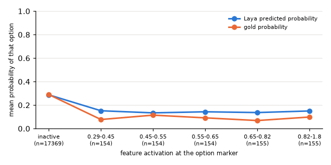

# Feature 6496

Critérios em que aparece: changed_base_vs_ft

**Interpretação (preencher):** 

---

## Maiores ativações

**tr_customer_service_000244 / needs_human** (noul, customer_service) | ativação 3.156 em `estado` | opções ['false', 'true'] | Laya: **true** [0.48, 0.52] | gabarito: **true**

```
[CLS]noul question: This conversation requires a human agent rather than automated handling.[SEP]
▸ [MASK] false: Automation can carry this to resolution.
▸ [MASK] true: A human must take over: judgement, authority or empathy is required.

[SEP]

{"account": {"lifetime_value_usd": 91, "prior_tickets_90d": 0, "seats": 1, "tenure_months": 1, "tier": "standard"}, "thread": [{"role": "customer", "text": "Hi there! I just opened my package and noticed that I received the standard kit instead of the deluxe version I had ordered. I hate to be a pain, but I'm actually on a very tight schedule and⟦ need⟧ the specific components from the deluxe kit for a project deadline on Tuesday. Could you help me figure out how to get the right items sent out?"}]}[SEP]
```

**tr_customer_service_000286 / needs_human** (noul, customer_service) | ativação 2.979 em `opção` | opções ['false', 'true'] | Laya: **false** [0.502, 0.498] | gabarito: **true**

```
[CLS]noul question: This conversation requires a human agent rather than automated handling.[SEP]
▸ [MASK] false: Automation⟦ can⟧ carry this to resolution.
▸ [MASK] true: A human must take over: judgement, authority or empathy is required.

[SEP]

{"account": {"lifetime_value_usd": 2881, "prior_tickets_90d": 1, "seats": 1, "tenure_months": 49, "tier": "premium"}, "orders": [{"amount_usd": 9, "date": "2026-01-14", "id": "A-85515", "status": "failed"}], "thread": [{"role": "customer", "text": "My package was supposed to arrive yesterday and it still isn’t here—this is a hard deadline for me and I need it today!"}]}[SEP]
```

**tr_customer_service_000042 / needs_human** (noul, customer_service) | ativação 2.967 em `opção` | opções ['false', 'true'] | Laya: **true** [0.432, 0.568] | gabarito: **false**

```
[CLS]noul question: This conversation requires a human agent rather than automated handling.[SEP]
▸ [MASK] false: Automation⟦ can⟧ carry this to resolution.
▸ [MASK] true: A human must take over: judgement, authority or empathy is required.

[SEP]

{"account": {"lifetime_value_usd": 1132, "prior_tickets_90d": 0, "seats": 1, "tenure_months": 19, "tier": "standard"}, "orders": [{"amount_usd": 198, "date": "2026-02-26", "id": "A-43618", "status": "failed"}, {"amount_usd": 198, "date": "2026-02-21", "id": "A-84574", "status": "refunded"}], "thread": [{"role": "customer", "text": "Looks like the package is still not here. Guess I’ll just wait until it shows up."}]}[SEP]
```

**tr_customer_service_000244 / needs_human** (noul, customer_service) | ativação 2.916 em `estado` | opções ['false', 'true'] | Laya: **true** [0.48, 0.52] | gabarito: **true**

```
[CLS]noul question: This conversation requires a human agent rather than automated handling.[SEP]
▸ [MASK] false: Automation can carry this to resolution.
▸ [MASK] true: A human must take over: judgement, authority or empathy is required.

[SEP]

{"account": {"lifetime_value_usd": 91, "prior_tickets_90d": 0, "seats": 1, "tenure_months": 1, "tier": "standard"}, "thread": [{"role": "customer", "text": "Hi there! I just opened my package and noticed that I received the standard kit instead of the deluxe version I had ordered. I hate to be a pain, but I'm actually on a very tight schedule⟦ and⟧ need the specific components from the deluxe kit for a project deadline on Tuesday. Could you help me figure out how to get the right items sent out?"}]}[SEP]
```

**tr_customer_service_000244 / churn_risk** (score, customer_service) | ativação 2.906 em `estado` | opções ['0', '1', '2', '3'] | Laya: **1** [0.102, 0.785, 0.068, 0.045] | gabarito: **1**

```
[CLS]score question: How likely is this customer to stop doing business with us because of this interaction?[SEP]
▸ [MASK] level 0: No sign of dissatisfaction.
▸ [MASK] level 1: Mild frustration, but the relationship is intact.
▸ [MASK] level 2: Clearly unhappy; repeat problems or explicit complaints.
▸ [MASK] level 3: Imminent: threatening to cancel, dispute or leave.

[SEP]

{"account": {"lifetime_value_usd": 91, "prior_tickets_90d": 0, "seats": 1, "tenure_months": 1, "tier": "standard"}, "thread": [{"role": "customer", "text": "Hi there! I just opened my package and noticed that I received the standard kit instead of the deluxe version I had ordered. I hate to be a pain, but I'm actually on a very tight schedule and⟦ need⟧ the specific components from the deluxe kit for a project deadline on Tuesday. Could you help me figure out how to get the right items sent out?"}]}[SEP]
```

## Ativações medianas (faixa 40-60%, mediana 0.595)

**tr_customer_service_000265 / action** (choice, customer_service) | ativação 0.572 em `estado` | opções ['answer_directly', 'close_no_action', 'escalate_to_human', 'execute_refund', 'request_information'] | Laya: **close_no_action** [0.211, 0.278, 0.186, 0.154, 0.17] | gabarito: **escalate_to_human**

```
[CLS]choice question: What should the assistant do next with this conversation?[SEP]
▸ [MASK] answer_directly: The assistant can resolve this itself with information it already has.
▸ [MASK] close_no_action: No further action is warranted; the matter is settled.
▸ [MASK] escalate_to_human: Hand off to a human agent with the appropriate authority.
▸ [MASK] execute_refund: Issue the refund or credit the customer is owed.
▸ [MASK] request_information: More detail is needed from the customer before anything can be done.

[SEP]

{"account": {"lifetime_value_usd": 379, "prior_tickets_90d": 3, "seats": 5, "tenure_months": 11, "tier": "premium"}, "orders": [{"amount_usd": 999, "date": "2026-02-26", "id": "A-44178", "status": "settled"}, {"amount_usd": 999, "date": "2026-02-11", "id": "A-78032", "status": "settled"}, {"amount_usd": 999, "date": "2026-03-13", "id": "A-48014", "status": "pending"}], "thread⟦":⟧ [{"role": "customer", "text": "My premium subscription delivery arrived today, but I received the wrong item. It’s the $999 package, but it’s completely different from what I ordered."}, {"role": "agent", "text": "I see you have been with us for nearly a year, and I appreciate you bringing this discrepancy to our attention. To assist you further, could you please provide the order number and describe the item you actually received?"}, {"role": "customer", "text": "The order number is #88291. I was expecting the professional hardware kit, but the box I opened contained a set of basic cabling accessories instead."}, {"role": "agent", "text": "Thank you for providing those details. I am reviewing the shipping manifest for that specific order number now; would you be able to upload a photo of the packing slip that was included in the box?"}, {"role": "customer", "text": "I’ve attached the photo of the slip to this chat. I just need to know how we’re going to handle this mix-up."}]}[SEP]
```

**tr_security_incidents_000091 / credential_compromise** (noul, security_incidents) | ativação 0.619 em `estado` | opções ['false', 'true'] | Laya: **true** [0.055, 0.945] | gabarito: **false**

```
[CLS]noul question: The evidence indicates a credential or account has been compromised.[SEP]
▸ [MASK] false: no, the statement does not hold
▸ [MASK] true: yes, the statement holds

[SEP]

{"alert": {"description": "two successful logins from distant locations too close together", "evidence": "Two successful logins to a shared mailbox were recorded on 2026-09-15 09:45:12 UTC and 2026-09-15 09:51:03 UTC from the allowlisted IP 192.0.2.77 (New York, US). Both attempts used MFA and the principal had privileged access; no change window was in effect at the time. Credential rotation for this mailbox occurred on 2026-03-18.", "rule": "impossible_travel"}, "context": {"asset_criticality": "medium",⟦ "⟧change_window_active": false, "source_on_allowlist": true}, "history": {"credential_rotation_days_ago": 180, "distinct_countries_30d": 2, "logins_30d": 725, "prior_alerts_90d": 0}, "principal": {"mfa_enrolled": true, "name": "svc-infra-238", "privileges": ["deploy:production", "secrets:read"], "type": "shared_mailbox"}}[SEP]
```

**tr_security_incidents_000130 / urgency** (score, security_incidents) | ativação 0.620 em `estado` | opções ['0', '1', '2', '3'] | Laya: **1** [0.054, 0.593, 0.206, 0.147] | gabarito: **2**

```
[CLS]score question: How quickly must a responder act on this alert?[SEP]
▸ [MASK] level 0: No time pressure; can wait indefinitely.
▸ [MASK] level 1: Routine; handle within the normal queue.
▸ [MASK] level 2: Elevated; should be handled within the same week.
▸ [MASK] level 3: Critical; requires action within the same day.

[SEP]

{"alert": {"description": "a first-ever sign-in from an unfamiliar country", "evidence": "A sign-in for this privileged shared_mailbox originated from a country not previously associated with the account. The connection was established from an allowlisted IP address while a maintenance change window was active.", "rule": "new_country_login"}, "context": {"asset_criticality": "high", "change_window_active": true, "source_on_allowlist": true}, "history": {"credential_rotation_days_ago": 365, "distinct_countries_30d": 4, "logins_30d": 1717, "prior_alert⟦s⟧_90d": 1}, "principal": {"mfa_enrolled": true, "name": "ci-deploy-712", "privileges": ["deploy:production", "secrets:read"], "type": "shared_mailbox"}}[SEP]
```

**tr_customer_service_000103 / needs_human** (noul, customer_service) | ativação 0.597 em `opção` | opções ['false', 'true'] | Laya: **true** [0.419, 0.581] | gabarito: **true**

```
[CLS]noul question: This conversation requires a human agent rather than automated handling.[SEP]
▸ [MASK] false: Automation⟦ can⟧ carry this to resolution.
▸ [MASK] true: A human must take over: judgement, authority or empathy is required.

[SEP]

{"account": {"lifetime_value_usd": 3711, "prior_tickets_90d": 0, "seats": 1, "tenure_months": 41, "tier": "standard"}, "thread": [{"role": "customer", "text": "Your new analytics dashboard is completely broken – every time I click the export button the whole page crashes. I’ve been on the standard plan for over three years (41 months), and this is getting ridiculous. If it isn’t fixed soon I’ll have to cancel."}, {"role": "agent", "text": "I’m really sorry you’re experiencing that. Could you let me know which browser you’re using and whether you see any error messages when it crashes?"}, {"role": "customer", "text": "I’m on Chrome 115, and the console just says ‘Uncaught TypeError’. I need a fix ASAP, otherwise I’m leaving."}]}[SEP]
```

**tr_customer_service_000192 / urgency** (score, customer_service) | ativação 0.543 em `marcador` | opções ['0', '1', '2', '3'] | Laya: **1** [0.105, 0.465, 0.177, 0.254] | gabarito: **2**

```
[CLS]score question: How time-sensitive is this conversation?[SEP]
▸ [MASK] level 0: No time pressure; can wait indefinitely.
▸ ⟦[MASK]⟧ level 1: Routine; handle within the normal queue.
▸ [MASK] level 2: Elevated; should be handled within the same week.
▸ [MASK] level 3: Critical; requires action within the same day.

[SEP]

{"account": {"lifetime_value_usd": 212, "prior_tickets_90d": 1, "seats": 1, "tenure_months": 5, "tier": "standard"}, "thread": [{"role": "customer", "text": "I got the replacement you mailed last month, but it showed up with a shattered screen again, and I have to have a working unit by next Friday or my deadline will be missed."}, {"role": "agent", "text": "I’m sorry to hear that. Could you let me know the serial number on the device and whether you still have the original packaging?"}, {"role": "customer", "text": "The serial is XJ‑2024‑B7, and yes, I kept the box. This is the second time this has happened after the ticket I opened last quarter."}, {"role": "agent", "text": "Thanks for the details. Would you be able to send us a photo of the damage so we can see exactly what went wrong?"}, {"role": "customer", "text": "I’ll attach a picture right after this message. I really need this sorted before Friday, otherwise my client walks."}]}[SEP]
```

## Estatísticas (conjunto de descoberta, dev e teste)

**pred / error**

| split | decisões | ativas | ativas e Laya errou | taxa | lift | q (BH) | OR (CMH) | q (CMH) |
|---|---|---|---|---|---|---|---|---|
| discovery | 5100 | 50 | 41 | 0.820 | 1.29 | 0.0149 | 2.49 | 0.0708 |
| dev | 900 | 8 | 7 | 0.875 | 1.33 | nan | nan | nan |
| test | 2000 | 31 | 24 | 0.774 | 1.22 | 0.227 | 2.01 | 0.352 |

**corr / error**

| split | decisões | ativas | ativas e Laya errou | taxa | lift | q (BH) | OR (CMH) | q (CMH) |
|---|---|---|---|---|---|---|---|---|
| discovery | 5100 | 41 | 32 | 0.780 | 1.23 | 0.0876 | 53.18 | 0.00184 |
| dev | 900 | 4 | 3 | 0.750 | 1.14 | nan | nan | nan |
| test | 2000 | 23 | 16 | 0.696 | 1.09 | 0.769 | 6.33 | 0.033 |

**state / error**

| split | decisões | ativas | ativas e Laya errou | taxa | lift | q (BH) | OR (CMH) | q (CMH) |
|---|---|---|---|---|---|---|---|---|
| discovery | 5100 | 2438 | 1549 | 0.635 | 1.00 | 1 | 1.12 | 0.233 |
| dev | 900 | 433 | 282 | 0.651 | 0.99 | 1 | 0.97 | 0.937 |
| test | 2000 | 917 | 611 | 0.666 | 1.05 | 0.247 | 1.36 | 0.0341 |

Confusão mais sobre-representada (pred): `urgency|1>3` (n=21, lift 7.34, p=6.04e-14). Formato `pergunta|índice previsto>índice correto`.

Confusão mais sobre-representada (corr): `action|1>0` (n=12, lift 36.41, p=8.39e-17). Formato `pergunta|índice previsto>índice correto`.

Confusão mais sobre-representada (state): `matches_order|1>0` (n=95, lift 1.81, p=1.38e-17). Formato `pergunta|índice previsto>índice correto`.



